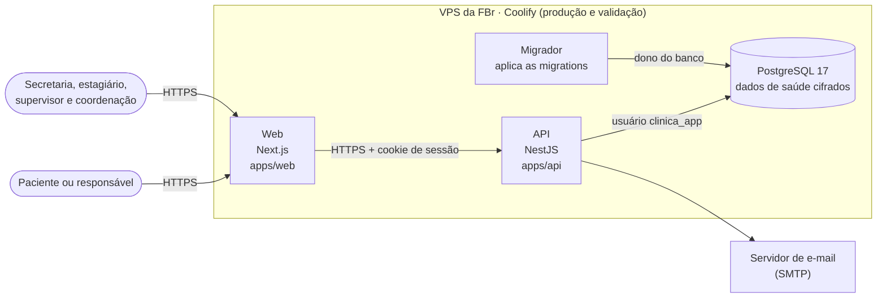
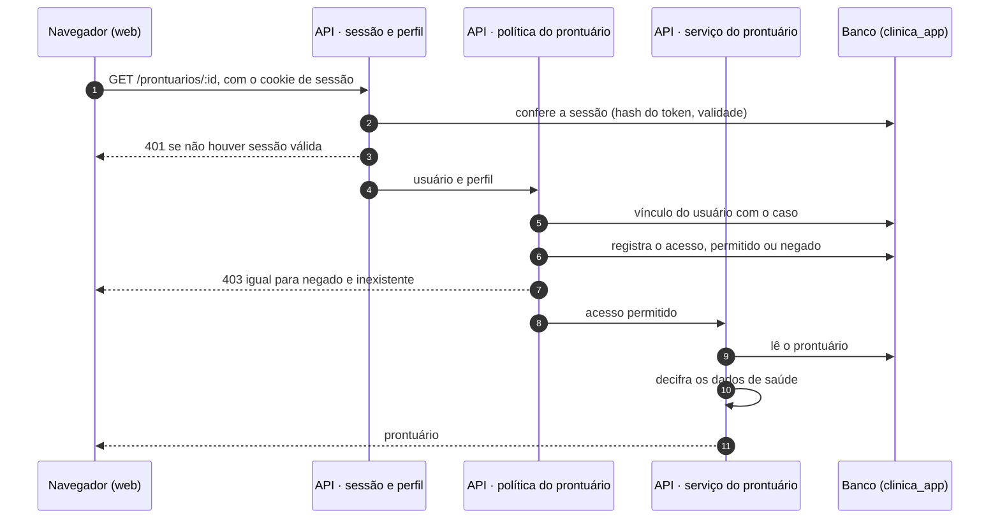

# Arquitetura técnica

Esta página descreve a arquitetura atual do sistema: as partes que o compõem, os módulos de cada característica de produto (CP), o caminho de uma requisição e as decisões técnicas, com o motivo e os requisitos que cada uma atende. O projeto detalhado de cada feature continua nas páginas de projeto do [Ciclo 3](projeto-features.md) e do [Ciclo 4](projeto-features.md), e o funcionamento dos ambientes está em [Implantação](implantacao.md).

As decisões de negócio ficam no [Registro de Decisões com a FBr](../requisitos/decisoes-fbr.md) (DF). As decisões técnicas ficam na [seção de decisões técnicas](#decisoes-tecnicas) desta página (DT), no mesmo formato: código, data, decisão, motivo e requisitos atendidos.

## Visão geral

O sistema é uma aplicação web com três partes: o site (web), a API e o banco de dados. O paciente usa as páginas públicas, sem conta. A secretaria, os estagiários, os supervisores e a coordenação usam a área interna, depois de entrar com usuário e senha.

| Parte | Tecnologia | Onde está | O que faz |
| --- | --- | --- | --- |
| Web | Next.js e React | `apps/web` | Páginas públicas, em `src/app/(publico)` (inscrição, entrada, ativação da conta), e área interna, em `src/app/(interno)` (painel, triagem, distribuição, casos, agendamento, prontuários e usuários). Não acessa o banco: tudo passa pela API. |
| API | NestJS | `apps/api` | Regras de negócio, controle de acesso, auditoria e envio de e-mails. Um módulo por área do FDD, em `src/modules`. |
| Tipos e validações compartilhados | TypeScript e Zod | `packages/shared` | Esquemas de entrada, perfis e regras de domínio usados pela web e pela API, para que as duas validem do mesmo jeito. |
| Banco de dados | PostgreSQL e Drizzle ORM | `packages/database` | Tabelas (`src/schema`), migrations versionadas (`drizzle/`) e o script do usuário da aplicação (`sql/usuario-da-aplicacao.sql`). |
| Implantação | Docker, GHCR e Coolify | `implantacao/`, `.github/workflows/implantacao.yml` | Uma imagem da web e uma da API por commit, implantadas na validação (`development`) e na produção (`main`). |

O repositório é um monorepo com pnpm e Turborepo: um `pnpm build`, `pnpm test` ou `pnpm lint` na raiz roda a tarefa em todos os pacotes, na ordem das dependências.

## Módulos por característica de produto

Cada módulo da API corresponde a uma área do FDD e a uma ou mais CPs. A última coluna vem do [catálogo de requisitos](../requisitos/priorizacao-e-mvp.md#catalogo-de-requisitos): os RFs do MVP de cada CP, com o ciclo (C) e o estado da feature.

| Módulo da API | CP | Rotas principais | RFs do MVP (ciclo, estado) |
| --- | --- | --- | --- |
| `inscricao` | CP1 | `POST /inscricoes` | {{ rfs_da_cp("CP1") }} |
| `triagem` | CP2 | `GET /triagem/inscricoes`, `POST /triagem/inscricoes/:id/prioridade` | {{ rfs_da_cp("CP2") }} |
| `fila` | CP3 | ainda sem rotas | {{ rfs_da_cp("CP3") }} |
| `agendamento` | CP4 | `POST /sessoes`, `GET /sessoes/agenda`, `POST /sessoes/:id/whatsapp` | {{ rfs_da_cp("CP4") }} |
| `casos` | CP5 | `GET /casos/aguardando-distribuicao`, `POST /casos/:id/supervisor`, `POST /casos/:id/estagiario`, `GET /casos/meus` | {{ rfs_da_cp("CP5") }} |
| `acompanhamento-clinico` | CP6, CP7 e CP8 | `GET /prontuarios/:id`, `POST /prontuarios/:id/dados-iniciais`, `POST /prontuarios/:id/sessoes/:sessaoId/evolucoes` | {{ rfs_da_cp("CP6", "CP7", "CP8") }} |
| `assiduidade` | CP9 | ainda sem rotas | {{ rfs_da_cp("CP9") }} |
| `administrativo` | CP10 | ainda sem rotas | {{ rfs_da_cp("CP10") }} |
| `institucional` | CP11 | ainda sem rotas | {{ rfs_da_cp("CP11") }} |
| `acesso` | CP12 | `POST /auth/login`, `POST /auth/logout`, `GET /auth/sessao`, `/usuarios`, `/ativacao` | {{ rfs_da_cp("CP12") }} |

Fora dos módulos de área, a API tem serviços transversais usados por todos eles:

| Serviço | Onde está | Função | Requisitos |
| --- | --- | --- | --- |
| Auditoria | `src/auditoria` | Grava cada operação auditada na tabela `auditoria`, na mesma transação da operação. | [RNF10](../requisitos/nao-funcionais.md#rnf10), [RNF18](../requisitos/nao-funcionais.md#rnf18) |
| Perfis e sessão | `src/auth`, `src/modules/acesso` | Lê o cookie de sessão de cada requisição e recusa as rotas sem o perfil exigido. | [RF50](../requisitos/funcionais.md#rf50), [RNF50](../requisitos/nao-funcionais.md#rnf50) |
| Criptografia | `src/common/criptografia.ts` | Cifra e decifra os dados de saúde antes de gravar e depois de ler. | [RNF51](../requisitos/nao-funcionais.md#rnf51) |
| Parâmetros | `src/parametros` | Lê os parâmetros configuráveis (por exemplo, a duração da sessão e o limite de casos por supervisor), com o valor padrão quando a coordenação não definiu outro. | [RF10](../requisitos/funcionais.md#rf10), [RF20](../requisitos/funcionais.md#rf20), [RF53](../requisitos/funcionais.md#rf53) |
| Notificações | `src/notificacoes` | Envia e-mails pelo SMTP configurado. O envio de SMS só escreve no log, porque o SMS foi descartado ([DF24](../requisitos/decisoes-fbr.md#df24)). | [RF10](../requisitos/funcionais.md#rf10), [RF53](../requisitos/funcionais.md#rf53) |
| Validação | `src/common/zod-validation.pipe.ts` | Valida o corpo de cada requisição com o esquema do `packages/shared`. | [RNF1](../requisitos/nao-funcionais.md#rnf1) |

## Caminho de uma requisição

Exemplo: o supervisor abre o prontuário de um paciente ([RF27](../requisitos/funcionais.md#rf27), com a restrição do [RF55](../requisitos/funcionais.md#rf55)).

1. **Sessão:** o cookie da sessão é `httpOnly`, e o banco guarda só o hash do token. Sem sessão válida, a rota responde 401.
2. **Perfil:** cada rota declara os perfis que a usam (`@Perfis(...)`). Perfil fora da lista recebe 403.
3. **Validação:** o corpo da requisição passa pelo esquema Zod do `packages/shared`; dado inválido volta com 400 e a mensagem do campo.
4. **Regra de negócio:** o serviço do módulo aplica as regras do requisito. Quando há regra de acesso a dado clínico, ela fica numa política própria, como a `politica-prontuario.ts`, que registra todo acesso, permitido ou negado.
5. **Banco:** a operação e o registro de auditoria entram na mesma transação. A API se conecta como `clinica_app`, que não consegue alterar nem apagar os registros que só aceitam inserção.

## Decisões técnicas { #decisoes-tecnicas }

Cada decisão técnica tem um código (DT), a data em que entrou no repositório, o motivo e os requisitos que atende. Quando uma decisão for substituída, a anterior continua na tabela, marcada como substituída, como no Registro de Decisões com a FBr.

| Código | Data | Decisão | Motivo | Requisitos |
| --- | --- | --- | --- | --- |
| DT01 | 10/10/2026 | Monorepo com pnpm e Turborepo, em TypeScript na web e na API, com os esquemas de validação (Zod) e os tipos de domínio num pacote compartilhado (`packages/shared`). | Uma regra de validação escrita uma vez vale na tela e na API. A equipe já conhecia TypeScript ([Solução Proposta, viabilidade da proposta](../produto/solucao-proposta.md#26-viabilidade-da-proposta)). | [RNF1](../requisitos/nao-funcionais.md#rnf1) |
| DT02 | 10/10/2026 | API em NestJS, com um módulo por área do FDD e serviços transversais (auditoria, sessão, criptografia, parâmetros, notificações). | Cada Líder de Feature trabalha no módulo da sua área, e as regras transversais ficam num lugar só. | CP1 a CP12 |
| DT03 | 10/10/2026 | Web em Next.js, separada em área pública, sem conta, e área interna, com sessão. A web não acessa o banco. | O paciente não tem conta, e todo dado passa pelas regras de acesso da API. | [RNF56](../requisitos/nao-funcionais.md#rnf56), [RNF58](../requisitos/nao-funcionais.md#rnf58) |
| DT04 | 10/10/2026 | PostgreSQL com Drizzle ORM e migrations versionadas no repositório, aplicadas por um serviço migrador a cada implantação. | O banco de cada ambiente fica igual ao do código implantado, sem passo manual. | [RNF53](../requisitos/nao-funcionais.md#rnf53) |
| DT05 | 24/10/2026 | Dados de saúde cifrados em repouso com AES-256-GCM, com a chave (`CHAVE_DADOS`) fora do banco e do repositório. Desde 28/10/2026, um script troca a chave sem perda de dados. | Uma cópia do banco, sozinha, não revela dado de saúde. | [RNF51](../requisitos/nao-funcionais.md#rnf51) |
| DT06 | 24/10/2026 | Auditoria, registro de acessos ao prontuário, evoluções e decisões de prioridade só aceitam inserção: um gatilho no banco recusa a alteração e a exclusão. | O histórico clínico e a trilha de auditoria não podem ser reescritos, nem por engano da aplicação. | [RNF10](../requisitos/nao-funcionais.md#rnf10), [RNF27](../requisitos/nao-funcionais.md#rnf27), [RNF52](../requisitos/nao-funcionais.md#rnf52), [RNF5](../requisitos/nao-funcionais.md#rnf5) |
| DT07 | 24/10/2026 | O acesso ao prontuário é decidido na API, por uma política única (`politica-prontuario.ts`) que registra todo acesso e responde do mesmo jeito para prontuário negado e inexistente. | A regra de quem vê o conteúdo clínico fica num lugar só, e a resposta negada não revela o que existe. | [RF55](../requisitos/funcionais.md#rf55), [RNF25](../requisitos/nao-funcionais.md#rnf25), [RNF52](../requisitos/nao-funcionais.md#rnf52), [DF32](../requisitos/decisoes-fbr.md#df32) |
| DT08 | 24/10/2026 | Senhas guardadas só como hash bcrypt, com bloqueio de 15 minutos na 3ª tentativa seguida com erro. | Uma cópia do banco não revela senhas, e a tentativa de adivinhar senhas fica lenta. | [RNF49](../requisitos/nao-funcionais.md#rnf49), [DF25](../requisitos/decisoes-fbr.md#df25) |
| DT09 | 25/10/2026 | Sessão por cookie `httpOnly`, com o hash do token no banco e expiração por inatividade. A web e a API ficam no mesmo site, para o cookie `SameSite=Lax` chegar à API ([#161](https://github.com/mdsreq-fga-unb/REQ-2026.2-T02-ClinicaEscolaFBr/issues/161)). | O token não fica acessível ao JavaScript da página, e a saída do sistema encerra a sessão no servidor. | [RF50](../requisitos/funcionais.md#rf50), [RF51](../requisitos/funcionais.md#rf51), [RNF50](../requisitos/nao-funcionais.md#rnf50) |
| DT10 | 28/10/2026 | A API se conecta ao banco com o usuário `clinica_app`, sem permissão de alterar ou apagar as tabelas que só aceitam inserção. As migrations rodam com o dono do banco. | Mesmo com uma falha na API, os registros que só aceitam inserção continuam protegidos. | [RNF52](../requisitos/nao-funcionais.md#rnf52) |
| DT11 | 29/10/2026 | Imagens publicadas no GHCR e implantadas no Coolify da VPS da FBr, com a `development` na validação e a `main` na produção, depois de aprovação. | A FBr confere cada mudança na validação, com dados fictícios, antes da produção. | [RNF14](../requisitos/nao-funcionais.md#rnf14), [RNF53](../requisitos/nao-funcionais.md#rnf53) |

Os detalhes de cada decisão estão no código, nos comentários dos arquivos citados, e nas páginas de [Segurança da implantação](implantacao.md#seguranca-da-implantacao), [Cópia de segurança e restauração](copia-de-seguranca.md) e [Implantação](implantacao.md).

**Como registrar uma decisão nova:** na PR que introduz a decisão, acrescente uma linha a esta tabela com o próximo código, a data, a decisão, o motivo e os requisitos atendidos. Uma decisão que substitui outra marca a anterior como substituída, sem apagá-la.
