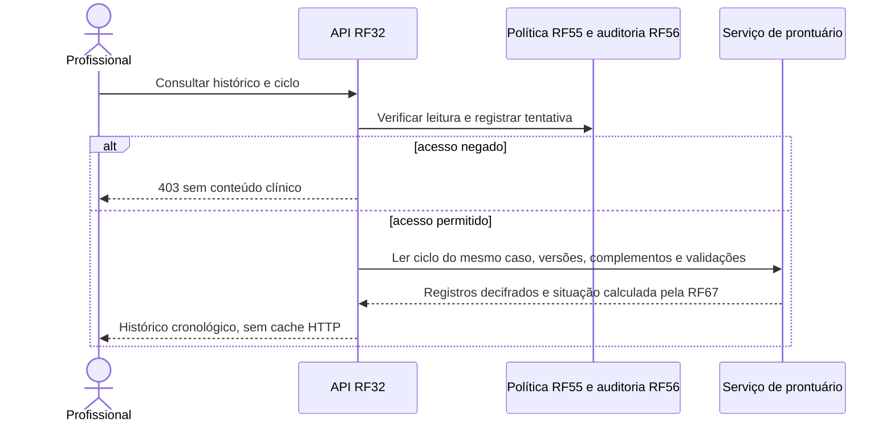

# RF32 — histórico integrado ao Ciclo 6

Referência: [issue #275](https://github.com/mdsreq-fga-unb/REQ-2026.2-T02-ClinicaEscolaFBr/issues/275), [projeto da feature](projeto-features.md) e [protótipo 6-4](prototipos.md#rf32).

Base local em 24/11/2026: `bf551fd` da [PR #309 (RF67)](https://github.com/mdsreq-fga-unb/REQ-2026.2-T02-ClinicaEscolaFBr/pull/309), que inclui a [PR #308 (RF30)](https://github.com/mdsreq-fga-unb/REQ-2026.2-T02-ClinicaEscolaFBr/pull/308). As duas PRs ainda estão abertas; `development` continua em `aa41b9b`. O diff desta entrega contém somente a RF32 sobre essa base. Não registra aceite institucional.

## Disponível

- `GET /prontuarios/:id/evolucoes?ciclo=` com política de leitura RF55, auditoria RF56 e `Cache-Control: no-store`.
- Ciclo atual por padrão, seletor limitado ao próprio caso e estado vazio sem recorrer aos dados de outro ciclo.
- Sessões em ordem cronológica; originais, correções RF29 e complementos RF30 preservados com autor e data próprios. Correções também mostram versão e motivo.
- Situação real da RF67, com autor e data da última validação. Uma correção ou complemento posterior devolve a evolução a pendente, conforme a regra compartilhada da RF67, inclusive no empate de instantes.
- Transferências RF25 com responsáveis anteriores e novos; o motivo clínico da transferência não integra esta resposta. Como a tabela de transferências não possui ciclo, o intervalo é delimitado pela criação do prontuário selecionado e do seguinte.
- Seção de histórico no prontuário, tabela no desktop, cartões no celular e expansão dos registros. Os fluxos de registro e correção existentes continuam disponíveis.
- Sem migration e sem novas tabelas das features dos colegas.

## Consulta, segurança e atualização

A operação `consultar_historico_evolucoes` registra tanto leitura permitida quanto tentativa negada na RF56. O conteúdo clínico é decifrado pelo serviço de prontuário somente após a política de acesso e integra a resposta para abrir os registros na própria tela. A auditoria não recebe texto clínico nem motivo de transferência. Prontuário inexistente e acesso negado têm a mesma resposta 403.

A consulta usa a chave de cache do prontuário: as invalidações existentes após registro, correção, complemento e validação também atualizam o histórico. Ao trocar o ciclo ou perder acesso, o conteúdo anterior deixa de ser exibido. Não há persistência desse cache no navegador.

## Sequência para a PR

1. Integrar #308 e depois #309 na `development`; atualizar esta branch, preservando o diff da RF32. A RF32 não cria migration; as `0022`/`0023` nesta base pertencem às dependências e devem acompanhar a resolução de numeração feita pelos respectivos autores.
2. Se for abrir antes disso, usar PR em rascunho sobre `feat/rf67-validar-evolucao` e mudar a base para `development` depois da integração das dependências. Não apresentar os commits dos colegas como entrega própria.
3. RF31 ainda não foi localizada no remoto. O protótipo permite abrir a sessão no próprio histórico, como implementado. Uma navegação futura para RF31 pode ser acrescentada quando sua rota existir.

Revisão independente, inspeção de design, usabilidade e aceite institucional continuam pendentes. A evidência técnica não marca automaticamente os critérios da issue.
