# Projeto das features

Esta página registra o processo **Projetar por Feature** do FDD: o modelo detalhado, os diagramas de sequência, as rotas da API, as regras ligadas aos critérios de aceitação e os dados de teste de cada feature. Ela é o material da **inspeção de design** (marco 1 do [DoD](../requisitos/dor-dod.md#1-design-inspecionado)), e o resultado da inspeção de cada feature é registrado na sua issue.

As seções seguem as características de produto (CP), na ordem do fluxo do sistema, e cada feature diz em que ciclo foi construída. O RF19 foi removido em 24/10/2026, por decisão da FBr. Os requisitos de origem estão na [Requisitos funcionais](../requisitos/funcionais.md), e os itens de cada ciclo, em [Features e backlog](../visao-geral/backlog.md).

!!! note "Regras de negócio: vale o requisito"
    As regras de negócio (prazos, limites, durações, quem pode o quê) são escritas uma vez, no requisito da [Requisitos funcionais](../requisitos/funcionais.md) e na decisão do [Registro de Decisões com a FBr](../requisitos/decisoes-fbr.md). Este projeto cita o RF e a DF e descreve como a regra é implementada; quando os valores aparecem aqui, é como exemplo de teste. Se este projeto e o requisito divergirem, vale o requisito, e a divergência é corrigida aqui. A visão geral da arquitetura e as decisões técnicas estão em [Arquitetura técnica](arquitetura.md).

!!! info "Quem escreveu o projeto do Ciclo 4"
    Por causa do prazo do ciclo, o projeto das features do Ciclo 4 foi escrito pelo Gabriel em 05/11/2026, menos o do RF52, escrito pelo Joaquim. Para que nenhum projeto seja inspecionado por quem o escreveu, a inspeção de cada feature é feita pelo Líder de Feature com o revisor da issue, e o código continua com cada Líder.

!!! info "Projeto do Ciclo 5"
    O projeto das sete features do Ciclo 5 (RF17, RF29, RF39, RF41, RF44, RF48 e RF56) foi escrito pelo Gabriel em 12/11/2026, a partir das pranchas do Ciclo 5. A inspeção de cada um é feita pelo Líder de Feature com o revisor da issue, como no Ciclo 4.

!!! info "Projeto do Ciclo 6"
    O projeto das 14 features do Ciclo 6 (RF30, RF31, RF32, RF33, RF40, RF42, RF43, RF45, RF49, RF63, RF64, RF65, RF67 e RF68) foi escrito pelo Gabriel em 16/11/2026, junto com as pranchas do Ciclo 6. A inspeção de cada um é feita pelo Líder de Feature com o revisor da issue, como nos Ciclos 4 e 5. Os pontos que ainda dependem da FBr estão marcados em cada feature e nas [pendências de validação](../requisitos/analise-feedback.md#pendencias-de-validacao-com-a-fbr).

## Convenções

- **API:** NestJS, um módulo por área do FDD (`acesso`, `inscricao`, `triagem`, `casos`, `agendamento`, `acompanhamento-clinico`, `assiduidade`, `fila`, `administrativo` e `institucional`). As rotas internas exigem sessão e usam o `PerfisGuard` com o decorator `@Perfis(...)`. As rotas públicas (inscrição e ativação de conta) não exigem sessão.
- **Banco:** PostgreSQL com Drizzle, em `packages/database`. Os nomes de tabela e coluna seguem o português sem acento, como as tabelas `usuarios` e `auditoria` da base técnica.
- **Validação:** esquemas Zod em `packages/shared`, usados tanto pela API quanto pela interface.
- **Auditoria:** toda operação que altera dados relevantes chama o `AuditoriaService`, que grava na tabela `auditoria` (somente inserção) o autor, a operação, a entidade, o estado anterior e o novo.
- **Datas:** gravadas com fuso horário (`timestamptz`) e exibidas no horário de Brasília.
- **Criptografia em repouso (RNF51):** os dados de saúde (queixa, percepção de urgência, histórico, prioridade clínica e dados iniciais do prontuário) ficam em colunas `*_cifrada`, cifradas com AES-256-GCM pela aplicação (`apps/api/src/common/criptografia.ts`). A chave fica na variável `CHAVE_DADOS`, fora do banco e do repositório. Como a cor fica cifrada, as listas ordenadas pela prioridade (RF18) são ordenadas na aplicação, depois de decifrar.
- **Dados de teste:** sempre fictícios. Nenhum dado real de paciente entra no repositório, no banco de desenvolvimento ou em prints.
- **Rotas públicas do paciente:** o paciente e o responsável legal não têm conta (critério R6.2 do DoR). As rotas que mostram dados de uma inscrição, como a consulta da fila (RF8) e as declarações da CP10, usam o `VerificacaoGuard` do RF52, que só libera a inscrição cuja identidade foi verificada.

## Modelo detalhado

O modelo integrado do domínio, com todas as classes num diagrama só, está em [Execução do processo](../visao-geral/execucao-do-processo.md#1-modelo-abrangente-do-dominio). Abaixo, as classes de cada ciclo, com os atributos e as regras de implementação.

### Classes do Ciclo 3 { #modelo-detalhado-do-ciclo-3 }

O diagrama reúne as classes usadas pelas 13 features e já reflete as decisões da reunião com a FBr de 23/10/2026 ([Registro de Decisões](../requisitos/decisoes-fbr.md)). Ele detalha o [modelo de domínio](../requisitos/funcionais.md) de cada CP no nível de implementação.

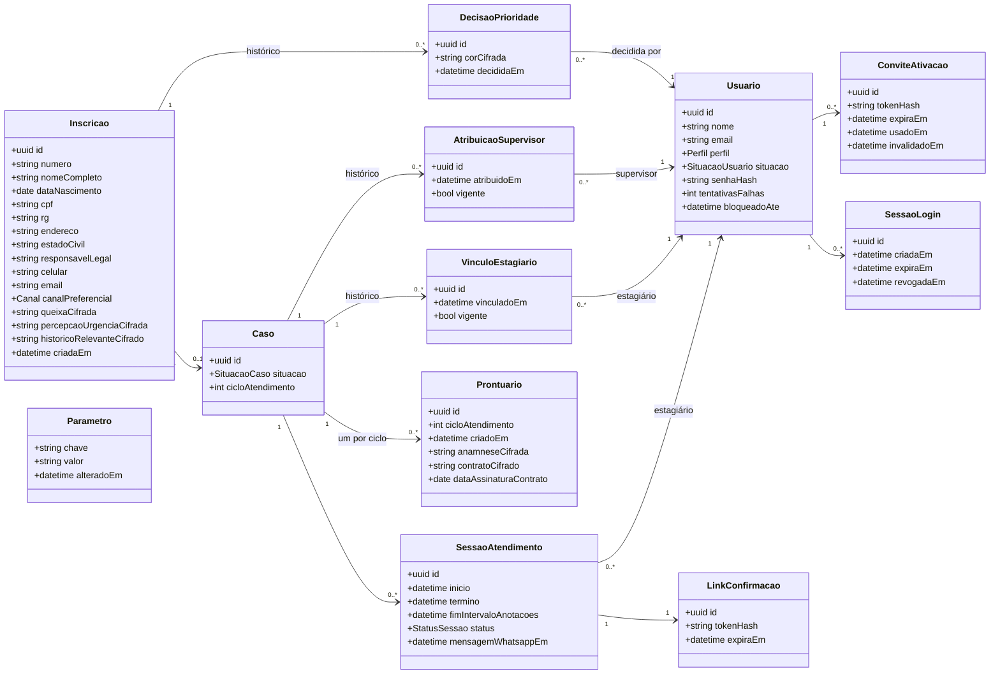

**Valores dos tipos enumerados:**

- `Perfil`: secretaria, estagiario, supervisor, coordenacao (já existe em `@clinica/shared`).
- `SituacaoUsuario`: pendente_ativacao, ativo, desativado. Substitui a coluna booleana `ativo` da base técnica, que não representa o estado "pendente de ativação" do RF53.
- `Canal`: email, whatsapp, ligacao. O SMS não é usado ([DF24](../requisitos/decisoes-fbr.md#df24)); WhatsApp e ligação exigem o celular.
- `Cor`: vermelha, amarela, verde.
- `SituacaoCaso`: aguardando_distribuicao, aguardando_vinculo, em_atendimento, encerrado.
- `StatusSessao`: agendada (os demais status entram com o RF14, o RF15 e o RF16 no Ciclo 4).

**Restrições de integridade no banco** (RNF19, RNF9):

- Uma `AtribuicaoSupervisor` vigente por caso e um `VinculoEstagiario` vigente por caso, garantidos por índices únicos parciais `WHERE vigente`. A `DecisaoPrioridade` é somente inserção (RNF5), e a vigente é a mais recente da inscrição.
- Um `Prontuario` por caso e ciclo de atendimento: índice único em `(caso_id, ciclo_atendimento)`.
- `SessaoAtendimento.termino` maior que `inicio` e `fimIntervaloAnotacoes` igual ou maior que `termino`, garantidos por restrições `CHECK`.

**Parâmetros iniciais** (tabela `parametros`, alterados pela coordenação):

| Chave | Valor padrão | Usado em |
| --- | --- | --- |
| `duracao_sessao_minutos` | 50 | RF10 |
| `intervalo_anotacoes_minutos` | 10 | RF10 |
| `limite_casos_supervisor` | 50 | RF20 |
| `validade_convite_horas` | 72 | RF53 |

---

### Classes do Ciclo 4 { #modelo-detalhado-do-ciclo-4 }

Classes novas do Ciclo 4, que se somam às [do Ciclo 3](#modelo-detalhado-do-ciclo-3). A `Inscricao` aparece só com os atributos usados aqui.

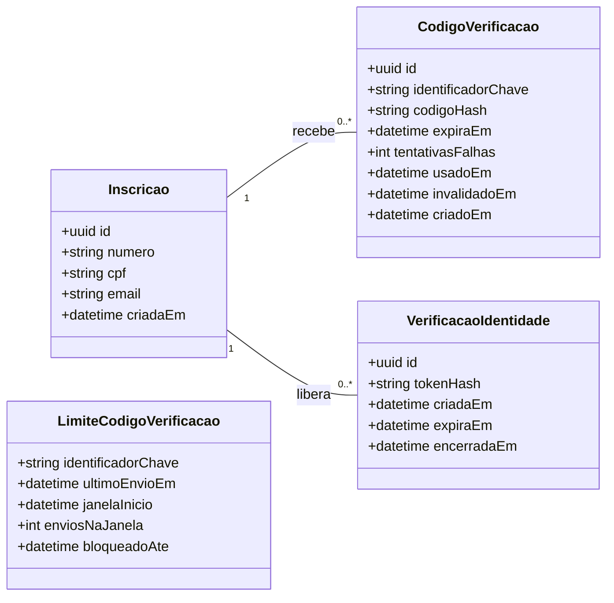

`LimiteCodigoVerificacao` não tem chave estrangeira: ele é guardado pelo identificador informado, exista ou não uma inscrição com ele.

### Classes do Ciclo 5 { #modelo-detalhado-do-ciclo-5 }

Classes novas do Ciclo 5 e as colunas novas de classes que já existem. O `Caso`, o `VinculoEstagiario`, a `AtribuicaoSupervisor`, a `Evolucao` e o `CancelamentoSessao` aparecem só com os atributos usados aqui.

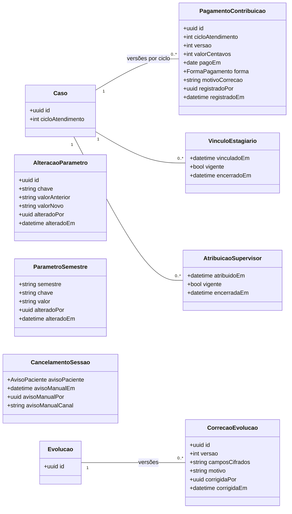

- **`PagamentoContribuicao` (RF41):** só inserção, como a `Evolucao`. A versão 1 é o registro, e cada correção é uma versão nova, com o motivo obrigatório. Vale a versão de maior número do caso no ciclo. O banco garante `unique (caso_id, ciclo_atendimento, versao)`, `motivo_correcao` nulo só na versão 1 (`check`) e o trigger `impedir_alteracao_registro` contra `update` e `delete`. O valor é guardado em centavos, copiado do parâmetro no momento do registro, para a mudança do parâmetro não alterar o que já foi pago. A forma é o enum `forma_pagamento` (`dinheiro`, `pix`, `cartao`).
- **`AlteracaoParametro` (RF41, RF29 e RF48):** o histórico das mudanças da tabela `parametros`, só inserção. A tabela `parametros` continua com o valor vigente, e a mudança grava as duas na mesma transação. Serve para o "Última alteração: de R$ 30,00 para R$ 35,00…" da prancha 8-1.
- **`ParametroSemestre` (RF48 e RF29):** os parâmetros que valem por semestre, com a chave primária `(semestre, chave)`: as vagas ofertadas (`vagas_ofertadas`, RF48) e a data-limite para corrigir evoluções (`data_limite_correcao`, RF29). A alteração grava uma `AlteracaoParametro` com a chave `vagas_ofertadas:2026/2`, por exemplo. O semestre de uma data é `AAAA/1` de janeiro a junho e `AAAA/2` de julho a dezembro, pelo horário de Brasília.
- **`CorrecaoEvolucao` (RF29):** só inserção, como a `Evolucao`. Cada correção é a ficha inteira (os campos da DF38, cifrados, RNF51), com o motivo, quem corrigiu e quando, e `unique (evolucao_id, versao)`. A versão 1 é a própria `Evolucao`, que não muda; a vigente é a correção de maior versão.
- **`avisoPaciente` e o aviso manual em `CancelamentoSessao` (RF17):** o aviso do cancelamento por ausência do estagiário (`envio_pendente`, `email_enviado`, `sem_email` ou `email_nao_enviado`), gravado na transação do RF16, e quando, por quem e por qual canal (`whatsapp` ou `outro`) a secretaria avisou o paciente. O trigger que impede alterar o cancelamento passa a aceitar só a mudança destas colunas.
- **`encerradoEm` e `encerradaEm` (RF48):** hoje o vínculo e a atribuição só têm `vigente`, e os indicadores de posição precisam saber quem estava em atendimento numa data passada. A transferência (RF25) e o desligamento (RF37) passam a preencher a data junto com o `vigente = false`. A migration preenche os registros antigos com o `transferido_em` da transferência que os encerrou e com o `decidido_em` do desligamento. A reversão (RF38) já cria um vínculo novo, e por isso o histórico continua certo.

### Classes do Ciclo 6 { #modelo-detalhado-do-ciclo-6 }

Classes novas do Ciclo 6 e as colunas novas de classes que já existem. A `Evolucao`, o `Caso`, o `CancelamentoSessao`, o `Usuario`, a `Inscricao` e a `SessaoAtendimento` aparecem só com os atributos usados aqui. Como nos ciclos anteriores, os registros que formam o histórico clínico ou administrativo são somente inserção (trigger `impedir_alteracao_registro`), e o texto clínico fica cifrado (RNF51).

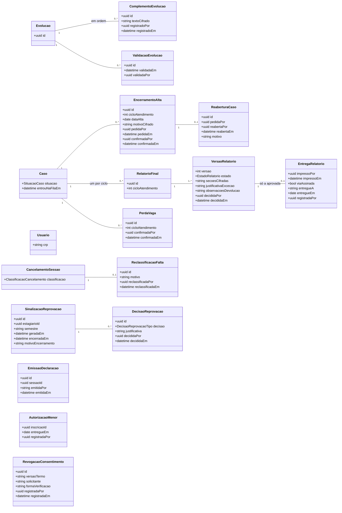

- **`ComplementoEvolucao` (RF30):** só inserção, com o texto cifrado e o limite de 1.000 caracteres do RF28. A ordem é a de `registradoEm`. Não se confunde com a `CorrecaoEvolucao` do RF29, que é a ficha inteira numa versão nova.
- **`ValidacaoEvolucao` (RF67):** só inserção. A evolução está **validada** quando a validação mais recente é posterior à última correção e ao último complemento; senão, está **pendente de validação**. A situação é calculada na leitura, e não gravada, para uma correção ou um complemento novo a devolverem a "pendente" sem nenhuma escrita extra.
- **`EncerramentoAlta` e `ReaberturaCaso` (RF68):** a alta tem dois passos, o pedido do estagiário e a confirmação do supervisor; enquanto `confirmadaEm` é nulo, o caso continua em atendimento. O motivo é cifrado. A confirmação passa o caso para a situação nova `encerrado_por_alta`, distinta de `desligado_por_faltas` (RF37), e encerra o vínculo e a atribuição com a data, como o RF48 já espera. A reabertura guarda quem pediu, quem reabriu, a data/hora e o motivo, e não apaga o encerramento.
- **`RelatorioFinal`, `VersaoRelatorio` e `EntregaRelatorio` (RF33):** um relatório por caso e ciclo de atendimento, com as versões numeradas e o `unique (relatorio_id, versao)`. O estado é o enum `estado_relatorio` (`rascunho`, `em_revisao`, `devolvido`, `aprovado`); só o rascunho é alterado, e a versão enviada para revisão fica fixa. A versão guarda também as sessões e as evoluções consideradas, para a conferência com o prontuário. A entrega só existe para a versão aprovada (`check`).
- **`crp` em `Usuario` (RF53, RF33 e RF45):** o número do CRP do supervisor, obrigatório no cadastro de usuário com o perfil de supervisor e mostrado no relatório final e na declaração.
- **`ReclassificacaoFalta` (RF40):** o `CancelamentoSessao` é somente inserção; a reclassificação de uma ausência do estagiário em cancelamento administrativo é uma linha nova, com o motivo, o autor e a data/hora. A contagem do semestre conta as ausências sem reclassificação.
- **`SinalizacaoReprovacao` e `DecisaoReprovacao` (RF63 e RF64):** uma sinalização aberta por estagiário e semestre (`unique` parcial onde `encerrada_em is null`). Ela é encerrada pela decisão ou, sem decisão, com o motivo `contagem_abaixo_do_limite`. A decisão é o enum `decisao_reprovacao` (`confirmada`, `nao_aplicada`), com a justificativa obrigatória, e uma decisão nova não apaga a anterior.
- **`PerdaVaga` e `entrouNaFilaEm` (RF43):** a confirmação da perda da vaga pela contribuição pendente. O caso guarda a data da última entrada na fila, que o desempate da fila (RF7) passa a usar no lugar da data da inscrição ([DF33](../requisitos/decisoes-fbr.md#df33)).
- **`EmissaoDeclaracao` e `AutorizacaoMenor` (RF45):** cada emissão fica registrada (RNF39), com quem emitiu: um usuário da secretaria ou a verificação de identidade do RF52. A autorização para crianças e adolescentes é registrada pela secretaria e libera a emissão para o responsável legal.
- **`RevogacaoConsentimento` (RF65):** só inserção, ligada à inscrição. Guarda a versão do termo revogada, quem pediu (titular ou responsável legal), a forma de verificação da identidade (`documento` ou `verificacao_rf52`), quem registrou e quando. O aceite original, na inscrição, não muda.

## Acesso e segurança (CP12)

### RF50 — Autenticar usuário institucional ([#45](https://github.com/mdsreq-fga-unb/REQ-2026.2-T02-ClinicaEscolaFBr/issues/45))

_Construída no Ciclo 3._

**Rotas:**
- `POST /auth/login` (pública): recebe e-mail e senha e devolve um cookie de sessão `httpOnly`.
- `POST /auth/logout`.

O `SessaoGuard` valida a sessão em cada requisição e preenche `req.usuario`, que o `PerfisGuard` já usa. A cada requisição válida, ele renova `expiraEm` para 30 minutos depois, e a sessão parada por 30 minutos expira (RNF50). O cookie é `httpOnly`, `Secure` e `SameSite=Lax`, e só o hash do token fica no banco.

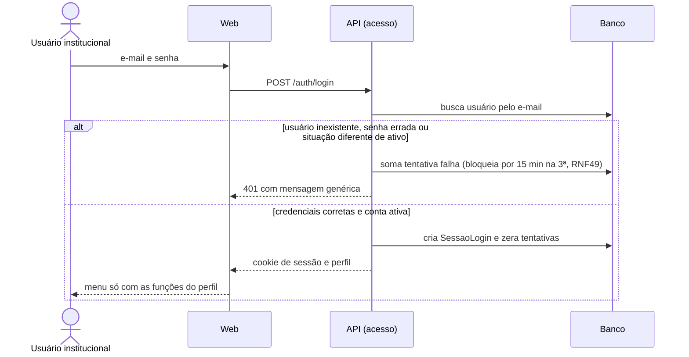

| Regra | Critério de aceitação |
| --- | --- |
| A senha é comparada com o hash (bcrypt ou Argon2), e a mesma mensagem é usada para qualquer falha | E-mail ou senha incorretos negam o acesso sem indicar o campo |
| Só a situação `ativo` autentica | Usuário desativado (RF54) não entra; usuário pendente (RF53) também não |
| Contador `tentativasFalhas` e `bloqueadoAte` no usuário ([DF25](../requisitos/decisoes-fbr.md#df25)) | Na 3ª tentativa seguida com erro, o acesso fica bloqueado por 15 minutos |
| `entradasEmCurso` reserva a conferência de cada entrada: os erros somados às entradas em curso não passam de 3, e as entradas além disso esperam uma vaga por até 5 segundos em vez de serem recusadas; só a senha errada conta como erro ([#176](https://github.com/mdsreq-fga-unb/REQ-2026.2-T02-ClinicaEscolaFBr/issues/176)). A vaga volta em qualquer erro inesperado, e uma reserva com mais de 30 segundos (`emCursoDesde`) é descartada, caso a API tenha caído no meio da conferência. E-mails sem conta seguem a mesma regra, em memória | Tentativas simultâneas com erro não passam de 3 antes do bloqueio, e entradas simultâneas com a senha certa são todas aceitas. Sem vaga em 5 segundos, a entrada recebe 429 ("Muitas tentativas de entrada ao mesmo tempo"), que não conta como erro. A espera é a mesma com ou sem conta, para o tempo da resposta não revelar quais e-mails têm conta |
| O menu e as rotas são filtrados pelo perfil (`PerfisGuard`) | Usuário ativo vê apenas as funcionalidades do seu perfil |

**Dados de teste:** um usuário de cada perfil, ativo; um desativado; um pendente de ativação; um com 2 tentativas falhas (para testar o bloqueio na 3ª).

### RF52 — Verificar identidade do paciente ou responsável ([#47](https://github.com/mdsreq-fga-unb/REQ-2026.2-T02-ClinicaEscolaFBr/issues/47))

_Construída no Ciclo 4._

O RF52 não mostra dados por conta própria: ele confirma a identidade e entrega às outras features uma verificação ligada a uma única inscrição. Quem usa a verificação é a consulta da posição na fila (RF8, [#155](https://github.com/mdsreq-fga-unb/REQ-2026.2-T02-ClinicaEscolaFBr/issues/155)) e, mais adiante, as declarações de comparecimento da CP10 (RF44 a RF46). O código vai só por e-mail ([DF24](../requisitos/decisoes-fbr.md#df24)).

**Rotas** (módulo `acesso`, todas públicas):

- `POST /verificacao/codigo`: recebe o identificador, que pode ser o CPF (com ou sem pontuação) ou o número da inscrição (`AAAA-NNNNN`). Responde sempre `202` com a mesma mensagem, ou `429` com `segundosRestantes` (pedido antes de 60 segundos) ou `bloqueadoAte` (limite de 3 códigos em 60 minutos).
- `POST /verificacao/conferir`: recebe o identificador e o código. Com o código certo, responde `200` e grava o cookie `verificacao`. Em qualquer outro caso, responde `400` com a mesma mensagem.
- `GET /verificacao`: devolve o número da inscrição liberada e o fim do prazo da verificação, para a página `/consultar` saber se a pessoa já confirmou a identidade. Sem verificação válida, responde `401`.
- `POST /verificacao/encerrar`: encerra a verificação e apaga o cookie.

O `VerificacaoGuard` lê o cookie `verificacao`, confere se a verificação está dentro do prazo e não foi encerrada e preenche `req.inscricaoVerificada` com o id da inscrição. Sem verificação válida, a rota responde `401` sem nenhum dado. O cookie é `httpOnly`, `Secure` e `SameSite=Lax`, como o da sessão do RF50, e só o hash do token fica no banco.

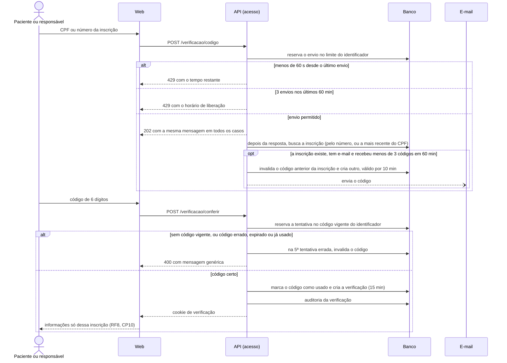

| Regra | Critério de aceitação |
| --- | --- |
| A verificação fica ligada a uma única inscrição, e o `VerificacaoGuard` só entrega o id dela às rotas do paciente | O CPF ou o número, com o código informado em até 10 minutos, libera acesso apenas às informações desse paciente |
| Sem verificação válida, as rotas do paciente respondem `401` sem dado; a conferência responde sempre a mesma mensagem, exista ou não a inscrição | Sem código, ou com código incorreto ou expirado, nada é exibido e a existência da inscrição não é confirmada |
| Para inscrição sem e-mail, nada é enviado, e a resposta é o mesmo `202` de qualquer pedido | Inscrição sem e-mail não recebe código, e a resposta é a mesma de qualquer pedido |
| `usadoEm` é gravado com um `UPDATE` condicional (`usado_em is null`), e só uma conferência simultânea passa | Código já utilizado é recusado |
| `tentativasFalhas` é reservada antes da comparação, como no RF50; na 5ª tentativa errada, o código recebe `invalidadoEm` | Na quinta tentativa incorreta, o código é invalidado e nem o correto passa a ser aceito |
| `ultimoEnvioEm` no limite do identificador; o novo código invalida o anterior | Novo código pedido antes de 60 segundos é recusado, informando o tempo restante |
| `enviosNaJanela` e `janelaInicio` contam os envios em 60 minutos; no 3º, `bloqueadoAte` recebe a hora do envio mais 60 minutos | Depois de 3 códigos em 60 minutos, o quarto pedido é recusado, e o bloqueio dura 60 minutos |

**Decisões de projeto** (a conferir na inspeção):

1. **Identificador guardado como chave, e não em texto.** `identificadorChave` é um HMAC-SHA256 do identificador normalizado (`cpf:<11 dígitos>` ou `numero:<AAAA-NNNNN>`), com uma chave do servidor. O CPF não fica gravado nas tabelas novas. Na implementação, a chave do HMAC é derivada da `CHAVE_DADOS` (HKDF), para não exigir outra variável na implantação; se a `CHAVE_DADOS` for trocada, os códigos e as verificações em curso deixam de valer, e a pessoa pede um novo código.
2. **Limites pelo identificador, pela inscrição e pela origem.** Os limites do `429` valem igual para um CPF ou número que existe e para um que não existe, para que a resposta não revele a inscrição; é a mesma ideia do bloqueio do RF50 para e-mail sem conta. Na implementação, entraram mais dois limites, que não mudam a resposta:
    - **Por inscrição:** no máximo 3 códigos em 60 minutos, somando o CPF e o número, e só um código vale por vez; o código novo invalida o anterior da inscrição, venha ele de qualquer dos dois identificadores. Assim, alternar o CPF e o número não dobra as tentativas. Quando a inscrição já recebeu 3 códigos, o pedido responde o mesmo `202`, e nada é enviado.
    - **Por origem:** 30 pedidos de código e 30 conferências a cada 10 minutos por endereço (`LIMITE_VERIFICACAO_POR_ORIGEM`), como o limite da inscrição do RF1. Sem ele, alguém poderia pedir códigos para muitas inscrições de uma vez, já que os números são sequenciais, e tentar adivinhar todos.
3. **CPF com mais de uma inscrição:** vale a mais recente, que é a que está na fila.
4. **Duração da verificação:** 15 minutos, sem renovação (`MINUTOS_VERIFICACAO`). O RF52 não define esse prazo. Ele é curto porque a consulta é rápida e pode ser feita num computador compartilhado. Depois do prazo, a pessoa pede um novo código.
5. **Envio do e-mail fora da resposta:** a API responde logo depois de reservar o envio no limite do identificador. A busca da inscrição, a gravação do código e o e-mail acontecem depois da resposta, para que o tempo dela não indique se a inscrição existe ou tem e-mail.
6. **Código:** gerado com `crypto.randomInt` e guardado como HMAC, nunca em texto.
7. **Auditoria:** a verificação concluída grava `verificar_identidade` na auditoria, sem usuário e com a inscrição como entidade, para rastrear o acesso aos dados dela. O pedido de código não altera dado da inscrição e não é auditado.

**Telas:** página pública `/consultar`, em dois passos (identificador e código), usada pelo RF8 antes de mostrar a posição na fila. O componente da verificação recebe o conteúdo que aparece depois dela, e é ali que o RF8 e a CP10 entram; até lá, a página mostra só a confirmação da identidade, o número da inscrição e o botão para encerrar a consulta. O código é digitado num campo único com `inputmode="numeric"` e `autocomplete="one-time-code"`. As mensagens de erro usam `role="alert"` e recebem o foco, e o botão de reenvio mostra o tempo restante. As telas estão nos [protótipos](prototipos.md#rf52).

**Dados de teste:**

- Inscrições fictícias: uma com e-mail, uma só com celular e um CPF com duas inscrições.
- Identificadores sem inscrição: um CPF e um número inexistentes.
- Códigos: um vencido (criado há 11 minutos), um já usado e um com 4 tentativas erradas.
- Limites: um identificador com envio há 30 segundos, um com 2 envios na janela e um bloqueado.
- Em desenvolvimento, o e-mail chega ao Mailpit (`http://localhost:8025`).

**Riscos:** o remetente oficial de e-mail depende da FBr, como no RF53. O RF1, de que o RF52 depende, já está na `main` ([#139](https://github.com/mdsreq-fga-unb/REQ-2026.2-T02-ClinicaEscolaFBr/pull/139)).

---

### RF53 — Cadastrar usuário institucional com perfil de acesso ([#48](https://github.com/mdsreq-fga-unb/REQ-2026.2-T02-ClinicaEscolaFBr/issues/48))

_Construída no Ciclo 3._

**Rotas:**
- `POST /usuarios` (coordenação);
- `POST /usuarios/:id/convite` (coordenação, para reenviar o convite);
- `POST /ativacao` (pública): recebe o token e a nova senha.

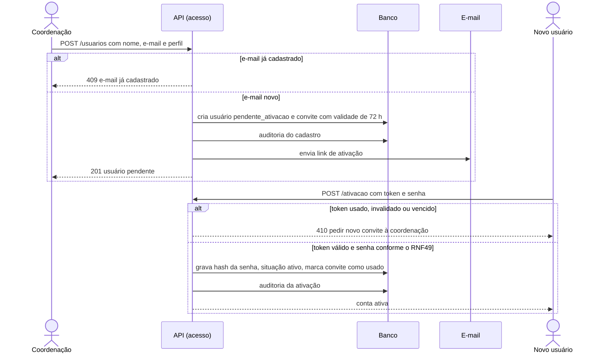

| Regra | Critério de aceitação |
| --- | --- |
| O token é guardado só como hash, é de uso único e vale pelo prazo do convite ([RF53](../requisitos/funcionais.md#rf53), [DF30](../requisitos/decisoes-fbr.md#df30)) | Link já usado ou com mais de 72 horas é recusado |
| O reenvio marca o convite anterior como `invalidadoEm` e cria outro | O reenvio invalida o link anterior |
| Índice único no e-mail | E-mail já cadastrado não pode ser cadastrado de novo |
| Rota com `@Perfis('coordenacao')` | Usuário sem perfil de coordenação não cadastra |
| O cadastro, o reenvio e a ativação chamam o `AuditoriaService` | Operações registradas com autor, usuário afetado e data/hora |

**Dados de teste:** um convite válido, um vencido (criado há 73 h) e um já usado. Em desenvolvimento, o e-mail chega ao Mailpit (`http://localhost:8025`).

### RF54 — Desativar usuário institucional ([#49](https://github.com/mdsreq-fga-unb/REQ-2026.2-T02-ClinicaEscolaFBr/issues/49))

_Construída no Ciclo 3._

**Rota:** `POST /usuarios/:id/desativacao` (coordenação).

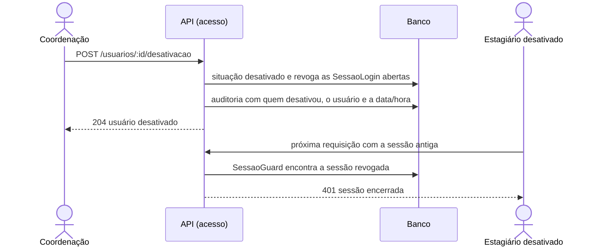

| Regra | Critério de aceitação |
| --- | --- |
| Revogar as sessões e conferir a situação do usuário a cada requisição | A próxima requisição do desativado é recusada, mesmo com sessão aberta |
| Nada é apagado: os registros continuam ligados ao `usuarioId` | Registros anteriores continuam visíveis, com o nome de quem os fez |
| `@Perfis('coordenacao')` | Usuário sem perfil de coordenação não desativa |

**Dados de teste:** um estagiário ativo com sessão aberta e registros de auditoria em seu nome.

### RF55 — Restringir acesso ao prontuário do paciente ([#50](https://github.com/mdsreq-fga-unb/REQ-2026.2-T02-ClinicaEscolaFBr/issues/50))

_Construída no Ciclo 3._

**Escopo no Ciclo 3:**
- **O que entra agora:** a regra de acesso protege o prontuário criado pelo RF66; os dados iniciais (RF69) entram no Ciclo 4 sob a mesma regra.
- **O que entra depois:** a mesma política passa a valer para a evolução (CP7, a partir do Ciclo 4). O critério da transferência entre estagiários é verificado quando a transferência (RF25) for construída, no Ciclo 4, e a política passa a proteger também o relatório final (RF33) no Ciclo 6.

**Rotas:**
- `GET /prontuarios/:id`: estagiário responsável e supervisor do caso; coordenação, só leitura, em qualquer caso ([DF32](../requisitos/decisoes-fbr.md#df32)).
- `GET /pacientes/:id/dados-administrativos`: secretaria e coordenação.

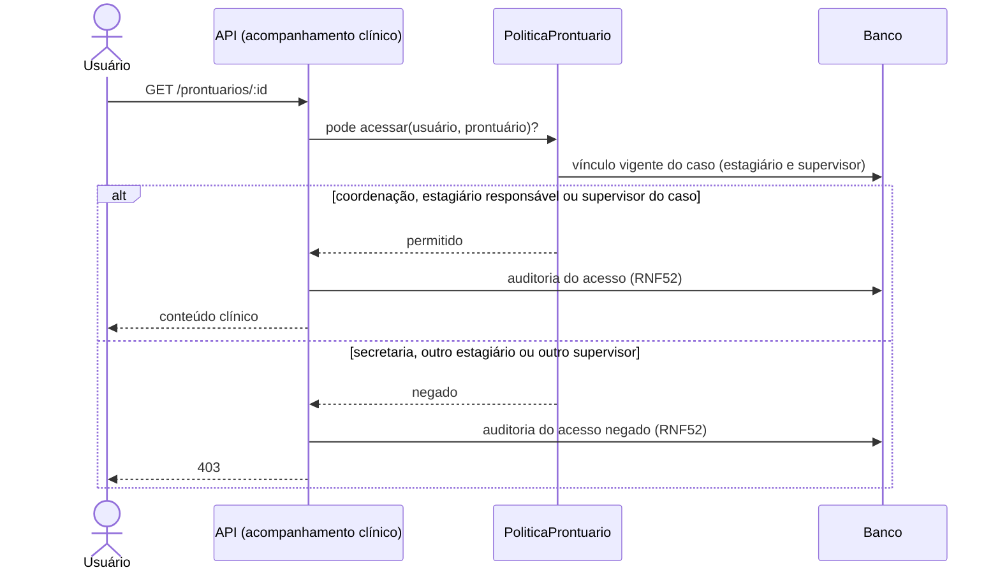

| Regra | Critério de aceitação |
| --- | --- |
| A verificação acontece na API (`PoliticaProntuario`), não só na interface | Estagiário não responsável tem o acesso negado, inclusive com requisição direta ao servidor |
| A coordenação consulta qualquer prontuário, sem vínculo com o caso, e o acesso fica registrado | A coordenação vê o conteúdo clínico de um caso sem vínculo, e o acesso aparece no registro |
| A rota administrativa devolve apenas nome, data de nascimento, contatos, responsável legal, situação do caso, sessões, faltas e contribuição | A secretaria vê só os dados cadastrais e administrativos |
| Os dados são criptografados em repouso e em trânsito (RNF51) | Inspeção do banco e do HTTPS no ambiente de homologação |

**Dados de teste:** um caso com estagiário A e supervisor S; outro estagiário B; uma secretaria; uma coordenação.

---

### RF56 — Consultar registro de acessos ao prontuário ([#51](https://github.com/mdsreq-fga-unb/REQ-2026.2-T02-ClinicaEscolaFBr/issues/51))

_Ciclo 5._

**Rota** (módulo `acompanhamento-clinico`): `GET /acessos-prontuario?pacienteId&usuarioId&inicio&fim&pagina` (`@Perfis('coordenacao')`). Lê a tabela `acessos_prontuario`, que o `PoliticaProntuario` já grava em todo acesso, permitido ou negado, desde o Ciclo 3 (RNF52). Cada linha traz a data e a hora, o nome e o perfil do usuário, o nome do paciente e a operação. Não traz nenhum dado do prontuário (RNF17). Ordem: do acesso mais recente para o mais antigo, 50 por página.

| Operação na tabela (`operacao`, `permitido`) | Mostrada como |
| --- | --- |
| `permitido = false`, qualquer operação | Acesso negado |
| `consultar_prontuario` | Visualização |
| `registrar_anamnese`, `registrar_contrato`, `registrar_evolucao` e `registrar_dados_iniciais` (gravado antes do RF69 separar a anamnese e o contrato) | Criação |
| `marcar_sessao_realizada`, `corrigir_evolucao` (RF29) e os complementos (RF30, Ciclo 6) | Alteração |

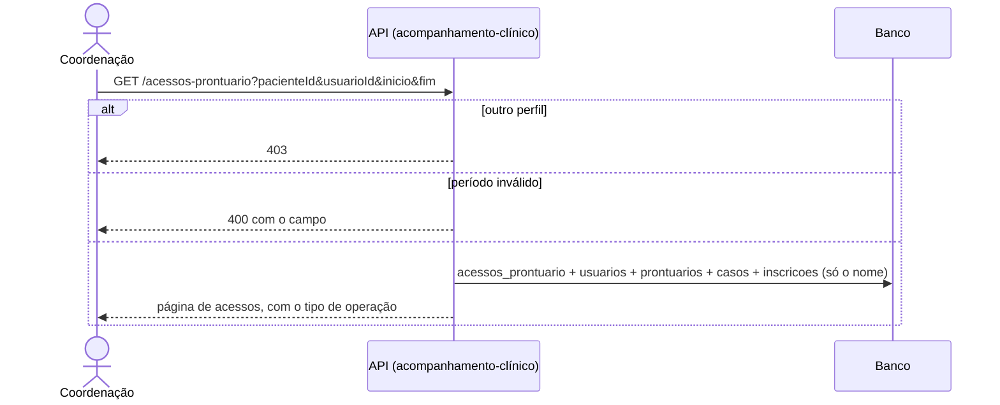

| Regra | Critério de aceitação |
| --- | --- |
| A política já grava a leitura com o usuário, o perfil e a data/hora | Cada visualização gera uma entrada com nome, perfil, data/hora e "visualização" |
| A operação vira "Criação" ou "Alteração" pela tabela acima | Cada criação ou alteração gera a entrada com a operação correspondente |
| Os filtros entram no `where`; o período usa o dia inteiro em Brasília | Os filtros mostram só as entradas que os atendem |
| A resposta não tem nenhuma coluna do prontuário | A consulta não mostra o conteúdo clínico |
| `permitido = false` vira "Acesso negado" ([DF29](../requisitos/decisoes-fbr.md#df29)) | As tentativas negadas aparecem como "acesso negado" |
| `@Perfis('coordenacao')` | Quem não é coordenação não consulta (403) |

**Decisões de projeto:** a tipificação é feita na leitura, pela tabela acima, com os valores que o `PoliticaProntuario` grava em `acessos_prontuario` (e não os nomes da auditoria geral), para valer também para os acessos já registrados. A tabela de acessos não guarda o modo da política, por isso o tipo sai do nome da operação. Uma operação nova do prontuário entra na tabela na mesma PR, e um teste falha se aparecer uma `operacao` sem tipo. O acesso é gravado pela política **antes** da operação e fora da transação dela, como o RNF52 pede para todo acesso: uma criação ou alteração autorizada que falha depois (por exemplo, o `409` do segundo envio) continua no registro. Por isso, a tela diz "Operação" e o texto de ajuda explica que a linha registra a tentativa autorizada; o resultado da operação fica na auditoria geral (RNF10). A tentativa negada num prontuário que não existe fica sem paciente (`prontuario_id` nulo) e aparece com "—" na coluna do paciente. Consultar o registro também é registrado na auditoria geral (RNF10), e não no próprio registro de acessos.

**Telas:** página "Registro de acessos" (`/acessos-prontuario`), no menu da coordenação, com os filtros paciente (busca pelo nome, como a lista de Pacientes do RF22), usuário, data inicial e final e "Filtrar"; a tabela com o selo de cada operação ("Acesso negado" em vermelho, com o ícone de X); "Nenhum acesso encontrado" quando não há resultado; os cartões no celular; e "Você não tem acesso ao registro de acessos" para os outros perfis. Abre com os últimos 30 dias. Protótipo: [prancha 6-2](prototipos.md#rf56).

**Acessibilidade (RNF56 a RNF58):** a tabela tem `caption`; o selo tem o texto da operação, e não só a cor; a contagem do resultado é anunciada com `role="status"`.

**Dados de teste:** uma visualização do estagiário, uma da coordenação, uma evolução registrada, uma sessão marcada como realizada, uma tentativa negada da secretaria e uma num prontuário inexistente; cada filtro sozinho e combinados; um período sem acessos; a resposta conferida sem texto clínico; a secretaria, o supervisor e o estagiário (403).

**Dependências e riscos:** usa a gravação do RF55 (#50) e os nomes de operação do RF27, do RF28 e do RF69. O RF29, construído no mesmo ciclo, grava `corrigir_evolucao`.

**Na implementação (RF56, ajustes da inspeção de 16/11):** a API mantém os filtros por `pacienteId` (id da inscrição) e `usuarioId` e aceita também `paciente` e `usuario`, buscas literais por parte do nome. Os filtros se combinam; nomes têm até 150 caracteres, datas inexistentes ou período invertido retornam 400. A resposta contém `acessos`, `total`, `pagina` e `tamanhoPagina` (50), com contagem e página na mesma transação de leitura consistente; o id desempata acessos com a mesma data. O perfil é o gravado no momento do acesso, inclusive para usuários desativados. Nenhum conteúdo clínico é selecionado ou decifrado.

A tentativa negada sem prontuário identificado permanece com paciente “—” e **só aparece quando não há filtro de paciente**, tanto por nome quanto por id. Essa regra está no texto de ajuda e no teste da API; filtros de usuário e período continuam aplicáveis. A tela anuncia o total e a página em `role="status"`, preserva os filtros em caso de falha e retorna à primeira página ao pesquisar novamente. Os demais perfis recebem 403 e não veem o item no menu.

**Banco:** a migration `0019_rf56_indices_acessos` adiciona índices em `criado_em`, `(prontuario_id, criado_em)` e `(usuario_id, criado_em)`. Ela vem depois da `0017` do RF41 e da `0018` do RF29, com o snapshot apontando para a `0018`, e não altera registros, gatilhos de imutabilidade, permissões nem migrations já integradas.

**Verificação:** testes de API cobrem registros permitidos e negados, operações atuais e legadas, filtros e ausência de paciente, contagem/paginação, limites do dia em Brasília, sigilo, permissões e imutabilidade. Testes web cobrem estados, foco, contagem e paginação; E2E usa dados fictícios e cobre seis larguras, teclado, axe e recusa aos demais perfis. O cenário de leitor de tela requer o workflow macOS. A inspeção de design da #51 foi aprovada com ajustes, e a FBr validou o protótipo do Ciclo 5, com a prancha 6-2 do RF56, em 16/11 ([DF59](../requisitos/decisoes-fbr.md#df59)), o que fecha o R7.3. Os testes não substituem a inspeção de código independente.

---

### RF57 — Registrar consentimento para tratamento de dados ([#52](https://github.com/mdsreq-fga-unb/REQ-2026.2-T02-ClinicaEscolaFBr/issues/52))

_Construída no Ciclo 4._

O termo entra na etapa 3 da inscrição (RF1). A rota continua a mesma, `POST /inscricoes`, que passa a exigir o aceite. O texto do termo fica versionado no banco, e cada inscrição guarda a versão aceita e a data/hora do aceite. O texto da versão `0.1` está em [Termo de consentimento — versão 0.1](termo-consentimento.md).

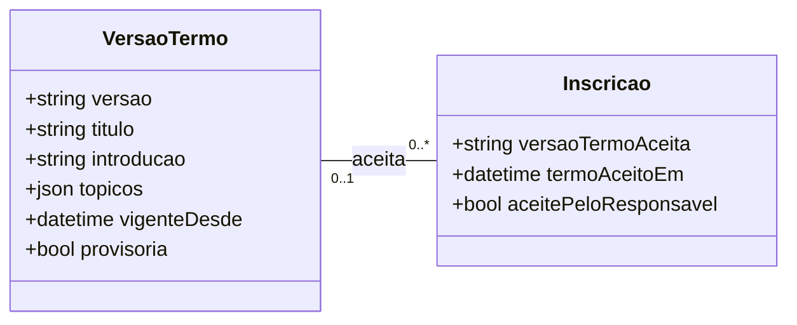

- **`topicos`:** `jsonb` com a lista dos cinco tópicos do protótipo, cada um com `titulo` e `corpo` em Markdown: o que coletamos, para que usamos, quem pode ver, por quanto tempo guardamos e seus direitos e como desistir. A caixa de concordância e o aviso para menor ficam na tela, e não no texto versionado.
- **Multiplicidade:** a inscrição antiga, feita antes do termo, não tem versão (decisão 2), por isso o lado da `VersaoTermo` é `0..1`.
- **Valores do servidor:** o `aceitePeloResponsavel` vem de `menorDeIdade(dataNascimento)`, nunca do cliente, e o `termoAceitoEm` é o `now()` da transação. Um `CHECK ((versao_termo_aceita is null) = (termo_aceito_em is null))` garante os dois juntos.

**Rotas** (módulo `inscricao`, públicas):

- `GET /termo/vigente`: devolve a versão vigente, se é provisória, o título, a introdução e os cinco tópicos.
- `POST /inscricoes`: recebe, além dos dados da inscrição, `aceiteTermo: true` e a `versaoTermo` que a pessoa leu.

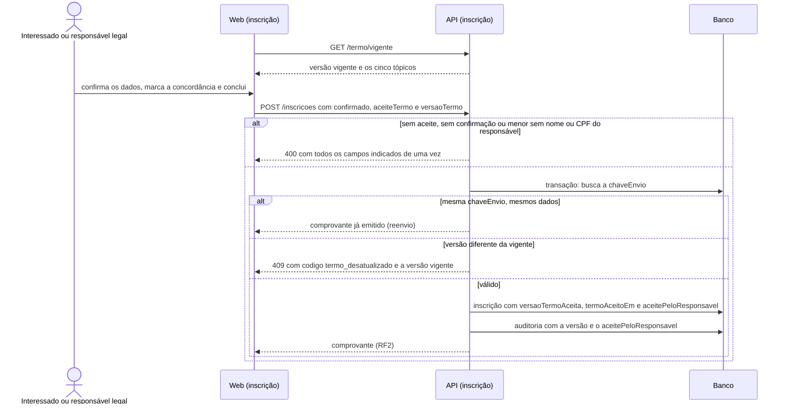

| Regra | Critério de aceitação |
| --- | --- |
| `aceiteTermo` é `z.literal(true)` no esquema da inscrição, validado junto com o resto pelo `ZodValidationPipe` | Sem aceite, a inscrição não é concluída, e o sistema indica o aceite |
| A inscrição grava a versão e o `termoAceitoEm` do servidor | A inscrição guarda a versão aceita e a data/hora |
| Para menor de idade (`menorDeIdade`), o aceite é do responsável: exige o nome e o CPF do responsável informados na etapa 1 (decisão 4) e grava `aceitePeloResponsavel` | Na inscrição de menor, o termo pede a identificação e a concordância do responsável |
| O texto do termo traz o prazo de guarda e como revogar (RF65), nos tópicos 4 e 5 da [versão 0.1](termo-consentimento.md) | O termo informa o prazo de guarda e como revogar |
| Uma versão nova só vale para as inscrições seguintes; as antigas mantêm a versão aceita | Cada versão aprovada vale para as inscrições seguintes, sem alterar os aceites anteriores (DF44) |
| A versão é conferida no serviço, dentro da transação e **depois** da busca pela `chaveEnvio`. O 409 do termo tem código próprio (`{ codigo: "termo_desatualizado", versaoVigente }`) e não se confunde com o 409 da `chaveEnvio` reutilizada com outros dados | Uma resposta perdida seguida de troca de versão não devolve 409 para uma inscrição já gravada |
| No reenvio, o `aceiteTermo` e a `versaoTermo` saem do `...cadastro` comparado campo a campo | O reenvio legítimo, com a mesma `chaveEnvio`, não vira 409 |

**Decisões de projeto:**

1. **Versão provisória.** Até a FBr aprovar o texto (DF44), a versão vigente é a `0.1`, marcada `provisoria`, e aparece assim na tela. A produção fica com `INSCRICAO_ABERTA=false` até haver uma versão aprovada (sem a variável, a inscrição fica aberta: `?? true` no `inscricao-aberta.guard.ts`). Além disso, em produção, a API recusa a inscrição enquanto a versão vigente for `provisoria`.
2. **Inscrições antigas.** As inscrições feitas antes do termo ficam com a versão vazia. Elas não são apagadas nem recebem um aceite presumido.
3. **Texto no banco, e não no código:** uma versão nova entra por migration, sem mudar o código da tela.
4. **CPF do responsável obrigatório para menor de idade.** A implementação preserva a exigência já integrada à inscrição, conforme a [DF47](../requisitos/decisoes-fbr.md#df47), registrada na validação de 06/11. Nome e CPF identificam quem aceita pelo menor. A decisão e sua confirmação institucional são acompanhadas no catálogo; não se presume aprovação do texto do termo.
5. **Duas caixas: a confirmação do RF1 e o aceite do termo.** O critério do RF1 pede que a pessoa revise os dados e confirme o envio, e a LGPD pede que o consentimento seja específico e destacado (art. 11, I). Por isso, as duas caixas ficam separadas: "Confirmo que revisei os meus dados" (o `confirmado` que já existe) e a do termo. As pranchas 1-1 e 1-2 mostram só a do termo e são ajustadas. O aviso provisório que a etapa 3 mostra hoje no lugar do termo sai.
6. **Inscrição feita na recepção.** Enquanto o RF3 não entra, a recepção preenche o formulário on-line pelo interessado. Quem lê o termo e marca a caixa é o próprio interessado ou o responsável, na tela ou numa cópia impressa da mesma versão; a recepção não marca por ele. Fica registrado como limitação que, até o RF3, o aceite dado na recepção não se distingue do aceite on-line.

**Na implementação:** a migration `0015_consentimento_versionado`, depois da fila, da transferência de casos e das fichas (0012 a 0014), cria as versões e os campos de aceite. Antes da publicação, seu texto 0.1 foi alinhado à DF51: o contato de emergência é obrigatório. A obrigatoriedade dos campos do formulário RF1 é acompanhada separadamente na issue #252. A versão continua provisória; inscrições legadas não recebem aceite presumido, e versões publicadas não podem ser atualizadas ou apagadas. Um texto aprovado futuro entra por nova migration. O serviço usa a data do banco e calcula o responsável pela data de nascimento; a chave de envio é consultada antes da versão vigente para preservar reenvios.

O bloco do termo segue as pranchas 1-1 e 1-2: selo de versão, tópicos com “Ler tópico”, concordância dentro do quadro e aviso de disponibilidade depois dele. Para menor, exibe aviso informativo, nome e CPF do responsável só para leitura, retorno à etapa 1 para correção e alerta sobre assinatura presencial. Os textos dos cinco tópicos vêm do documento versionado, preservando seu conteúdo completo. Como diferenças da prancha, permanecem os dois blocos de revisão do RF1 já implementado (dados e triagem), os botões “Editar dados” e “Editar triagem” e o envio “Confirmar e enviar inscrição”; o termo não altera esse fluxo. O erro de CPF remete à etapa 1, além da validação que já impede avançar sem ele.

`AMBIENTE_APLICACAO=producao` bloqueia inscrição com termo provisório; sem a variável, `NODE_ENV=production` também bloqueia. O compose repassa a variável com padrão `producao`. **Antes do merge, a implantação deve confirmar `AMBIENTE_APLICACAO=validacao` no Coolify da validação**, como descrito em [Implantação](implantacao.md#configuracao). A implementação é destinada a dados fictícios enquanto o termo for provisório. **R4.4 permanece como ressalva do DoR: falta aprovação formal da FBr, o que impede produção e inscrições reais, mas não a integração técnica em development.** R7.2: estados de carregamento, indisponibilidade, ausência de aceite, identificação do responsável e versão alterada estão descritos e testados. R7.3: as referências são as pranchas 1-1 e 1-2, com as diferenças acima registradas para inspeção. R8.3: não há integração externa própria; o fluxo usa a API de inscrição e o PostgreSQL existentes, e a massa fictícia cobre adulto, menor, falta de aceite, troca de versão, reenvio e registros legados. Os itens da issue permanecem sujeitos à conferência do líder, sem marcação automática.

A evidência automatizada inclui RF57/RNF51 no teste de criptografia da inscrição, RNF56 com axe, RNF57 com `focoVisivel` nos tópicos e no aceite e RNF58 em 320, 360, 768, 1024, 1366 e 1920 px. O caminho do responsável é testado no computador e no celular.

**Telas:** etapa 3 da inscrição, com o termo depois do resumo, os cinco tópicos que abrem e fecham (botões com `aria-expanded` e `aria-controls`), a caixa de confirmação dos dados e a caixa de concordância, as duas desmarcadas, e, para menor, o nome e o CPF do responsável só para leitura e o aviso de que o aceite on-line não substitui o termo assinado na clínica. O `aceiteTermo` entra nos dois lugares que hoje só tratam o `confirmado`: o link do resumo de erros, que leva à caixa do termo, e o mapeamento do 400 do servidor. **Termo desatualizado (409):** a tela recarrega o termo, desmarca a caixa e mostra "O termo foi atualizado. Leia a nova versão e marque a concordância de novo", com o foco na mensagem; esse estado entra na prancha. Conferida também a 320 px (RNF58). Protótipo: [pranchas 1-1 e 1-2](prototipos.md#rf57).

**Dados de teste:** uma inscrição de maior de idade com aceite e outra sem aceite; uma de menor com o CPF do responsável e outra sem; um envio com a versão `0.0`, diferente da vigente (409 com `termo_desatualizado`); um reenvio com a mesma `chaveEnvio` depois de a versão mudar (devolve o comprovante); uma inscrição antiga sem versão; um adulto com o CPF do responsável preenchido, que é descartado; o `aceiteTermo: false` enviado direto à API (400).

---

### RF65 — Registrar revogação do consentimento ([#281](https://github.com/mdsreq-fga-unb/REQ-2026.2-T02-ClinicaEscolaFBr/issues/281))

_Ciclo 6._

**Rota** (módulo `inscricao`): `POST /inscricoes/:id/revogacao` (secretaria). Recebe `solicitante` (`titular` ou `responsavel`), `formaVerificacao` (`documento` ou `verificacao_rf52`) e, no primeiro caso, o documento apresentado. Grava a `RevogacaoConsentimento` e aplica os efeitos na mesma transação.

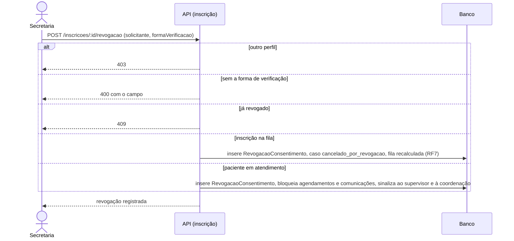

| Regra | Critério de aceitação |
| --- | --- |
| Na fila: o caso vai para a situação nova `cancelado_por_revogacao`, e a fila (RF7) deixa de listá-lo | A revogação de um inscrito na fila o retira, com a situação e os dados da revogação |
| Em atendimento: o agendamento (RF10) recusa com 422, as comunicações ao titular (o aviso do RF17 e a confirmação do RF14) param e a revogação aparece ao supervisor e à coordenação; o lembrete do RF13 fica fora do MVP | A revogação bloqueia agendamentos, suspende os lembretes e é sinalizada |
| A inscrição, o aceite, o prontuário e as sessões não mudam; a revogação é uma linha nova | O aceite original, a revogação e os registros clínicos continuam no histórico |
| `formaVerificacao` obrigatória no Zod | A revogação não é concluída sem a verificação de identidade |
| `@Perfis('secretaria')` | Quem não é da secretaria não registra |

**Decisões de projeto:** a revogação não apaga dados: os registros ficam guardados pelo prazo de 5 anos (Resolução CFP nº 1/2009), com o acesso do RF55. O encerramento do atendimento é decisão clínica, fora do sistema; o sistema só bloqueia o que é novo e avisa. A base legal do tratamento, que o Jurídico da FBr ainda vai indicar, e o texto final do termo podem mudar os efeitos; até lá, vale o requisito.

**Telas:** na ficha do paciente, o cartão "Consentimento para tratamento de dados" com "Registrar revogação"; a página "Revogação do consentimento" com quem pede, como a identidade foi confirmada e o aviso dos efeitos para aquele caso; o erro sem a verificação; a inscrição "Cancelada por revogação do consentimento" na fila; o aviso ao supervisor e à coordenação; o histórico do consentimento; e o acesso negado. Protótipo: [prancha 1-1](prototipos.md#rf65).

**Acessibilidade (RNF56 a RNF58):** as escolhas são `fieldset` com `legend`; o aviso dos efeitos fica antes do botão; o botão de registrar tem o nome da ação.

**Dados de teste:** a revogação de um inscrito na fila (sai da fila, posições recalculadas); a de um paciente em atendimento (agendamento recusado, sem o e-mail de confirmação da sessão, aviso ao supervisor); sem a forma de verificação (400); a revogação repetida (409); o estagiário e a coordenação tentando registrar (403); o aceite original e o prontuário conferidos depois da revogação; uma nova inscrição do mesmo titular, com novo aceite.

**Dependências e riscos:** depende do RF57 (#52) e do RF52 (#47), e integra o RF7, o RF10, o RF14, o RF17 e o RF55. A migration acrescenta o valor `cancelado_por_revogacao` ao enum `situacao_caso`.

---

## Inscrição on-line (CP1)

### RF1 — Registrar solicitação de atendimento on-line ([#88](https://github.com/mdsreq-fga-unb/REQ-2026.2-T02-ClinicaEscolaFBr/issues/88))

_Construída no Ciclo 3._

**Rota:** `POST /inscricoes` (pública), validada pelo esquema `inscricaoSchema` em `@clinica/shared`. A interface tem 3 etapas, com o aviso do CVV e do SAMU fixo em todas:
1. dados e contatos;
2. triagem (queixa, percepção de urgência e histórico relevante);
3. revisão e confirmação.

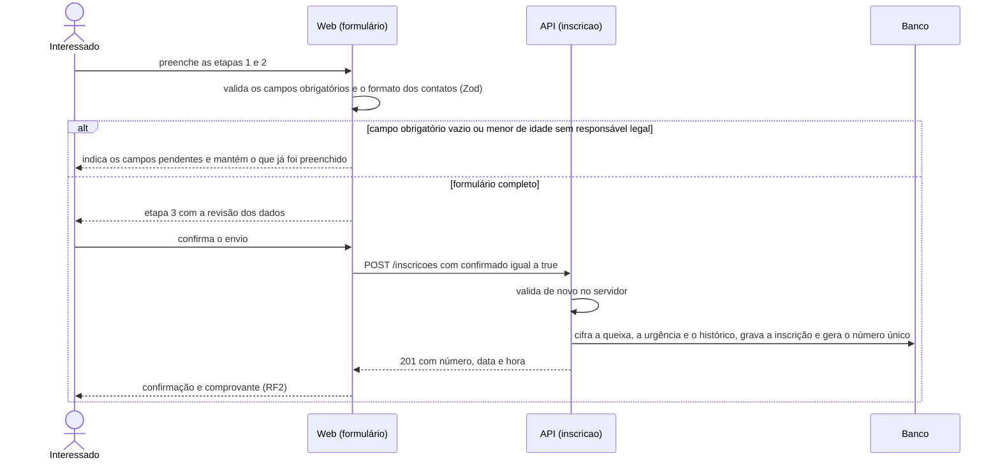

| Regra | Critério de aceitação |
| --- | --- |
| O mesmo esquema Zod é usado na interface e na API | Envio com campo obrigatório vazio é bloqueado, e os dados são mantidos |
| A idade é calculada a partir da data de nascimento, e o responsável legal é obrigatório para menores de 18 anos | Menor de idade sem responsável legal é bloqueado |
| E-mail e celular obrigatórios, sem a escolha do canal preferencial ([DF48](../requisitos/decisoes-fbr.md#df48)); a API grava `canal_preferencial = 'email'` nas inscrições novas, e as antigas mantêm o canal escolhido | Formato validado e os dois contatos exigidos |
| CPF com 11 números; RG **opcional** ([DF60](../requisitos/decisoes-fbr.md#df60)), como texto livre, como está no documento, sem órgão emissor, sem estado e sem upload | Nenhum envio de cópia do documento; a inscrição sem RG é aceita quando os demais campos obrigatórios estão preenchidos |
| A API só grava com `confirmado: true` | Sem confirmação, a solicitação não é registrada |
| Número no formato `AAAA-NNNNN`, com o ano do registro e a sequência `inscricoes_numero_seq`, que não reinicia a cada ano | Cada inscrição recebe um número único, como "2026-00487" |
| Queixa, urgência e histórico são cifrados antes de gravar (RNF51) | Nenhum desses campos aparece legível no banco |
| A interface só mostra a confirmação após a resposta 201 | Nenhuma confirmação sem registro efetivo |
| Componente `AvisoEmergencia` fixo no layout do formulário | Aviso do CVV e do SAMU em todas as etapas |

**Dados de teste:** um adulto com e-mail e celular; um menor com responsável legal; uma inscrição sem e-mail e outra sem celular (recusadas); uma inscrição com CPF em formato inválido; um RG com letra ("12.345.678-X"); uma inscrição sem RG (aceita, com o RG nulo no banco).

### RF2 — Emitir comprovante de inscrição ([#89](https://github.com/mdsreq-fga-unb/REQ-2026.2-T02-ClinicaEscolaFBr/issues/89))

_Construída no Ciclo 3._

O comprovante é montado na interface a partir da resposta do `POST /inscricoes` (número, data e hora) e pode ser impresso ou salvo em PDF pelo navegador. Não há rota pública para consultar um comprovante por número, o que evita a enumeração de inscrições.

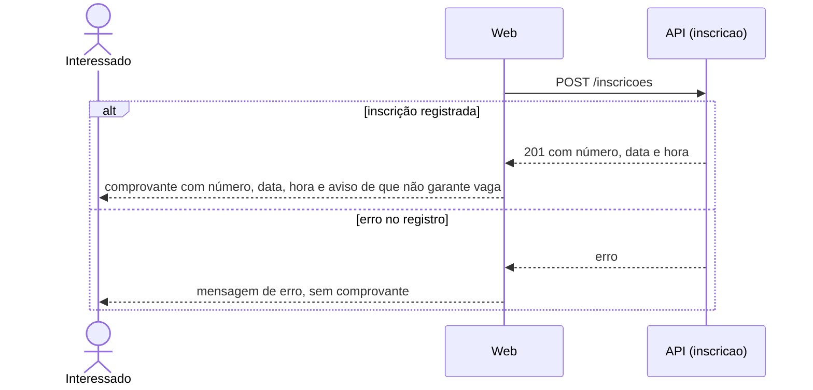

| Regra | Critério de aceitação |
| --- | --- |
| O comprovante só existe a partir da resposta 201 | Nenhum comprovante para inscrição não concluída |
| O componente recebe apenas o número, a data e a hora | O comprovante não contém a queixa nem dados clínicos |
| Texto fixo sobre triagem e vagas | Informa que o atendimento depende da triagem e das vagas |

---

## Triagem (CP2)

### RF4 — Organizar informações da inscrição para triagem ([#90](https://github.com/mdsreq-fga-unb/REQ-2026.2-T02-ClinicaEscolaFBr/issues/90))

_Construída no Ciclo 3._

**Rota:** `GET /triagem/inscricoes` (supervisor e coordenação). Devolve as inscrições sem decisão de prioridade vigente, com o campo calculado `diasAguardando` (dias desde `criadaEm`), e aceita ordenação por esse campo. A FBr não adota prazo de triagem ([DF19](../requisitos/decisoes-fbr.md#df19)), então não há sinal de "além do prazo".

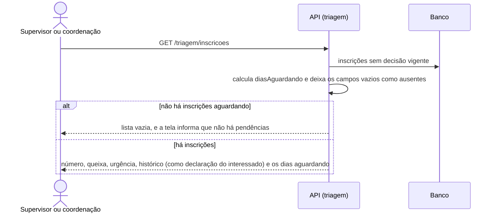

| Regra | Critério de aceitação |
| --- | --- |
| `@Perfis('supervisor','coordenacao')` | Usuários sem autorização não veem as respostas |
| Campo vazio é enviado como `null`, e a interface mostra "não informado" | Campo sem resposta aparece como ausente |
| As respostas aparecem num bloco "Declarado pelo interessado", separado da decisão da equipe | Declaração separada da avaliação da equipe |
| `diasAguardando` calculado a partir de `criadaEm` | Cada inscrição mostra há quantos dias aguarda, sem sinal de prazo |

**Dados de teste:** uma inscrição de hoje; uma de 8 dias atrás sem triagem (aparece com 8 dias aguardando, sem sinal de prazo); uma inscrição legada com o histórico vazio.

### RF6 — Registrar prioridade clínica do inscrito ([#91](https://github.com/mdsreq-fga-unb/REQ-2026.2-T02-ClinicaEscolaFBr/issues/91))

_Construída no Ciclo 3._

**Rota:** `POST /triagem/inscricoes/:id/prioridade` (supervisor e coordenação). Recebe a cor. A primeira decisão cria o `Caso` com a situação `aguardando_distribuicao`.

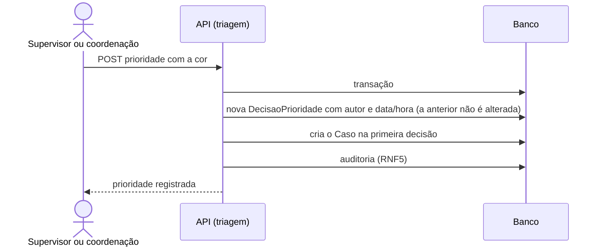

| Regra | Critério de aceitação |
| --- | --- |
| Histórico somente inserção, com trava no banco; a vigente é a mais recente (RNF5) | A alteração mantém a decisão anterior no histórico, sem alterá-la |
| A tela mostra a referência vermelha/amarela/verde como texto, sem cor pré-selecionada | Nenhuma sugestão automática de cor |
| Sem decisão vigente, a fila e a distribuição tratam o caso como pendente | Inscrição sem classificação aparece como pendente |

**Dados de teste:** uma inscrição sem decisão; uma com decisão amarela que muda para vermelha; uma secretaria tentando registrar (recebe 403).

---

## Fila de espera (CP3)

A fila não tem tabela própria. Ela é a lista dos casos nas situações `aguardando_distribuicao`, `aguardando_vinculo` e `aguardando_vaga` (RF38), que são as que esperam um estagiário, ordenada no `FilaService`. O caso nasce na primeira decisão de prioridade (RF6), então todo caso da fila tem prioridade registrada. Os casos `em_atendimento`, `encerrado` e `desligado_por_faltas` ficam fora. O mesmo serviço passa a ordenar a lista de casos aguardando distribuição (RF18), para as duas nunca ficarem diferentes.

**Classe alterada:** `Caso` ganha `entradaNaFilaEm`. Quando um paciente volta à fila por perda da vaga (RF43), ela recebe a data da volta ([DF33](../requisitos/decisoes-fbr.md#df33)). O preenchimento é feito em três lugares:

- **Migration:** cria a coluna anulável, preenche os casos existentes com o `inscricoes.criada_em` da inscrição e só depois a torna `NOT NULL`.
- **`registrarPrioridade`** (`triagem.service.ts`), que cria o caso: passa a gravar a data da inscrição.
- **`semear-carga.ts`:** a massa da carga também passa a preencher a coluna.

**O que o `FilaService` oferece às outras features:**

| Método | Usado por |
| --- | --- |
| `listar()`: a fila ordenada, com a posição | RF7 e a lista do RF18 |
| `posicaoDaInscricao(inscricaoId)`: a posição na fila inteira, ou nenhuma | RF8 e a consulta da secretaria |
| `proximoElegivel(supervisorId)`: o primeiro caso `aguardando_vinculo` do supervisor | RF37 |

### RF7 — Ordenar inscritos na fila de espera ([#140](https://github.com/mdsreq-fga-unb/REQ-2026.2-T02-ClinicaEscolaFBr/issues/140))

_Construída no Ciclo 4._

**Rota:** `GET /fila` (coordenação). Devolve a fila ordenada, com a posição, o número da inscrição, o nome, a prioridade vigente e a entrada na fila. À parte, devolve as inscrições ainda sem prioridade ("Prioridade pendente"), fora da ordenação, com o número, o nome e a data da inscrição.

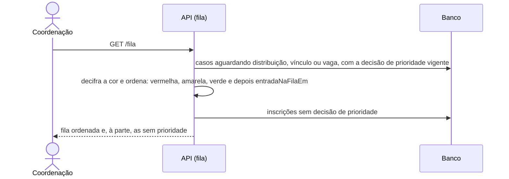

| Regra | Critério de aceitação |
| --- | --- |
| Só entra na fila o caso com decisão de prioridade vigente; o RF5 e as sinalizações não definem posição | Inscrito com prioridade confirmada entra na posição da prioridade; sinalização sem classificação não define posição |
| A ordem é calculada a cada consulta, a partir da decisão vigente | Uma nova prioridade confirmada atualiza a posição |
| O caso sai da fila quando recebe estagiário (RF21), é desligado (RF37) ou encerrado. A distribuição a um supervisor (RF20) não tira o caso da fila: ele continua `aguardando_vinculo` até o vínculo. As posições dos outros são recalculadas, e as decisões continuam no histórico do RF6 | Mudança de situação recalcula os afetados e preserva o histórico |
| Desempate por `entradaNaFilaEm` e, nela, pela ordem da inscrição | Na mesma prioridade, fica à frente quem se inscreveu primeiro |

**Decisões de projeto:**

1. **Situações da fila.** A fila inclui os casos aguardando distribuição, aguardando vínculo e aguardando vaga (RF38), porque todos esperam um estagiário. A ordenação acontece na aplicação, depois de decifrar a cor, como no RF18. Se o RF7 entrar antes do RF37 e do RF38, o filtro usa só as duas situações que já existem.
2. **Prancha 6-1, "Mudanças recentes".** O texto "saiu da fila: caso distribuído a…" passa a "saiu da fila: estagiário vinculado", como a regra acima. A prancha é ajustada.
3. **Histórico de mudanças da fila.** A prancha 6-1 mostra o botão "Histórico de mudanças", o painel "Mudanças recentes" ("passou da posição 2 para 3"), o selo "Posição atualizada" e, no acesso negado, "Tentativa registrada". Como a fila é calculada a cada consulta, as posições anteriores não ficam guardadas, e o `PerfisGuard` só nega o acesso, sem registrar. O "histórico preservado" do RF7 é o das decisões do RF6. A pergunta foi levada à FBr em 06/11:
    - **se a FBr não pedir o histórico,** o painel, o selo e a frase da tentativa saem da prancha;
    - **se pedir,** entra uma rota de histórico montada com as `decisoes_prioridade` e a auditoria da distribuição e do vínculo, sem a variação de posição.

    Até a resposta, a tela não tem esses elementos.

**Telas:** item "Fila de espera" no menu da coordenação (proposta levada à FBr em 06/11), com a posição, a prioridade e a entrada na fila, e a seção "Prioridade pendente". A marca "Voltou à fila" só aparece com o RF43, do Ciclo 6. Protótipo: [prancha 6-1](prototipos.md#rf7).

**Estados e mensagens esperadas — RF7:**
- **Fila vazia:** quando não houver casos elegíveis na fila, apresentar "Não há inscritos na fila de espera". A seção "Prioridade pendente" permanece disponível quando houver inscrições sem classificação clínica.
- **Prioridade pendente:** apresentar separadamente as inscrições ainda sem prioridade confirmada, com número da inscrição, nome e data da inscrição, sem atribuir posição na fila.
- **Acesso negado:** para usuários sem perfil autorizado, apresentar "Você não tem acesso à fila de espera". A API deve retornar HTTP 403 sem expor informações dos inscritos.
- **Mudança de prioridade:** após uma nova classificação clínica confirmada, apresentar a fila na ordem recalculada, sem afirmar que existe histórico das posições anteriores.
- **Histórico de mudanças:** não apresentar botão, painel de histórico, selo de posição atualizada ou mensagem de tentativa registrada enquanto essas funcionalidades não forem definidas pela FBr e suportadas pelo projeto.

**Dados de teste:** três casos vermelhos, amarelos e verdes inscritos em ordem trocada; dois casos amarelos inscritos em dias diferentes; um caso que muda de verde para vermelha; um caso `aguardando_vinculo` (continua na fila); um caso que recebe estagiário, um desligado e um encerrado (saem da fila); uma inscrição sem prioridade; a secretaria, o estagiário e o supervisor tentando abrir a fila (403); a lista do RF18 na mesma ordem depois da troca para o `FilaService`; um caso existente, criado antes da migration, com a `entradaNaFilaEm` preenchida pela data da inscrição.

---

### RF8 — Consultar posição individual na fila ([#155](https://github.com/mdsreq-fga-unb/REQ-2026.2-T02-ClinicaEscolaFBr/issues/155))

_Construída no Ciclo 4._

!!! warning "Mudança da DF55 (12/11/2026)"
    A FBr decidiu que o inscrito vê só "Em triagem", antes de ser chamado para o atendimento, ou "Em atendimento", depois de chamado, **sem a posição na fila** ([DF55](../requisitos/decisoes-fbr.md#df55)). A tabela, o diagrama e as regras abaixo já seguem a DF55. A ordem da fila continua sendo calculada pelo RF7 e vista só pela equipe.

**Rotas** (módulo `fila`, num controller próprio, separado do `GET /fila`, que tem os guards internos na classe):

- `GET /fila/minha-situacao` (pública, com o `VerificacaoGuard` do RF52). Usa só a inscrição ligada à verificação, em `req.inscricaoVerificada`, e devolve uma de três situações, pela `casos.situacao`. Não devolve a prioridade nem nenhum dado clínico. Responde com `Cache-Control: no-store`, porque a consulta pode ser feita num computador compartilhado.
- `GET /fila/situacao?numero=` (secretaria): a consulta presencial, para inscrições legadas sem e-mail ou pessoas que precisam de apoio na verificação (novas inscrições seguem a DF48) e para quem recebeu "procure a secretaria". Devolve a mesma resposta da rota pública, com a situação, sem a posição (DF55) e sem a cor (RNF17). A secretaria confere a identidade da pessoa no balcão, e a consulta fica na auditoria.

| Situação do caso | Resposta |
| --- | --- |
| Sem caso (inscrição sem prioridade), `aguardando_distribuicao`, `aguardando_vinculo` ou `aguardando_vaga` | Em triagem, sem a posição |
| `em_atendimento` | Em atendimento |
| `encerrado` ou `desligado_por_faltas` | Procure a secretaria |

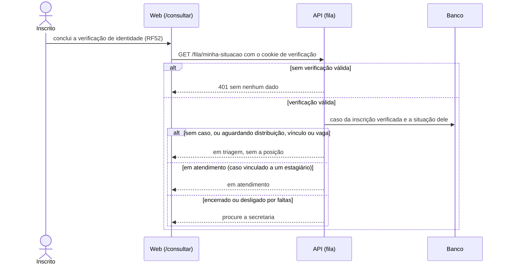

| Regra | Critério de aceitação |
| --- | --- |
| A rota só lê `req.inscricaoVerificada` e nunca recebe um id de inscrição (RNF6) | Depois da verificação, o inscrito vê a própria situação, sem a posição |
| Sem verificação válida, `401` sem dado | Sem verificação, a consulta é negada |
| A situação vem de `casos.situacao`, lida na hora; a posição não é calculada nem devolvida (DF55) | Depois do vínculo com um estagiário, uma nova consulta mostra "Em atendimento" |

**Decisões de projeto:** a resposta não traz a posição nem a cor (DF55 e RNF17). Ela vem com o aviso de que estar em triagem não garante data de atendimento, porque a captação é semestral (RNF7). O "procure a secretaria", para o caso encerrado ou desligado, continua como encaminhamento à secretaria e é uma proposta da equipe, registrada nas pendências de validação. O horário "Consulta feita em…" vem da API, junto com a resposta.

**Acessibilidade (RNF56 a RNF58):** o resultado, que carrega depois da verificação, é anunciado com `role="status"`. O aviso do 401 usa `role="alert"`, recebe o foco e traz o botão "Confirmar identidade", que recarrega a página para recomeçar a verificação (se o componente da #202 ganhar uma função para recomeçar, ela substitui o recarregamento). A situação tem ícone e texto, e não só cor, e a página é conferida a 320 px sem rolagem lateral.

**Telas:** página `/consultar`, depois dos dois passos do RF52. O componente da #202 já mostra o título, o aviso "Identidade confirmada" e o "Encerrar consulta"; o RF8 mostra só o cartão do resultado, com "Em triagem", "Em atendimento", o encaminhamento "Procure a secretaria" e o acesso negado. Para a secretaria, a consulta pelo número fica na lista de Pacientes. Protótipo: [pranchas 1-3 e 1-4](prototipos.md#rf8).

**Dados de teste:** inscrição sem caso e casos aguardando distribuição, vínculo ou vaga retornam `em_triagem`; após a chamada/vínculo, o caso `em_atendimento` aparece como tal. Encerrados ou desligados retornam `procure_secretaria`. Em todos esses estados, a resposta contém somente `numero`, `situacao` e `consultadaEm`, sem posição, prioridade ou dados clínicos. Testes verificam código real RF52, consulta após mudança do caso, query com outra inscrição ignorada, secretaria autorizada, demais perfis negados, expiração e encerramento. O teste de compreensão do aviso RNF7 com usuários permanece uma atividade de validação; o e2e verifica sua apresentação, não substitui esse teste humano.

**Dependências e riscos:** depende da verificação do RF52, das situações do caso mantidas pela distribuição/vínculo (RF20/RF21) e do encerramento/desligamento. A consulta presencial compõe a lista de Pacientes do RF22. A fila do RF7 continua interna à equipe; o RF8 não chama `FilaService`, não calcula posição e não altera a ordenação. A FBr confirmou os nomes "Em triagem" e "Em atendimento" na DF55. O encaminhamento "Procure a secretaria" para casos encerrados/desligados continua pendente de confirmação específica da FBr.

**Na implementação:** a API e a interface seguem a [DF55](../requisitos/decisoes-fbr.md#df55), registrada na [PR #257](https://github.com/mdsreq-fga-unb/REQ-2026.2-T02-ClinicaEscolaFBr/pull/257). O cartão mantém número da inscrição, selo com ícone/texto, aviso informativo da captação semestral em "Em triagem" e horário de Brasília com ícone de relógio. As imagens históricas das pranchas 1-3/1-4 ainda contêm a posição e os nomes anteriores: a DF55 substitui esses elementos, conforme o aviso na página dos protótipos. "Atualizar situação" permanece como ação adicional à prancha e busca uma resposta nova sem cache. Título, identidade confirmada e encerramento continuam no componente RF52. A consulta da secretaria permanece abaixo da lista RF22, sem substituí-la. Os testes de navegador cobrem 320, 360, 768, 1024, 1366 e 1920 px, axe e foco por teclado nas ações "Atualizar situação" e "Confirmar identidade" (RNF56–RNF58).

**Execução local dos testes:** `pnpm --filter @clinica/web exec playwright test -c playwright.rf8.config.ts` seleciona RF8 e RF52; o CI usa `playwright.config.ts` e executa a suíte geral. Ambas usam o capturador `e2e/smtp-local.mjs` iniciado pela configuração geral em loopback (`1026`, consulta HTTP `8026`): todos os e-mails dos e2e ficam nesse capturador, sem envio externo. Os cenários RF8 usam destinatários próprios para não ler mensagens de outros testes. Banco e demais variáveis devem apontar para infraestrutura descartável local; não usar dados reais.

---

## Distribuição de casos (CP5)

### RF18 — Listar casos aguardando distribuição ([#92](https://github.com/mdsreq-fga-unb/REQ-2026.2-T02-ClinicaEscolaFBr/issues/92))

_Construída no Ciclo 3._

**Rota:** `GET /casos/aguardando-distribuicao` (coordenação e supervisor). Devolve os casos com a situação `aguardando_distribuicao`, ordenados pela cor (vermelha, amarela, verde, decifrada na aplicação) e pela data da inscrição, da mais antiga para a mais recente. Cada item traz só o número da inscrição, o nome, a cor e a data.

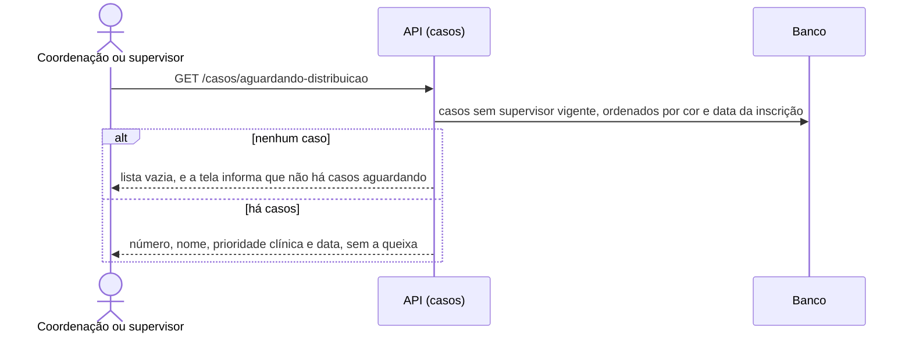

**Dados de teste:** casos vermelho, amarelo e verde, com datas diferentes; dois casos vermelhos para testar o desempate; um caso já distribuído (não aparece).

### RF19 — Registrar áreas de especialidade do supervisor ([#93](https://github.com/mdsreq-fga-unb/REQ-2026.2-T02-ClinicaEscolaFBr/issues/93))

_Construída no Ciclo 3._

**Removido em 24/10/2026.** A FBr não divide os atendimentos por área de especialidade ([DF26](../requisitos/decisoes-fbr.md#df26)). Não há rotas nem tabelas de áreas no Ciclo 3.

### RF20 — Distribuir caso a supervisor ([#94](https://github.com/mdsreq-fga-unb/REQ-2026.2-T02-ClinicaEscolaFBr/issues/94))

_Construída no Ciclo 3._

**Rotas:**
- `GET /supervisores/disponibilidade` (coordenação): devolve os supervisores ativos com a contagem de casos ativos (com atribuição vigente e situação diferente de `encerrado`) e o parâmetro `limite_casos_supervisor` (padrão de 50).
- `POST /casos/:id/supervisor` (coordenação): recebe o supervisor.

```mermaid
sequenceDiagram
    actor C as Coordenação
    participant A as API (casos)
    participant DB as Banco
    C->>A: GET /supervisores/disponibilidade
    A-->>C: supervisores com "casos ativos de limite"
    C->>A: POST /casos/:id/supervisor
    A->>DB: busca a atribuição vigente e conta os casos ativos do supervisor
    alt o caso já tem supervisor
        A-->>C: 409 use a transferência de caso (RF25)
    else supervisor no limite de casos
        A-->>C: 422 limite de casos atingido
    else supervisor abaixo do limite
        A->>DB: AtribuicaoSupervisor vigente com autor e data e situação aguardando_vinculo
        A->>DB: auditoria (RNF18)
        A-->>C: caso distribuído
    end
```

| Regra | Critério de aceitação |
| --- | --- |
| A contagem e a atribuição acontecem na mesma transação, com bloqueio da linha do supervisor | Supervisor no limite não recebe novo caso, mesmo com duas distribuições simultâneas |
| Limite vindo do parâmetro `limite_casos_supervisor` ([DF17](../requisitos/decisoes-fbr.md#df17)) | A lista mostra "12 de 50" e o motivo quando o supervisor está no limite |
| `@Perfis('coordenacao')` | Usuário sem perfil de coordenação não distribui casos |

**Dados de teste:** um supervisor com 12 casos; um supervisor com 50 casos (no limite); todos os supervisores no limite (mensagem de nenhum disponível); um caso já distribuído.

### RF21 — Vincular paciente a estagiário responsável ([#95](https://github.com/mdsreq-fga-unb/REQ-2026.2-T02-ClinicaEscolaFBr/issues/95))

_Construída no Ciclo 3._

**Rota:** `POST /casos/:id/estagiario` (supervisor responsável pelo caso). Mostra como opções apenas estagiários com a situação `ativo`, cada um com a quantidade de pacientes em atendimento, como no protótipo. O vínculo e a criação do prontuário (RF66) acontecem na mesma transação. O caso tem um único estagiário responsável vigente, garantido por índice único parcial; os estagiários de apoio só observam e não são vinculados ([DF27](../requisitos/decisoes-fbr.md#df27)).

```mermaid
sequenceDiagram
    actor S as Supervisor
    participant A as API (casos)
    participant DB as Banco
    S->>A: GET estagiários disponíveis
    alt nenhum estagiário ativo
        A-->>S: não há estagiários disponíveis para vínculo
    end
    S->>A: POST /casos/:id/estagiario
    A->>DB: confere se o supervisor é o responsável vigente do caso
    alt não é o supervisor do caso
        A-->>S: 403
    else é o supervisor do caso
        A->>DB: transação com VinculoEstagiario vigente (autor e data) e situação em_atendimento
        A->>DB: cria o Prontuario do ciclo (RF66)
        A->>DB: auditoria (RNF18)
        A-->>S: estagiário vinculado
    end
```

**Dados de teste:** um caso distribuído ao supervisor S; um supervisor T tentando vincular (recebe 403); um estagiário desativado, que não aparece nas opções.

---

### RF22 — Consultar responsáveis pelo caso ([#145](https://github.com/mdsreq-fga-unb/REQ-2026.2-T02-ClinicaEscolaFBr/issues/145))

_Construída no Ciclo 4._

**Rotas** (módulo `casos`):

- `GET /pacientes?busca` (secretaria e coordenação): a lista de Pacientes, com o nome do paciente, os nomes do estagiário e do supervisor e a situação do caso, sem dado clínico. Para a secretaria, a resposta traz só esses campos (RNF17); o número da inscrição vem só para a coordenação. É a página que hoje dá 404 no menu.
- `GET /casos/:id/responsaveis` (secretaria, coordenação e o estagiário e o supervisor responsáveis): os dois nomes, ou "pendente de distribuição" no que faltar.

```mermaid
sequenceDiagram
    actor U as Secretaria, coordenação ou responsável
    participant A as API (casos)
    participant DB as Banco
    U->>A: GET /casos/:id/responsaveis
    A->>DB: atribuição de supervisor e vínculo de estagiário vigentes
    alt estagiário ou supervisor sem vínculo com o caso
        A-->>U: 403
    else
        A-->>U: nome do supervisor e do estagiário, ou pendente de distribuição
    end
```

| Regra | Critério de aceitação |
| --- | --- |
| A resposta só traz nomes e a situação; nunca a queixa, a prioridade ou o prontuário (RNF17) | A consulta mostra os responsáveis, sem dados clínicos |
| Sem atribuição ou sem vínculo vigente, o campo vem como `null`, e a tela mostra "pendente de distribuição" | O caso sem um dos responsáveis aparece como pendente, sem nome |

**Telas:** lista de Pacientes (secretaria e coordenação) e ficha do paciente, já existente nos dados administrativos, com o quadro "Responsáveis". Protótipo: [prancha 2-3](prototipos.md#rf22).

**Dados de teste:** um caso em atendimento, um aguardando vínculo (sem estagiário) e um aguardando distribuição (sem os dois); um estagiário de outro caso (403).

**Na implementação (PR do RF22):**

- **Rotas:**
    - `GET /pacientes?busca` devolve `{ pacientes, cortada }`. A lista vem em ordem alfabética, com até 200 pacientes. Quando há mais, `cortada` é `true`, e a tela pede para buscar pelo nome. A busca usa `ILIKE` com `%` e `_` escapados.
    - `GET /casos/:id/responsaveis` não tem `@Perfis`: o serviço libera a secretaria e a coordenação, e o estagiário e o supervisor só nos casos com vínculo ou atribuição vigente. Para eles, o caso inexistente responde como o negado (`403`), sem revelar o que existe.
    - As duas rotas respondem com `Cache-Control: no-store`.
- **Número da inscrição:** não vem para a secretaria (RNF17). Vem para a coordenação e para o estagiário e o supervisor responsáveis, que já o veem nas próprias telas.
- **Situação de distribuição:** a prancha 2-3 tem três selos, calculados pelos responsáveis vigentes (`situacaoDistribuicao`, em `@clinica/shared`):
    - "Distribuído", com os dois responsáveis;
    - "Aguardando vínculo de estagiário", só com o supervisor;
    - "Pendente de distribuição", sem supervisor.

    O nome que falta aparece como "—".
- **Lista de Pacientes:**
    - a busca espera a pessoa parar de digitar (300 ms) antes de consultar a API;
    - a contagem "Mostrando N pacientes." é anunciada ao leitor de tela;
    - a tabela aparece a partir de 1024 px, e abaixo disso a lista vira cartões.
- **Ficha do paciente:**
    - o quadro "Responsáveis pelo caso" fica no topo, depois do aviso do conteúdo clínico;
    - a secretaria e a coordenação veem a ficha completa (RF55) a partir da distribuição;
    - antes da distribuição, e para o estagiário e o supervisor responsáveis, a ficha mostra só o quadro e a identificação, como na prancha;
    - o supervisor chega pelo nome do paciente em "Meus casos";
    - o quadro mostra a orientação de cada perfil: a coordenação vai à distribuição, e o supervisor vincula o estagiário pelo diálogo do RF21. O vínculo só é oferecido nas situações em que o RF21 o aceita (`aguardando_vinculo` e `aguardando_vaga`): o caso desligado por faltas volta pela reversão (RF38);
    - o botão "Transferir caso" da coordenação (RF25) passa para dentro do quadro, como na prancha 4-3.
- **Trilha do estagiário:** aponta para "Meus pacientes", que é do RF23 e já existe.

---

### RF23 — Consultar casos sob responsabilidade do estagiário ou supervisor ([#146](https://github.com/mdsreq-fga-unb/REQ-2026.2-T02-ClinicaEscolaFBr/issues/146))

_Construída no Ciclo 4._

**Rota:** `GET /casos/meus?estagiarioId` (estagiário e supervisor). A rota já existe para o supervisor ("Meus casos"); ela passa a aceitar o estagiário, que vê só os casos com vínculo vigente dele, e o supervisor ganha o filtro por estagiário.

```mermaid
sequenceDiagram
    actor U as Estagiário ou supervisor
    participant A as API (casos)
    participant DB as Banco
    U->>A: GET /casos/meus
    alt estagiário
        A->>DB: casos com vínculo vigente do estagiário
    else supervisor
        A->>DB: casos com atribuição vigente do supervisor, com o estagiário de cada um
    end
    A-->>U: paciente, prioridade e situação de cada caso
```

| Regra | Critério de aceitação |
| --- | --- |
| Filtro pelo vínculo vigente do estagiário | O estagiário vê só os casos vinculados a ele |
| Filtro pela atribuição vigente do supervisor, que já inclui os casos dos estagiários dele | O supervisor vê os casos dele e os dos estagiários |
| O acesso direto a um caso de outro segue o RF55, com `403` sem dado | Quem não tem vínculo não vê o caso na lista e tem o acesso direto negado |

**Telas:** "Meus pacientes" do estagiário (a página que hoje dá 404 depois da entrada, #160) e "Meus casos" do supervisor, com o filtro por estagiário. Protótipo: [prancha 4-1](prototipos.md#rf23).

**Dados de teste:** dois estagiários do mesmo supervisor, com dois casos cada; um caso aguardando vínculo; um estagiário sem casos (estado vazio); um estagiário abrindo o prontuário de um caso do outro (403).

**Na implementação (PR do RF23):**

- **Rota:** `GET /casos/meus` aceita o estagiário e o supervisor e responde com `Cache-Control: no-store`. O estagiário recebe só os casos com vínculo vigente dele; o supervisor, os casos com atribuição vigente dele, que já incluem os dos seus estagiários. O caso encerrado não entra. A resposta ganhou os campos:
    - `estagiarioId`: o estagiário do vínculo vigente;
    - `estagiarioAnterior` e `estagiarioAnteriorId`: o último estagiário do caso desligado por faltas (RF37), que a prancha mostra ao supervisor junto com a data;
    - `supervisor`: o supervisor do caso, mostrado na lista do estagiário.
- **Filtro por estagiário (diferença do projeto):** o projeto previa `GET /casos/meus?estagiarioId`. A lista do supervisor é pequena (o limite é de 50 casos ativos por supervisor, parâmetro do RF20), e as opções do filtro vêm dela, então o filtro é feito na tela e a rota não aceita o `estagiarioId`. A opção do filtro é o id do estagiário (`estagiarioId`, ou `estagiarioAnteriorId` no caso desligado), e o nome é só o rótulo: dois estagiários com o mesmo nome são duas opções. Se a opção escolhida sai da lista (o caso foi transferido, por exemplo), o filtro volta para "Todos".
- **Caso desligado por faltas (diferença da prancha 4-1):** a prancha mostra o caso desligado ("Desligado por faltas · Em 28/10/2026") também ao estagiário, com "Ver ficha" e "Abrir prontuário". O desligamento (RF37) encerra o vínculo, e o RF55 não deixa o estagiário sem vínculo vigente abrir o prontuário. Por isso o caso desligado aparece só para o supervisor, com o último estagiário e a data, e sai de "Meus pacientes". Quando a reversão do desligamento (RF38) volta o caso ao atendimento, com um novo vínculo, ele volta à lista do estagiário.
- **"Meus pacientes":** é a página inicial do estagiário (#160). Tem o resumo por situação, a tabela (a partir de 1024 px; abaixo disso, cartões), o supervisor de cada caso e o estado vazio. A prioridade clínica é a exceção do RNF17 para os próprios casos; a queixa e os dados de triagem não vêm na resposta.
- **"Meus casos":** ganhou as colunas da prancha e perdeu o número da inscrição (RNF17). O filtro é um grupo de opções ("Todos", cada estagiário e "Sem estagiário"), que só aparece quando há mais de uma opção, e a quantidade de casos filtrados é anunciada ao leitor de tela.
- **Acesso direto negado:** o prontuário de outro caso e a ficha de outro caso (`/pacientes/:casoId`, aberta por "Ver ficha") mostram a mesma tela da prancha 4-1: cadeado, orientação, "Voltar para meus pacientes" (ou "meus casos", ou "pacientes") e "Tentativa registrada em …", sem o nome do paciente. A tela é o componente `AcessoNegado`, que as duas páginas usam. Para a informação ser verdadeira, `GET /casos/:id/responsaveis` passou a registrar a tentativa negada na auditoria (`consultar_responsaveis_negada`, RNF52), como o prontuário já fazia. A ficha antes mostrava o aviso vermelho do RF22.
- **Evidência dos RNFs:** os testes de leitor de tela do RNF24 (VoiceOver) cobrem "Meus pacientes" e o filtro de "Meus casos", e o teste de carga do RNF21 inclui o estagiário abrindo "Meus pacientes" e o RF23 na lista de RFs.

---

### RF25 — Transferir caso para outro estagiário ou supervisor ([#147](https://github.com/mdsreq-fga-unb/REQ-2026.2-T02-ClinicaEscolaFBr/issues/147))

_Construída no Ciclo 4._

```mermaid
classDiagram
    direction LR
    class TransferenciaCaso {
      +uuid id
      +string tipo
      +uuid estagiarioAnteriorId
      +uuid estagiarioNovoId
      +uuid supervisorAnteriorId
      +uuid supervisorNovoId
      +string motivoCifrado
      +uuid transferidoPor
      +datetime transferidoEm
    }
    class Caso
    class VinculoEstagiario
    class AtribuicaoSupervisor
    Caso "1" -- "0..*" TransferenciaCaso : registra
    TransferenciaCaso --> VinculoEstagiario : encerra o anterior e cria o novo
    TransferenciaCaso --> AtribuicaoSupervisor : encerra a anterior e cria a nova
```

**Rota:** `POST /casos/:id/transferencia` (supervisor responsável ou coordenação). Recebe o `motivo`, obrigatório, e o novo estagiário, o novo supervisor ou os dois.

```mermaid
sequenceDiagram
    actor U as Supervisor responsável ou coordenação
    participant A as API (casos)
    participant DB as Banco
    U->>A: POST /casos/:id/transferencia com novo responsável e motivo
    alt supervisor tentando trocar o supervisor, ou estagiário de outro supervisor
        A-->>U: 403 com a orientação de pedir à coordenação
    else sem motivo ou caso não ativo
        A-->>U: 400 ou 422
    else válido
        A->>DB: transação: encerra o vínculo e, se for o caso, a atribuição vigentes
        A->>DB: cria o novo vínculo e, se for o caso, a nova atribuição
        A->>DB: TransferenciaCaso com os anteriores, os novos, o motivo e o autor
        A->>DB: auditoria (RNF18)
        A-->>U: transferido, com o mesmo prontuário
    end
```

| Regra | Critério de aceitação |
| --- | --- |
| O supervisor só troca o estagiário, e só para um estagiário dele, pela definição única do início da CP4; um estagiário sem caso vigente não é de nenhum supervisor, e a transferência para ele é feita pela coordenação | O supervisor transfere para outro estagiário dele, e o anterior perde o acesso |
| Estagiário de outro supervisor: `403`, com a orientação de pedir à coordenação | O supervisor A não transfere para estagiário do supervisor B |
| A coordenação troca o supervisor e, se indicar, o estagiário | A transferência pela coordenação registra os novos responsáveis e revoga o acesso dos anteriores |
| O prontuário do ciclo não muda; o acesso segue o vínculo vigente (RF55) | O novo responsável vê o histórico preservado (RF27) |
| `TransferenciaCaso` é só de inserção e fica no banco, mesmo sem a tela do RF26 | O histórico de transferências existe inteiro desde já |

**Decisões de projeto** (a conferir na inspeção):

1. **"Estagiário do supervisor".** O modelo não liga o estagiário a um supervisor: o vínculo é por caso. Vale a definição única do início da CP4, a mesma do RF11 e do RF37.
2. **Sessões futuras do estagiário anterior.** Ficam canceladas como `administrativo`, com a origem de quem transferiu (`supervisor` ou `coordenacao`), sem falta para ninguém, e a tela lista as sessões para reagendar com o novo estagiário.
3. **Supervisor no limite de 50 casos:** na transferência, a coordenação pode escolher o supervisor que já está no limite da [DF17](../requisitos/decisoes-fbr.md#df17), com um aviso ([DF50](../requisitos/decisoes-fbr.md#df50), de 11/11/2026). A distribuição de um caso novo (RF20) continua recusando esse supervisor.

**Telas:** "Transferir caso" na ficha do caso, com os casos ativos de cada opção, o motivo e a confirmação. Protótipo: [prancha 4-3](prototipos.md#rf25).

**Dados de teste:** um caso com sessões futuras transferido entre dois estagiários do mesmo supervisor; uma tentativa do supervisor A com estagiário do supervisor B e outra com um estagiário sem caso (403); um supervisor com 50 casos, desabilitado na escolha da coordenação; uma transferência pela coordenação para outro supervisor, com e sem novo estagiário; uma sem motivo; o estagiário anterior tentando abrir o prontuário depois (403).

**Na implementação (PR do RF25):**

- **Rotas:** `GET /casos/:id/transferencia` devolve o caso, os responsáveis atuais e as opções de quem pede: para o supervisor, os estagiários dele com conta ativa, sem o atual, com os pacientes em atendimento de cada um; para a coordenação, todos os estagiários ativos e os supervisores ativos, com os casos ativos e o limite. `POST /casos/:id/transferencia` faz a transferência. As duas rotas são do supervisor responsável e da coordenação; para a secretaria, o estagiário e outro supervisor, `403`.
- **Situações:** a transferência vale para o caso `em_atendimento`, `aguardando_vinculo` e `aguardando_vaga`. O caso que aguarda distribuição vai pela distribuição (RF20), e o desligado por faltas, pela reversão (RF38): `422` com a orientação. O caso sem estagiário não é transferido pelo supervisor, que usa "Vincular estagiário" (RF21).
- **Coordenação:** escolhe o novo supervisor e, se quiser, o novo estagiário, ou mantém o supervisor ("Manter …") e troca só o estagiário. Sem novo estagiário, o vínculo anterior é encerrado e o caso fica `aguardando_vinculo`, em "Meus casos" do novo supervisor, que vincula o estagiário pelo RF21 com o mesmo prontuário.
- **Mesmo prontuário:** o vínculo novo aponta para o prontuário do ciclo, que não muda; o acesso segue o vínculo e a atribuição vigentes (RF55).
- **Sessões futuras:** canceladas como `administrativo`, com a origem de quem transferiu e sem falta. A resposta traz o horário de cada uma, e o aviso de sucesso as lista para a secretaria reagendar em "Agendar sessão".
- **Motivo:** obrigatório, até 1.000 caracteres, gravado cifrado em `transferencias_caso.motivo_cifrado` (RNF51) e fora da auditoria. A auditoria `transferir_caso` (RNF18) guarda os responsáveis anteriores e os novos.
- **Histórico:** a migration `0013_transferencia_de_caso` cria a tabela `transferencias_caso` com a trava `impedir_alteracao_registro`, como as outras tabelas só de inserção. A consulta do histórico é do RF26, fora do MVP.
- **Concorrência:** o caso, o estagiário e o supervisor escolhidos são travados (`FOR UPDATE`) na transação; duas transferências ao mesmo tempo resultam em uma só, e a outra recebe `409`.
- **Telas:** o supervisor transfere em "Meus casos", no caso em atendimento com estagiário; a coordenação, pelo botão "Transferir caso" na ficha do paciente. O formulário segue a prancha 4-3: o resumo do caso, a escolha com os pacientes ou os casos de cada opção, o supervisor no limite desabilitado, o motivo, o aviso de quem perde e quem ganha o acesso, o resumo de erros com links para os campos e a confirmação com "De", "Para" e "Motivo".
- **Diferenças da prancha 4-3:**
    - O resumo mostra o número da inscrição, porque o prontuário não tem número próprio.
    - O botão fica em "Meus casos" e na ficha do paciente, porque o painel "Responsáveis pelo caso" do RF22 ainda não existe.
    - Não há a lista do histórico de transferências, que é do RF26.
    - A opção "Manter …" deixa a coordenação trocar só o estagiário, como o RF25 permite.
    - Para a coordenação, a lista mostra todos os estagiários ativos, e não só os do novo supervisor: pela definição de "estagiário do supervisor", quem ainda não tem caso não é de nenhum supervisor, e a transferência para ele é feita pela coordenação.
    - O supervisor no limite de 50 casos aparece com o aviso da prancha e pode ser escolhido pela coordenação ([DF50](../requisitos/decisoes-fbr.md#df50)). A confirmação diz com quantos casos ele fica, a auditoria `transferir_caso` registra `acimaDoLimite`, e o aviso de sucesso diz que o limite foi ultrapassado.

---

## Agendamento, confirmação e cancelamento (CP4)

As três features de sessão do Ciclo 4 mudam o status da `SessaoAtendimento` criada pelo RF10 e usam o `LinkConfirmacao` que ele já gera. O cancelamento ganha uma tabela própria, porque guarda a origem, a classificação e a justificativa.

```mermaid
classDiagram
    direction LR
    class SessaoAtendimento {
      +string status
      +datetime confirmadaEm
      +string confirmadaPor
    }
    class LinkConfirmacao {
      +string tokenHash
      +datetime expiraEm
      +datetime usadoEm
    }
    class CancelamentoSessao {
      +uuid id
      +string origem
      +string classificacao
      +string justificativaCifrada
      +uuid registradoPor
      +datetime registradoEm
      +int antecedenciaMinutos
    }
    SessaoAtendimento "1" -- "1" LinkConfirmacao : tem
    SessaoAtendimento "1" -- "0..1" CancelamentoSessao : cancelada por
```

- **Status da sessão:** `agendada`, `confirmada` (RF14), `cancelada` (RF15, RF16, RF25 e RF37), `realizada` e `falta_paciente` (RF34).
- **Ajustes no código do Ciclo 3 que acompanham os status novos.** Hoje todo status é tratado igual, e três lugares precisam mudar junto com o enum:
    - **Sobreposição (RNF9):** as restrições `sessoes_estagiario_sem_sobreposicao` e `sessoes_caso_sem_sobreposicao` ganham `WHERE (sessao_ocupa_horario(status))`, uma função que compara o status como texto (veja a regra única da migration, abaixo), como a migration `0003` já prevê. Sem isso, a sessão cancelada continua ocupando o horário, e não dá para remarcar.
    - **Agenda:** o `STATUS_QUE_OCUPAM_AGENDA` (`dominio-ciclo-3.ts`) passa a incluir `confirmada`, para a sessão confirmada continuar bloqueando conflitos.
    - **Sessão realizada:** o `marcarSessaoRealizada` e a próxima sessão dos dados administrativos (`prontuarios.service.ts`) passam a aceitar `agendada` ou `confirmada`. Sem isso, a sessão confirmada não poderia ser marcada como realizada nem receber evolução (RF28).
- **Regra única para a migration:** os três valores novos do enum (`confirmada`, `cancelada` e `falta_paciente`) e os três ajustes acima saem numa migration só, na **primeira PR que entrar entre o RF14, o RF15 e o RF34**. As outras reaproveitam. O valor novo do enum não pode ser usado na transação em que é criado, e o `migrate` do Drizzle aplica todas as migrations pendentes numa transação só (o `migrar.ts` da implantação usa esse `migrate`). Por isso, separar em duas migrations não basta: as restrições comparam o status como texto, sem consultar o valor novo do enum. Como a condição de uma restrição de exclusão só aceita funções imutáveis, e a conversão do enum para texto não é, a comparação `status::text <> 'cancelada'` fica numa função PL/pgSQL marcada como imutável, `sessao_ocupa_horario(status)`, e a restrição usa `WHERE (sessao_ocupa_horario(status))`. Foi assim que a migration `0007` entrou, no RF34. O mesmo vale para qualquer outro uso dos valores novos na mesma PR, como um `CHECK` ou um índice parcial com `'confirmada'` ou `'falta_paciente'`. Os testes de integração não pegam esse erro, porque o PGlite roda cada comando à parte; quem pega é o `pnpm db:migrate` do CI.
- **`CancelamentoSessao.origem`:** quem registrou o cancelamento: `link` (o paciente, sem login), `secretaria`, `estagiario`, `supervisor` (ausência do estagiário no RF16 e transferência no RF25) ou `coordenacao` (desligamento no RF37 e transferência no RF25). **`classificacao`:** `no_prazo`, `fora_do_prazo`, `administrativo`, `ausencia_estagiario` (RF16) ou `desligamento` (RF37). A `justificativaCifrada` pode ficar vazia só nas classificações `desligamento` e `administrativo` da transferência (RF25), em que o motivo fica no `DesligamentoPorFaltas` ou na `TransferenciaCaso`. O cancelamento por desligamento guarda o `desligamentoId`, para o RF38 listar as sessões a reagendar.
- **Parâmetros novos** (tabela `parametros`, configuráveis pela coordenação): `prazo_confirmacao_horas` (24, [DF45](../requisitos/decisoes-fbr.md#df45)), que substitui a constante usada hoje, e `antecedencia_minima_cancelamento_minutos` (60, [DF20](../requisitos/decisoes-fbr.md#df20)).
- **Link (RNF59):** o `expiraEm` passa a ser o início da sessão, porque o cancelamento pelo link vale até lá. O prazo de confirmação é conferido à parte. Hoje o link expira no fim do prazo de confirmação (`sessoes.service.ts`); a migration do RF14 (`0009`, porque a `0007` do RF34 e a `0008` do RF37 não trouxeram esse ajuste) atualiza o `expira_em` dos links ainda não usados das sessões futuras para o início da sessão, para os links já enviados também permitirem o cancelamento.
- **"Estagiário do supervisor"** (uma definição para o RF11, o RF25 e o RF37): o estagiário que tem vínculo vigente num caso cuja atribuição de supervisor vigente é desse supervisor. Um estagiário sem caso vigente não é de nenhum supervisor. Como um estagiário pode ter casos com supervisores diferentes, o que cada supervisor vê dele se limita aos casos do próprio supervisor (RNF16).

### RF10 — Agendar sessão do paciente ([#96](https://github.com/mdsreq-fga-unb/REQ-2026.2-T02-ClinicaEscolaFBr/issues/96))

_Construída no Ciclo 3._

**Rota:** `POST /sessoes` (secretaria, ou o estagiário responsável pelo caso). Recebe o caso, o início e, opcionalmente, o término. Sem término, ele é calculado com o parâmetro `duracao_sessao_minutos` (padrão de 50). O fim do intervalo para anotações é `termino + intervalo_anotacoes_minutos` (padrão de 10) ([DF18](../requisitos/decisoes-fbr.md#df18)).

**Escopo no Ciclo 3:** o agendamento gera o link de confirmação. Com e-mail como canal preferencial, a API envia o link por e-mail; com WhatsApp ou ligação, a resposta traz a mensagem pronta e o endereço `https://wa.me/55<celular>?text=<mensagem>`, e a interface mostra o botão "Enviar pelo WhatsApp", que chama `POST /sessoes/:id/whatsapp` para registrar `mensagemWhatsappEm` ([DF24](../requisitos/decisoes-fbr.md#df24)). O SMS não é usado. A página que confirma a presença entra com o RF14, no Ciclo 4. Com a [DF48](../requisitos/decisoes-fbr.md#df48), a inscrição não pede mais o canal, e o botão do WhatsApp só aparece nas inscrições anteriores a ela com WhatsApp ou ligação.

```mermaid
sequenceDiagram
    actor U as Secretaria ou estagiário responsável
    participant A as API (agendamento)
    participant DB as Banco
    participant M as E-mail
    U->>A: POST /sessoes com caso, início e término opcional
    A->>DB: confere o perfil, o vínculo vigente e o estagiário responsável
    alt sem estagiário vinculado, ou usuário sem permissão
        A-->>U: 403 ou 422 com o motivo
    else término menor ou igual ao início
        A-->>U: 422 término deve ser posterior ao início
    else sobreposição com sessão do estagiário ou do paciente
        A-->>U: 409 conflito de horário
    else horário livre
        A->>DB: SessaoAtendimento agendada e LinkConfirmacao
        A->>DB: auditoria (RNF10)
        alt canal preferencial e-mail
            A->>M: envia o link de confirmação de presença
            A-->>U: sessão agendada, link enviado por e-mail
        else canal WhatsApp ou ligação
            A-->>U: sessão agendada, com a mensagem pronta e o endereço do WhatsApp
        end
    end
```

**Garantia no banco (RNF9):** além da verificação na API, duas restrições de exclusão na tabela `sessoes_atendimento` impedem a sobreposição mesmo com duas requisições simultâneas; a API traduz a violação em 409.

**Regra de sobreposição:** para o mesmo estagiário, existe conflito quando outra sessão `agendada` tem `inicio < novoFimIntervalo` e `fimIntervaloAnotacoes > novoInicio`; para o mesmo paciente, quando `inicio < novoTermino` e `termino > novoInicio`. Como as desigualdades são estritas, uma sessão do estagiário das 14h00 às 14h50, com anotações até as 15h00, não conflita com outra que começa às 15h00.

**Dados de teste:** uma sessão existente das 14h00 às 14h50, com anotações até as 15h00, e as tentativas do mesmo estagiário às 14h50 (bloqueada) e às 15h00 (permitida); um paciente com e-mail e outro com WhatsApp como canal; um paciente sem estagiário; um estagiário que não é o responsável; um término anterior ao início.

---

### RF11 — Consultar agenda de sessões do estagiário ([#141](https://github.com/mdsreq-fga-unb/REQ-2026.2-T02-ClinicaEscolaFBr/issues/141))

_Construída no Ciclo 4._

**Rota:** `GET /agenda?estagiarioId&de&ate&status` (estagiário: só a própria agenda, com o `estagiarioId` ignorado; supervisor: só os estagiários que ele supervisiona). Por padrão, mostra as sessões agendadas, confirmadas e realizadas da semana; as canceladas e as faltas aparecem só quando o filtro as pede.

```mermaid
sequenceDiagram
    actor U as Estagiário ou supervisor
    participant A as API (agendamento)
    participant DB as Banco
    U->>A: GET /agenda com período, situação e estagiário
    alt estagiário
        A->>DB: sessões do próprio estagiário no período, só dos casos com vínculo vigente dele
    else supervisor
        A->>DB: confere se o estagiário tem caso vigente supervisionado por ele
        alt não supervisiona
            A-->>U: 403, sem nenhuma sessão
        end
        A->>DB: sessões do estagiário no período, só dos casos com atribuição vigente do supervisor
    end
    A-->>U: nome do paciente, data, início, término e situação (RNF13)
```

| Regra | Critério de aceitação |
| --- | --- |
| Filtro de período (`de`, `ate`) e de situação, com o padrão agendada, confirmada e realizada | O estagiário vê as próprias sessões, com filtro por período |
| "Estagiário do supervisor" segue a definição única do início da CP4 | O supervisor vê a agenda dos estagiários dele |
| Para o supervisor, a consulta filtra as sessões pelos casos com atribuição vigente dele; as sessões do mesmo estagiário em casos de outro supervisor não vêm (RNF16) | O supervisor vê só as sessões dos casos que supervisiona |
| `403` sem sessão para quem não supervisiona; o estagiário nunca vê a agenda de outro | Sem vínculo de supervisão, não acessa a agenda |
| Para o estagiário, a consulta filtra as sessões pelos casos com vínculo vigente dele, inclusive as sessões passadas (RNF16, RF25) | Encerrado o vínculo, por transferência ou desligamento, as sessões do caso e o nome do paciente deixam de aparecer |

**Telas:** item "Agenda" do estagiário e, para o supervisor, "Agenda" com a escolha do estagiário (proposta levada à FBr). A sessão realizada leva ao prontuário. Depois da entrada, o estagiário cai em `/meus-pacientes`, construída pelo RF23 (#160). A "Agenda" da secretaria, que também dá 404 hoje, é construída pelo RF14, com a seção "Sem confirmação". Protótipo: [prancha 4-2](prototipos.md#rf11).

**Na implementação (PR do RF11):**

- **Rotas:** `GET /agenda` e `GET /agenda/estagiarios` (só o supervisor, para o campo "Estagiário") ficam num controller próprio, como pediu a inspeção, separado da `GET /sessoes/agenda` do RF10, que mostra só os horários ocupados. O período vai até 93 dias.
- **"Esta semana":** de segunda a domingo. Os dias úteis aparecem sempre, com "Nenhuma sessão neste dia"; o sábado e o domingo, só quando têm sessão, porque o agendamento não proíbe o fim de semana. Nos períodos maiores que uma semana, só os dias com sessão.
- **Situação:** "Cancelada" e "Falta do paciente" entram como opções desmarcadas, como o projeto já previa (a prancha 4-2 deixava "a confirmar").
- **Ações de cada linha:** "Abrir prontuário" na sessão realizada; "Registrar falta do paciente" na sessão que já passou sem registro, para o estagiário com vínculo vigente (o diálogo do RF34); "Cancelar sessão" nas futuras, com o diálogo do RF15 e do RF16; para o supervisor, "Registrar ausência do estagiário". As ações seguem a mesma regra das rotas.
- **Página:** `/agenda` mostra o conteúdo de cada perfil: "Sem confirmação" para a secretaria (RF14), a agenda do estagiário e a "Agenda dos estagiários" do supervisor, com o escolhido no endereço (`?estagiario=`). A coordenação não tem agenda. O supervisor ganha o item "Agenda" no menu, entre "Distribuição de casos" e "Meus casos", como na proposta da prancha.
- **Acesso negado:** a tentativa do supervisor de abrir a agenda de um estagiário que não é dele fica na auditoria (`consultar_agenda_negada`), como diz a tela.
- **Fim do vínculo:** a agenda do estagiário segue a mesma regra do prontuário: só os casos com vínculo vigente. A agenda não guarda um histórico dos antigos pacientes; se a FBr pedir esse histórico, ele precisa ser validado como exceção ao RNF16.

**Dados de teste:** um estagiário com sessões na semana em todas as situações; um período sem sessões; um supervisor com dois estagiários; um estagiário com casos de dois supervisores (cada um vê só as sessões dos próprios casos); um supervisor pedindo a agenda de um estagiário de outro (403); um estagiário com o vínculo encerrado e com o caso transferido, com as sessões do caso fora da agenda.

---

### RF14 — Confirmar presença em sessão agendada ([#142](https://github.com/mdsreq-fga-unb/REQ-2026.2-T02-ClinicaEscolaFBr/issues/142))

_Construída no Ciclo 4._

**Rotas:**

- `GET /confirmacao/:token` (pública): devolve só a data e o horário da sessão, o primeiro nome do paciente (RNF59), a situação (`agendada` ou `confirmada`) e se ainda dá para confirmar.
- `POST /confirmacao/:token/confirmar` (pública).
- `GET /sessoes/sem-confirmacao` (secretaria): sessões futuras agendadas cujo prazo terminou sem confirmação, com o caminho para os contatos do paciente, que ficam na ficha, e não na linha (RNF13 e prancha 2-1). A prancha 2-1 mostrava também o canal preferencial; com a [DF48](../requisitos/decisoes-fbr.md#df48), a inscrição não pede mais o canal, e a coluna saiu em 12/11/2026. A tela orienta o contato pelo e-mail ou pelo celular.
- `POST /sessoes/:id/confirmacao` (secretaria): confirmação feita por telefone, como no protótipo.

```mermaid
sequenceDiagram
    actor P as Paciente
    participant W as Web (/confirmacao)
    participant A as API (agendamento)
    participant DB as Banco
    P->>W: abre o link recebido no agendamento
    W->>A: GET /confirmacao/:token
    A->>DB: busca o link pelo hash do token
    alt link inexistente, vencido ou sessão cancelada
        A-->>W: link não é mais válido (mesma resposta)
    else sessão já confirmada
        A-->>W: presença já confirmada, só com a opção de cancelar (RF15)
    else sessão agendada
        A-->>W: data, horário e primeiro nome do paciente, com o prazo para confirmar
    end
    P->>W: confirmar presença
    W->>A: POST /confirmacao/:token/confirmar
    alt sessão já confirmada
        A-->>W: 409 presença já confirmada
    else depois do prazo (início menos prazo_confirmacao_horas)
        A-->>W: 422 prazo encerrado, procure a secretaria
    else dentro do prazo
        A->>DB: status confirmada, confirmadaEm e confirmadaPor = link
        A->>DB: auditoria (RNF10)
        A-->>W: presença confirmada
    end
```

| Regra | Critério de aceitação |
| --- | --- |
| Confirma se `agora <= inicio - prazo_confirmacao_horas` | Sessão às 14h00: a confirmação até as 14h00 do dia anterior muda para "confirmada" e é auditada |
| Depois disso, `422` com a orientação de procurar a secretaria | A confirmação depois das 14h00 do dia anterior é recusada |
| A lista da secretaria é uma consulta: status `agendada`, `inicio` futuro e prazo vencido; nenhuma falta é criada | Sessão sem confirmação no fim do prazo vai para a secretaria, sem falta |
| Sessão `cancelada` responde como link não mais válido | Sessão cancelada não pode ser confirmada |
| Sessão `confirmada`: a página informa que a presença já foi confirmada e só oferece cancelar; uma nova confirmação responde `409` (RNF59) | Depois da confirmação, o link não confirma de novo e continua permitindo cancelar |
| A página do link mostra só a data, o horário e o primeiro nome do paciente, sem o nome do estagiário (RNF59) | O link não expõe outros dados da sessão |

**Decisão de projeto:** não há tarefa agendada. A sinalização para a secretaria é a própria consulta, então a sessão aparece na lista assim que o prazo vence.

**Telas:** página pública `/confirmacao/:token`, com os sete estados do protótipo, compartilhada com o RF15; a página "Agenda" da secretaria (`/agenda`), construída nesta feature, com a seção "Sem confirmação", o link "Ver contatos do paciente" e "Registrar confirmação". Protótipo: [pranchas 1-5, 1-6](prototipos.md#rf14-rf15-link) e [2-1](prototipos.md#rf14).

**O que fica para depois (registrado na PR do RF14):**

- o botão "Não vou poder ir: cancelar sessão" e os três estados do cancelamento entram com o RF15, para a página não ter um botão sem função (entraram na PR do RF15 e do RF16);
- a tabela diária "Hoje" da prancha 2-1 não tem rota neste projeto e fica como pendência da Agenda da secretaria;
- o rodapé "Dúvidas: [TELEFONE DA CLÍNICA]" das pranchas 1-5 e 1-6 fica de fora até a clínica informar o número;
- **a configuração dos parâmetros pela coordenação** (apontada na revisão da PR #217): o `prazo_confirmacao_horas` fica na tabela `parametros`, com o padrão de 24 horas (DF45), e a API lê o valor a cada uso, então a mudança vale sem nova versão. Mas nenhuma tela ou rota deixa a coordenação alterar os parâmetros, nem este nem os do Ciclo 3 (`duracao_sessao_minutos`, `intervalo_anotacoes_minutos`, `limite_casos_supervisor` e `validade_convite_horas`), e nenhum RF cobre essa configuração. Até uma feature própria, a alteração é feita direto na tabela, por quem administra a implantação, a pedido da coordenação.

**Dados de teste:** uma sessão às 14h00 de depois de amanhã (confirma); uma às 14h00 de amanhã, com o relógio às 14h01 de hoje (recusa); uma já confirmada (informa e só oferece cancelar; nova confirmação, 409); uma cancelada; um token inexistente; uma sessão sem confirmação com o prazo vencido (aparece na lista).

---

### RF15 — Registrar cancelamento de sessão pelo paciente ([#143](https://github.com/mdsreq-fga-unb/REQ-2026.2-T02-ClinicaEscolaFBr/issues/143))

_Construída no Ciclo 4._

**Rotas:**

- `POST /confirmacao/:token/cancelar` (pública): o paciente cancela pelo link, com a justificativa obrigatória.
- `POST /sessoes/:id/cancelamento` (secretaria; estagiário responsável só no tipo administrativo): recebe a justificativa e o tipo, `pedido_paciente` ou `administrativo`. É a **única rota do cancelamento administrativo para remarcação**, também quando ele vem do diálogo do estagiário (RF16); o supervisor não registra esse tipo. O cancelamento administrativo avisa o paciente pelo mesmo caminho do RF16, porque a sessão muda sem o pedido dele; o pedido do paciente não gera aviso.

```mermaid
sequenceDiagram
    actor U as Paciente (link), secretaria ou estagiário
    participant A as API (agendamento)
    participant F as FaltasService (CP9)
    participant DB as Banco
    U->>A: cancelamento com justificativa
    alt sem justificativa
        A-->>U: 400 justificativa
    else sessão já iniciada, realizada, cancelada ou com falta
        A-->>U: 422 a sessão não pode mais ser cancelada
    else válido
        A->>A: antecedência = início - agora
        alt tipo administrativo
            A->>A: classificação administrativo
        else antecedência >= antecedencia_minima_cancelamento_minutos
            A->>A: classificação no_prazo
        else
            A->>A: classificação fora_do_prazo
        end
        A->>DB: transação: status cancelada, CancelamentoSessao, link usado e auditoria (RNF10)
        opt fora_do_prazo
            A->>F: registrarCancelamentoForaDoPrazo(sessão), na mesma transação
        end
        A-->>U: sessão cancelada, com a classificação
    end
```

| Regra | Critério de aceitação |
| --- | --- |
| Antecedência >= 60 minutos: `no_prazo` | Sessão às 14h00: o cancelamento até as 13h00 fica "no prazo", com a justificativa, e é auditado |
| Antecedência < 60 minutos, antes do início: `fora_do_prazo`, que vira falta pelo `FaltasService` na mesma transação | A partir das 13h01, fica "fora do prazo" e gera a falta para a CP9 |
| Justificativa obrigatória, cifrada | Sem justificativa, não registra, e o campo é indicado |
| O link recebe `usadoEm` na mesma transação do cancelamento e da auditoria, com `UPDATE` condicional (`usado_em is null`), e toda operação depois disso responde como link não mais válido (RNF59) | Pelo link, o paciente cancela, e depois o link não permite mais nada |
| `inicio <= agora`, ou status `realizada`, recusa | Sessão iniciada ou realizada não pode ser cancelada |
| Tipo `administrativo` só pela secretaria ou pelo estagiário, sem falta, qualquer que seja a antecedência | O cancelamento administrativo não gera falta |

**Decisão de projeto:** o valor do parâmetro é lido no momento do cancelamento e guardado com a antecedência em minutos no `CancelamentoSessao`, para a classificação poder ser conferida depois, mesmo que o parâmetro mude. Valem as regras de desmarcação da DF20, mais recentes que as do contrato da clínica (12 horas).

**Telas:** "Cancelar" na página do link, com a justificativa; diálogo "Cancelar sessão" na agenda da secretaria e do estagiário, com o tipo. Protótipo: [pranchas 1-5, 1-6](prototipos.md#rf14-rf15-link) e [2-2](prototipos.md#rf15-rf16).

**Na implementação (PR do RF15 e do RF16):**

- **Migration `0010`:** só o parâmetro `antecedencia_minima_cancelamento_minutos` (60). A tabela `cancelamentos_sessao` veio na `0008`, do RF37, e o status `cancelada` e a liberação do horário vieram na `0007`, do RF34.
- **Onde fica o botão:** "Cancelar sessão" entra nas listas de sessões que já existem: "Sessões do ciclo" na ficha do paciente, para a secretaria, e as sessões do prontuário, para o estagiário e o supervisor do caso. Só aparece nas sessões agendadas ou confirmadas que ainda não começaram, e só para quem a API aceita, pela mesma regra das rotas, como os botões de falta do RF34. A Agenda da prancha 2-2 depende da tabela "Hoje" e do RF11, e passa a usar o mesmo diálogo quando eles forem feitos (a agenda do estagiário e a do supervisor já usam, desde o RF11; a tabela "Hoje" da secretaria continua pendente). Por isso, a tela "Você não tem acesso a esta sessão" da prancha não tem onde aparecer: quem não tem acesso não vê o botão, e a API responde 403.
- **Justificativa:** até 1.000 caracteres, o mesmo limite do motivo da falta (a prancha 1-5 deixava "a confirmar"). Fica cifrada no `CancelamentoSessao` e não aparece em nenhuma lista nem na auditoria, que guarda a classificação, a origem, a antecedência e o id do cancelamento, onde o motivo está (RNF51, CFP art. 9º). Nenhuma tela mostra a justificativa por enquanto.
- **Resultado na página do link:** quando o cancelamento fica fora do prazo, a mensagem final diz que ele conta como falta (a prancha 1-5 deixava "a confirmar").
- **A sessão não pode mais ser cancelada:** realizada, cancelada ou com falta (422, com o motivo); pelo link, a mesma resposta do link inválido (RNF59).

**Dados de teste:** sessão às 14h00 cancelada às 12h59, às 13h00 e às 13h01; uma já iniciada; uma sem justificativa; um cancelamento administrativo 10 minutos antes; o link usado depois do cancelamento; um estagiário que não é o responsável tentando cancelar (403).

---

### RF16 — Registrar cancelamento de sessão pelo estagiário ([#144](https://github.com/mdsreq-fga-unb/REQ-2026.2-T02-ClinicaEscolaFBr/issues/144))

_Construída no Ciclo 4._

**Rota:** `POST /sessoes/:id/ausencia-estagiario` (estagiário responsável, supervisor responsável ou secretaria). Recebe o motivo, obrigatório, e registra só a ausência real do estagiário. O cancelamento administrativo para remarcação, que o RF16 também distingue, usa a rota do RF15 (`POST /sessoes/:id/cancelamento` com o tipo `administrativo`), feita pela secretaria ou pelo estagiário, como dizem os dois requisitos; assim, o tipo tem uma implementação só, que também avisa o paciente.

```mermaid
sequenceDiagram
    actor U as Estagiário, supervisor ou secretaria
    participant A as API (agendamento)
    participant DB as Banco
    participant M as E-mail
    U->>A: POST /sessoes/:id/ausencia-estagiario com motivo
    alt sem vínculo com a sessão
        A-->>U: 403
    else sem motivo, ou sessão já iniciada
        A-->>U: 400 ou 422
    else válido
        A->>DB: transação: status cancelada, CancelamentoSessao (ausencia_estagiario, com a origem de quem registrou) e auditoria (RNF10)
        alt canal e-mail
            A->>M: avisa o paciente do cancelamento
            A-->>U: registrado, paciente avisado por e-mail
        else WhatsApp ou ligação
            A-->>U: registrado, com a mensagem pronta para a secretaria (DF24)
        end
    end
```

| Regra | Critério de aceitação |
| --- | --- |
| O registro muda o status e avisa o paciente por e-mail ([DF48](../requisitos/decisoes-fbr.md#df48)) | O registro com motivo atualiza a sessão e dispara a notificação ao paciente |
| `403` para quem não é o estagiário, o supervisor do caso ou a secretaria | Quem não tem vínculo com a sessão não registra a ausência |
| `ausencia_estagiario` fica guardado para o RF39 e o RF40, dos Ciclos 5 e 6 | A ausência real conta nas faltas do estagiário |
| `administrativo` vem só da rota do RF15 e não entra na contagem do estagiário; o supervisor não registra esse tipo | O cancelamento para remarcar não conta |

**Decisão de projeto:** o aviso ao paciente usa o mesmo caminho do link do RF10 (e-mail automático ou mensagem pronta para o WhatsApp). O RF17, do Ciclo 5, completa a notificação. Isso fica registrado como entrega parcial (R1.7).

**Telas:** o mesmo diálogo "Cancelar sessão" do RF15, com a opção "Ausência do estagiário"; a opção "Para remarcar" do diálogo chama a rota do RF15. Protótipo: [prancha 2-2](prototipos.md#rf15-rf16).

**Na implementação (PR do RF15 e do RF16):**

- **Aviso ao paciente:** com a DF48, a inscrição não pede mais o canal preferencial. A ausência e o cancelamento para remarcar avisam por e-mail sempre que o paciente tem e-mail, sem o motivo do cancelamento (CFP art. 9º). Sem e-mail, ou se o envio falhar, a tela diz que o paciente ainda não foi avisado e quem deve entrar em contato. O aviso à secretaria com o botão "Enviar pelo WhatsApp" fica para o RF17, como na prancha 2-2 (entrega parcial, R1.7).
- **Quem vê o quê no diálogo:** a secretaria vê as três opções; o estagiário responsável, a ausência e o cancelamento para remarcar; o supervisor do caso, só a ausência. O vínculo e a atribuição vigentes valem, e não o estagiário de cada sessão.

**Dados de teste:** uma ausência real registrada pelo estagiário e outra pelo supervisor; um cancelamento administrativo pela secretaria, pela rota do RF15; um paciente com e-mail e outro sem; uma falha no envio do e-mail; um estagiário e um supervisor de outro caso (403); uma sessão já iniciada.

---

### RF17 — Notificar paciente sobre ausência do estagiário ([#223](https://github.com/mdsreq-fga-unb/REQ-2026.2-T02-ClinicaEscolaFBr/issues/223))

_Ciclo 5._

**O que já existe:** o cancelamento por ausência do estagiário (RF16, #144) já manda o e-mail ao paciente depois do commit, sem o motivo, e devolve `avisoAoPaciente` (`email_enviado`, `sem_email` ou `email_nao_enviado`). Hoje esse resultado só aparece na tela de quem cancelou e não fica gravado.

**Rotas** (módulo `agendamento`):

- O `POST /sessoes/:id/ausencia-estagiario` (RF16) passa a gravar o aviso no cancelamento (`aviso_paciente`), **dentro da transação do RF16**: `sem_email` quando o paciente não tem e-mail, ou `envio_pendente` antes de mandar o e-mail. Depois do commit, o envio muda o valor para `email_enviado` ou `email_nao_enviado`.
- `GET /cancelamentos/avisos-pendentes` (secretaria): os cancelamentos por ausência do estagiário com `aviso_paciente` `sem_email`, `email_nao_enviado` ou `envio_pendente` há mais de 5 minutos (o processo caiu entre o commit e o envio), sem `aviso_manual_em`, de sessões ainda não passadas há mais de 7 dias. Cada um traz o nome do paciente, a data e o horário, o motivo da pendência e a mensagem pronta. Com celular, traz também o endereço do WhatsApp com a mensagem, montado com o `celularParaWhatsapp` do agendamento (`horario.ts`), o mesmo do RF10; sem celular (inscrição anterior à DF48 com só o e-mail, quando o e-mail falha), traz `celular: null`.
- `POST /cancelamentos/:id/aviso` (secretaria): registra que o paciente foi avisado (`aviso_manual_em`, `aviso_manual_por` e `aviso_manual_canal`, `whatsapp` ou `outro`), como o `POST /sessoes/:id/whatsapp` do agendamento. Responde `409` quando o `aviso_manual_em` já existe, para duas pessoas da secretaria não registrarem o mesmo aviso.

```mermaid
sequenceDiagram
    actor E as Estagiário
    participant A as API (agendamento)
    participant M as E-mail
    participant DB as Banco
    actor S as Secretaria
    E->>A: POST /sessoes/:id/ausencia-estagiario
    A->>DB: transação do RF16 (sessão cancelada, cancelamento)<br/>e aviso_paciente = envio_pendente ou sem_email
    opt paciente com e-mail, depois do commit
        A->>M: e-mail sem o motivo
        alt envio falhou
            A->>DB: aviso_paciente = email_nao_enviado
        else
            A->>DB: aviso_paciente = email_enviado
        end
    end
    S->>A: GET /cancelamentos/avisos-pendentes (Agenda)
    A-->>S: mensagem pronta, com o link do WhatsApp se houver celular
    S->>A: POST /cancelamentos/:id/aviso (whatsapp ou outro)
    A->>DB: aviso_manual_em, por e canal, e auditoria
```

| Regra | Critério de aceitação |
| --- | --- |
| O e-mail sai no mesmo pedido, depois do commit, com dia da semana, data e horário, e sem o motivo (CFP art. 9º) | O cancelamento por ausência envia o e-mail no mesmo momento, sem o motivo da ausência |
| O texto diz "Este cancelamento não conta como falta" e "A secretaria vai entrar em contato para marcar outro horário" (prancha 5-1) | O e-mail informa que não conta como falta e que a secretaria vai entrar em contato |
| `sem_email` é gravado na transação do RF16 e entra na lista | Para paciente sem e-mail, a secretaria recebe o aviso com o botão e a mensagem pronta |
| A falha do envio não desfaz a transação do RF16; `email_nao_enviado`, e o `envio_pendente` que ficou parado, entram na lista | Se o envio falhar, o cancelamento continua registrado e a secretaria recebe o aviso |

**Decisões de projeto:** a mensagem do WhatsApp tem o mesmo texto do e-mail, montada por uma função só, usada pelos dois. O aviso pendente sai da lista quando a secretaria registra o aviso: pelo "Enviar pelo WhatsApp", como no agendamento (DF24), ou, sem celular, pelo "Registrar que o paciente foi avisado", depois de falar com ele por outro meio da ficha (ligação ou presencialmente). Não há reenvio automático do e-mail: a falha vai para a secretaria. O aviso do cancelamento para remarcar continua só por e-mail, como no RF16, porque a nova sessão já leva o aviso do agendamento (RF10). A coluna nova não muda as linhas antigas: os cancelamentos anteriores à migration ficam com `aviso_paciente` nulo e fora da lista. Como o valor do cancelamento novo é gravado na própria transação do RF16, o nulo nunca significa "perdeu o aviso"; a migration também põe um `check` que exige `aviso_paciente` nos cancelamentos por ausência criados depois dela. O `check` é criado com `NOT VALID`, que vale para as linhas novas sem conferir as antigas, em vez de comparar o `registrado_em` com uma data fixa.

**Telas:** cartão "Avise o paciente sobre o cancelamento" na Agenda da secretaria, acima das sessões sem confirmação (RF14), com um item por aviso pendente: o aviso laranja "… não tem e-mail cadastrado e ainda não foi avisada" ou o vermelho "Não foi possível enviar o e-mail a …. A sessão de … continua cancelada.", a "Mensagem pronta" e "Enviar pelo WhatsApp", que abre o link numa aba nova e registra o envio. Sem celular, no lugar do botão aparece "O paciente não tem celular cadastrado. Avise por outro contato da ficha.", com o link "Ver contatos" e o botão "Registrar que o paciente foi avisado". No celular, o botão ocupa a largura toda. Protótipo: [prancha 5-1](prototipos.md#rf17).

**Acessibilidade (RNF56 a RNF58):** cada aviso tem ícone e texto; o botão diz para quem é a mensagem (`aria-label="Enviar pelo WhatsApp para …"`); depois do envio, o item sai com uma mensagem em `role="status"`.

**Dados de teste:** um cancelamento por ausência com e-mail (enviado, fora da lista); um paciente sem e-mail (inscrição anterior à DF48); um envio que falha (servidor de e-mail de teste recusando); um envio que falha para um paciente sem celular (aviso sem o botão do WhatsApp e com o registro manual); um cancelamento parado em `envio_pendente` há mais de 5 minutos (entra na lista); o "Enviar pelo WhatsApp" tirando o item da lista; o e-mail e a mensagem conferidos sem o motivo; o estagiário e a coordenação na rota dos avisos (403).

**Dependências e riscos:** depende do RF16 (#144), já integrado. O reagendamento (RF12) é posterior ao MVP.

**Na implementação (PR do RF17):**

- **Migration:** a `0020_aviso_ausencia_estagiario`, depois dos índices do RF56 (`0019`), cria os enums `aviso_paciente` e `canal_aviso_manual` e as quatro colunas do aviso em `cancelamentos_sessao`. O `check` `cancelamentos_aviso_paciente` (aviso só e sempre na ausência do estagiário) é criado com `NOT VALID`, e o `cancelamentos_aviso_manual_completo` exige o momento, o autor e o canal juntos. O gatilho `cancelamentos_sessao_somente_insercao` dá lugar ao `cancelamentos_sessao_campos_preenchidos`, com o `proteger_campos_preenchidos` do RF34: as colunas do cancelamento não mudam, as do aviso manual só passam de vazio a preenchido e o `aviso_paciente` muda depois do envio. O `usuario-da-aplicacao.sql` passa a dar `UPDATE`, mas não `DELETE`, nessa tabela, sem mudança no script.
- **Texto único:** `aviso-cancelamento.ts` monta os parágrafos do aviso, usados no e-mail (um `<p>` por parágrafo) e na mensagem do WhatsApp (num parágrafo só). O cancelamento para remarcar usa a mesma função, com a frase do novo horário.
- **Link do WhatsApp:** o `linkDoWhatsapp`, em `horario.ts`, passou a montar o endereço no agendamento (RF10) e no aviso, com o `celularParaWhatsapp`.
- **Aviso registrado uma vez:** a rota trava a linha do cancelamento e responde `409` quando o aviso já foi registrado; `422` quando o paciente já foi avisado por e-mail, ou quando o canal é `whatsapp` e ele não tem celular. A auditoria guarda o canal e o aviso anterior (RNF10).
- **Telas:** o cartão fica na Agenda da secretaria, acima das sessões sem confirmação, e não aparece sem aviso pendente. O texto do aviso laranja ficou "… não tem e-mail cadastrado e ainda não recebeu o aviso.", sem o gênero do paciente, que o sistema não usa. Depois do registro, o item sai da lista, e o aviso de sucesso recebe o foco (`role="status"`). No resultado do cancelamento por ausência, quem não é da secretaria lê que ela recebeu o aviso; a secretaria, que a mensagem pronta está na Agenda.

---

## Prontuário (CP6)

### RF27 — Consultar prontuário do paciente ([#148](https://github.com/mdsreq-fga-unb/REQ-2026.2-T02-ClinicaEscolaFBr/issues/148))

_Construída no Ciclo 4._

**Rota:** `GET /prontuarios/:id`, que já existe (estagiário e supervisor responsáveis; coordenação só para leitura, com o acesso registrado, [DF32](../requisitos/decisoes-fbr.md#df32)). O Ciclo 4 completa a resposta com o que faltava dos elementos mínimos.

| Elemento mínimo | De onde vem | Sem registro |
| --- | --- | --- |
| Identificação do paciente, do caso e do ciclo | `Caso`, `Inscricao`, `Prontuario` | — |
| Dados iniciais | RF69 | "Sem registro neste ciclo" |
| Responsáveis e histórico | `VinculoEstagiario`, `AtribuicaoSupervisor` e `TransferenciaCaso` (RF25) | — |
| Sessões do ciclo, com a situação e as faltas | `SessaoAtendimento`, `FaltaPaciente` (CP9) | "Sem registro neste ciclo" |
| Evoluções, com correções, complementos e validação | RF28; RF29, RF30 e RF67 nos Ciclos 5 e 6 | "Nenhuma" em cada contador, até essas features existirem |
| Encerramento por alta | RF68 | "Sem registro neste ciclo" |
| Relatório final | RF33 | "Sem registro neste ciclo" |

```mermaid
sequenceDiagram
    actor U as Responsável ou coordenação
    participant A as API (acompanhamento-clinico)
    participant DB as Banco
    U->>A: GET /prontuarios/:id
    A->>DB: confere o vínculo vigente (RF55) e registra o acesso (RNF52)
    alt sem vínculo e não é coordenação
        A-->>U: 403 sem nenhum dado
    else
        A->>DB: lê e decifra os elementos do ciclo
        A-->>U: prontuário com todas as seções, as ausentes marcadas
    end
```

| Regra | Critério de aceitação |
| --- | --- |
| A resposta tem uma chave para cada elemento mínimo, mesmo vazia | O responsável vê todos os elementos do ciclo |
| Elemento vazio vem como `null` e a tela mostra a ausência, sem conteúdo presumido | O elemento sem registro aparece como ausente |
| O acesso segue o vínculo vigente, e os registros ficam ligados ao prontuário, e não ao responsável | Depois da transferência, o novo responsável vê os registros anteriores |
| `403` sem dado para quem não tem vínculo, com a coordenação só lendo | Sem vínculo, não acessa; a coordenação só lê |

**Telas:** o prontuário nas seções do modelo da clínica, com a barra "Ir para", as evoluções e o histórico de responsáveis fechados e "Marcar sessão como realizada" na sessão que já terminou, como hoje. Protótipo: [prancha 5-1](prototipos.md#rf27).

**Verificável no Ciclo 4:** os critérios 2 (elemento sem registro aparece como ausente) e 4 (sem vínculo não acessa; a coordenação só lê) ficam completos. O critério 1 fica parcial: as evoluções aparecem sem correções, complementos e validação (RF29, RF30 e RF67, Ciclos 5 e 6), e a alta (RF68) e o relatório final (RF33) aparecem como "Sem registro neste ciclo". O critério 3 (o novo responsável vê os registros anteriores) só pode ser verificado depois do RF25 ([#147](https://github.com/mdsreq-fga-unb/REQ-2026.2-T02-ClinicaEscolaFBr/issues/147)). O texto das partes dos ciclos seguintes está como ponto a confirmar na prancha 5-1.

**RNFs:** RNF25 (inclui o antigo RNF26), RNF51 (o conteúdo clínico só é decifrado depois da política de acesso) e RNF52.

**Dados de teste:** um prontuário completo (dados iniciais, sessões realizadas, uma falta e evoluções) e um recém-criado; um caso transferido (RF25); a coordenação lendo; um estagiário sem vínculo (403).

**Na implementação (PR do RF27):** a página inclui a barra fixa "Ir para" com foco visível; a lista de sessões tem as colunas Sessão, Situação e Evolução e se adapta a cartões em telas estreitas; as evoluções ficam em seção própria, fechadas por padrão. Dados iniciais mostram queixa e total de seções preenchidas e abrem a leitura completa em página somente leitura. O histórico de responsáveis também começa fechado. Alta e relatório ausentes aparecem como "Sem registro neste ciclo"; correções, complementos, validação, alta e relatório continuam dependentes de RF29, RF30, RF67, RF68 e RF33. A página inclui testes web de prontuário completo e vazio e um fluxo e2e com verificação de acessibilidade e larguras entre 320 e 1920 px.

---

### RF66 — Criar e inicializar o prontuário do paciente ([#97](https://github.com/mdsreq-fga-unb/REQ-2026.2-T02-ClinicaEscolaFBr/issues/97))

_Construída no Ciclo 3._

**Criação:** automática, na mesma transação do vínculo (RF21). Não há rota própria: o prontuário nasce com a identificação do paciente, do caso, do ciclo de atendimento, do estagiário responsável e do supervisor.

**Fora do Ciclo 3:** o registro da anamnese e do contrato terapêutico foi separado no [RF69](../requisitos/funcionais.md#rf69) em 24/10/2026 e entra no Ciclo 4, depois que a FBr enviar os modelos. No Ciclo 3, a tela do prontuário mostra a identificação e o espaço dos dados iniciais ainda vazio.

| Regra | Critério de aceitação |
| --- | --- |
| A criação acontece só dentro da transação do RF21 | Caso sem estagiário vinculado não tem prontuário |
| Índice único em `(caso_id, ciclo_atendimento)` | Não é criado um segundo prontuário no mesmo ciclo |
| A criação guarda a data/hora e o vínculo que a originou | O prontuário mostra quando e por qual vínculo foi criado |

**Dados de teste:** um caso recém-vinculado; uma tentativa de vincular de novo no mesmo ciclo.

---

### RF69 — Registrar anamnese e contrato terapêutico do paciente ([#130](https://github.com/mdsreq-fga-unb/REQ-2026.2-T02-ClinicaEscolaFBr/issues/130))

_Construída no Ciclo 4._

**O que já existe:** a rota `POST /prontuarios/:id/dados-iniciais` grava a anamnese como um texto só e o contrato da DF41 (data, termo para pesquisa e via guardada), tudo de uma vez e uma vez só.

**O que muda:**

- **Anamnese nas seis seções** da ficha da clínica ([DF37](../requisitos/decisoes-fbr.md#df37)): `anamneseCifrada` passa a guardar as seções num JSON cifrado (`queixaPrincipal`, `historiaProblemaAtual`, `historicoFamiliar`, `desenvolvimento`, `historicoMedico`, `aspectosPsicossociais`). Os registros antigos, com o texto único, aparecem como a queixa principal.
- **Anamnese e contrato salvos separados**, como no protótipo: `POST /prontuarios/:id/anamnese` e `POST /prontuarios/:id/contrato`, cada um uma vez, com autor e data/hora próprios (`anamnesePor`, `anamneseEm`, `contratoPor`, `contratoEm`). Assim, o estagiário registra a anamnese antes de a via assinada estar guardada. A migration copia os `dados_iniciais_por` e `dados_iniciais_em` dos prontuários que já têm dados iniciais para as quatro colunas novas, porque o registro antigo gravava as duas partes juntas.
- **Limite de 1.000 caracteres por seção:** proposta da equipe, que não está no RF69 e foi registrada nas [pendências de validação com a FBr](../requisitos/analise-feedback.md#pendencias-de-validacao-com-a-fbr).
- **Queixa principal preenchida** com a queixa da inscrição (RF1), decifrada na hora de abrir o formulário.

```mermaid
sequenceDiagram
    actor E as Estagiário responsável
    participant A as API (acompanhamento-clinico)
    participant DB as Banco
    E->>A: GET /prontuarios/:id (formulário com a queixa da inscrição)
    E->>A: POST /prontuarios/:id/anamnese com as seis seções
    alt não é o estagiário responsável, ou caso sem prontuário
        A-->>E: 403 ou 404
    else sem queixa principal, ou seção com mais de 1.000 caracteres
        A-->>E: 400 com o campo indicado
    else anamnese já registrada
        A-->>E: 409
    else
        A->>DB: anamnese cifrada, com autor e data/hora
        A->>DB: auditoria
        A-->>E: anamnese registrada
    end
    E->>A: POST /prontuarios/:id/contrato com data, termo para pesquisa e via guardada
    A->>DB: mesmas conferências, e 400 sem a via guardada
    A-->>E: contrato registrado
```

| Regra | Critério de aceitação |
| --- | --- |
| Cada parte grava autor e data/hora próprios | A anamnese e o contrato ficam como dados iniciais, com autor e data/hora |
| Seis seções, com a queixa principal vinda da inscrição | A anamnese segue as seis seções, com a queixa da inscrição |
| Só a queixa principal é obrigatória; as outras ficam `null` e aparecem como "não informado" | Sem queixa principal, não salva; as seções em branco aparecem como "não informado" |
| O contrato guarda a data e o aceite do termo para pesquisa; a via guardada é obrigatória (proposta da equipe) | O contrato registra a data e o aceite do termo |
| `403` para quem não é o estagiário responsável | Outro usuário não registra |
| `404` sem prontuário (RF66) | Caso sem prontuário não aceita o registro |

**Telas:** formulário de dados iniciais com a anamnese em seis campos e o quadro do contrato, cada um com o seu botão de salvar, e a leitura pelo supervisor. Protótipo: [prancha 5-2](prototipos.md#rf69).

**Dados de teste:** um prontuário novo; uma anamnese só com a queixa principal e outra completa; uma seção com 1.001 caracteres; um contrato sem a via guardada; uma segunda anamnese no mesmo prontuário (409); o supervisor tentando registrar (403); um registro antigo, com o texto único.

**Na implementação (PR do RF69):** cada seção numerada tem dica, contador de caracteres e erro associado; o primeiro campo inválido recebe foco e o formulário anuncia no topo que os dados digitados foram mantidos. O supervisor lê anamnese e contrato na página "Dados iniciais · paciente", com trilha de navegação e indicação "Só leitura". O formulário de registro continua no prontuário do estagiário responsável; após `409`, a consulta é invalidada para mostrar o registro existente. Testes web cobrem preenchimento inicial, campos vazios, limite, erros, foco, bloqueio durante envio e conflito.

---

## Registro de evolução (CP7)

### RF28 — Registrar evolução da sessão realizada ([#149](https://github.com/mdsreq-fga-unb/REQ-2026.2-T02-ClinicaEscolaFBr/issues/149))

_Construída no Ciclo 4._

**O que já existe:** `POST /prontuarios/:id/sessoes/:sessaoId/realizada` (o estagiário marca a sessão como realizada depois do término) e `POST /prontuarios/:id/sessoes/:sessaoId/evolucoes`, que grava a evolução com dois campos, a queixa e o planejamento ([DF23](../requisitos/decisoes-fbr.md#df23)).

**O que muda:** a evolução passa a seguir a ficha da [DF38](../requisitos/decisoes-fbr.md#df38). A tabela `evolucoes` ganha cinco colunas cifradas, `humorAparencia`, `conteudoTrabalhado`, `tecnicasUtilizadas`, `intervencoesEncaminhamentos` (opcional) e `planoProximaSessao`, e as antigas (`queixa` e `planejamento`) ficam só para leitura das evoluções já registradas, como o texto livre do contrato antigo. Como `queixa_cifrada` e `planejamento_cifrado` são `NOT NULL` hoje, a migration as torna anuláveis.

```mermaid
sequenceDiagram
    actor E as Estagiário responsável
    participant A as API (acompanhamento-clinico)
    participant DB as Banco
    E->>A: POST .../sessoes/:sessaoId/realizada (depois do término)
    A->>DB: status realizada
    E->>A: POST .../sessoes/:sessaoId/evolucoes com os cinco campos
    alt sem vínculo vigente, ou sessão de outro paciente
        A-->>E: 403
    else sessão não realizada (agendada, confirmada, cancelada ou com falta)
        A-->>E: 422
    else campo obrigatório vazio ou com mais de 1.000 caracteres
        A-->>E: 400 com os campos indicados
    else
        A->>DB: evolução cifrada, com autor, data/hora e a sessão de origem
        A->>DB: auditoria
        A->>DB: conta as sessões realizadas do ciclo
        A-->>E: evolução registrada e, a cada 10ª sessão, o aviso de fechamento avaliativo
    end
```

| Regra | Critério de aceitação |
| --- | --- |
| A evolução fica ligada à sessão (índice único), ao prontuário e ao ciclo, com autor e data/hora | A evolução válida fica associada à sessão, ao paciente e ao ciclo |
| Confere que a sessão é do caso do prontuário e que o estagiário tem o vínculo vigente | Não registra em sessão de outro paciente nem sem vínculo |
| Só aceita sessão `realizada` | Sessão não realizada não aceita evolução |
| O número da sessão no ciclo, a data, o horário e o comparecimento vêm da sessão, sem campo no formulário | O registro mostra os dados da sessão, sem digitação |
| Quatro obrigatórios e `intervencoesEncaminhamentos` opcional, cada um com até 1.000 caracteres (proposta da equipe) | Sem um obrigatório, não salva; mais de 1.000 caracteres é recusado |
| Uma evolução original por sessão: o segundo envio para a mesma sessão devolve `409` | A sessão com evolução não aceita outra; mudanças seguem a correção (RF29) e o complemento (RF30) |
| O aviso é calculado pelo número da sessão da evolução no ciclo (a ordem dela entre as realizadas), e não pelo total no momento do registro: aparece só quando esse número é múltiplo de 10, e não se repete nas evoluções seguintes | Na 10ª sessão realizada do ciclo, os dois veem o aviso |

**Fechamento avaliativo:** o RF28 só mostra o aviso. O registro do fechamento depende do relatório final (RF33, Ciclo 6). Por quanto tempo o aviso fica visível para o supervisor ainda está em aberto e entrou nas pendências de validação.

**Decisão de projeto:** as evoluções já registradas com os campos antigos aparecem no prontuário com os rótulos "Evolução da queixa" e "Planejamento", sem migração do conteúdo, porque não dá para separar o texto nos campos novos sem mudar o que foi escrito.

**Telas:** formulário de evolução aberto pela ação "Registrar evolução" do prontuário, com os dados da sessão só para leitura e os cinco campos; o aviso de fechamento avaliativo no topo do prontuário e em "Meus casos" do supervisor. Protótipo: [prancha 5-3](prototipos.md#rf28).

**Dados de teste:** uma sessão realizada; sessões agendada, confirmada, cancelada e com falta (422); uma sessão de outro paciente (403); um estagiário com o vínculo revogado (403); o supervisor e a coordenação tentando registrar (403); uma segunda evolução na mesma sessão (409); uma evolução sem técnicas utilizadas; um campo com 1.001 caracteres; um paciente com 9 sessões realizadas que registra a 10ª; uma evolução antiga, com os dois campos.

**Na implementação (PR do RF28):** "Registrar evolução" abre uma página própria com trilha, botão "Cancelar" e os dados completos da sessão; o formulário usa duas colunas em telas largas. Após salvar, a página mostra a confirmação e abre a evolução no prontuário. Se outro envio já tiver gravado a evolução, o `409` invalida a consulta e carrega o registro existente. No prontuário, a tabela de sessões indica o registro, a ausência de aplicação ou a ação permitida; a seção separada de Evoluções mantém cada item recolhido, exceto o recém-salvo. O aviso de fechamento permanece conforme comportamento atual até a FBr definir sua duração. Testes web cobrem os estados do formulário, e o fluxo e2e mede axe e responsividade de 320 a 1920 px.

---

### RF29 — Corrigir evolução registrada ([#224](https://github.com/mdsreq-fga-unb/REQ-2026.2-T02-ClinicaEscolaFBr/issues/224))

_Ciclo 5._

**Rotas** (módulo `acompanhamento-clinico`):

- `POST /prontuarios/:id/evolucoes/:evolucaoId/correcoes` (o estagiário autor da evolução, com vínculo vigente, ou o supervisor do caso; pelo `PoliticaProntuario` com o modo `escrita` e a conferência do autor no serviço): recebe os campos da ficha de evolução (DF38) e o `motivo`, obrigatório. Grava uma `CorrecaoEvolucao`, a versão seguinte, e registra o acesso como `corrigir_evolucao` (RF56).
- O `GET /prontuarios/:id` passa a trazer, em cada evolução, a versão vigente e as anteriores, cada uma com o autor, a data/hora e o motivo.
- `GET /parametros/data-limite-correcao` e `PUT /parametros/data-limite-correcao` (coordenação): a data-limite do semestre vigente, com a última alteração, e a alteração.

```mermaid
sequenceDiagram
    actor U as Estagiário ou supervisor do caso
    participant A as API (acompanhamento-clínico)
    participant DB as Banco
    U->>A: POST .../evolucoes/:evolucaoId/correcoes (campos, motivo)
    A->>DB: política do prontuário (vínculo e atribuição vigentes), registra o acesso
    alt sem permissão
        A-->>U: 403, igual para prontuário inexistente (RNF25)
    else sem motivo ou campo acima do limite
        A-->>U: 400 com o campo indicado, nada gravado
    else depois da data-limite do semestre da sessão
        A-->>U: 422 com a data-limite (dd/mm/aaaa)
    else
        A->>DB: transação: trava a evolução, versão = última + 1
        A->>DB: insere CorrecaoEvolucao cifrada (RNF51) e auditoria (RNF10)
        A-->>U: versão nova, com autor, data/hora e motivo
    end
```

| Regra | Critério de aceitação |
| --- | --- |
| A `Evolucao` original não muda (só inserção, trigger); a correção é uma linha nova, com `versao` | A correção do estagiário no prazo preserva a original e registra a nova com autor, data/hora e motivo |
| `motivo` obrigatório no Zod e no banco (`not null`) | A correção sem motivo é recusada, e o registro continua como estava |
| Compara o dia de hoje em Brasília com a `data_limite_correcao` do **semestre da sessão** da evolução; vale para os dois perfis; o `422` traz a data-limite em dd/mm/aaaa, como na tela | Depois da data-limite, nem o estagiário nem o supervisor corrigem |
| O `PUT` grava o parâmetro do semestre e a `AlteracaoParametro` na mesma transação | A coordenação registra a data-limite, com o valor anterior, o novo, o autor e a data/hora |
| Sem a data do semestre, a correção passa, e a resposta do `GET /parametros/data-limite-correcao` traz `pendente: true`, que vira o aviso da coordenação | Sem data-limite, a correção é permitida, e a coordenação é avisada |
| Política do prontuário com o modo `escrita` (vínculo ou atribuição vigentes) e, para o estagiário, `evolucoes.registrada_por = usuário`; a coordenação só lê | Só o autor e o supervisor do caso corrigem; o supervisor pode corrigir o registro do estagiário |

**Decisões de projeto:** a correção guarda a ficha inteira, e não só o campo mudado, para cada versão poder ser lida sozinha. Duas correções da mesma evolução ao mesmo tempo não geram a mesma versão: a transação trava a evolução antes de calcular a versão seguinte, e o `unique (evolucao_id, versao)` do banco, no [modelo do Ciclo 5](#modelo-detalhado-do-ciclo-5), recusa a repetição se a trava falhar. A data-limite fica num parâmetro por semestre (`ParametroSemestre`, chave `data_limite_correcao`), a mesma tabela das vagas ofertadas do RF48. O prazo é o do **semestre da sessão**, e não o de hoje: assim, na virada do semestre, sem a data do semestre novo registrada, as evoluções do semestre anterior continuam fechadas. Sem a data registrada para o semestre da sessão, vale a regra do RF29 (a correção é permitida e a coordenação é avisada). O autor é o estagiário que registrou a evolução (`registrada_por`), como diz o critério do RF29. Depois de uma transferência (RF25), o estagiário anterior perde o acesso ao prontuário (RF55), e o novo não corrige as evoluções do anterior: só o supervisor do caso corrige as dele. A evolução registrada antes da DF38, com a queixa e o planejamento, é corrigida com os mesmos campos dela.

**Telas:** "Corrigir evolução" em cada evolução do prontuário, dentro do prazo, abre a página "Corrigir evolução da sessão N" (como a "Registro de evolução" do RF28), com o aviso "A correção é permitida até …. A versão original continua guardada no histórico.", os campos já preenchidos e o "Motivo da correção". Sem motivo, aparece o aviso "A correção não foi salva." com o link para o campo. No prontuário, a evolução mostra "Versão N · atual" e as anteriores, com "Corrigida por … em …. Motivo: …". Depois do prazo, aparece "O prazo para corrigir evoluções deste semestre terminou em …", sem o botão. O botão também não aparece para o estagiário nas evoluções de outro autor. Para a coordenação, a página "Parâmetros" (a mesma do RF41) ganha o cartão "Data-limite para correção de evoluções", com o aviso de data pendente. Protótipo: [prancha 6-1](prototipos.md#rf29).

**Acessibilidade (RNF56 a RNF58):** o aviso do topo recebe o foco e leva ao campo com erro; cada versão é uma seção com título; o contador de caracteres segue o do RF28.

**Dados de teste:** a correção do estagiário no prazo (versão 2, a 1 legível); a do supervisor no registro do estagiário; sem motivo (400, nada gravado); um dia depois da data-limite (422 para os dois); sem data-limite (permitida, e a coordenação vê o aviso); a coordenação mudando a data, com o histórico; a coordenação, a secretaria e o estagiário de outro caso tentando corrigir (403); o acesso `corrigir_evolucao` aparecendo no registro do RF56; o `clinica_app` tentando alterar uma versão (recusado pelo banco); uma evolução de 2026/2 corrigida em janeiro de 2027, depois da data-limite de 2026/2 e sem a de 2027/1 registrada (recusada); depois de uma transferência, o estagiário novo tentando corrigir a evolução do anterior (403) e o supervisor corrigindo a mesma evolução (permitido).

**Dependências e riscos:** depende do RF28 (#149), integrado no Ciclo 4. O complemento (RF30) e a validação pelo supervisor (RF67) são do Ciclo 6 e vão ler a versão vigente.

**Na implementação ([PR #267](https://github.com/mdsreq-fga-unb/REQ-2026.2-T02-ClinicaEscolaFBr/pull/267)):** a tabela `correcoes_evolucao` é somente inserção, com a restrição única `(evolucao_id, versao)` pedida na inspeção de design; a versão seguinte é calculada sob uma trava consultiva da evolução, e não com `FOR UPDATE`, que exigiria do `clinica_app` a permissão de alterar as evoluções. O motivo também é cifrado (RNF51). O corpo da correção é validado no serviço, depois da política de acesso, com o esquema do formato da evolução original (a ficha da DF38 ou a antiga), para o 400 indicar o campo. O `GET /prontuarios/:id` traz, em cada evolução, os campos da versão vigente, `versaoAtual`, `versoes` (da vigente para a original) e `correcao` (`dataLimite`, `prazoEncerrado` e `permitida`, calculada para quem consulta). O 422 traz a data-limite e a mensagem com a data em dd/mm/aaaa. Uma correção com os mesmos campos da versão vigente ainda cria uma nova versão com o motivo, para registrar a justificativa sem alterar o conteúdo clínico. A página `/parametros` reutiliza a tela do RF41 e inclui o cartão da data-limite, com um único item "Parâmetros" no menu. A migration `0018_correcao_de_evolucao` segue a `0017_contribuicao_social` do RF41; se a #269 (RF56) entrar primeiro, regenere esta migration como `0019` e atualize o journal e o snapshot do Drizzle. Testes: `correcao-evolucao.spec.ts` cobre os dados de teste acima, as rotas com os perfis e a correção feita como `clinica_app`; os testes web cobrem a página de correção, as versões no prontuário e o cartão; o fluxo e2e `ciclo-3.spec.ts` corrige a evolução registrada pelo RF28, com o axe e as larguras de 320 a 1920 px.

---

### RF30 — Registrar complemento de evolução da sessão ([#271](https://github.com/mdsreq-fga-unb/REQ-2026.2-T02-ClinicaEscolaFBr/issues/271))

_Ciclo 6._

**Rota** (módulo `acompanhamento-clinico`): `POST /prontuarios/:id/evolucoes/:evolucaoId/complementos` (estagiário responsável, com vínculo vigente; pelo `PoliticaProntuario` com o modo `escrita`). Recebe o `texto`. Grava um `ComplementoEvolucao` e registra o acesso como `complementar_evolucao` (RF56). O `GET /prontuarios/:id` passa a trazer, em cada evolução, os complementos em ordem cronológica.

```mermaid
sequenceDiagram
    actor U as Estagiário responsável
    participant A as API (acompanhamento-clínico)
    participant DB as Banco
    U->>A: POST .../evolucoes/:evolucaoId/complementos (texto)
    A->>DB: política do prontuário (vínculo vigente), registra o acesso
    alt sem vínculo vigente ou outro perfil
        A-->>U: 403, igual para prontuário inexistente (RNF25)
    else texto vazio ou acima de 1.000 caracteres
        A-->>U: 400 com o campo, nada gravado
    else caso encerrado por alta ou desligado
        A-->>U: 422 com a situação do caso
    else
        A->>DB: insere ComplementoEvolucao cifrado (RNF51) e auditoria (RNF10)
        A-->>U: complemento com autor e data/hora
    end
```

| Regra | Critério de aceitação |
| --- | --- |
| Tabela só de inserção; a `Evolucao` e as correções não mudam | O complemento fica associado à evolução, sem alterar o conteúdo salvo, com autor e data/hora próprios |
| Os complementos vêm ordenados por `registrado_em`, com o tipo `complemento`, separado das versões do RF29 | A consulta mostra o original e todos os complementos em ordem, distinguindo-os das correções |
| Política do prontuário com o modo `escrita`, só para o perfil de estagiário com vínculo vigente; o supervisor e a coordenação recebem 403 | Usuário sem vínculo clínico vigente não adiciona complemento |
| Zod: `texto` obrigatório, de 1 a 1.000 caracteres depois do `trim` | Complemento vazio ou acima do limite é recusado, com o campo indicado |
| O serviço confere a situação do caso: só `em_atendimento` aceita | Caso encerrado por alta ou desligado não aceita novo complemento |

**Decisões de projeto:** o complemento é um texto livre, e não a ficha da DF38, porque é informação adicional, e não revisão do conteúdo. Quem registra e se há prazo são pendências com a FBr; até a resposta, vale o requisito: só o estagiário responsável, enquanto o caso estiver em atendimento, sem prazo. Um complemento novo devolve a evolução validada para "pendente de validação" (RF67), sem escrita extra, porque a situação é calculada na leitura.

**Telas:** em cada evolução do prontuário, a seção "Complementos" com o campo "Novo complemento" e o botão "Salvar complemento", visível só para o estagiário responsável com o caso em atendimento. Erro com o aviso "O complemento não foi salvo." e o link para o campo; depois de salvo, o aviso de sucesso e a linha do tempo da evolução. No caso encerrado, o aviso sem o campo. Protótipo: [prancha 6-1](prototipos.md#rf30).

**Acessibilidade (RNF56 a RNF58):** o aviso de erro recebe o foco e leva ao campo; o contador de caracteres segue o do RF28; a linha do tempo é uma lista, com o tipo de cada item escrito, e não só pela cor.

**Dados de teste:** o estagiário responsável adicionando dois complementos (ordem preservada, original intacto); complemento vazio e com 1.001 caracteres (400); o supervisor, a coordenação, a secretaria e o estagiário de outro caso (403); o caso encerrado por alta e o desligado (422); uma evolução validada que recebe complemento (volta a pendente); o `clinica_app` tentando alterar um complemento (recusado pelo banco).

**Dependências e riscos:** depende do RF28 (#149) e lê as versões do RF29 (#224). A resposta da FBr sobre quem registra pode abrir o registro ao supervisor; a rota já recebe o perfil, e a mudança fica na política.

---

### RF67 — Validar evolução pelo supervisor ([#272](https://github.com/mdsreq-fga-unb/REQ-2026.2-T02-ClinicaEscolaFBr/issues/272))

_Ciclo 6._

**Rota** (módulo `acompanhamento-clinico`): `POST /prontuarios/:id/evolucoes/:evolucaoId/validacao` (supervisor do caso, com a atribuição vigente). Grava uma `ValidacaoEvolucao` e registra o acesso como `validar_evolucao`. O `GET /prontuarios/:id` passa a trazer, em cada evolução, `validacao` (`validada` ou `pendente`, com o supervisor e a data/hora da última validação).

```mermaid
sequenceDiagram
    actor S as Supervisor do caso
    participant A as API (acompanhamento-clínico)
    participant DB as Banco
    S->>A: POST .../evolucoes/:evolucaoId/validacao
    A->>DB: atribuição vigente do supervisor no caso
    alt não é o supervisor do caso
        A-->>S: 403, registrado na auditoria
    else já validada e sem mudança depois
        A-->>S: 409 com a validação atual
    else
        A->>DB: insere ValidacaoEvolucao e auditoria (RNF27)
        A-->>S: validada, com o supervisor e a data/hora
    end
```

| Regra | Critério de aceitação |
| --- | --- |
| Insere a validação com `validada_por` e `validada_em` | A validação marca a evolução como validada, com o supervisor e a data/hora |
| Só o perfil de supervisor com a `AtribuicaoSupervisor` vigente no caso; a coordenação e os outros supervisores recebem 403 | Apenas o supervisor do caso valida |
| Validada quando a última validação é posterior à última correção (RF29) e ao último complemento (RF30) | Evolução validada que recebe nova correção ou complemento volta para "pendente" |
| O `GET` devolve a situação calculada, e a tela mostra a etiqueta "Validada" ou "Pendente de validação" | Na consulta, as pendentes aparecem de forma distinta das validadas |

**Decisões de projeto:** a validação não guarda uma cópia do conteúdo: ela vale para o que existia na data/hora dela, e as correções e os complementos têm data/hora própria. Como as tabelas são só de inserção, comparar as datas basta para saber se algo mudou depois. A validação repetida sem mudança é recusada com 409, para o histórico não ganhar linhas iguais.

**Telas:** na evolução, a etiqueta da situação e, para o supervisor do caso, o botão "Validar evolução", que abre a confirmação "Validar a evolução da sessão N?". Depois de validada, "Validada por … em …"; quando volta a pendente, o aviso com a data da validação anterior e o motivo, e o botão "Validar de novo". O estagiário vê só a situação. Protótipo: [prancha 6-2](prototipos.md#rf67).

**Acessibilidade (RNF56 a RNF58):** a confirmação é um `dialog` com título e foco no primeiro botão; a situação tem texto, e não só cor; o resultado é anunciado com `role="status"`.

**Dados de teste:** o supervisor validando a evolução com uma correção e um complemento; a validação repetida sem mudança (409); uma correção depois da validação (pendente) e a nova validação; a coordenação, outro supervisor e o estagiário tentando validar (403); a consulta com evoluções validadas e pendentes.

**Dependências e riscos:** depende do RF28 e lê o RF29 e o RF30. Se o RF30 atrasar, a regra vale só com as correções, e o complemento entra quando for integrado.

---

### RF31 — Consultar evolução de uma sessão específica ([#274](https://github.com/mdsreq-fga-unb/REQ-2026.2-T02-ClinicaEscolaFBr/issues/274))

_Ciclo 6._

**Rota** (módulo `acompanhamento-clinico`): `GET /prontuarios/:id/sessoes/:sessaoId/evolucao` (estagiário responsável, supervisor do caso e coordenação, pelo `PoliticaProntuario` com o modo `leitura`). Devolve a versão vigente da evolução, as versões anteriores (RF29), os complementos (RF30) e a situação da validação (RF67), cada item com o tipo, o autor e a data/hora, e registra o acesso como `consultar_evolucao` (RF56).

| Regra | Critério de aceitação |
| --- | --- |
| A resposta tem uma linha do tempo com o tipo de cada item (`original`, `correcao`, `complemento`), o autor e a data/hora | A consulta mostra o original, as correções e os complementos, distinguindo revisão de informação adicional |
| A situação de validação é a calculada do RF67 | A consulta mostra se a evolução está validada ou pendente |
| Sessão sem evolução: 200 com `evolucao: null` | A sessão sem evolução mostra o aviso de que ainda não há registro |
| A política do prontuário dá leitura à coordenação, sem as ações; os outros perfis recebem 403, igual para sessão inexistente (RNF25) | A coordenação consulta sem alterar; quem não tem vínculo e não é a coordenação não acessa |

**Decisões de projeto:** a consulta de uma sessão reaproveita a leitura do prontuário, filtrada pela sessão, para a regra de acesso ser a mesma do RF55 e do RF27. As ações "Corrigir evolução" e "Adicionar complemento" vêm com a resposta (`acoes`), calculadas para quem consulta, como a `correcao.permitida` do RF29.

**Telas:** página "Evolução da sessão N" (`/prontuarios/:id/sessoes/:sessaoId/evolucao`), aberta pela sessão no prontuário e na agenda: cabeçalho com o paciente, a data, o estagiário e o supervisor; "Conteúdo atual" com a situação de validação; "Histórico desta evolução" com a linha do tempo; as ações para quem pode. Para a coordenação, o aviso "Você está consultando como coordenação…". Protótipo: [prancha 6-3](prototipos.md#rf31).

**Acessibilidade (RNF56 a RNF58):** a linha do tempo é uma lista ordenada, com o tipo escrito em cada item; a página tem um título por seção.

**Dados de teste:** a evolução com original, correção e complemento, vista pelo estagiário, pelo supervisor e pela coordenação (só leitura, com o acesso registrado); a sessão sem evolução; o estagiário de outro caso e a secretaria (403); a sessão de outro prontuário pela mesma rota (403).

**Dependências e riscos:** depende do RF28, do RF29 e do RF30, e mostra o RF67. Se o RF30 ou o RF67 atrasarem, a página sai sem esses itens, que entram depois.

---

### RF32 — Consultar histórico de evolução do paciente ([#275](https://github.com/mdsreq-fga-unb/REQ-2026.2-T02-ClinicaEscolaFBr/issues/275))

_Ciclo 6._

**Rota** (módulo `acompanhamento-clinico`): `GET /prontuarios/:id/evolucoes?ciclo=` (estagiário responsável, supervisor do caso e coordenação, pelo `PoliticaProntuario` com o modo `leitura`). Devolve as evoluções do ciclo de atendimento pedido (o atual, se vazio), por sessão e em ordem cronológica, com o autor, o resumo dos registros (original, correções e complementos) e a situação de validação. O detalhe de uma sessão é o do RF31.

| Regra | Critério de aceitação |
| --- | --- |
| Filtra por `ciclo_atendimento` do caso, ordena pela data da sessão e traz, por sessão, o tipo, o autor e a data/hora de cada registro | O histórico mostra, por sessão, os originais, as correções e os complementos |
| Ciclo sem evoluções: lista vazia, sem buscar outro ciclo | O ciclo sem evoluções mostra o aviso, sem dados de outro ciclo |
| O autor é o `registrada_por` de cada registro, e não o estagiário vigente | Depois da transferência (RF25), o histórico mostra os registros dos responsáveis anteriores |
| A situação de validação é a do RF67 | O histórico indica, em cada evolução, se está validada ou pendente |
| Política do prontuário (RF55); 403 para quem não tem acesso | Usuário sem acesso ao prontuário não consulta o histórico |

**Decisões de projeto:** a transferência entra no histórico como uma linha informativa, lida da `TransferenciaCaso` do RF25, para explicar a troca de autor. O seletor de ciclo só oferece os ciclos do próprio caso.

**Telas:** no prontuário, a seção "Evoluções do ciclo N", com o seletor "Ciclo de atendimento", o aviso da transferência e a tabela "Sessão · Data · Autor · Registros · Validação"; cada linha abre a sessão no histórico ou a página do RF31. No celular, a tabela vira uma lista de cartões. Protótipo: [prancha 6-4](prototipos.md#rf32).

**Acessibilidade (RNF56 a RNF58):** a tabela tem `caption` e cabeçalhos de coluna; a situação tem texto.

**Dados de teste:** um ciclo com quatro sessões, duas registradas antes de uma transferência; um segundo ciclo sem evoluções (aviso, sem os dados do primeiro); evoluções validadas e pendentes; o estagiário anterior à transferência (403, pela RF55); a coordenação consultando (acesso registrado).

**Dependências e riscos:** depende do RF27, do RF28, do RF29 e do RF30, e mostra o RF67.

---

### RF68 — Encerrar caso por alta ([#273](https://github.com/mdsreq-fga-unb/REQ-2026.2-T02-ClinicaEscolaFBr/issues/273))

_Ciclo 6._

**Rotas** (módulo `casos`):

- `POST /casos/:id/alta` (estagiário responsável): recebe `dataAlta` e `motivo`. Grava o `EncerramentoAlta` com o pedido, sem a confirmação.
- `POST /casos/:id/alta/confirmacao` (supervisor do caso): confirma o pedido aberto. Na mesma transação, passa o caso a `encerrado_por_alta`, encerra o vínculo e a atribuição com a data, cancela as sessões futuras como `administrativo` e libera a vaga.
- `POST /casos/:id/reabertura` (coordenação): recebe `pedidaPor` e `motivo`. Grava a `ReaberturaCaso` e devolve o caso a `em_atendimento`, ou a `aguardando_vinculo` se o estagiário não estiver mais ativo.

```mermaid
sequenceDiagram
    actor E as Estagiário responsável
    actor S as Supervisor do caso
    actor C as Coordenação
    participant A as API (casos)
    participant DB as Banco
    E->>A: POST /casos/:id/alta (dataAlta, motivo)
    A->>DB: insere EncerramentoAlta (pedido), caso continua em atendimento
    S->>A: POST /casos/:id/alta/confirmacao
    alt não é o supervisor do caso
        A-->>S: 403
    else
        A->>DB: transação: confirma, caso encerrado_por_alta, encerra vínculo e atribuição, cancela sessões futuras, libera a vaga
        A-->>S: caso encerrado por alta
    end
    C->>A: POST /casos/:id/reabertura (pedidaPor, motivo)
    alt outro semestre ou outro ciclo
        A-->>C: 422 (nova inscrição)
    else
        A->>DB: insere ReaberturaCaso, caso em_atendimento ou aguardando_vinculo, ocupa a vaga
        A-->>C: caso reaberto
    end
```

| Regra | Critério de aceitação |
| --- | --- |
| A confirmação encerra o caso, mantém sessões, evoluções e prontuário e libera a vaga, na mesma transação | A alta registrada, com data, motivo e confirmação, encerra o caso, preserva o histórico e libera a vaga |
| O agendamento (RF10) e a evolução (RF28) recusam o caso `encerrado_por_alta` com 422 | O caso encerrado por alta não aceita agendamento nem evolução, salvo reabertura |
| A reabertura exige `motivo` e `pedidaPor` (o estagiário ou o supervisor do caso) e grava quem reabriu e quando | A reabertura exige o motivo, registra quem pediu, quem reabriu e a data/hora, e devolve o caso a "em atendimento" |
| Estagiário inativo: o caso volta a `aguardando_vinculo`, com a atribuição do supervisor recriada | O caso reaberto sem o estagiário volta a aguardar vínculo, com o supervisor mantido |
| Compara o semestre da alta (`AAAA/1` ou `AAAA/2`) com o de hoje: diferente dá 422 | O caso encerrado em semestre anterior não pode ser reaberto |
| A situação `encerrado_por_alta` é distinta de `desligado_por_faltas`, e o histórico mostra "Alta" | O histórico identifica a alta, distinta do desligamento |
| Sem `confirmada_em`, nada muda no caso | A alta só é concluída após a confirmação do supervisor |
| `@Perfis` por rota e a conferência do vínculo ou da atribuição vigente no serviço | Só o estagiário registra, só o supervisor confirma e só a coordenação reabre; os demais recebem a negação |
| Os indicadores (RF48) leem o encerramento do vínculo pela `encerradoEm`, já usada no RF48 | O caso encerrado deixa de contar como atendimento ativo a partir da data |

**Decisões de projeto:** a alta reaproveita o caminho do desligamento (RF37) para encerrar o vínculo, cancelar as sessões e liberar a vaga, mas com a situação e o registro próprios. As sessões futuras canceladas entram como `administrativo`, que não conta como falta do paciente nem do estagiário. Um pedido de alta aberto impede um segundo pedido (409). A situação nova do caso é um ponto a conferir na inspeção, porque o enum já tem `encerrado`, sem o motivo.

**Telas:** "Encerrar caso por alta" na ficha do caso, para o estagiário, com a data, o motivo e o aviso da confirmação; a etiqueta "Alta aguardando confirmação do supervisor"; o cartão "Alta de …" para o supervisor, com "Confirmar alta"; o caso "Encerrado por alta em …" com o histórico e o "Agendar sessão" indisponível; o diálogo "Reabrir o caso …?" da coordenação e os avisos do estagiário inativo e do semestre anterior. Protótipo: [prancha 6-5](prototipos.md#rf68).

**Acessibilidade (RNF56 a RNF58):** o diálogo de reabertura tem título e foco; o botão indisponível tem a explicação ao lado, ligada por `aria-describedby`.

**Dados de teste:** o pedido e a confirmação, com a vaga liberada e as sessões futuras canceladas; o agendamento e a evolução depois da alta (422); a reabertura no mesmo semestre, com o estagiário ativo e com o estagiário desativado (aguardando vínculo); a reabertura de um caso de 2026/1 em 2026/2 (422); a secretaria tentando registrar, um supervisor de outro caso tentando confirmar e o estagiário tentando reabrir (403); os indicadores de um período depois da alta.

**Dependências e riscos:** depende do RF28 e integra o RF21, o RF37 e o RF48. A migration acrescenta o valor `encerrado_por_alta` ao enum `situacao_caso`, e as consultas que listam os casos ativos precisam tratá-lo como encerrado.

---

## Relatório final de evolução (CP8)

### RF33 — Gerar relatório final de evolução ([#131](https://github.com/mdsreq-fga-unb/REQ-2026.2-T02-ClinicaEscolaFBr/issues/131))

_Ciclo 6._

**Rotas** (módulo `acompanhamento-clinico`):

- `GET /casos/:id/relatorio-final?ciclo=` (estagiário responsável, supervisor do caso, coordenação; a secretaria recebe só a versão aprovada): o relatório do ciclo, com as versões e os registros de origem (sessões e evoluções do ciclo), e as lacunas (sessão realizada sem evolução).
- `PUT /casos/:id/relatorio-final/rascunho` (estagiário responsável): grava as seções do rascunho.
- `POST /casos/:id/relatorio-final/envio` (estagiário responsável): fixa o rascunho como versão `em_revisao`; exige a `justificativaExcecao` quando o ciclo tem menos de 8 ou mais de 10 sessões realizadas.
- `POST /casos/:id/relatorio-final/versoes/:versao/decisao` (supervisor do caso): `aprovar` ou `devolver`, com as `observacoes` obrigatórias na devolução.
- `GET /casos/:id/relatorio-final/versoes/:versao/impressao` (estagiário, supervisor e secretaria; só a versão aprovada): a página de impressão, com os campos de assinatura; registra a impressão.
- `POST /casos/:id/relatorio-final/entrega` (secretaria): recebe `viaAssinada: true`, `entregueA` e `entregueEm`.

```mermaid
sequenceDiagram
    actor E as Estagiário responsável
    actor S as Supervisor do caso
    actor SE as Secretaria
    participant A as API (acompanhamento-clínico)
    participant DB as Banco
    E->>A: POST .../relatorio-final/envio
    alt ciclo sem evoluções
        A-->>E: 422, sem relatório
    else fora de 8 a 10 sessões sem justificativa
        A-->>E: 400 com o campo
    else
        A->>DB: versão N em_revisao, com as sessões e as evoluções de origem
    end
    S->>A: POST .../versoes/N/decisao (aprovar ou devolver, observações)
    A->>DB: aprovada (fixa) ou devolvida, e a devolvida libera um rascunho N+1
    SE->>A: GET .../versoes/N/impressao
    A->>DB: só se aprovada, e registra quem imprimiu e quando
    SE->>A: POST .../entrega (viaAssinada, entregueA, entregueEm)
    A->>DB: EntregaRelatorio e auditoria
```

| Regra | Critério de aceitação |
| --- | --- |
| O envio cria a versão `em_revisao`, ligada ao ciclo, às sessões e às evoluções de origem, visível ao supervisor do caso | A submissão com os campos obrigatórios gera a versão em revisão, disponível ao supervisor |
| Sem evolução no ciclo, o `GET` devolve `semEvolucoes: true` e o envio dá 422 | O ciclo sem evoluções não gera relatório, sem conteúdo presumido |
| Política do prontuário para o estagiário e o supervisor; a coordenação só lê; a secretaria só a versão aprovada | Sem vínculo não gera nem consulta; a coordenação consulta sem alterar; a secretaria acessa só a aprovada |
| O `GET` lista as sessões realizadas sem evolução, e a tela as mostra no aviso do topo; o sistema não escreve texto clínico | Evolução ausente fica identificável para revisão humana, sem texto do sistema |
| A devolução exige `observacoes`, e a versão devolvida fica guardada; o estagiário trabalha num rascunho novo | A devolução exige observações e permite nova versão sem apagar as anteriores |
| A aprovação grava o supervisor e a data/hora e fixa a versão (trigger); só ela gera a impressão | A aprovação bloqueia alterações e permite a impressão com campo de assinatura |
| A impressão e a entrega conferem `estado = aprovado` | Relatório sem aprovação não é impresso pela secretaria |
| A entrega exige `viaAssinada = true`; não há rota de download nem de e-mail | A secretaria imprime só a aprovada e confirma a via assinada antes de registrar a entrega |
| O envio conta as sessões `realizada` do ciclo; fora de 8 a 10, a justificativa é obrigatória | O ciclo fora de 8 a 10 sessões exige justificativa |

**Decisões de projeto:** as seções seguem o modelo da Clínica Escola ([DF42](../requisitos/decisoes-fbr.md#df42)): identificação, descrição da demanda, procedimentos, análise e conclusão. A identificação é preenchida pelo sistema com os dados do caso e o CRP do supervisor (`Usuario.crp`), e a finalidade é escrita pelo estagiário. O texto das seções é cifrado (RNF51). A "versão para impressão" é uma página HTML com o estilo de impressão (`@media print`), aberta para imprimir, e não um arquivo para baixar, porque o RF33 não permite download nem envio ao paciente; o PDF de que o requisito fala é o da impressão do navegador. A secretaria vê o relatório na ficha do paciente, sem as versões anteriores. O CRP depende da mudança no cadastro do supervisor (RF53).

**Telas:** "Relatório final · ciclo N" no prontuário, com o rascunho em seções, o aviso das lacunas e "Salvar rascunho" e "Enviar para revisão"; o erro da justificativa; a revisão do supervisor com "Devolver para ajustes" e "Aprovar relatório"; a lista de versões com a situação de cada uma; a versão para impressão com as assinaturas; e, para a secretaria, "Imprimir" e "Registrar entrega". Protótipo: [prancha 6-6](prototipos.md#rf33).

**Acessibilidade (RNF56 a RNF58):** cada seção do relatório é um campo com rótulo visível; o aviso das lacunas lista as sessões; a página de impressão tem os títulos das seções como cabeçalhos.

**Dados de teste:** um ciclo de 9 sessões com 8 evoluções (a lacuna aparece); o envio, a devolução sem observações (400), a devolução com observações e a versão 2 aprovada, com a versão 1 guardada; a tentativa de alterar a versão aprovada (recusada pelo banco); um ciclo de 6 sessões sem justificativa (400) e com justificativa; o ciclo sem evoluções (422); a secretaria tentando imprimir uma versão em revisão (403) e registrando a entrega sem marcar a via assinada (400); a coordenação lendo; o estagiário de outro caso (403).

**Dependências e riscos:** depende do RF28 e do RF32 e da mudança do RF53 (CRP do supervisor). É a maior feature do ciclo; se apertar, a impressão e a entrega podem ser integradas numa segunda PR, depois do fluxo de revisão.

---

## Controle de assiduidade e alertas (CP9)

As cinco features da CP9 trabalham sobre os mesmos registros: a falta (`FaltaPaciente`), o desligamento (`DesligamentoPorFaltas`) e a vaga liberada (`VagaLiberada`). A contagem e o alerta não têm tabela própria: são calculados a partir das faltas, para que nunca fiquem diferentes delas (RNF32). O módulo novo da API é o `assiduidade`.

**Classes novas** (somam-se ao modelo acima e ao do Ciclo 3):

```mermaid
classDiagram
    direction LR
    class SessaoAtendimento {
      +uuid id
      +string status
      +datetime inicio
    }
    class Caso {
      +uuid id
      +string situacao
      +int cicloAtendimento
    }
    class FaltaPaciente {
      +uuid id
      +string origem
      +int cicloAtendimento
      +uuid registradaPor
      +bool registradaPeloPaciente
      +datetime registradaEm
      +bool justificada
      +string motivoJustificativaCifrado
      +uuid justificadaPor
      +datetime justificadaEm
      +uuid retiradaPor
      +datetime retiradaEm
    }
    class DesligamentoPorFaltas {
      +uuid id
      +int cicloAtendimento
      +date dataDecisao
      +uuid decididoPor
      +datetime decididoEm
      +uuid revertidoPor
      +datetime revertidoEm
      +string motivoReversaoCifrado
    }
    class VagaLiberada {
      +uuid id
      +uuid estagiarioId
      +uuid supervisorId
      +datetime liberadaEm
      +datetime ocupadaEm
      +uuid ocupadaPorVinculoId
      +datetime encerradaEm
    }
    SessaoAtendimento "1" -- "0..1" FaltaPaciente : gera
    Caso "1" -- "0..*" FaltaPaciente : acumula
    Caso "1" -- "0..*" DesligamentoPorFaltas : sofre
    DesligamentoPorFaltas "1" -- "1" VagaLiberada : libera
    DesligamentoPorFaltas "0..*" -- "2..*" FaltaPaciente : fundamentado por
    DesligamentoPorFaltas "0..1" -- "0..*" FaltaPaciente : retira da contagem na reversão
```

- **`FaltaPaciente.origem`:** `falta`, quando a sessão aconteceu sem o paciente (RF34), ou `cancelamento_fora_do_prazo`, quando o RF15 classifica o cancelamento assim. Uma sessão gera no máximo uma falta (índice único em `sessao_id`).
- **Autor da falta:** `registradaPor` é o usuário logado. No cancelamento pelo link do RF15 não há usuário: `registradaPor` fica vazio e `registradaPeloPaciente` é verdadeiro, e a auditoria identifica o paciente pelo link, como o RNF10 prevê. Uma restrição do banco exige um dos dois.
- **Faltas que fundamentam o desligamento (RF37, RF38):** o desligamento não tem motivo digitado, porque o motivo é sempre o limite de faltas atingido. Em vez disso, a tabela `desligamento_faltas` grava as faltas que contavam no momento da decisão (`desligamentoId`, `faltaId`). É o "motivo" do desligamento que o critério do RF38 pede, com autor e data/hora no `DesligamentoPorFaltas`.
- **Status novo da sessão:** `falta_paciente`, que se soma ao `confirmada` e ao `cancelada` do RF14 e do RF15. A migration segue a regra única da CP4: sai na primeira PR que entrar entre o RF14, o RF15 e o RF34, com os ajustes do código do Ciclo 3.
- **Situações novas do caso:** `desligado_por_faltas` (RF37) e `aguardando_vaga` (RF38, quando a vaga já foi ocupada).
- **Cifrados (RNF51):** o motivo da justificativa e o motivo da reversão podem trazer informação de saúde, como um atestado, por isso ficam em colunas `*_cifrado`.
- **Quem lê o motivo da justificativa:** quem pode justificar a falta (a secretaria e o estagiário e o supervisor responsáveis) e a coordenação, que lê o prontuário (DF32). O texto aparece só na linha da falta, nos dados administrativos e no prontuário; nunca na agenda, na faixa de alertas ou nas listas. A leitura pela secretaria segue o protótipo (prancha 3-2, "atestado médico"), mas, como o motivo pode trazer informação de saúde e o RF55 limita a secretaria a dados administrativos, ela é confirmada com a FBr em 06/11. Até a resposta, vale a regra acima. O motivo da reversão é lido só pela coordenação.
- **Motivos fora da auditoria em texto legível:** a coluna `dados_novos` da auditoria é `jsonb` sem cifra. Por isso, a justificativa e a reversão gravam na auditoria só `justificada: true`, `motivoInformado: true` e os ids das faltas retiradas, nunca o texto do motivo.
- **Somente inserção, com campos que só são preenchidos uma vez (RNF32):** nenhuma falta é apagada nem tem a origem trocada. A justificativa e a retirada da contagem preenchem campos vazios com um `UPDATE` condicional (`justificada_em is null`, `retirada_em is null`), e cada operação vai para a auditoria com o estado anterior e o novo.
- **Permissões no banco (RNF32):** essas tabelas precisam de `UPDATE` para a justificativa, a retirada, a reversão e a vaga, então não podem usar o gatilho `impedir_alteracao_registro`, que também bloqueia `UPDATE`. Por isso, o `usuario-da-aplicacao.sql` ganha um `REVOKE DELETE, TRUNCATE` explícito em `faltas_paciente`, `desligamentos_por_faltas`, `desligamento_faltas` e `vagas_liberadas` (hoje o `DELETE` é concedido em todas as tabelas e só retirado das que têm aquele gatilho). Um gatilho novo, `proteger_campos_preenchidos`, recusa no `UPDATE` a troca dos campos de identidade (`origem`, `sessao_id`, `caso_id`, `ciclo_atendimento`, `registrada_*`, `decidido_*`, `liberada_em`) e de qualquer campo de preenchimento único que já esteja preenchido (`justificada_*`, `retirada_*`, `revertido_*`, `ocupada_*`, `encerrada_em`). A `desligamento_faltas` é só de inserção e usa o `impedir_alteracao_registro`.

**Contagem (RF35):** `FaltasService.contar(casoId)` conta as `FaltaPaciente` do ciclo vigente do caso com `retiradaEm` vazio. Ela aparece no prontuário (RF27) e nos dados administrativos da secretaria, como "Faltas no ciclo: N de 2". Ela não aparece na agenda nem na resposta que a alimenta, porque o RNF13 limita cada sessão da agenda ao nome do paciente, à data, ao início, ao término e ao status.

---

### RF34 — Registrar falta do paciente na sessão ([#150](https://github.com/mdsreq-fga-unb/REQ-2026.2-T02-ClinicaEscolaFBr/issues/150))

_Construída no Ciclo 4._

**Rotas** (módulo `assiduidade`):

- `POST /sessoes/:id/falta`: secretaria ou estagiário responsável pelo caso. Recebe, opcionalmente, `justificada` e `motivo`, para quem já tem o comprovante na hora.
- `POST /faltas/:id/justificativa`: secretaria, estagiário responsável ou supervisor responsável. Recebe o `motivo`, obrigatório. É a justificativa feita depois, a partir da lista de sessões do paciente: nos dados administrativos, para a secretaria, e no prontuário, para o estagiário e o supervisor.

```mermaid
sequenceDiagram
    actor U as Secretaria ou estagiário responsável
    participant A as API (assiduidade)
    participant DB as Banco
    U->>A: POST /sessoes/:id/falta, com justificativa opcional
    A->>DB: confere o perfil e o vínculo vigente com o caso
    alt sem permissão
        A-->>U: 403, sem dado da sessão
    else sessão futura, já cancelada, já realizada ou já com falta
        A-->>U: 422 com o motivo
    else justificada sem motivo
        A-->>U: 400 com o campo indicado
    else sessão presencial já passada, agendada ou confirmada
        A->>DB: transação com status falta_paciente e FaltaPaciente (origem falta)
        A->>DB: auditoria (RNF10, RNF32)
        A->>DB: conta as faltas do ciclo (RF35)
        A-->>U: falta registrada, com a contagem e o aviso ou o alerta
    end
```

| Regra | Critério de aceitação |
| --- | --- |
| Só aceita sessão com `inicio` no passado e status `agendada` ou `confirmada`; a confirmação do RF14 não muda nada | Falta em sessão presencial já passada, sem realização nem cancelamento, confirmada ou não, muda o status para "falta do paciente", com data, horário e usuário |
| `422` para `cancelada`, `realizada` ou `falta_paciente` | Sessão cancelada ou realizada não aceita falta |
| A transação grava a `FaltaPaciente`, que é o evento consumido pela contagem | Cada falta gera o evento da contagem (RF35) |
| A justificativa preenche `justificada`, o motivo cifrado, `justificadaPor` e `justificadaEm`, e não muda a origem nem a contagem | A secretaria ou os responsáveis justificam, na hora ou depois, com autor e data/hora |
| `403` para quem não é a secretaria nem o estagiário ou o supervisor responsáveis | Outro usuário não justifica a falta |

**Telas:** diálogo "Registrar falta do paciente" na agenda e na lista de sessões, com a caixa "Falta justificada" e o campo de motivo, que só aparece quando ela é marcada; "Marcar como justificada" na linha da falta, depois. Na agenda, a sessão com falta mostra só o status "Falta do paciente": quem registrou e quando aparecem na linha da falta, nos dados administrativos e no prontuário, e não na agenda nem na resposta que a alimenta (RNF13). A prancha 3-1 mostra "Registrada por…" na agenda; a implementação segue o RNF13, e a prancha é ajustada. Protótipo: [prancha 3-1](prototipos.md#rf34).

**Dados de teste:** uma sessão das 14h00 de ontem confirmada e outra não confirmada (aceitam a falta); uma sessão de amanhã, uma cancelada e uma realizada (recusam); uma falta justificada no registro e outra justificada depois; um estagiário e um supervisor sem vínculo com o caso tentando justificar (403); a resposta da agenda e a auditoria de uma falta justificada, sem o autor da falta na agenda e sem o texto do motivo na auditoria; o `clinica_app` tentando apagar uma falta e trocar a origem dela (recusado pelo banco).

---

### RF35 — Contabilizar faltas do paciente no ciclo ([#151](https://github.com/mdsreq-fga-unb/REQ-2026.2-T02-ClinicaEscolaFBr/issues/151))

_Construída no Ciclo 4._

**Sem rota própria.** A contagem é o `FaltasService.contar(casoId)`, chamado pelas telas que mostram o paciente e no fim das transações que criam ou retiram falta. A falta vem de dois lugares: do RF34 e do cancelamento do RF15, que chama `FaltasService.registrarCancelamentoForaDoPrazo(tx, sessaoId, autor)` na mesma transação, quando classifica o cancelamento como fora do prazo. O `tx` é a transação do RF15, e o `autor` é o usuário logado (secretaria) ou `{ pacientePeloLink: true }` no cancelamento pelo link. A assinatura é combinada entre a PR do RF15 (Nicolas) e a do RF35.

```mermaid
sequenceDiagram
    participant F as RF34 ou RF15
    participant S as FaltasService
    participant DB as Banco
    F->>S: falta ou cancelamento fora do prazo, na mesma transação
    S->>DB: FaltaPaciente com a origem
    S->>DB: conta as faltas do ciclo com retiradaEm vazio
    alt contagem = 1
        S-->>F: aviso de que uma nova falta resulta em desligamento
        Note over S: o aviso fica visível para a secretaria e o estagiário pela consulta de alertas, mesmo quando quem causou a falta foi o paciente pelo link
    else contagem >= 2
        S-->>F: limite atingido (alerta do RF36)
    end
```

| Regra | Critério de aceitação |
| --- | --- |
| Conta as faltas do `cicloAtendimento` vigente do caso, consecutivas ou não, e nunca zera por sessão realizada | A 1ª falta ou o 1º cancelamento fora do prazo leva a 1 e avisa; uma nova falta, mesmo depois de sessões realizadas, leva a 2 e dispara o alerta |
| Só o RF15 com classificação `fora_do_prazo` cria falta; `no_prazo` e `administrativo` não chamam o serviço | Cancelamento no prazo e cancelamento administrativo não alteram a contagem |
| A falta de confirmação (RF14) não cria registro nenhum | Quem não confirmou, mas compareceu, não ganha falta |
| O aviso da 1ª falta não depende de quem chamou: o `GET /faltas/alertas` do RF36 devolve também os casos `em_atendimento` com contagem 1, como aviso, para a secretaria e o estagiário responsável. Assim, a falta que vem do cancelamento pelo link, feito pelo paciente, também avisa os dois | Na 1ª falta, a secretaria e o estagiário veem o aviso, qualquer que seja a origem |
| `justificada` não entra no filtro da contagem | A falta justificada continua contando |
| O filtro usa o ciclo vigente do caso | Num novo ciclo, a contagem começa em zero |
| A reversão (RF38) preenche `retiradaEm` e `retiradaPor` só nas faltas indicadas | Na reversão, as faltas indicadas deixam de contar e continuam no histórico, com autor e data/hora |

**Onde o aviso da 1ª falta aparece:** na mesma faixa da área interna do RF36, com ícone de alerta em âmbar e o texto "1 falta no ciclo: uma nova falta resulta em desligamento", o nome do paciente e o link para ele. Ela aparece para a secretaria e para o estagiário responsável a partir do registro da falta e some quando a próxima sessão do paciente termina (realizada, com falta ou cancelada), quando o caso deixa de estar `em_atendimento` ou quando a contagem muda. Assim, o aviso chega aos dois mesmo quando a falta veio do cancelamento pelo link, sem ninguém abrir a ficha. Depois disso, o aviso continua só no contador da ficha e do prontuário. Quem registra a falta pelo RF34 também vê o aviso na resposta, logo depois do registro.

**Telas:** contador "Faltas no ciclo: N de 2", no prontuário e nos dados administrativos (fora da agenda, pelo RNF13), com o histórico do que conta e do que não conta e a falta retirada marcada como desconsiderada. Protótipo: [prancha 3-2](prototipos.md#rf35).

**Dados de teste:** paciente sem falta; com uma falta; com uma falta, duas sessões realizadas e uma nova falta; cancelamentos no prazo (2 horas antes), fora do prazo (30 minutos antes) e administrativo (10 minutos antes); paciente que não confirmou e compareceu; falta justificada; paciente no ciclo 2 com duas faltas no ciclo 1; um cancelamento fora do prazo pelo link (falta com `registradaPeloPaciente`, sem `registradaPor`, e aviso na faixa da secretaria e do estagiário); o aviso sumindo depois da sessão seguinte.

---

### RF36 — Emitir alerta de limite de faltas atingido ([#152](https://github.com/mdsreq-fga-unb/REQ-2026.2-T02-ClinicaEscolaFBr/issues/152))

_Construída no Ciclo 4._

**Rota:** `GET /faltas/alertas` (secretaria e coordenação: todos os casos; estagiário: só os casos dele; supervisor: lista vazia, porque a faixa é carregada em toda página e o alerta não é dele). Devolve os casos `em_atendimento` com contagem 2 ou mais, sem desligamento vigente no ciclo, com o nome do paciente e a data da última falta, sem o motivo das faltas. À parte, para a secretaria e o estagiário responsável, devolve os avisos da 1ª falta (contagem 1) do RF35, enquanto valem as condições de exibição definidas no RF35.

**O alerta não tem tabela:** ele existe enquanto a condição vale. Por isso, some sozinho quando o desligamento é registrado (o caso deixa de estar `em_atendimento`) e não volta depois de uma reversão que deixe a contagem abaixo de 2.

```mermaid
sequenceDiagram
    actor U as Secretaria, coordenação ou estagiário
    participant W as Web (área interna)
    participant A as API (assiduidade)
    U->>W: qualquer página da área interna
    W->>A: GET /faltas/alertas
    A-->>W: casos com limite atingido, conforme o perfil
    W-->>U: faixa vermelha "Limite de faltas atingido" com o nome do paciente
```

| Regra | Critério de aceitação |
| --- | --- |
| Contagem >= 2 e caso `em_atendimento` | Na 2ª falta do ciclo, consecutiva ou não, o alerta aparece para a secretaria, o estagiário responsável e a coordenação |
| O caso desligado sai do filtro | O registro do desligamento (RF37) remove o alerta |

**Telas (RNF33):** faixa no topo da área interna, carregada pelo layout em toda página, com ícone, o texto "Limite de faltas atingido", o nome do paciente e o link para o paciente (a ficha, para a secretaria e a coordenação; o prontuário, para o estagiário). A faixa não acompanha a rolagem: com vários pacientes, ela cobriria o conteúdo das páginas; `role="status"`, para o leitor de tela anunciar sem roubar o foco; o vermelho nunca é o único sinal. A consulta fica em cache no navegador (TanStack Query, como o total da triagem no menu), para não pesar na navegação. O menu não tem contador de faltas hoje (`menu.ts`): se a FBr quiser um, ele é novo e fica com o RF36. Protótipo: [prancha 3-3](prototipos.md#rf36).

**Dados de teste:** um paciente com 1 falta (sem alerta) e outro com 2 (com alerta), vistos pelos três perfis; a coordenação com três pacientes no limite; um estagiário que não é o responsável (não vê o alerta do paciente); o mesmo paciente depois do desligamento (o alerta some).

---

### RF37 — Desligar paciente por faltas e liberar vaga ([#153](https://github.com/mdsreq-fga-unb/REQ-2026.2-T02-ClinicaEscolaFBr/issues/153))

_Construída no Ciclo 4._

**Rotas:**

- `POST /casos/:id/desligamento` (secretaria ou coordenação), sem corpo. A `dataDecisao` é o dia do registro, sem edição, como no protótipo. Não recebe motivo: o motivo é o limite atingido, e as faltas que o fundamentam são gravadas na `desligamento_faltas`.
- `GET /vagas/liberadas` (coordenação: todas; supervisor: as vagas com `supervisorId` igual ao dele, isto é, as liberadas em casos que ele supervisionava), com o próximo inscrito elegível da fila, que vem do RF7. A vaga guarda o supervisor do caso desligado, e não depende da definição de "estagiário do supervisor", porque o estagiário pode ficar sem caso vigente depois do desligamento.

**Próximo inscrito elegível** (a combinar com o Jônatas na PR do RF7): é o primeiro, na ordem da fila do RF7, entre os casos `aguardando_vinculo` com atribuição vigente do mesmo supervisor da vaga, porque só esses o supervisor pode vincular ao estagiário dela (RF21). Se não houver nenhum, vem vazio, e a tela orienta pedir à coordenação a distribuição do próximo da fila (RF20). O método é `FilaService.proximoElegivel(supervisorId)`. Os campos são os mesmos da lista do RF18, que o supervisor já consulta: número da inscrição, nome, prioridade e entrada na fila, sem a queixa (RNF17). A cor da prioridade aparece porque o RF18 já a mostra ao supervisor.

```mermaid
sequenceDiagram
    actor U as Secretaria ou coordenação
    participant A as API (assiduidade)
    participant F as Fila (RF7)
    participant DB as Banco
    U->>A: POST /casos/:id/desligamento
    A->>DB: transação: trava o caso (FOR UPDATE) e confere o perfil e a contagem do ciclo
    alt sem alerta pendente (contagem menor que 2, caso fora de em_atendimento ou desligamento vigente no ciclo)
        A-->>U: 422 paciente sem alerta de limite pendente
    else limite atingido
        A->>DB: DesligamentoPorFaltas, faltas que o fundamentam e caso desligado_por_faltas
        A->>DB: encerra o vínculo vigente com o estagiário
        A->>DB: cancela as sessões futuras (classificação desligamento, ligadas ao desligamento, sem falta)
        A->>DB: VagaLiberada do estagiário e do supervisor
        A->>DB: auditoria (RNF10, RNF32)
        A->>F: próximo inscrito elegível
        A-->>U: desligado, vaga liberada aguardando realocação
    end
```

| Regra | Critério de aceitação |
| --- | --- |
| `422` fora da mesma condição do alerta do RF36: contagem do ciclo de 2 ou mais, caso `em_atendimento` e sem desligamento vigente no ciclo. A conferência acontece depois de travar o caso com `FOR UPDATE`, como o `vincularEstagiario` faz; assim, dois pedidos simultâneos não geram dois desligamentos nem duas vagas | Paciente sem alerta pendente não pode ser desligado por faltas |
| O desligamento grava, na `desligamento_faltas`, as faltas que contavam na decisão | A decisão fica registrada com data, responsável e as faltas que a fundamentaram |
| Uma transação só: desligamento, situação do caso, vínculo encerrado, sessões futuras canceladas e vaga liberada | A confirmação registra a decisão com data e responsável, muda o status, encerra o vínculo, cancela as sessões futuras e sinaliza a vaga, com o próximo inscrito da fila |
| As sessões canceladas pelo desligamento não geram falta nem notificação de ausência do estagiário | O desligamento não aumenta a contagem nem conta como falta do estagiário |
| `VagaLiberada.ocupadaEm` só é preenchido pelo RF21, quando o supervisor vincula um novo paciente ao mesmo estagiário | Nenhum inscrito é vinculado sozinho; a vaga só deixa de estar pendente com o novo vínculo |
| Tudo na mesma transação, sem fila de mensagens nem tarefa agendada | A vaga aparece como liberada em até 5 segundos (RNF34) |

**Mudanças no código do Ciclo 3 que a CP9 faz** (`casos.service.ts`):

1. **Vínculo ocupa a vaga:** ao registrar um vínculo novo pelo RF21, o `CasosService` procura a `VagaLiberada` aberta mais antiga do mesmo estagiário e preenche `ocupadaEm` e `ocupadaPorVinculoId`. Os vínculos criados pela transferência (RF25) e pela reversão (RF38) não ocupam vaga: o da reversão volta para a própria vaga do desligamento, que é encerrada, e o da transferência não é um paciente novo da fila. Por isso, o método recebe a origem do vínculo, e só a do RF21 ocupa vaga.
2. **O RF21 recusa o caso desligado:** hoje o `vincularEstagiario` só recusa `encerrado`. Num caso `desligado_por_faltas`, a atribuição do supervisor continua vigente, e um vínculo novo devolveria o caso a `em_atendimento` sem registrar reversão, contornando o RF38. O RF21 passa a responder `409` "Caso desligado por faltas: só a coordenação reverte (RF38)". O caso `aguardando_vaga` continua aceitando o vínculo, porque a reversão já foi feita pela coordenação (veja o RF38).
3. **Caso desligado fora do limite do supervisor (DF17):** o `casosAtivos` conta todo caso não `encerrado`. Ele passa a excluir também `desligado_por_faltas`, que não está em atendimento. O caso continua em "Meus casos" do supervisor, como na prancha 3-4, com a situação "Desligado por faltas". O `aguardando_vaga` continua contando, porque o caso volta ao atendimento.

**Telas:** botão "Desligar por faltas" só no paciente com alerta, com diálogo de confirmação que lista as sessões futuras que serão canceladas; cartão "Vaga liberada aguardando realocação" na distribuição (coordenação) e em "Meus casos" (supervisor), com o próximo inscrito elegível. Protótipo: [prancha 3-4](prototipos.md#rf37).

**Aviso ao paciente:** o RF37 não pede aviso, e nenhuma mensagem é enviada quando as sessões futuras são canceladas pelo desligamento. Como o paciente pode ir à clínica para uma sessão que não existe mais, a pergunta foi levada à FBr em 06/11. Em 11/11, a FBr respondeu que o estagiário responsável avisa o paciente, por fora do sistema ([DF53](../requisitos/decisoes-fbr.md#df53)), e a confirmação do desligamento lembra esse aviso, haja ou não sessões canceladas.

**Dados de teste:** um paciente com 2 faltas e duas sessões futuras; um paciente com 1 falta (recusado); dois pedidos de desligamento simultâneos do mesmo caso (um aceito, o outro 422); uma fila com o próximo inscrito elegível do mesmo supervisor, uma com inscrito só de outro supervisor (vem vazio) e uma fila vazia; o desligamento pela secretaria e pela coordenação; a vaga vista pelo supervisor do estagiário e por outro supervisor (que não vê); o supervisor tentando vincular estagiário ao caso desligado (409); um supervisor com 50 casos, um deles desligado (pode receber um novo caso).

---

### RF38 — Reverter desligamento de paciente por faltas ([#154](https://github.com/mdsreq-fga-unb/REQ-2026.2-T02-ClinicaEscolaFBr/issues/154))

_Construída no Ciclo 4._

**Rotas:** `GET /casos/aguardando-vaga` (só coordenação), para a seção "Reversões aguardando estagiário" da Distribuição, e `POST /desligamentos/:id/reversao` (só coordenação), com o `motivo`, obrigatório, e a lista `faltasRetiradas`, com os ids das faltas do ciclo que deixam de contar (RF35). A lista pode vir vazia ou retirar só parte das faltas. Quando a **contagem resultante** (as faltas do ciclo que continuam contando depois da retirada) for de 2 ou mais, o paciente voltaria ao atendimento já no limite, com o alerta do RF36 na hora. Isso acontece com a lista vazia, mas também, por exemplo, retirando 1 de 3 faltas. Por isso, sempre que a contagem resultante for de 2 ou mais, a reversão só é aceita com `manterContagem: true`, e a tela pede a confirmação "O paciente volta com o limite de faltas atingido".

```mermaid
sequenceDiagram
    actor C as Coordenação
    participant A as API (assiduidade)
    participant DB as Banco
    C->>A: POST /desligamentos/:id/reversao, com motivo e faltas retiradas
    alt outro perfil
        A-->>C: 403
    else sem motivo, ou falta de outro caso ou ciclo
        A-->>C: 400 com o campo indicado
    else desligamento já revertido
        A-->>C: 409
    else contagem resultante de 2 ou mais, sem manterContagem
        A-->>C: 422 com a contagem resultante, pedindo a confirmação
    else reversão válida
        A->>DB: transação: trava o caso, marca o desligamento como revertido, com autor, data e motivo cifrado
        A->>DB: retira da contagem as faltas indicadas
        alt vaga livre e estagiário com conta ativa
            A->>DB: novo vínculo vigente com o mesmo estagiário e caso em_atendimento
            A->>DB: encerra a VagaLiberada
            A-->>C: revertido, com as sessões canceladas a reagendar
        else vaga ocupada por outro paciente, ou estagiário desativado
            A->>DB: caso aguardando_vaga, sem mexer no vínculo novo, e encerra a VagaLiberada se ainda estiver aberta
            A-->>C: revertido, aguardando um estagiário pelo supervisor ou pela coordenação
        end
        A->>DB: auditoria (RNF10, RNF32)
    end
```

| Regra | Critério de aceitação |
| --- | --- |
| Vaga sem `ocupadaEm` e estagiário com conta ativa: o caso volta para `em_atendimento` com um novo `VinculoEstagiario` do mesmo estagiário; o vínculo antigo continua no histórico | Com a vaga livre, o paciente volta ao atendimento com o mesmo estagiário, a sinalização sai e as sessões canceladas aparecem para reagendar |
| Vaga com `ocupadaEm`, ou estagiário desativado (RF54, o RF21 exige conta ativa): o vínculo do novo paciente não é tocado, e o caso fica `aguardando_vaga` | Com a vaga já ocupada, o novo paciente continua e a reversão fica pendente de tratamento manual |
| Saída do `aguardando_vaga`: o caso mantém a atribuição do supervisor e aparece em "Meus casos" dele, com a ação "Vincular estagiário" (RF21, que aceita essa situação). Se o supervisor também precisar mudar, a coordenação usa a transferência (RF25). O caso aparece ainda numa seção "Reversões aguardando estagiário" na Distribuição, para a coordenação acompanhar. O `distribuir` (RF20) não é usado, porque o caso já tem supervisor | A reversão pendente tem dono e lugar para ser resolvida |
| Sessões a reagendar: as sessões futuras canceladas pelo desligamento ficam ligadas a ele (`CancelamentoSessao.desligamentoId`). Depois da reversão, elas aparecem como "A reagendar" na agenda da secretaria e na lista de sessões do prontuário do estagiário, até o caso ter uma sessão nova agendada (RF10) ou até a data de cada uma passar | A secretaria e o estagiário veem as sessões que precisam remarcar |
| `@Perfis('coordenacao')` | Outro perfil não reverte |
| O desligamento recebe os campos da reversão, e nenhum registro é apagado. O motivo do desligamento é o limite atingido, com as faltas da `desligamento_faltas`; o da reversão é digitado e cifrado | O desligamento e a reversão continuam na auditoria, cada um com autor, data/hora e motivo |

**Telas:** diálogo "Reverter desligamento" com o motivo obrigatório e a lista das faltas do ciclo, cada uma com uma caixa "Deixa de contar"; depois, a lista das sessões canceladas a reagendar, com o atalho para o agendamento. A escolha das faltas é uma proposta levada à FBr em 06/11. Protótipo: [prancha 3-5](prototipos.md#rf38).

**Dados de teste:** um desligamento com a vaga livre e duas sessões canceladas (aparecem "A reagendar" para a secretaria e o estagiário); um com a vaga já ocupada por outro paciente; um com o estagiário desativado depois do desligamento (fica `aguardando_vaga`); um caso `aguardando_vaga` vinculado pelo supervisor; uma reversão sem motivo (recusada); uma reversão com uma falta retirada de duas (a contagem volta a 1); uma com uma falta retirada de três, sem e com `manterContagem` (422 e aceita); tentativas da secretaria, do supervisor e do estagiário (403); uma segunda reversão do mesmo desligamento (409).

---

**Decisões de projeto da CP9** (a conferir na inspeção):

1. **Contagem e alerta calculados, sem tabela.** Assim, não há como a contagem divergir das faltas, e a reversão ajusta tudo só preenchendo `retiradaEm`. O custo é uma consulta por tela, coberta por um índice em `(caso_id, ciclo_atendimento)` na `faltas_paciente`.
2. **Cancelamento fora do prazo vira `FaltaPaciente`.** O RF15 (Nicolas) chama o `FaltasService` na mesma transação do cancelamento. A interface entre os dois é só esse método, combinado entre as duas PRs.
3. **Sessões canceladas pelo desligamento.** Ficam `cancelada`, com a classificação `desligamento`, que não é nenhuma das três do RF15. Elas não contam como falta do paciente nem do estagiário.
4. **Novo vínculo na reversão, em vez de reativar o antigo.** Preserva o histórico de responsáveis do RF27 e respeita o índice de um vínculo vigente por caso.
5. **Situação `aguardando_vaga`.** O RF38 não diz em que situação o caso fica quando a vaga já foi ocupada. O protótipo mostra "aguarda vaga". O caso mantém o supervisor, que vincula um estagiário quando houver vaga (RF21); se o supervisor também mudar, a coordenação usa a transferência (RF25). A mesma situação vale quando o estagiário foi desativado depois do desligamento.
6. **Fila (RF7) ainda não existe.** Até o RF7 entrar, o `GET /vagas/liberadas` devolve o próximo inscrito elegível como vazio, e a tela mostra "Fila de espera disponível com o RF7".
7. **Motivo do desligamento.** O desligamento não tem motivo digitado: o motivo é o limite atingido, registrado com as faltas que contavam na decisão (`desligamento_faltas`).

**Construção (07/11/2026):** o RF36, o RF37 e o RF38 entraram juntos, com a migration `0008_desligamento_por_faltas`. Como o RF37 é o primeiro a cancelar sessões, a tabela `cancelamentos_sessao` (o `CancelamentoSessao` da CP4) entrou com ele, com as colunas, as origens e as classificações do projeto; o RF15 reaproveita a tabela e não a cria de novo. Ela é só de inserção (gatilho `impedir_alteracao_registro`), e as restrições do banco exigem o `desligamentoId` só na classificação `desligamento` e a justificativa fora do `desligamento` e do `administrativo`.

**Dependências e riscos:** a migration dos status sai na primeira PR que entrar entre o RF14, o RF15 (Nicolas) e o RF34, pela regra única da CP4. Se o RF34 entrar antes, ele leva a migration e os ajustes; até o RF14 e o RF15 entrarem, os testes do RF34 criam as sessões confirmadas e canceladas direto no banco, como no Ciclo 3. O RF7 (Jônatas) traz a fila. Nenhuma integração externa: não há e-mail, SMS nem PDF na CP9.

---

### RF39 — Consolidar faltas do estagiário para a supervisão ([#225](https://github.com/mdsreq-fga-unb/REQ-2026.2-T02-ClinicaEscolaFBr/issues/225))

_Ciclo 5._

**Rota** (módulo `assiduidade`): `GET /faltas-estagiarios?estagiarioId&inicio&fim` (supervisor e coordenação). Lê os `cancelamentos_sessao` com a classificação `ausencia_estagiario` (RF16) e a sessão no período, e devolve, por linha, só o nome do estagiário, a data e o horário da sessão e a data/hora do registro. Os cancelamentos `administrativo` (para remarcar) ficam de fora. O campo "Estagiário" da tela vem de `GET /faltas-estagiarios/estagiarios`, pela mesma regra da autorização.

```mermaid
sequenceDiagram
    actor U as Supervisor ou coordenação
    participant A as API (assiduidade)
    participant DB as Banco
    U->>A: GET /faltas-estagiarios?estagiarioId&inicio&fim
    alt outro perfil, ou estagiário que não é do supervisor
        A-->>U: 403
    else período inválido
        A-->>U: 400 com o campo
    else
        A->>DB: cancelamentos ausencia_estagiario + sessões + usuários
        A-->>U: linhas sem paciente nem motivo, e a contagem
    end
```

| Regra | Critério de aceitação |
| --- | --- |
| Filtro `classificacao = 'ausencia_estagiario'` e `sessoes.inicio` no período (dias inteiros em Brasília) | Lista as sessões canceladas por ausência real no período, sem os cancelamentos para remarcar |
| A consulta não faz join com a inscrição, e a resposta não tem o motivo (cifrado, nem decifrado) | Cada linha mostra o estagiário, a data, o horário e o registro, sem o paciente nem o motivo |
| Para o supervisor, só as sessões de casos com a atribuição dele vigente no momento do registro da ausência; `estagiarioId` fora da lista do filtro dá 403, registrado na auditoria. A coordenação vê todos (RNF35) | Quem não é a coordenação nem o supervisor do estagiário não acessa |

**Decisões de projeto:** a linha conta para o supervisor pela atribuição vigente **no momento do registro da ausência**, com a `encerradaEm` do [modelo do Ciclo 5](#modelo-detalhado-do-ciclo-5), para a falta antiga não sumir depois de uma transferência. A data do registro, e não a da sessão, resolve o apontamento 2 da inspeção de design: a transferência (RF25) que troca o supervisor também encerra o vínculo do estagiário e cancela as sessões futuras dele, e assim uma ausência registrada antes da transferência para uma sessão posterior a ela iria, pela data da sessão, para o novo supervisor, que nunca supervisionou aquele estagiário (RNF35). No momento do registro, o estagiário da sessão tinha o vínculo com o caso e era supervisionado pelo supervisor da atribuição vigente. O filtro "Estagiário" e a autorização usam a mesma lista (apontamento 1): para o supervisor, os estagiários dele hoje (definição única da CP4: vínculo vigente num caso com a atribuição vigente dele) e os que têm falta registrada enquanto o caso era dele; para a coordenação, todos. A consulta só lista: a contagem do semestre é do RF40, e a reprovação, do RF63, os dois no Ciclo 6.

**Telas:** página "Faltas dos estagiários" (`/faltas-estagiarios`), no menu do supervisor e da coordenação, com o filtro "Estagiário" ("Todos os meus estagiários" para o supervisor e "Todos os estagiários" para a coordenação), as datas e "Consultar"; "N faltas no período" e a tabela, ou "Nenhuma falta no período" com as datas; os cartões no celular; e "Você não tem acesso à relação de faltas" para os outros perfis. Abre com o semestre vigente até hoje. Protótipo: [prancha 7-1](prototipos.md#rf39).

**Acessibilidade (RNF56 a RNF58):** a tabela tem `caption`; a contagem é anunciada com `role="status"`; o filtro é um `select` com rótulo.

**Dados de teste:** duas ausências de um estagiário e uma de outro, do mesmo supervisor, mais um cancelamento para remarcar e um pedido do paciente (só as três ausências aparecem); uma ausência fora do período; o supervisor pedindo um estagiário de outro supervisor (403); a coordenação vendo todos; um período sem faltas; a resposta conferida sem o nome do paciente e sem o motivo; o estagiário e a secretaria (403).

**Dependências e riscos:** depende do RF16 (#144), integrado no Ciclo 4, e da `encerradaEm` da atribuição, criada para o RF48 no mesmo ciclo. Se o RF48 atrasar, o RF39 usa a atribuição vigente hoje e registra a diferença.

**Na implementação (PR do RF39):**

- **Sem migration:** a consulta usa a `encerradaEm` da atribuição, que veio com o RF48 (`0016`).
- **Supervisor do momento do registro:** a condição fica num `exists` sobre `atribuicoes_supervisor` (`atribuido_em <= registrado_em < encerrada_em`), usado na consulta e na lista do filtro. Os testes cobrem a ausência registrada em 01/10 para a sessão de 20/10, com a transferência em 10/10: a falta fica com a supervisora anterior, que continua a escolher a estagiária no filtro, e o novo supervisor recebe a lista vazia e `403` ao pedir essa estagiária. A ausência registrada depois da transferência, com o novo estagiário, é do novo supervisor.
- **Período:** dias inteiros de Brasília pelo início da sessão, com a data inicial não posterior à final. A data final pode passar de hoje, porque a ausência é registrada antes da sessão. A tela abre com o semestre vigente até hoje (`inicioDoSemestre`). A validação de data do calendário passou para `datas.ts` e é usada também pelo RF41 e pelo RF48.
- **Acesso negado:** o supervisor que pede um estagiário fora da lista recebe `403`, e a tentativa vai para a auditoria (`consultar_faltas_estagiario_negada`), como na agenda do estagiário (RF11). O estagiário e a secretaria recebem `403` nas duas rotas, e a tela mostra "Você não tem acesso à relação de faltas".
- **Tela:** página "Faltas dos estagiários" no menu do supervisor e da coordenação, montada em `components/assiduidade/faltas-dos-estagiarios.tsx`. A contagem fica dentro de `role="status"`, a tabela tem `caption`, e abaixo de 768 px a tabela dá lugar à lista de cartões, com "Consultar" na largura toda.

---

### RF40 — Contabilizar faltas do estagiário no semestre ([#276](https://github.com/mdsreq-fga-unb/REQ-2026.2-T02-ClinicaEscolaFBr/issues/276))

_Ciclo 6._

**Rotas** (módulo `assiduidade`):

- `GET /faltas-estagiarios/semestre?semestre=&estagiarioId=` (supervisor e coordenação, pela mesma regra do RF39): a contagem de cada estagiário no semestre, com as ausências e as reclassificações.
- `POST /faltas-estagiarios/:cancelamentoId/reclassificacao` (coordenação): recebe o `motivo`. Grava a `ReclassificacaoFalta`, e a contagem é recalculada; em seguida, a regra da sinalização (RF63) é reavaliada.

```mermaid
sequenceDiagram
    actor C as Coordenação
    participant A as API (assiduidade)
    participant DB as Banco
    C->>A: POST /faltas-estagiarios/:cancelamentoId/reclassificacao (motivo)
    alt outro perfil
        A-->>C: 403
    else sem motivo
        A-->>C: 400 com o campo
    else não é ausência do estagiário, ou já reclassificada
        A-->>C: 409
    else
        A->>DB: transação: insere ReclassificacaoFalta, recalcula a contagem, reavalia a sinalização (RF63), auditoria
        A-->>C: contagem nova
    end
```

| Regra | Critério de aceitação |
| --- | --- |
| A contagem é a quantidade de cancelamentos `ausencia_estagiario` do estagiário no semestre, sem reclassificação | Cada ausência real do estagiário aumenta a contagem em um |
| Os cancelamentos `administrativo` ficam fora | O cancelamento para remarcação não altera a contagem |
| O semestre é o da **data da sessão**, em Brasília (`AAAA/1` ou `AAAA/2`); a consulta recebe o semestre, e os anteriores continuam consultáveis | A contagem recomeça a cada semestre, e a do anterior fica no histórico |
| A reclassificação exige `motivo` e grava o autor e a data/hora; a contagem cai | A reclassificação pela coordenação exige motivo, fica registrada e diminui a contagem |
| Mesma autorização do RF39: o supervisor do estagiário e a coordenação | Só o supervisor do estagiário e a coordenação consultam |

**Decisões de projeto:** a contagem é calculada na consulta, e não guardada, porque é a soma de registros que nunca mudam (o cancelamento e a reclassificação). Assim, não há contador para ficar fora de sincronia. A reclassificação é uma **proposta da equipe**, pendente de validação com a FBr, como a escolha das faltas na reversão do RF38; o ponto está nas pendências de validação. O semestre segue a mesma função do RF29 e do RF48.

**Telas:** a página "Faltas dos estagiários" do RF39 ganha o seletor "Semestre" e o resumo por estagiário ("Faltas em 2026/2" e a situação "N de 3" ou "Limite atingido"); ao abrir um estagiário, a tabela das faltas, com "Reclassificar" para a coordenação e as reclassificadas riscadas, com o motivo. Protótipo: [prancha 7-1](prototipos.md#rf40).

**Acessibilidade (RNF56 a RNF58):** a falta reclassificada tem o texto "Reclassificada…", e não só o risco; o diálogo de reclassificação tem título e leva o foco ao campo com erro.

**Dados de teste:** duas ausências e um cancelamento administrativo no mesmo semestre (contagem 2); uma ausência em junho e outra em julho (uma em cada semestre); a reclassificação com e sem motivo; a reclassificação repetida (409); o supervisor de outro estagiário e o estagiário (403).

**Dependências e riscos:** depende do RF16 (#144) e do RF39 (#225). Se a FBr recusar a reclassificação, a rota sai e a contagem continua igual.

---

### RF63 — Sinalizar reprovação do estagiário por faltas ([#277](https://github.com/mdsreq-fga-unb/REQ-2026.2-T02-ClinicaEscolaFBr/issues/277))

_Ciclo 6._

**Rotas** (módulo `assiduidade`): `GET /sinalizacoes-reprovacao?situacao=abertas|todas&estagiarioId=` (supervisor do estagiário e coordenação). A sinalização é criada pelo serviço do RF40, na mesma transação do registro da ausência (RF16) ou da reclassificação, e não tem rota de escrita própria.

| Regra | Critério de aceitação |
| --- | --- |
| Quando a contagem do semestre chega a 3 e não há sinalização aberta, cria uma `SinalizacaoReprovacao` | Na terceira falta, a sinalização aparece ao supervisor e à coordenação |
| A sinalização aberta só é encerrada pela decisão (RF64) ou pela contagem abaixo de 3 | Continua visível enquanto não houver decisão |
| `unique` parcial por estagiário e semestre com `encerrada_em is null` | Faltas além da terceira não criam nova sinalização |
| A reclassificação que deixa a contagem abaixo de 3, sem decisão, encerra com `contagem_abaixo_do_limite`; voltando a 3, cria uma nova | A reclassificação abaixo de 3 antes da decisão encerra sem decisão, e a sinalização volta se a contagem voltar a 3 |
| Com decisão registrada, a reclassificação não mexe na sinalização nem na decisão; a consulta mostra a contagem atual | A reclassificação depois da decisão mantém a decisão e mostra a contagem atualizada |
| Mesma autorização do RF39 | Só o supervisor do estagiário e a coordenação veem a sinalização |

**Decisões de projeto:** a sinalização mostra o nome do estagiário, a contagem e a data e o horário das sessões, sem o paciente nem o motivo (RNF35), com a mesma consulta do RF39. O aviso ao supervisor aparece no topo de "Meus casos", e a lista da coordenação fica numa página própria, porque é ela quem decide.

**Telas:** a faixa de alerta em "Meus casos" do supervisor; a página "Sinalizações de reprovação" da coordenação, com "Registrar decisão"; o aviso da contagem atualizada depois da terceira falta; e, no histórico, a sinalização encerrada sem decisão e a decisão mantida depois da reclassificação. Protótipo: [prancha 7-2](prototipos.md#rf63).

**Acessibilidade (RNF56 a RNF58):** a faixa de alerta usa `role="alert"` só quando aparece pela primeira vez na sessão; depois, é uma região comum, para não repetir o anúncio a cada página.

**Dados de teste:** a terceira ausência gerando a sinalização; a quarta, sem nova sinalização; a reclassificação levando a 2 antes da decisão (encerra) e uma nova ausência voltando a 3 (nova sinalização); a reclassificação depois da decisão (decisão mantida); o estagiário e a secretaria consultando (403).

**Dependências e riscos:** depende do RF40, no mesmo ciclo. O RF40 e o RF63 têm o mesmo Líder, e a sinalização entra na mesma transação da contagem.

---

### RF64 — Registrar decisão institucional sobre a reprovação do estagiário ([#278](https://github.com/mdsreq-fga-unb/REQ-2026.2-T02-ClinicaEscolaFBr/issues/278))

_Ciclo 6._

**Rota** (módulo `assiduidade`): `POST /sinalizacoes-reprovacao/:id/decisoes` (coordenação). Recebe `decisao` (`confirmada` ou `nao_aplicada`) e `justificativa`. Grava a `DecisaoReprovacao` e encerra a sinalização aberta; numa sinalização já decidida, grava uma nova decisão ao lado da anterior.

```mermaid
sequenceDiagram
    actor C as Coordenação
    participant A as API (assiduidade)
    participant DB as Banco
    C->>A: POST /sinalizacoes-reprovacao/:id/decisoes (decisao, justificativa)
    alt outro perfil
        A-->>C: 403
    else sem justificativa
        A-->>C: 400 com o campo
    else
        A->>DB: insere DecisaoReprovacao, encerra a sinalização (se aberta), auditoria
        A-->>C: decisão com autor e data/hora
    end
```

| Regra | Critério de aceitação |
| --- | --- |
| Grava a decisão, a justificativa, o autor e a data/hora, e encerra a sinalização | A decisão com justificativa fica registrada e encerra a sinalização |
| `justificativa` obrigatória no Zod e no banco | A decisão não é registrada sem justificativa |
| `@Perfis('coordenacao')` | Quem não é da coordenação não registra |
| O `GET` do RF63 traz as sinalizações encerradas e as decisões | A sinalização encerrada e a decisão ficam no histórico, para o supervisor e a coordenação |
| Uma decisão nova numa sinalização decidida é outra linha; nenhuma é apagada | Se a contagem mudar, a coordenação registra uma nova decisão, sem apagar a anterior |

**Decisões de projeto:** o sistema só registra a decisão; a desativação do estagiário (RF54) e os efeitos acadêmicos ficam fora, e a tela diz isso no diálogo. A contagem não muda com a decisão.

**Telas:** o diálogo "Decisão sobre a reprovação de …", com as duas opções, a justificativa e o aviso de que a contagem não muda; o erro sem justificativa; o histórico do estagiário com a sinalização e as decisões; para o supervisor, só a decisão registrada. Protótipo: [prancha 7-3](prototipos.md#rf64).

**Acessibilidade (RNF56 a RNF58):** as opções são um `fieldset` com `legend`; o histórico é uma lista ordenada.

**Dados de teste:** a decisão "confirmada" com justificativa; sem justificativa (400); uma segunda decisão depois de uma reclassificação, com a primeira preservada; o supervisor tentando registrar (403); o histórico lido pelo supervisor.

**Dependências e riscos:** depende do RF63.

---

## Registros administrativos (CP10)

### RF41 — Registrar pagamento da contribuição social do paciente ([#43](https://github.com/mdsreq-fga-unb/REQ-2026.2-T02-ClinicaEscolaFBr/issues/43))

_Ciclo 5._

**Rotas** (módulo `administrativo`):

- `GET /casos/:id/contribuicao` (secretaria): a situação no ciclo atual do caso. Traz `pendente` ou `efetivada`, o prazo (10 dias corridos a partir do primeiro vínculo depois da última entrada do caso na fila, RF21), a versão vigente e as anteriores, cada uma com o autor e a data/hora.
- `POST /casos/:id/contribuicao` (secretaria): recebe `pagoEm` e `forma`. O valor não vem do pedido: a API lê o parâmetro `valor_contribuicao_centavos` na mesma transação.
- `POST /casos/:id/contribuicao/correcao` (secretaria): recebe `valorCentavos`, `pagoEm`, `forma` e `motivo` (obrigatório) e grava a versão seguinte.
- `GET /parametros/valor-contribuicao` e `PUT /parametros/valor-contribuicao` (coordenação): o valor vigente com a última alteração, e a alteração, que recebe só o `valorCentavos`.

```mermaid
sequenceDiagram
    actor S as Secretaria
    participant A as API (administrativo)
    participant DB as Banco
    S->>A: POST /casos/:id/contribuicao (pagoEm, forma)
    A->>DB: transação: trava o caso (FOR UPDATE) e lê o ciclo atual
    alt caso sem vínculo no ciclo
        A-->>S: 422, a contribuição só é devida depois do vínculo
    else já existe pagamento no ciclo
        A-->>S: 409 com a data do pagamento registrado
    else data no futuro ou forma inválida
        A-->>S: 400 com o campo indicado
    else
        A->>DB: lê valor_contribuicao_centavos (parametros)
        A->>DB: insere PagamentoContribuicao versão 1 com o valor lido
        A->>DB: auditoria (RNF10, RNF36)
        A-->>S: efetivada, com valor, data, forma, autor e data/hora
    end
```

| Regra | Critério de aceitação |
| --- | --- |
| O valor é lido do parâmetro na transação e copiado para o registro | O registro marca a contribuição como efetivada e guarda o valor vigente, a data, a forma, quem registrou e quando |
| O caso é travado com `FOR UPDATE`, e o `unique (caso_id, ciclo_atendimento, versao)` segura dois envios ao mesmo tempo; o segundo recebe `409` com o `pagoEm` da versão vigente | O segundo pagamento no mesmo ciclo é bloqueado, informando a data do já registrado |
| `@Perfis('secretaria')` nas rotas do pagamento | Quem não é secretaria não registra pagamento (403) |
| `PUT /parametros/valor-contribuicao` grava `parametros` e `AlteracaoParametro` na mesma transação; o registro já feito guarda o próprio valor | A alteração pela coordenação registra o valor anterior, o novo, o autor e a data/hora e vale só para os pagamentos seguintes |
| `@Perfis('coordenacao')` nas rotas do parâmetro | Quem não é coordenação não altera o valor (403) |
| A correção insere a versão seguinte, com o motivo; o trigger recusa `update` e `delete` | A correção exige o motivo, gera nova versão com autor e data/hora e mantém a anterior consultável |

**Decisões de projeto:** a chave do parâmetro é `valor_contribuicao_centavos`, um inteiro em centavos, e "valor da contribuição social" é o nome dele na tela e no requisito; não há outra chave. Ele começa em 3500 centavos (R$ 35,00), pela migration, como os outros de `PARAMETROS_PADRAO`. **Prazo de 10 dias:** conta do primeiro vínculo criado depois da última entrada do caso na fila (`casos.entrada_na_fila_em`, RF7). A transferência para outro estagiário (RF25) cria outro vínculo, mas não muda a entrada na fila, e por isso não reinicia o prazo. A volta à fila pela perda da vaga (RF43, [DF33](../requisitos/decisoes-fbr.md#df33)) muda a entrada na fila, e o prazo recomeça no vínculo seguinte, como diz o RF41. O "ciclo de atendimento" é o `casos.ciclo_atendimento`, que já separa as faltas e o prontuário; a inscrição num semestre novo abre um ciclo novo e uma contribuição nova. A correção pode mudar o valor, porque o erro pode estar nele (prancha 8-1). Nenhum dado de pagamento passa pela API como cobrança: o sistema só registra o que a secretaria recebeu por fora (RF41). O bloqueio da 2ª sessão sem pagamento é do RF43, no Ciclo 6; aqui o prazo só aparece no cartão.

**Telas:** cartão "Contribuição social · Ciclo N" na ficha do paciente (`/pacientes/[casoId]`), visto pela secretaria, com o selo "Pendente" e o prazo, ou "Efetivada" com valor, data e forma; "Registrar pagamento" e "Corrigir pagamento" abrem o formulário no lugar do cartão, e, no celular, os botões ficam em largura total. A versão anterior aparece abaixo da vigente, com "Registrado por… em…". O `409` mostra o aviso "Este ciclo já tem pagamento registrado." com a data. O valor da coordenação fica numa página nova, "Parâmetros" (`/parametros`), no menu da coordenação: a prancha não diz onde fica o cartão, e a página é uma proposta da equipe. Protótipo: [prancha 8-1](prototipos.md#rf41).

**Acessibilidade (RNF56 a RNF58):** as formas de pagamento são um grupo de rádio com legenda; o erro de cada campo fica ligado por `aria-describedby`, e o aviso do topo recebe o foco; o selo tem texto, e não só cor; a data usa o mesmo campo do agendamento (RF10).

**Dados de teste:** um caso vinculado há 3 dias (pendente, prazo em 7 dias); o registro em Pix; o segundo registro (409 com a data); dois registros ao mesmo tempo (um passa, o outro recebe 409); a correção sem motivo (400) e com motivo (versão 2, a 1 consultável); o estagiário e a coordenação tentando registrar (403); a coordenação mudando de R$ 35,00 para R$ 40,00 e o registro seguinte com R$ 40,00, sem mudar o anterior; um caso transferido para outro estagiário (o prazo continua contando do primeiro vínculo); um caso que voltou à fila e foi vinculado de novo (o prazo recomeça no vínculo novo); a secretaria tentando mudar o valor (403); o `clinica_app` tentando apagar uma versão (recusado pelo banco).

**Dependências e riscos:** usa o vínculo do RF21 e a entrada na fila do RF7 para o prazo, e a tabela `alteracoes_parametro`, criada com o RF48. A situação para a secretaria, a coordenação e o estagiário (lista com filtro e indicação na agenda) é do RF42, e o bloqueio, do RF43, os dois no Ciclo 6.

**Na implementação ([PR #263](https://github.com/mdsreq-fga-unb/REQ-2026.2-T02-ClinicaEscolaFBr/pull/263)):**

- **Migration:** a `0017_contribuicao_social`, depois da dos indicadores do RF48 (`0016`), cria o `pagamentos_contribuicao`, só de inserção (gatilho `pagamentos_contribuicao_somente_insercao`), e o parâmetro `valor_contribuicao_centavos` com 3500.
- **Consulta pela coordenação (RNF36):** o `GET /casos/:id/contribuicao` aceita também a coordenação, só para leitura, porque o RNF36 deixa o histórico disponível a ela. Na ficha do paciente, ela vê o cartão sem "Registrar pagamento" nem "Corrigir pagamento". Registrar e corrigir continuam só com a secretaria.
- **Ciclos anteriores (RNF36):** o `GET /casos/:id/contribuicao` traz também os `ciclosAnteriores`, os pagamentos dos ciclos anteriores do caso, do mais recente para o mais antigo, cada um com a versão vigente e as anteriores. No cartão, a seção "Ciclos anteriores" mostra a versão vigente de cada ciclo e, em "Ver versões anteriores", as outras, só para consulta, para a secretaria e a coordenação. Registrar e corrigir continuam valendo só para o ciclo atual.
- **Histórico do valor (RNF36):** o `GET /parametros/valor-contribuicao` (e a resposta do `PUT`) traz as `alteracoes`, todas as linhas de `alteracoes_parametro` do `valor_contribuicao_centavos`, da mais recente para a mais antiga, com o valor anterior, o novo, quem alterou e quando; a `ultimaAlteracao` continua sendo a primeira delas. Na página "Parâmetros", a tabela "Histórico de alterações" mostra a data e hora, quem alterou e os dois valores em reais, só para consulta.
- **Sem corte por data:** as duas consultas devolvem todo o histórico, sem filtro de tempo, e as tabelas são só de inserção; assim, nada com menos de 24 meses some da consulta, como pede o RNF36. Não houve migration nova.
- **Valor mudado com o formulário aberto:** o registro leva o `valorEsperadoCentavos`, o valor que a tela mostrou. Se a coordenação mudou o parâmetro nesse meio-tempo, a API responde `409` com o código `valor_alterado` e o valor atual, sem gravar nada; a tela mostra o valor novo e pede para confirmar de novo.
- **Correções ao mesmo tempo:** a correção leva a `versaoEsperada`, a versão que a secretaria abriu. Se outra pessoa corrigiu antes, a API responde `409` com o código `versao_desatualizada` e a versão atual, sem gravar nada, para a segunda correção não desfazer a primeira; a tela pede para abrir a correção de novo. O segundo pagamento no ciclo continua com o `409` de código `ja_pago`.
- **Outras decisões:** a correção precisa mudar o valor, a data ou a forma (senão, `422`); o valor fica entre R$ 0,01 e R$ 1.000,00, e o motivo, com até 500 caracteres; salvar o mesmo valor do parâmetro não grava alteração; o caso sem vínculo aparece como pendente, sem prazo; e o prazo vencido aparece no cartão, mas não bloqueia o registro, porque o bloqueio é do RF43.

---

### RF44 — Listar sessões com comparecimento registrado do paciente ([#226](https://github.com/mdsreq-fga-unb/REQ-2026.2-T02-ClinicaEscolaFBr/issues/226))

_Ciclo 5._

**Rotas** (módulo `administrativo`):

- `GET /declaracoes/minhas-sessoes` (pública, com o `VerificacaoGuard` do RF52): as sessões `realizada` da inscrição em `req.inscricaoVerificada`, de todos os ciclos, da mais recente para a mais antiga. Cada uma traz só a data, o horário e o nome do estagiário. Responde com `Cache-Control: no-store`.
- `GET /pacientes/:casoId/sessoes-realizadas` (secretaria): a mesma lista, para a ficha do paciente, com as sessões de todos os ciclos de atendimento desse caso. Cada inscrição tem no máximo um caso; se a mesma pessoa se inscrever de novo, a nova inscrição tem outro caso, e as sessões dele aparecem na ficha desse caso.

```mermaid
sequenceDiagram
    actor P as Paciente ou responsável
    participant W as Web (/declaracoes)
    participant A as API (administrativo)
    participant DB as Banco
    P->>W: confirma a identidade (RF52)
    W->>A: GET /declaracoes/minhas-sessoes
    alt verificação ausente ou expirada
        A-->>W: 401, e a tela pede a verificação de novo
    else
        A->>DB: sessões realizada da inscrição verificada
        A-->>W: lista (ou vazia), sem dado clínico
        W-->>P: tabela, ou "Não há sessões disponíveis para declaração"
    end
```

| Regra | Critério de aceitação |
| --- | --- |
| Filtra `status = 'realizada'`; a resposta só tem data, horário e nome do estagiário | A lista mostra só as sessões com presença registrada, com data, horário e estagiário |
| A rota pública só usa a inscrição da verificação e não recebe id (RNF6) | O paciente ou responsável verificado vê só as próprias sessões |
| Lista vazia volta `200` com `[]`, e a tela mostra o estado vazio | Sem sessão com presença, aparece o aviso de que não há sessões para declaração |
| `@Perfis('secretaria')` na rota interna; `401` sem verificação na pública | Usuário interno sem perfil de secretaria não acessa; sem verificação, nenhuma sessão aparece (RNF38) |

**Decisões de projeto:** a lista não tem ação até o RF45 (Ciclo 6). O aviso "A emissão da declaração pelo sistema ainda não está disponível. Para pedir a sua, procure a secretaria da clínica." é uma proposta da equipe, como diz a prancha. As sessões de ciclos anteriores entram, porque a declaração pode ser pedida depois do fim do atendimento.

**Telas:** página `/declaracoes`, depois dos dois passos do RF52 (o mesmo componente do RF8), com "Inscrição AAAA-NNNNN", o aviso, a tabela (cartões no celular) e "Encerrar consulta". Na ficha da secretaria, a seção "Sessões com presença registrada". O estagiário, o supervisor e a coordenação que abrem a rota interna veem a tela "Você não tem acesso a esta lista". Protótipo: [prancha 8-2](prototipos.md#rf44).

**Acessibilidade (RNF56 a RNF58):** tabela com `caption` e cabeçalhos; o estado vazio é um título com o texto. Como `/declaracoes` é pública, o e2e roda o axe e confere a falta de rolagem lateral em 320, 360, 768, 1024, 1366 e 1920 px (RNF58), e o foco reforçado dos controles com o `focoVisivel` (RNF57). O RNF56 também é verificado com o leitor de tela, num teste em `e2e/leitor-de-tela/`, como o da verificação do RF52, conforme o nível de rigor da [estratégia de V&V](../processo/verificacao-e-validacao.md).

**Dados de teste:** uma inscrição com três sessões realizadas, uma cancelada, uma com falta e uma agendada (só as três aparecem); um caso com sessões realizadas em dois ciclos de atendimento (as dos dois aparecem); uma inscrição sem sessão realizada (estado vazio); a inscrição A verificada pedindo a rota (só as de A); a rota sem verificação (401); o estagiário, o supervisor e a coordenação na rota interna (403).

**Dependências e riscos:** depende do RF52 (#47), já integrado, e da sessão `realizada`, marcada no prontuário (RF28). A emissão é do RF45.

**Na implementação ([PR #292](https://github.com/mdsreq-fga-unb/REQ-2026.2-T02-ClinicaEscolaFBr/pull/292)):**

- **Sem migration:** usa a `SessaoAtendimento` com o status `realizada`, o caso e a inscrição que já existem. As rotas ficam no `DeclaracoesModule`, dentro do módulo administrativo, porque a rota pública precisa do `VerificacaoGuard` do RF52, que vem do `AcessoModule`.
- **Rota pública:** só a inscrição do `VerificacaoGuard`; id na query é ignorado. A inscrição sem caso, ainda na triagem, recebe a lista vazia. O teste confere o `401` sem cookie, com cookie inválido, para a sessão da equipe e depois de "Encerrar consulta".
- **Rota da secretaria:** `404` para o caso que não existe e `400` para o id inválido, além do `403` para o estagiário, o supervisor e a coordenação.
- **Resposta:** só `inicio` (ISO 8601, exibido no horário de Brasília) e `estagiario`. O teste confere as chaves e procura no corpo o nome, o CPF, o número da inscrição e o e-mail do paciente.
- **Tela:** a página `/declaracoes` usa o `VerificacaoIdentidade` do RF52 com o título "Sessões com presença registrada". O padrão continua "Consultar minha inscrição", e o RF8 não muda. Quando a verificação vence, a lista some e a tela pede a confirmação de novo, sem chamar a API. Na ficha do paciente, a seção aparece para todos os perfis, e os que não são da secretaria veem "Você não tem acesso a esta lista", como na prancha 8-2.
- **RNFs:** o RNF38, o RNF6, o RNF43 e o RNF56 a RNF58 têm testes da API, do componente, do e2e (axe, rolagem lateral e foco nas seis larguras) e do VoiceOver. O **RNF41** (usabilidade da emissão) é verificado com o RF45, que traz a emissão; esta entrega é só a lista.

---

### RF42 — Consultar situação da contribuição social dos pacientes ([#44](https://github.com/mdsreq-fga-unb/REQ-2026.2-T02-ClinicaEscolaFBr/issues/44))

_Ciclo 6._

**Rotas** (módulo `administrativo`):

- `GET /contribuicoes?situacao=pendente|efetivada` (secretaria e coordenação): os pacientes em atendimento, com o nome, a situação no ciclo atual, a data da primeira sessão e, quando efetivada, a data do pagamento (a vigente do RF41).
- A agenda (`GET /sessoes/agenda` e `GET /agenda`) passa a trazer, na 1ª sessão do ciclo, `contribuicaoPendente: true`.
- O `GET /casos/meus` do estagiário passa a trazer a situação da contribuição dos casos dele, sem a forma nem o valor.

| Regra | Critério de aceitação |
| --- | --- |
| "Pendente" é o caso em atendimento sem `PagamentoContribuicao` no ciclo atual | O filtro "pendente" lista só os pacientes sem pagamento no ciclo atual |
| "Efetivada" traz a data do pagamento da versão vigente | Depois do registro (RF41), o paciente aparece como efetivada, com a data |
| A indicação vem só na 1ª sessão do ciclo e é calculada na leitura, por isso some quando o pagamento é registrado | Na agenda, a 1ª sessão de paciente pendente mostra "contribuição pendente", que some com o pagamento |
| No `casos/meus`, só `situacao`, para os casos com vínculo vigente do estagiário | O estagiário vê só a situação dos seus pacientes |
| `@Perfis('secretaria', 'coordenacao')` na consulta; o supervisor recebe 403 | O supervisor não acessa a consulta |

**Decisões de projeto:** a situação é calculada com a mesma função do RF41 (`situacao()`), para a ficha e a lista não divergirem. A lista mostra também o prazo do RF43 nos pendentes, para a secretaria saber quem está perto de perder a vaga.

**Telas:** página "Contribuição social" (`/contribuicoes`), no menu da secretaria e da coordenação, com o filtro "Situação" e a tabela; o estado vazio do filtro; a etiqueta "Contribuição pendente · 1ª sessão" na agenda do dia; a coluna "Contribuição" em "Meus pacientes" do estagiário; e o acesso negado ao supervisor. Protótipo: [prancha 8-1](prototipos.md#rf42).

**Acessibilidade (RNF56 a RNF58):** a tabela tem `caption`; a contagem do filtro é anunciada com `role="status"`; a etiqueta da agenda tem texto.

**Dados de teste:** três pacientes em atendimento, um efetivado e dois pendentes, um deles sem sessão agendada; o filtro "pendente" e o "efetivada"; o pagamento registrado e a etiqueta sumindo da agenda; o estagiário vendo só os seus, sem a forma; o supervisor (403).

**Dependências e riscos:** depende do RF41 (#43), integrado no Ciclo 5, e do agendamento da CP4.

**Na implementação:**

- **Lista.** `GET /contribuicoes?situacao=`, sem cache, com `@Perfis('secretaria', 'coordenacao')`; o supervisor e o estagiário recebem `403`, e a situação desconhecida, `400`. Cada linha traz o paciente, a situação no ciclo atual, a 1ª sessão do ciclo que não foi cancelada, a data do pagamento da versão vigente (só na efetivada) e o último dia do prazo (só na pendente com vínculo), calculado pela mesma `prazoDaContribuicao` da ficha (RF41). A forma e o valor ficam só na ficha.
- **Cálculo único.** `casosComContribuicaoPendente` e `primeirasSessoesComContribuicaoPendente` (`common/contribuicao-pendente.ts`) leem os pagamentos do ciclo atual na hora, para a lista, a agenda e "Meus pacientes" não divergirem e a indicação sumir assim que o pagamento é registrado.
- **Agenda.** A indicação "Contribuição pendente · 1ª sessão" (`contribuicaoPendente`) vai na agenda do estagiário e do supervisor (RF11). A secretaria não tem agenda do dia com os pacientes, só as sessões sem confirmação; ela acompanha pela página "Contribuição social", aberta pelo menu.
- **Meus pacientes.** O `GET /casos/meus` traz `contribuicao` (`pendente` ou `efetivada`) só para o estagiário e só nos casos em atendimento; a lista do supervisor não recebe o campo.
- **Tela.** Página "Contribuição social" (`/contribuicoes`), no menu da secretaria e da coordenação, com o filtro "Situação" (Todas, Pendente, Efetivada), a contagem anunciada em `role="status"`, a tabela com `caption` (com "Prazo para pagar" no filtro pendente) e os cartões no celular. O nome do paciente leva à ficha, onde o pagamento é registrado.

---

### RF43 — Bloquear agendamento por contribuição social pendente ([#279](https://github.com/mdsreq-fga-unb/REQ-2026.2-T02-ClinicaEscolaFBr/issues/279))

_Ciclo 6._

**Rotas:**

- O `POST /sessoes` (RF10) passa a recusar com 422 (`contribuicao_pendente`) o agendamento de nova sessão quando o caso já tem uma sessão realizada no ciclo e a contribuição está pendente.
- `GET /contribuicoes/prazos-vencidos` (secretaria e coordenação): os casos com vínculo há mais de 10 dias corridos sem pagamento, com a data do vínculo e o fim do prazo (`prazoDaContribuicao` do RF41).
- `POST /casos/:id/perda-vaga` (secretaria e coordenação): confirma a perda da vaga.

```mermaid
sequenceDiagram
    actor SE as Secretaria ou coordenação
    participant A as API (administrativo)
    participant DB as Banco
    SE->>A: POST /casos/:id/perda-vaga
    alt outro perfil
        A-->>SE: 403
    else pagamento registrado ou prazo não vencido
        A-->>SE: 409
    else
        A->>DB: transação: PerdaVaga, encerra o vínculo, libera a vaga, cancela as sessões futuras (administrativo)
        A->>DB: caso volta à fila: aguardando_distribuicao, entrouNaFilaEm = agora, mesma prioridade
        A-->>SE: caso na fila de espera
    end
```

| Regra | Critério de aceitação |
| --- | --- |
| Sem sessão `realizada` no ciclo, o agendamento não consulta a contribuição | A 1ª sessão nunca é bloqueada pela contribuição |
| Com sessão realizada e contribuição pendente, 422 com o motivo | Com pendência e uma sessão realizada, o agendamento é bloqueado, informando o motivo |
| A verificação lê o pagamento a cada agendamento | Depois do pagamento, o agendamento é permitido |
| O aviso lista o caso depois de `prazoDaContribuicao`; a confirmação encerra o vínculo, libera a vaga, cancela as sessões futuras e devolve o caso à fila | Vinculado há 10 dias sem pagamento gera aviso; a confirmação devolve o paciente à fila |
| Pago dentro do prazo, o caso não aparece no aviso, e a confirmação dá 409 | Quem paga no prazo não gera aviso nem perde a vaga |
| A fila (RF7) desempata pela `entrouNaFilaEm`, e não pela data da inscrição | O paciente volta com a mesma prioridade, atrás de quem entrou na fila antes |
| `@Perfis('secretaria', 'coordenacao')` | Só a secretaria e a coordenação confirmam |

**Decisões de projeto:** o prazo é contado do primeiro vínculo depois da última entrada na fila, como no RF41, e a transferência não o reinicia. A perda da vaga reaproveita o encerramento do desligamento (RF37), com a classificação própria, e as sessões futuras são canceladas como `administrativo`. A coluna `entrouNaFilaEm` começa com a data da classificação na fila, para a ordem atual não mudar.

**Telas:** no "Agendar sessão", o aviso de bloqueio com o link "Registrar pagamento" e o "Agendar" indisponível; o aviso informativo da 1ª sessão; o aviso de prazo vencido com "Confirmar perda da vaga" e o diálogo com as consequências; a ficha "Na fila de espera desde …"; e o aviso sem ação para o estagiário e o supervisor. Protótipo: [prancha 8-2](prototipos.md#rf43).

**Acessibilidade (RNF56 a RNF58):** o aviso de bloqueio recebe o foco; o diálogo de perda da vaga lista as consequências antes dos botões, e o botão de confirmação diz a ação.

**Dados de teste:** a 1ª sessão com contribuição pendente (agenda); a 2ª sessão com pendência (422) e depois do pagamento (agenda); o caso vinculado há 11 dias sem pagamento (aviso) e há 9 (sem aviso); a confirmação com a sessão futura cancelada e a volta à fila atrás de quem entrou antes; o caso transferido no meio do prazo (o prazo não reinicia); o estagiário e o supervisor tentando confirmar (403).

**Dependências e riscos:** depende do RF41 e do RF42, e muda o RF10 e o RF7, que já estão integrados; os testes do RF7 e do RF10 entram na mesma PR.

---

### RF45 — Emitir declaração de comparecimento do paciente ([#280](https://github.com/mdsreq-fga-unb/REQ-2026.2-T02-ClinicaEscolaFBr/issues/280))

_Ciclo 6._

**Rotas** (módulo `administrativo`):

- `GET /declaracoes/sessoes/:sessaoId` (paciente ou responsável, pelo `VerificacaoGuard` do RF52, e secretaria): a declaração da sessão, pronta para imprimir, com a data, o horário, o estagiário e o psicólogo responsável com o CRP; registra a `EmissaoDeclaracao` (RNF39).
- `PUT /inscricoes/:id/autorizacao-menor` (secretaria): registra a entrega da autorização assinada, com a data.

```mermaid
sequenceDiagram
    actor P as Paciente, responsável ou secretaria
    participant A as API (administrativo)
    participant DB as Banco
    P->>A: GET /declaracoes/sessoes/:sessaoId
    alt sessão de outra inscrição ou perfil sem permissão
        A->>DB: registra a tentativa (RNF39)
        A-->>P: 403
    else sessão sem presença registrada
        A-->>P: 422 com o motivo
    else menor de idade, pedido pelo responsável, sem autorização registrada
        A-->>P: 422 (autorização pendente)
    else
        A->>DB: insere EmissaoDeclaracao e auditoria
        A-->>P: dados da declaração para a página de impressão
    end
```

| Regra | Critério de aceitação |
| --- | --- |
| Só sessão com presença registrada (RF44); grava a emissão | A emissão gera o documento com data, horário e estagiário, e fica auditada |
| Sessão com falta ou cancelada: 422 com o motivo | A sessão sem presença não gera declaração, e o motivo é informado |
| Perfil sem permissão: 403, com a tentativa registrada | Usuário sem permissão não emite, e a tentativa é registrada |
| O `VerificacaoGuard` só libera as sessões da inscrição verificada | O paciente verificado não emite declaração de outro paciente |
| O documento traz o supervisor do caso como psicólogo responsável, com o `crp`, e o campo do carimbo | O documento contém a assinatura, o carimbo e o CRP |
| Menor, pedido pelo responsável, sem `AutorizacaoMenor`: 422 | Menor sem autorização tem a emissão bloqueada, com a pendência informada |
| Com a autorização registrada, a emissão segue | O responsável emite normalmente quando a autorização está preenchida |
| A resposta é uma página de impressão; não há download nem e-mail | O documento é só visualizado e impresso |

**Decisões de projeto:** a declaração não tem dado clínico: só o nome do paciente, a data, o horário e o estagiário, com a indicação de atendimento psicológico. O modelo, quem assina e o CRP aguardam a FBr; até lá, o psicólogo responsável é o supervisor do caso, com o CRP do cadastro (RF53). O registro da autorização para menores é uma **proposta da equipe**, pendente de validação. Como no RF33, a "pré-visualização" é a página com o estilo de impressão.

**Telas:** a lista do RF44 ganha "Emitir declaração" em cada sessão; a pré-visualização com "Imprimir" e "Voltar"; o bloqueio do responsável sem autorização; o registro da autorização na ficha da secretaria; o aviso da sessão sem presença; o acesso negado. Protótipo: [prancha 8-3](prototipos.md#rf45).

**Acessibilidade (RNF56 a RNF58):** cada botão "Emitir declaração" diz a sessão no nome acessível ("Emitir declaração da sessão de 05/11/2026"); a página de impressão tem título e lê em ordem.

**Dados de teste:** a emissão pelo paciente verificado e pela secretaria, com a emissão registrada; a sessão com falta e a cancelada (422); o paciente verificado pedindo a sessão de outra inscrição (403 e tentativa registrada); o menor sem autorização (422) e com autorização (emite); o estagiário tentando emitir (403); o documento conferido sem a queixa e sem a prioridade.

**Dependências e riscos:** depende do RF52 (#47), do RF44 (#226) e da mudança do RF53 (CRP). O modelo da FBr pode mudar o texto, sem mudar as regras.

---

## Indicadores e relatórios institucionais (CP11)

### RF48 — Consultar indicadores operacionais ([#22](https://github.com/mdsreq-fga-unb/REQ-2026.2-T02-ClinicaEscolaFBr/issues/22))

_Ciclo 5._

**Rotas** (módulo `institucional`, todas `@Perfis('coordenacao')`):

- `GET /indicadores?inicio=AAAA-MM-DD&fim=AAAA-MM-DD`: os quatro indicadores. Recusa com `400` o fim depois do dia da consulta ou o início depois do fim, com o campo e o motivo.
- `GET /vagas-ofertadas/:semestre` e `PUT /vagas-ofertadas/:semestre`: o total do semestre, com a última alteração, e a alteração, que recebe o `total` (inteiro maior que zero).

| Indicador | Cálculo (SQL, numa transação só leitura `REPEATABLE READ`) |
| --- | --- |
| Data de referência | Fim do dia `fim` em Brasília; se `fim` é hoje, o momento da consulta |
| Em atendimento ativo em D | Caso com um vínculo de estagiário em que `vinculado_em <= D` e (`encerrado_em` nulo ou `> D`), **ou** cujo último vínculo antes de D foi encerrado por uma transferência (`transferencias_caso.vinculo_anterior_id`) e que não foi desligado nem encerrado até D. O desligamento encerra o vínculo e tira o caso do atendimento ativo. A transferência só de supervisor encerra o vínculo e deixa o caso aguardando o vínculo pelo novo supervisor (RF25); como o RF48 diz que a transferência mantém o paciente em atendimento ativo, esse intervalo conta como vaga ocupada |
| 1. Vagas ocupadas | Casos ativos na data de referência, sobre as `vagas_ofertadas` do `ParametroSemestre` do semestre dela; sem registro, só a quantidade e `totalRegistrado: false` |
| 2. Tempo médio de espera | Para cada caso cuja primeira sessão `realizada` está no intervalo: dias corridos entre a data da inscrição e a dessa sessão; média com uma casa |
| 3. Taxa de evasão | Desligamentos por faltas com `decidido_em` no intervalo e `revertido_em` nulo, sobre os casos em atendimento ativo (pela definição acima) em pelo menos um dia do intervalo: o período de atendimento começa antes do fim do intervalo e não termina antes do início. O período de um vínculo encerrado por transferência vai até o vínculo seguinte, então o caso conta mesmo com o intervalo inteiro dentro da transição; denominador zero dá 0,0% |
| 4. Distribuição por supervisor | Todos os supervisores ativos, com a contagem dos casos ativos na data de referência cuja atribuição de supervisor também estava vigente nela (`atribuido_em <= D` e `encerrada_em` nula ou `> D`); quem tem zero aparece |

```mermaid
sequenceDiagram
    actor C as Coordenação
    participant A as API (institucional)
    participant DB as Banco
    C->>A: GET /indicadores?inicio&fim
    alt intervalo inválido
        A-->>C: 400 com o campo e o motivo, sem indicador
    else
        A->>DB: transação só leitura: as quatro consultas na mesma foto
        A->>DB: vagas ofertadas do semestre da data de referência
        A-->>C: indicadores, data de referência e textos do período
    end
```

| Regra | Critério de aceitação |
| --- | --- |
| A data de referência é o fim de `fim`; os de fluxo usam `inicio` a `fim`, inclusive | Na consulta de 01/08 a 31/08 feita em 15/09, os de posição refletem o fim de 31/08, e os de fluxo, de 01/08 a 31/08 |
| `fim` igual a hoje usa `now()` | Com fim no dia da consulta, os de posição refletem o momento da consulta |
| `revertido_em is null` no numerador | O desligamento revertido não entra na evasão |
| Cada indicador sempre volta um número; divisão por zero dá 0 | Indicador sem registros aparece como zero, nunca em branco |
| Validação do intervalo com Zod no `@clinica/shared` | O intervalo inválido é recusado com o motivo |
| `PUT /vagas-ofertadas/:semestre` grava o `ParametroSemestre` e a `AlteracaoParametro` na mesma transação | A coordenação registra as vagas do semestre, com o valor anterior, o novo, o autor e a data/hora |
| `totalRegistrado: false` sem linha do semestre | Sem vagas registradas, aparece só a quantidade ocupada e o aviso |
| `@Perfis('coordenacao')` em todas as rotas | Quem não é coordenação não consulta nem registra (403) |

**Decisões de projeto:** os indicadores são calculados na hora, sem tabela de resumo, porque o volume da clínica é pequeno. Assim, todo registro incluído ou alterado entra na próxima consulta, o que atende ao [RNF46](../requisitos/nao-funcionais.md#rnf46) (até 15 minutos); o teste registra um desligamento e confere que a consulta seguinte já o conta na taxa de evasão. O tempo de até 5 segundos do [RNF47](../requisitos/nao-funcionais.md#rnf47), com um período de 12 meses e 10 usuários ao mesmo tempo, é medido no teste de carga. A posição numa data passada depende do `encerradoEm`, criado neste ciclo (ver o [modelo do Ciclo 5](#modelo-detalhado-do-ciclo-5)); os vínculos encerrados antes da migration recebem a data pela transferência ou pelo desligamento. A data de inscrição é a `inscricoes.criada_em`, e não a `entrada_na_fila_em`, porque o RF48 fala da inscrição. Nenhum nome de paciente sai na resposta.

**Telas:** página "Indicadores" (`/indicadores`), no menu da coordenação, com as datas e "Consultar"; a frase do período ("Vagas ocupadas e distribuição mostram a situação ao fim de…"); os três cartões e a tabela por supervisor; "Alterar vagas ofertadas" (ou "Registrar vagas ofertadas", no aviso) abre o diálogo com a última alteração; o intervalo recusado marca o campo e mostra o aviso "Não foi possível consultar este período."; "Calculando os indicadores…" com o esqueleto dos cartões. O supervisor e os outros perfis veem "Você não tem acesso aos indicadores operacionais", com a volta para a página inicial do perfil. Abre com o mês corrente até hoje. Protótipo: [pranchas 9-1 e 9-2](prototipos.md#rf48).

**Acessibilidade (RNF56 a RNF58):** o resultado é anunciado com `role="status"` ao terminar; a barra das vagas tem o número em texto; a tabela tem `caption`; o diálogo prende o foco e o devolve ao link que o abriu; os cartões viram uma coluna no celular.

**Dados de teste:** para o teste de carga do RNF47, uma massa de 12 meses (inscrições, vínculos, transferências, desligamentos e sessões realizadas, na escala do cenário de referência do RNF12); para os critérios, um mês com vínculos, uma transferência, dois desligamentos (um revertido) e primeiras sessões dentro e fora do intervalo, com os valores esperados de cada indicador calculados à mão; a mesma consulta feita "depois", com um vínculo encerrado após o fim do intervalo (continua contado); o fim igual a hoje; um período sem registros (todos 0); o semestre sem vagas registradas; o fim no futuro e o início depois do fim (400); um supervisor sem casos (aparece com 0); uma transferência só de supervisor no meio do mês, com o novo vínculo 3 dias depois (o caso continua contado em "Vagas ocupadas" e no denominador da evasão nesses 3 dias); uma consulta com o intervalo inteiro dentro desses 3 dias (o caso entra no denominador da evasão); a secretaria, o supervisor e o estagiário (403).

**Dependências e riscos:** depende do RF21, do RF25, do RF37 e do RF38, já integrados, e da migration do `encerradoEm`, que mexe em tabelas usadas pela transferência e pelo desligamento: as duas passam a gravar a data e ganham teste. O RF9, fora do MVP, vai divulgar as vagas registradas aqui.

**Na implementação ([PR #259](https://github.com/mdsreq-fga-unb/REQ-2026.2-T02-ClinicaEscolaFBr/pull/259)):**

- **Migration:** a `0016_indicadores_operacionais`, depois do consentimento do RF57 (`0015`), cria o `parametros_semestre` e o `alteracoes_parametro` e acrescenta o `encerrado_em` do vínculo e o `encerrada_em` da atribuição. Os registros antigos recebem a data pela transferência ou pelo desligamento. O histórico das alterações é só de inserção, com o gatilho `alteracoes_parametro_somente_insercao`, que usa o `impedir_alteracao_registro`.
- **Semestre na rota:** o semestre é guardado como `2026/2`, mas vai na URL com hífen (`/vagas-ofertadas/2026-2`), porque a barra separa o caminho.
- **Gravação das vagas:** a transação trava o semestre (`pg_advisory_xact_lock`) antes de ler o valor anterior. Assim, duas gravações ao mesmo tempo, mesmo na primeira vez do semestre, não registram o mesmo valor anterior no histórico.
- **Leitura:** o banco devolve só os vínculos, as atribuições, os desligamentos e as sessões que podem cruzar o intervalo consultado; o cálculo dos quatro indicadores fica em `calculo-indicadores.ts`, separado do banco e testado sem ele.
- **Distribuição por supervisor:** a tabela vem ordenada pelo número de casos e, no empate, pelo nome.
- **Acesso negado:** a tela mostra "Você não tem acesso aos indicadores operacionais", com a volta para a página inicial, mas sem o "Tentativa registrada" da prancha 9-1, porque a recusa da rota (403) não é registrada na auditoria. A alteração das vagas, sim, vai para a auditoria, junto com o histórico.
- **RNF46 e RNF47:** o teste do desligamento refletido na taxa de evasão está em `indicadores.spec.ts`. O teste de carga do RNF47, com a massa de 12 meses, entra numa PR seguinte.

---

### RF49 — Exportar relatório institucional em PDF ([#23](https://github.com/mdsreq-fga-unb/REQ-2026.2-T02-ClinicaEscolaFBr/issues/23))

_Ciclo 6._

**Rota** (módulo `institucional`): `GET /indicadores/relatorio.pdf?inicio=&fim=` (coordenação). Recalcula os indicadores com a mesma função do `GET /indicadores` (RF48) e devolve o PDF para download, com os quatro indicadores, o intervalo, a data de referência, a data/hora da exportação e o nome de quem exportou; registra a exportação na auditoria.

| Regra | Critério de aceitação |
| --- | --- |
| A mesma função de cálculo do RF48, com os mesmos parâmetros da consulta exibida | O PDF tem os mesmos valores da tela, o intervalo, a referência, a data/hora e o usuário |
| Sem as vagas ofertadas do semestre, o PDF traz o mesmo aviso da tela | O PDF reproduz o aviso das vagas não registradas |
| `@Perfis('coordenacao')` | Quem não é da coordenação não exporta |

**Decisões de projeto:** o PDF é gerado na API, com uma biblioteca de PDF em Node (por exemplo, `pdfkit`), para o arquivo ser igual em qualquer navegador e não depender da impressão. A tela só habilita "Exportar PDF" depois de uma consulta, e a exportação manda os mesmos `inicio` e `fim` da consulta exibida, para não haver diferença entre a tela e o arquivo. O nome do arquivo leva o intervalo (`indicadores-2026-08-01-a-2026-08-31.pdf`).

**Telas:** o botão "Exportar PDF" na página "Indicadores operacionais", indisponível antes da consulta; o PDF com o cabeçalho da Clínica Escola, os indicadores e a tabela da distribuição; o aviso das vagas não registradas; e o acesso negado. Protótipo: [prancha 9-1](prototipos.md#rf49).

**Acessibilidade (RNF56 a RNF58):** o PDF é marcado (tagged), com título, idioma e a tabela com cabeçalhos; o botão indisponível tem a explicação ligada por `aria-describedby`.

**Dados de teste:** a exportação de agosto de 2026, conferida contra o `GET /indicadores` do mesmo intervalo; o semestre sem vagas ofertadas (aviso no PDF); o supervisor tentando exportar (403); a exportação registrada na auditoria.

**Dependências e riscos:** depende do RF48 (#22), integrado no Ciclo 5. A biblioteca de PDF é uma dependência nova, que passa pela revisão de dependências do CI.

## Roteiro da inspeção de design

A inspeção é feita pelo Líder de Feature com o revisor da issue, que nunca pode ser o autor do design. Para cada feature, o resultado é registrado num comentário da issue, usando os itens abaixo:

```text
## Inspeção de design (DoD 1) — <feature> (#NN)
Data: <dd/mm/aaaa>    Participantes: <Líder>, <revisor>
D1.1 Modelo, diagrama de sequência, rotas e regras revisados: sim | não
D1.2 Classes e relacionamentos usados: <lista>  — consistentes com o modelo de domínio: sim | não
D1.3 Viabilidade técnica: <tecnologias e integrações> · dados de teste: <ok> · riscos: <lista ou "nenhum">
D1.4 Acessibilidade (RNF56–RNF58, quando houver tela pública): <resultado>
D1.5 Segurança e LGPD (RNFs da CP12 aplicáveis): <resultado>
D1.6 Normas do CRP consideradas: <resultado>
D1.7 Modalidade presencial considerada: <resultado>
Resultado: aprovado | aprovado com ajustes | reprovado
Apontamentos: <lista>
```

No Ciclo 4, como o Gabriel escreveu o projeto, ele não inspecionou nenhuma feature, nem as que tem como revisor na issue (RF11, RF14, RF15, RF16 e RF69). Nelas, o Líder faz a inspeção com outro integrante, definido na reunião da equipe de 05/11/2026: o Jônatas, com o Nicolas (RF11, RF14, RF15 e RF16), e a Maria Clara, com o Luís (RF69). Nas features do Gabriel (RF34 a RF38), a inspeção é do Nicolas, o revisor das issues.
