# Projeto das features

Esta página registra o processo **Projetar por Feature** do FDD: o modelo detalhado, os diagramas de sequência, as rotas da API, as regras ligadas aos critérios de aceitação e os dados de teste de cada feature. Ela é o material da **inspeção de design** (marco 1 do [DoD](../requisitos/dor-dod.md#1-design-inspecionado)), e o resultado da inspeção de cada feature é registrado na sua issue.

As seções seguem as características de produto (CP), na ordem do fluxo do sistema, e cada feature diz em que ciclo foi construída. O RF19 foi removido em 24/10/2026, por decisão da FBr. Os requisitos de origem estão na [Requisitos funcionais](../requisitos/funcionais.md), e os itens de cada ciclo, em [Features e backlog](../visao-geral/backlog.md).

!!! note "Regras de negócio: vale o requisito"
    As regras de negócio (prazos, limites, durações, quem pode o quê) são escritas uma vez, no requisito da [Requisitos funcionais](../requisitos/funcionais.md) e na decisão do [Registro de Decisões com a FBr](../requisitos/decisoes-fbr.md). Este projeto cita o RF e a DF e descreve como a regra é implementada; quando os valores aparecem aqui, é como exemplo de teste. Se este projeto e o requisito divergirem, vale o requisito, e a divergência é corrigida aqui. A visão geral da arquitetura e as decisões técnicas estão em [Arquitetura técnica](arquitetura.md).

!!! info "Quem escreveu o projeto do Ciclo 4"
    Por causa do prazo do ciclo, o projeto das features do Ciclo 4 foi escrito pelo Gabriel em 05/11/2026, menos o do RF52, escrito pelo Joaquim. Para que nenhum projeto seja inspecionado por quem o escreveu, a inspeção de cada feature é feita pelo Líder de Feature com o revisor da issue, e o código continua com cada Líder.

## Convenções

- **API:** NestJS, um módulo por área do FDD (`acesso`, `inscricao`, `triagem`, `casos`, `agendamento`, `acompanhamento-clinico`). As rotas internas exigem sessão e usam o `PerfisGuard` com o decorator `@Perfis(...)`. As rotas públicas (inscrição e ativação de conta) não exigem sessão.
- **Banco:** PostgreSQL com Drizzle, em `packages/database`. Os nomes de tabela e coluna seguem o português sem acento, como as tabelas `usuarios` e `auditoria` da base técnica.
- **Validação:** esquemas Zod em `packages/shared`, usados tanto pela API quanto pela interface.
- **Auditoria:** toda operação que altera dados relevantes chama o `AuditoriaService`, que grava na tabela `auditoria` (somente inserção) o autor, a operação, a entidade, o estado anterior e o novo.
- **Datas:** gravadas com fuso horário (`timestamptz`) e exibidas no horário de Brasília.
- **Criptografia em repouso (RNF51):** os dados de saúde (queixa, percepção de urgência, histórico, prioridade clínica e dados iniciais do prontuário) ficam em colunas `*_cifrada`, cifradas com AES-256-GCM pela aplicação (`apps/api/src/common/criptografia.ts`). A chave fica na variável `CHAVE_DADOS`, fora do banco e do repositório. Como a cor fica cifrada, as listas ordenadas pela prioridade (RF18) são ordenadas na aplicação, depois de decifrar.
- **Dados de teste:** sempre fictícios. Nenhum dado real de paciente entra no repositório, no banco de desenvolvimento ou em prints.
- **Rotas públicas do paciente:** o paciente e o responsável legal não têm conta (critério R6.2 do DoR). As rotas que mostram dados de uma inscrição, como a consulta da fila (RF8) e as declarações da CP10, usam o `VerificacaoGuard` do RF52, que só libera a inscrição cuja identidade foi verificada.

## Modelo detalhado

O modelo integrado do domínio, com todas as classes num diagrama só, está em [Execução do processo](../visao-geral/execucao-do-processo.md#1-modelo-abrangente-do-dominio). Abaixo, as classes de cada ciclo, com os atributos e as regras de implementação.

### Classes do Ciclo 3 { #modelo-detalhado-do-ciclo-3 }

O diagrama reúne as classes usadas pelas 13 features e já reflete as decisões da reunião com a FBr de 23/10/2026 ([Registro de Decisões](../requisitos/decisoes-fbr.md)). Ele detalha o [modelo de domínio](../requisitos/funcionais.md) de cada CP no nível de implementação.

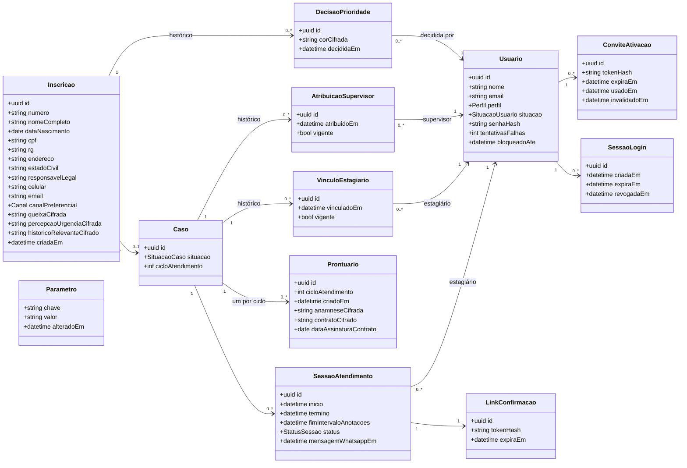

**Valores dos tipos enumerados:**

- `Perfil`: secretaria, estagiario, supervisor, coordenacao (já existe em `@clinica/shared`).
- `SituacaoUsuario`: pendente_ativacao, ativo, desativado. Substitui a coluna booleana `ativo` da base técnica, que não representa o estado "pendente de ativação" do RF53.
- `Canal`: email, whatsapp, ligacao. O SMS não é usado ([DF24](../requisitos/decisoes-fbr.md#df24)); WhatsApp e ligação exigem o celular.
- `Cor`: vermelha, amarela, verde.
- `SituacaoCaso`: aguardando_distribuicao, aguardando_vinculo, em_atendimento, encerrado.
- `StatusSessao`: agendada (os demais status entram com o RF14, o RF15 e o RF16 no Ciclo 4).

**Restrições de integridade no banco** (RNF19, RNF9):

- Uma `AtribuicaoSupervisor` vigente por caso e um `VinculoEstagiario` vigente por caso, garantidos por índices únicos parciais `WHERE vigente`. A `DecisaoPrioridade` é somente inserção (RNF5), e a vigente é a mais recente da inscrição.
- Um `Prontuario` por caso e ciclo de atendimento: índice único em `(caso_id, ciclo_atendimento)`.
- `SessaoAtendimento.termino` maior que `inicio` e `fimIntervaloAnotacoes` igual ou maior que `termino`, garantidos por restrições `CHECK`.

**Parâmetros iniciais** (tabela `parametros`, alterados pela coordenação):

| Chave | Valor padrão | Usado em |
| --- | --- | --- |
| `duracao_sessao_minutos` | 50 | RF10 |
| `intervalo_anotacoes_minutos` | 10 | RF10 |
| `limite_casos_supervisor` | 50 | RF20 |
| `validade_convite_horas` | 72 | RF53 |

---

### Classes do Ciclo 4 { #modelo-detalhado-do-ciclo-4 }

Classes novas do Ciclo 4, que se somam às [do Ciclo 3](#modelo-detalhado-do-ciclo-3). A `Inscricao` aparece só com os atributos usados aqui.

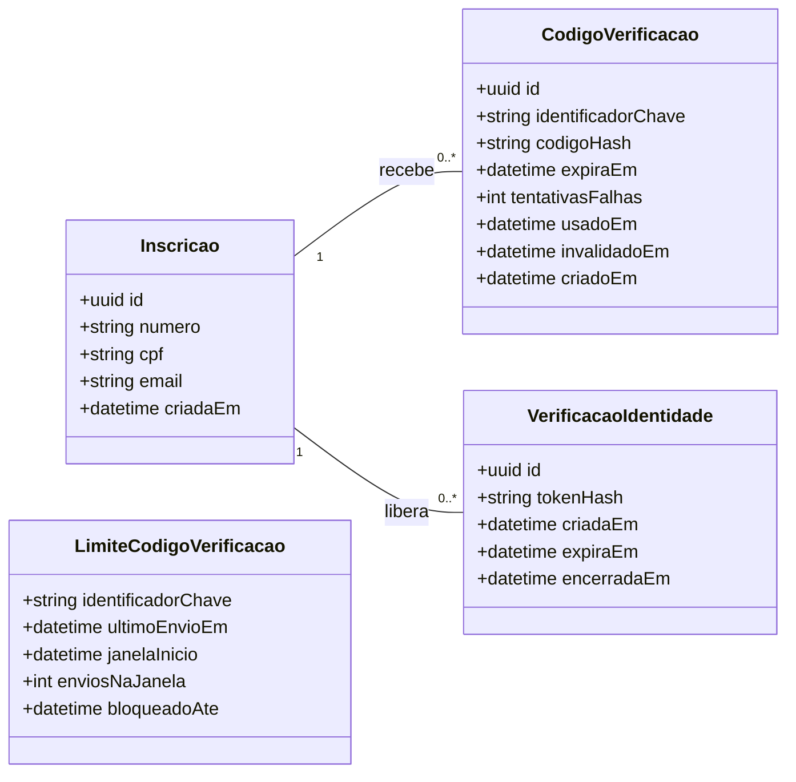

`LimiteCodigoVerificacao` não tem chave estrangeira: ele é guardado pelo identificador informado, exista ou não uma inscrição com ele.

## Acesso e segurança (CP12)

### RF50 — Autenticar usuário institucional ([#45](https://github.com/mdsreq-fga-unb/REQ-2026.2-T02-ClinicaEscolaFBr/issues/45))

_Construída no Ciclo 3._

**Rotas:**
- `POST /auth/login` (pública): recebe e-mail e senha e devolve um cookie de sessão `httpOnly`.
- `POST /auth/logout`.

O `SessaoGuard` valida a sessão em cada requisição e preenche `req.usuario`, que o `PerfisGuard` já usa. A cada requisição válida, ele renova `expiraEm` para 30 minutos depois, e a sessão parada por 30 minutos expira (RNF50). O cookie é `httpOnly`, `Secure` e `SameSite=Lax`, e só o hash do token fica no banco.

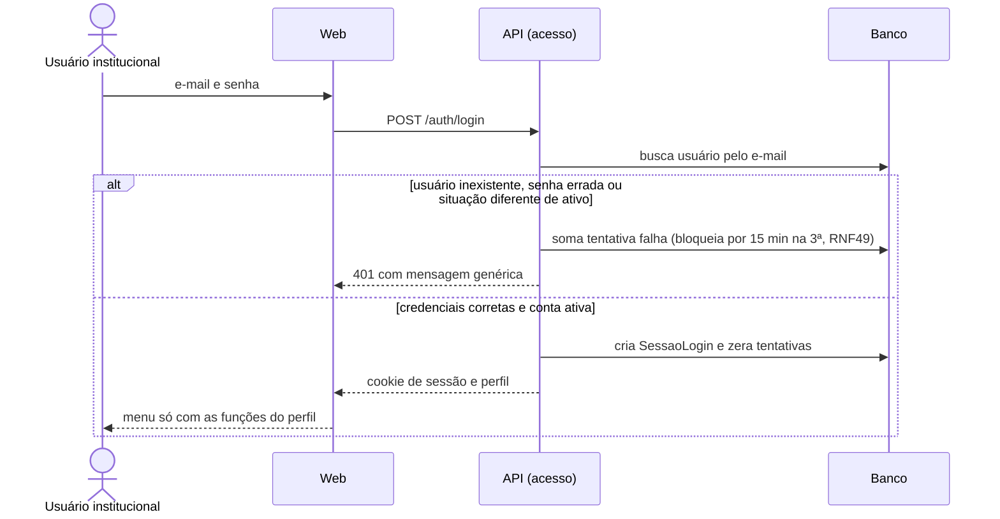

| Regra | Critério de aceitação |
| --- | --- |
| A senha é comparada com o hash (bcrypt ou Argon2), e a mesma mensagem é usada para qualquer falha | E-mail ou senha incorretos negam o acesso sem indicar o campo |
| Só a situação `ativo` autentica | Usuário desativado (RF54) não entra; usuário pendente (RF53) também não |
| Contador `tentativasFalhas` e `bloqueadoAte` no usuário ([DF25](../requisitos/decisoes-fbr.md#df25)) | Na 3ª tentativa seguida com erro, o acesso fica bloqueado por 15 minutos |
| `entradasEmCurso` reserva a conferência de cada entrada: os erros somados às entradas em curso não passam de 3, e as entradas além disso esperam uma vaga por até 5 segundos em vez de serem recusadas; só a senha errada conta como erro ([#176](https://github.com/mdsreq-fga-unb/REQ-2026.2-T02-ClinicaEscolaFBr/issues/176)). A vaga volta em qualquer erro inesperado, e uma reserva com mais de 30 segundos (`emCursoDesde`) é descartada, caso a API tenha caído no meio da conferência. E-mails sem conta seguem a mesma regra, em memória | Tentativas simultâneas com erro não passam de 3 antes do bloqueio, e entradas simultâneas com a senha certa são todas aceitas. Sem vaga em 5 segundos, a entrada recebe 429 ("Muitas tentativas de entrada ao mesmo tempo"), que não conta como erro. A espera é a mesma com ou sem conta, para o tempo da resposta não revelar quais e-mails têm conta |
| O menu e as rotas são filtrados pelo perfil (`PerfisGuard`) | Usuário ativo vê apenas as funcionalidades do seu perfil |

**Dados de teste:** um usuário de cada perfil, ativo; um desativado; um pendente de ativação; um com 2 tentativas falhas (para testar o bloqueio na 3ª).

### RF52 — Verificar identidade do paciente ou responsável ([#47](https://github.com/mdsreq-fga-unb/REQ-2026.2-T02-ClinicaEscolaFBr/issues/47))

_Construída no Ciclo 4._

O RF52 não mostra dados por conta própria: ele confirma a identidade e entrega às outras features uma verificação ligada a uma única inscrição. Quem usa a verificação é a consulta da posição na fila (RF8, [#155](https://github.com/mdsreq-fga-unb/REQ-2026.2-T02-ClinicaEscolaFBr/issues/155)) e, mais adiante, as declarações de comparecimento da CP10 (RF44 a RF46). O código vai só por e-mail ([DF24](../requisitos/decisoes-fbr.md#df24)).

**Rotas** (módulo `acesso`, todas públicas):

- `POST /verificacao/codigo`: recebe o identificador, que pode ser o CPF (com ou sem pontuação) ou o número da inscrição (`AAAA-NNNNN`). Responde sempre `202` com a mesma mensagem, ou `429` com `segundosRestantes` (pedido antes de 60 segundos) ou `bloqueadoAte` (limite de 3 códigos em 60 minutos).
- `POST /verificacao/conferir`: recebe o identificador e o código. Com o código certo, responde `200` e grava o cookie `verificacao`. Em qualquer outro caso, responde `400` com a mesma mensagem.
- `GET /verificacao`: devolve o número da inscrição liberada e o fim do prazo da verificação, para a página `/consultar` saber se a pessoa já confirmou a identidade. Sem verificação válida, responde `401`.
- `POST /verificacao/encerrar`: encerra a verificação e apaga o cookie.

O `VerificacaoGuard` lê o cookie `verificacao`, confere se a verificação está dentro do prazo e não foi encerrada e preenche `req.inscricaoVerificada` com o id da inscrição. Sem verificação válida, a rota responde `401` sem nenhum dado. O cookie é `httpOnly`, `Secure` e `SameSite=Lax`, como o da sessão do RF50, e só o hash do token fica no banco.

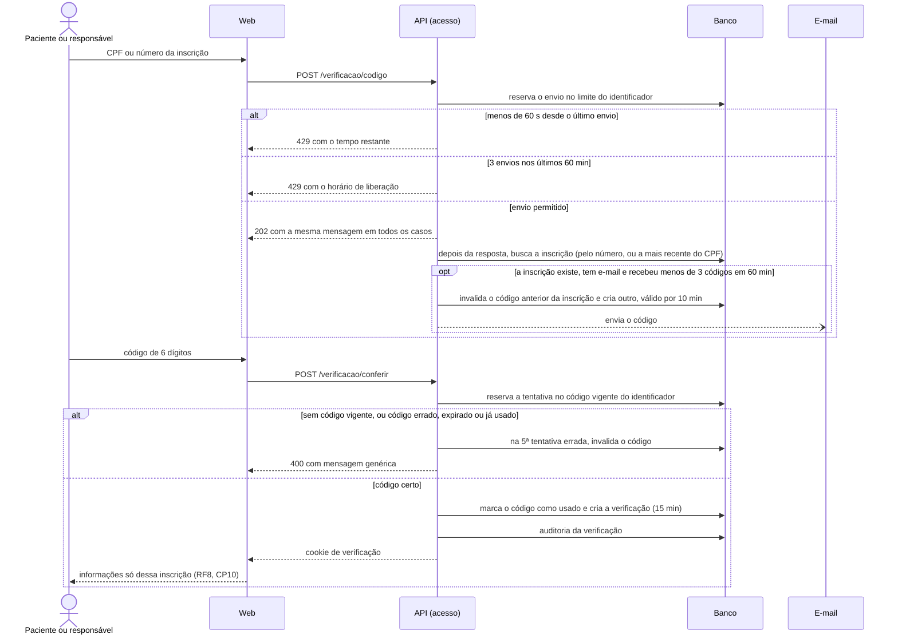

| Regra | Critério de aceitação |
| --- | --- |
| A verificação fica ligada a uma única inscrição, e o `VerificacaoGuard` só entrega o id dela às rotas do paciente | O CPF ou o número, com o código informado em até 10 minutos, libera acesso apenas às informações desse paciente |
| Sem verificação válida, as rotas do paciente respondem `401` sem dado; a conferência responde sempre a mesma mensagem, exista ou não a inscrição | Sem código, ou com código incorreto ou expirado, nada é exibido e a existência da inscrição não é confirmada |
| Para inscrição sem e-mail, nada é enviado, e a resposta é o mesmo `202` de qualquer pedido | Inscrição sem e-mail não recebe código, e a resposta é a mesma de qualquer pedido |
| `usadoEm` é gravado com um `UPDATE` condicional (`usado_em is null`), e só uma conferência simultânea passa | Código já utilizado é recusado |
| `tentativasFalhas` é reservada antes da comparação, como no RF50; na 5ª tentativa errada, o código recebe `invalidadoEm` | Na quinta tentativa incorreta, o código é invalidado e nem o correto passa a ser aceito |
| `ultimoEnvioEm` no limite do identificador; o novo código invalida o anterior | Novo código pedido antes de 60 segundos é recusado, informando o tempo restante |
| `enviosNaJanela` e `janelaInicio` contam os envios em 60 minutos; no 3º, `bloqueadoAte` recebe a hora do envio mais 60 minutos | Depois de 3 códigos em 60 minutos, o quarto pedido é recusado, e o bloqueio dura 60 minutos |

**Decisões de projeto** (a conferir na inspeção):

1. **Identificador guardado como chave, e não em texto.** `identificadorChave` é um HMAC-SHA256 do identificador normalizado (`cpf:<11 dígitos>` ou `numero:<AAAA-NNNNN>`), com uma chave do servidor. O CPF não fica gravado nas tabelas novas. Na implementação, a chave do HMAC é derivada da `CHAVE_DADOS` (HKDF), para não exigir outra variável na implantação; se a `CHAVE_DADOS` for trocada, os códigos e as verificações em curso deixam de valer, e a pessoa pede um novo código.
2. **Limites pelo identificador, pela inscrição e pela origem.** Os limites do `429` valem igual para um CPF ou número que existe e para um que não existe, para que a resposta não revele a inscrição; é a mesma ideia do bloqueio do RF50 para e-mail sem conta. Na implementação, entraram mais dois limites, que não mudam a resposta:
    - **Por inscrição:** no máximo 3 códigos em 60 minutos, somando o CPF e o número, e só um código vale por vez; o código novo invalida o anterior da inscrição, venha ele de qualquer dos dois identificadores. Assim, alternar o CPF e o número não dobra as tentativas. Quando a inscrição já recebeu 3 códigos, o pedido responde o mesmo `202`, e nada é enviado.
    - **Por origem:** 30 pedidos de código e 30 conferências a cada 10 minutos por endereço (`LIMITE_VERIFICACAO_POR_ORIGEM`), como o limite da inscrição do RF1. Sem ele, alguém poderia pedir códigos para muitas inscrições de uma vez, já que os números são sequenciais, e tentar adivinhar todos.
3. **CPF com mais de uma inscrição:** vale a mais recente, que é a que está na fila.
4. **Duração da verificação:** 15 minutos, sem renovação (`MINUTOS_VERIFICACAO`). O RF52 não define esse prazo. Ele é curto porque a consulta é rápida e pode ser feita num computador compartilhado. Depois do prazo, a pessoa pede um novo código.
5. **Envio do e-mail fora da resposta:** a API responde logo depois de reservar o envio no limite do identificador. A busca da inscrição, a gravação do código e o e-mail acontecem depois da resposta, para que o tempo dela não indique se a inscrição existe ou tem e-mail.
6. **Código:** gerado com `crypto.randomInt` e guardado como HMAC, nunca em texto.
7. **Auditoria:** a verificação concluída grava `verificar_identidade` na auditoria, sem usuário e com a inscrição como entidade, para rastrear o acesso aos dados dela. O pedido de código não altera dado da inscrição e não é auditado.

**Telas:** página pública `/consultar`, em dois passos (identificador e código), usada pelo RF8 antes de mostrar a posição na fila. O componente da verificação recebe o conteúdo que aparece depois dela, e é ali que o RF8 e a CP10 entram; até lá, a página mostra só a confirmação da identidade, o número da inscrição e o botão para encerrar a consulta. O código é digitado num campo único com `inputmode="numeric"` e `autocomplete="one-time-code"`. As mensagens de erro usam `role="alert"` e recebem o foco, e o botão de reenvio mostra o tempo restante. As telas estão nos [protótipos](prototipos.md#rf52).

**Dados de teste:**

- Inscrições fictícias: uma com e-mail, uma só com celular e um CPF com duas inscrições.
- Identificadores sem inscrição: um CPF e um número inexistentes.
- Códigos: um vencido (criado há 11 minutos), um já usado e um com 4 tentativas erradas.
- Limites: um identificador com envio há 30 segundos, um com 2 envios na janela e um bloqueado.
- Em desenvolvimento, o e-mail chega ao Mailpit (`http://localhost:8025`).

**Riscos:** o remetente oficial de e-mail depende da FBr, como no RF53. O RF1, de que o RF52 depende, já está na `main` ([#139](https://github.com/mdsreq-fga-unb/REQ-2026.2-T02-ClinicaEscolaFBr/pull/139)).

---

### RF53 — Cadastrar usuário institucional com perfil de acesso ([#48](https://github.com/mdsreq-fga-unb/REQ-2026.2-T02-ClinicaEscolaFBr/issues/48))

_Construída no Ciclo 3._

**Rotas:**
- `POST /usuarios` (coordenação);
- `POST /usuarios/:id/convite` (coordenação, para reenviar o convite);
- `POST /ativacao` (pública): recebe o token e a nova senha.

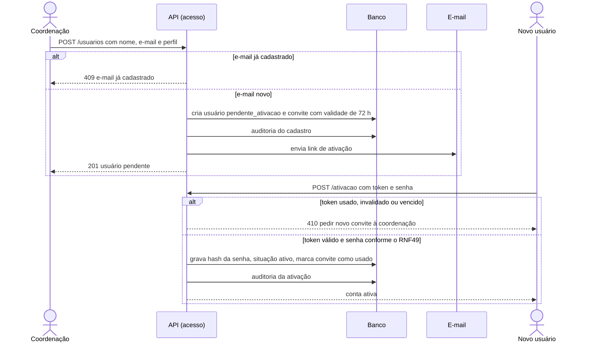

| Regra | Critério de aceitação |
| --- | --- |
| O token é guardado só como hash, é de uso único e vale pelo prazo do convite ([RF53](../requisitos/funcionais.md#rf53), [DF30](../requisitos/decisoes-fbr.md#df30)) | Link já usado ou com mais de 72 horas é recusado |
| O reenvio marca o convite anterior como `invalidadoEm` e cria outro | O reenvio invalida o link anterior |
| Índice único no e-mail | E-mail já cadastrado não pode ser cadastrado de novo |
| Rota com `@Perfis('coordenacao')` | Usuário sem perfil de coordenação não cadastra |
| O cadastro, o reenvio e a ativação chamam o `AuditoriaService` | Operações registradas com autor, usuário afetado e data/hora |

**Dados de teste:** um convite válido, um vencido (criado há 73 h) e um já usado. Em desenvolvimento, o e-mail chega ao Mailpit (`http://localhost:8025`).

### RF54 — Desativar usuário institucional ([#49](https://github.com/mdsreq-fga-unb/REQ-2026.2-T02-ClinicaEscolaFBr/issues/49))

_Construída no Ciclo 3._

**Rota:** `POST /usuarios/:id/desativacao` (coordenação).

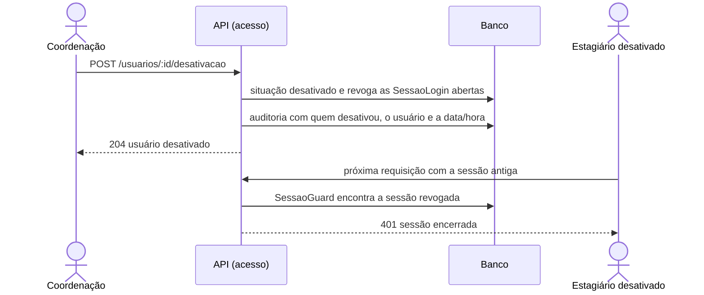

| Regra | Critério de aceitação |
| --- | --- |
| Revogar as sessões e conferir a situação do usuário a cada requisição | A próxima requisição do desativado é recusada, mesmo com sessão aberta |
| Nada é apagado: os registros continuam ligados ao `usuarioId` | Registros anteriores continuam visíveis, com o nome de quem os fez |
| `@Perfis('coordenacao')` | Usuário sem perfil de coordenação não desativa |

**Dados de teste:** um estagiário ativo com sessão aberta e registros de auditoria em seu nome.

### RF55 — Restringir acesso ao prontuário do paciente ([#50](https://github.com/mdsreq-fga-unb/REQ-2026.2-T02-ClinicaEscolaFBr/issues/50))

_Construída no Ciclo 3._

**Escopo no Ciclo 3:**
- **O que entra agora:** a regra de acesso protege o prontuário criado pelo RF66; os dados iniciais (RF69) entram no Ciclo 4 sob a mesma regra.
- **O que entra depois:** a mesma política passa a valer para a evolução (CP7, a partir do Ciclo 4). O critério da transferência entre estagiários é verificado quando a transferência (RF25) for construída, no Ciclo 4, e a política passa a proteger também o relatório final (RF33) no Ciclo 6.

**Rotas:**
- `GET /prontuarios/:id`: estagiário responsável e supervisor do caso; coordenação, só leitura, em qualquer caso ([DF32](../requisitos/decisoes-fbr.md#df32)).
- `GET /pacientes/:id/dados-administrativos`: secretaria e coordenação.

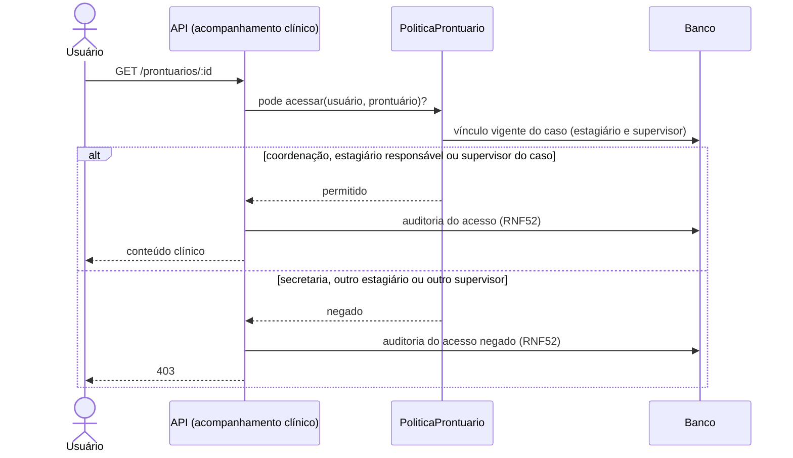

| Regra | Critério de aceitação |
| --- | --- |
| A verificação acontece na API (`PoliticaProntuario`), não só na interface | Estagiário não responsável tem o acesso negado, inclusive com requisição direta ao servidor |
| A coordenação consulta qualquer prontuário, sem vínculo com o caso, e o acesso fica registrado | A coordenação vê o conteúdo clínico de um caso sem vínculo, e o acesso aparece no registro |
| A rota administrativa devolve apenas nome, data de nascimento, contatos, responsável legal, situação do caso, sessões, faltas e contribuição | A secretaria vê só os dados cadastrais e administrativos |
| Os dados são criptografados em repouso e em trânsito (RNF51) | Inspeção do banco e do HTTPS no ambiente de homologação |

**Dados de teste:** um caso com estagiário A e supervisor S; outro estagiário B; uma secretaria; uma coordenação.

---

### RF57 — Registrar consentimento para tratamento de dados ([#52](https://github.com/mdsreq-fga-unb/REQ-2026.2-T02-ClinicaEscolaFBr/issues/52))

_Construída no Ciclo 4._

O termo entra na etapa 3 da inscrição (RF1). A rota continua a mesma, `POST /inscricoes`, que passa a exigir o aceite. O texto do termo fica versionado no banco, e cada inscrição guarda a versão aceita e a data/hora do aceite. O texto da versão `0.1` está em [Termo de consentimento — versão 0.1](termo-consentimento.md).

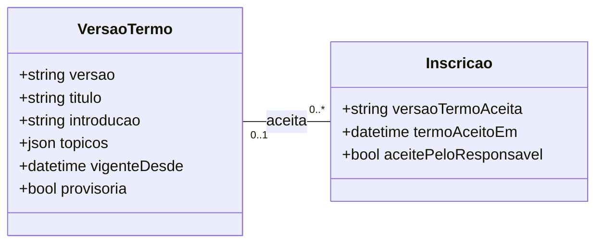

- **`topicos`:** `jsonb` com a lista dos cinco tópicos do protótipo, cada um com `titulo` e `corpo` em Markdown: o que coletamos, para que usamos, quem pode ver, por quanto tempo guardamos e seus direitos e como desistir. A caixa de concordância e o aviso para menor ficam na tela, e não no texto versionado.
- **Multiplicidade:** a inscrição antiga, feita antes do termo, não tem versão (decisão 2), por isso o lado da `VersaoTermo` é `0..1`.
- **Valores do servidor:** o `aceitePeloResponsavel` vem de `menorDeIdade(dataNascimento)`, nunca do cliente, e o `termoAceitoEm` é o `now()` da transação. Um `CHECK ((versao_termo_aceita is null) = (termo_aceito_em is null))` garante os dois juntos.

**Rotas** (módulo `inscricao`, públicas):

- `GET /termo/vigente`: devolve a versão vigente, se é provisória, o título, a introdução e os cinco tópicos.
- `POST /inscricoes`: recebe, além dos dados da inscrição, `aceiteTermo: true` e a `versaoTermo` que a pessoa leu.

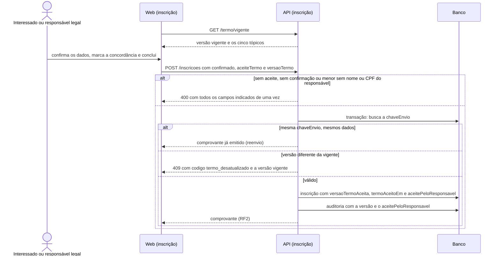

| Regra | Critério de aceitação |
| --- | --- |
| `aceiteTermo` é `z.literal(true)` no esquema da inscrição, validado junto com o resto pelo `ZodValidationPipe` | Sem aceite, a inscrição não é concluída, e o sistema indica o aceite |
| A inscrição grava a versão e o `termoAceitoEm` do servidor | A inscrição guarda a versão aceita e a data/hora |
| Para menor de idade (`menorDeIdade`), o aceite é do responsável: exige o nome e o CPF do responsável informados na etapa 1 (decisão 4) e grava `aceitePeloResponsavel` | Na inscrição de menor, o termo pede a identificação e a concordância do responsável |
| O texto do termo traz o prazo de guarda e como revogar (RF65), nos tópicos 4 e 5 da [versão 0.1](termo-consentimento.md) | O termo informa o prazo de guarda e como revogar |
| Uma versão nova só vale para as inscrições seguintes; as antigas mantêm a versão aceita | Cada versão aprovada vale para as inscrições seguintes, sem alterar os aceites anteriores (DF44) |
| A versão é conferida no serviço, dentro da transação e **depois** da busca pela `chaveEnvio`. O 409 do termo tem código próprio (`{ codigo: "termo_desatualizado", versaoVigente }`) e não se confunde com o 409 da `chaveEnvio` reutilizada com outros dados | Uma resposta perdida seguida de troca de versão não devolve 409 para uma inscrição já gravada |
| No reenvio, o `aceiteTermo` e a `versaoTermo` saem do `...cadastro` comparado campo a campo | O reenvio legítimo, com a mesma `chaveEnvio`, não vira 409 |

**Decisões de projeto:**

1. **Versão provisória.** Até a FBr aprovar o texto (DF44), a versão vigente é a `0.1`, marcada `provisoria`, e aparece assim na tela. A produção fica com `INSCRICAO_ABERTA=false` até haver uma versão aprovada (sem a variável, a inscrição fica aberta: `?? true` no `inscricao-aberta.guard.ts`). Além disso, em produção, a API recusa a inscrição enquanto a versão vigente for `provisoria`.
2. **Inscrições antigas.** As inscrições feitas antes do termo ficam com a versão vazia. Elas não são apagadas nem recebem um aceite presumido.
3. **Texto no banco, e não no código:** uma versão nova entra por migration, sem mudar o código da tela.
4. **CPF do responsável passa a ser obrigatório para menor de idade.** O aceite do termo pelo responsável exige o nome e o CPF dele, como no protótipo 1-1. A DF43 traz o CPF do responsável como dado da ficha, opcional, e o RF1 e a #191 o tratam assim. Com o RF57, ele passa a ser exigido na inscrição de menor. É uma proposta da equipe, citada no RF1 e registrada nas [pendências de validação com a FBr](../requisitos/analise-feedback.md#pendencias-de-validacao-com-a-fbr). Se a FBr recusar, o CPF volta a ser opcional, e o aceite do menor registra só o nome do responsável.
5. **Duas caixas: a confirmação do RF1 e o aceite do termo.** O critério do RF1 pede que a pessoa revise os dados e confirme o envio, e a LGPD pede que o consentimento seja específico e destacado (art. 11, I). Por isso, as duas caixas ficam separadas: "Confirmo que revisei os meus dados" (o `confirmado` que já existe) e a do termo. As pranchas 1-1 e 1-2 mostram só a do termo e são ajustadas. O aviso provisório que a etapa 3 mostra hoje no lugar do termo sai.
6. **Inscrição feita na recepção.** Enquanto o RF3 não entra, a recepção preenche o formulário on-line pelo interessado. Quem lê o termo e marca a caixa é o próprio interessado ou o responsável, na tela ou numa cópia impressa da mesma versão; a recepção não marca por ele. Fica registrado como limitação que, até o RF3, o aceite dado na recepção não se distingue do aceite on-line.

**Telas:** etapa 3 da inscrição, com o termo depois do resumo, os cinco tópicos que abrem e fecham (botões com `aria-expanded` e `aria-controls`), a caixa de confirmação dos dados e a caixa de concordância, as duas desmarcadas, e, para menor, o nome e o CPF do responsável só para leitura e o aviso de que o aceite on-line não substitui o termo assinado na clínica. O `aceiteTermo` entra nos dois lugares que hoje só tratam o `confirmado`: o link do resumo de erros, que leva à caixa do termo, e o mapeamento do 400 do servidor. **Termo desatualizado (409):** a tela recarrega o termo, desmarca a caixa e mostra "O termo foi atualizado. Leia a nova versão e marque a concordância de novo", com o foco na mensagem; esse estado entra na prancha. Conferida também a 320 px (RNF58). Protótipo: [pranchas 1-1 e 1-2](prototipos.md#rf57).

**Dados de teste:** uma inscrição de maior de idade com aceite e outra sem aceite; uma de menor com o CPF do responsável e outra sem; um envio com a versão `0.0`, diferente da vigente (409 com `termo_desatualizado`); um reenvio com a mesma `chaveEnvio` depois de a versão mudar (devolve o comprovante); uma inscrição antiga sem versão; um adulto com o CPF do responsável preenchido, que é descartado; o `aceiteTermo: false` enviado direto à API (400).

---

## Inscrição on-line (CP1)

### RF1 — Registrar solicitação de atendimento on-line ([#88](https://github.com/mdsreq-fga-unb/REQ-2026.2-T02-ClinicaEscolaFBr/issues/88))

_Construída no Ciclo 3._

**Rota:** `POST /inscricoes` (pública), validada pelo esquema `inscricaoSchema` em `@clinica/shared`. A interface tem 3 etapas, com o aviso do CVV e do SAMU fixo em todas:
1. dados e contatos;
2. triagem (queixa, percepção de urgência e histórico relevante);
3. revisão e confirmação.

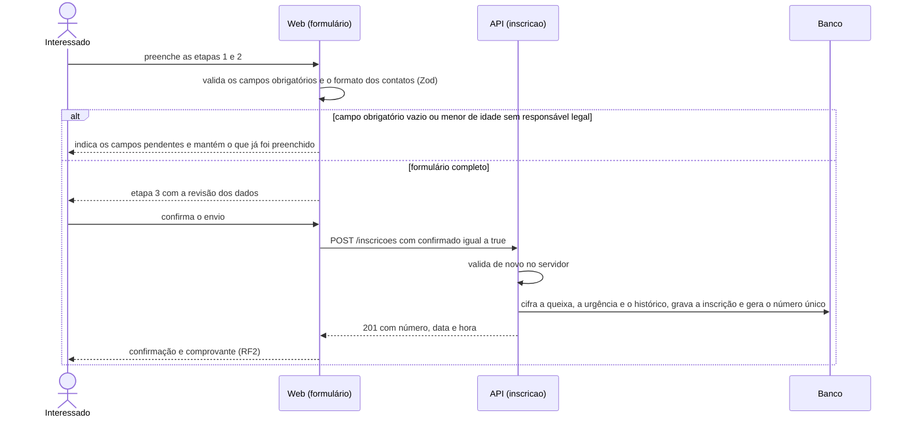

| Regra | Critério de aceitação |
| --- | --- |
| O mesmo esquema Zod é usado na interface e na API | Envio com campo obrigatório vazio é bloqueado, e os dados são mantidos |
| A idade é calculada a partir da data de nascimento, e o responsável legal é obrigatório para menores de 18 anos | Menor de idade sem responsável legal é bloqueado |
| Pelo menos um contato (celular ou e-mail) e o canal preferencial (e-mail, WhatsApp ou ligação) são obrigatórios; WhatsApp e ligação exigem o celular | Formato validado, um contato exigido e o preferencial registrado |
| CPF com 11 números; RG como texto livre, como está no documento, sem órgão emissor e sem upload | Nenhum envio de cópia do documento |
| A API só grava com `confirmado: true` | Sem confirmação, a solicitação não é registrada |
| Número no formato `AAAA-NNNNN`, com o ano do registro e a sequência `inscricoes_numero_seq`, que não reinicia a cada ano | Cada inscrição recebe um número único, como "2026-00487" |
| Queixa, urgência e histórico são cifrados antes de gravar (RNF51) | Nenhum desses campos aparece legível no banco |
| A interface só mostra a confirmação após a resposta 201 | Nenhuma confirmação sem registro efetivo |
| Componente `AvisoEmergencia` fixo no layout do formulário | Aviso do CVV e do SAMU em todas as etapas |

**Dados de teste:** um adulto com e-mail como canal preferencial; um menor com responsável legal, só celular e WhatsApp como canal; uma inscrição com ligação como canal e sem celular (recusada); uma inscrição com CPF em formato inválido; um RG com letra ("12.345.678-X").

### RF2 — Emitir comprovante de inscrição ([#89](https://github.com/mdsreq-fga-unb/REQ-2026.2-T02-ClinicaEscolaFBr/issues/89))

_Construída no Ciclo 3._

O comprovante é montado na interface a partir da resposta do `POST /inscricoes` (número, data e hora) e pode ser impresso ou salvo em PDF pelo navegador. Não há rota pública para consultar um comprovante por número, o que evita a enumeração de inscrições.

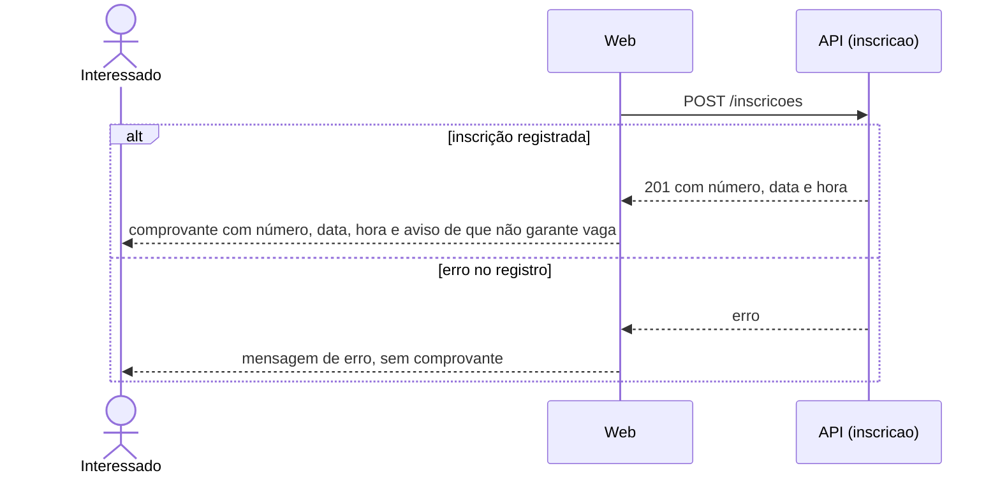

| Regra | Critério de aceitação |
| --- | --- |
| O comprovante só existe a partir da resposta 201 | Nenhum comprovante para inscrição não concluída |
| O componente recebe apenas o número, a data e a hora | O comprovante não contém a queixa nem dados clínicos |
| Texto fixo sobre triagem e vagas | Informa que o atendimento depende da triagem e das vagas |

---

## Triagem (CP2)

### RF4 — Organizar informações da inscrição para triagem ([#90](https://github.com/mdsreq-fga-unb/REQ-2026.2-T02-ClinicaEscolaFBr/issues/90))

_Construída no Ciclo 3._

**Rota:** `GET /triagem/inscricoes` (supervisor e coordenação). Devolve as inscrições sem decisão de prioridade vigente, com o campo calculado `diasAguardando` (dias desde `criadaEm`), e aceita ordenação por esse campo. A FBr não adota prazo de triagem ([DF19](../requisitos/decisoes-fbr.md#df19)), então não há sinal de "além do prazo".

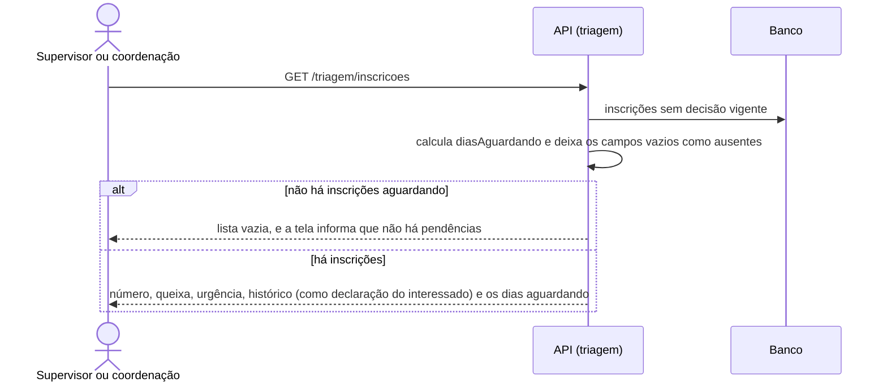

| Regra | Critério de aceitação |
| --- | --- |
| `@Perfis('supervisor','coordenacao')` | Usuários sem autorização não veem as respostas |
| Campo vazio é enviado como `null`, e a interface mostra "não informado" | Campo sem resposta aparece como ausente |
| As respostas aparecem num bloco "Declarado pelo interessado", separado da decisão da equipe | Declaração separada da avaliação da equipe |
| `diasAguardando` calculado a partir de `criadaEm` | Cada inscrição mostra há quantos dias aguarda, sem sinal de prazo |

**Dados de teste:** uma inscrição de hoje; uma de 8 dias atrás sem triagem (aparece com 8 dias aguardando, sem sinal de prazo); uma inscrição legada com o histórico vazio.

### RF6 — Registrar prioridade clínica do inscrito ([#91](https://github.com/mdsreq-fga-unb/REQ-2026.2-T02-ClinicaEscolaFBr/issues/91))

_Construída no Ciclo 3._

**Rota:** `POST /triagem/inscricoes/:id/prioridade` (supervisor e coordenação). Recebe a cor. A primeira decisão cria o `Caso` com a situação `aguardando_distribuicao`.

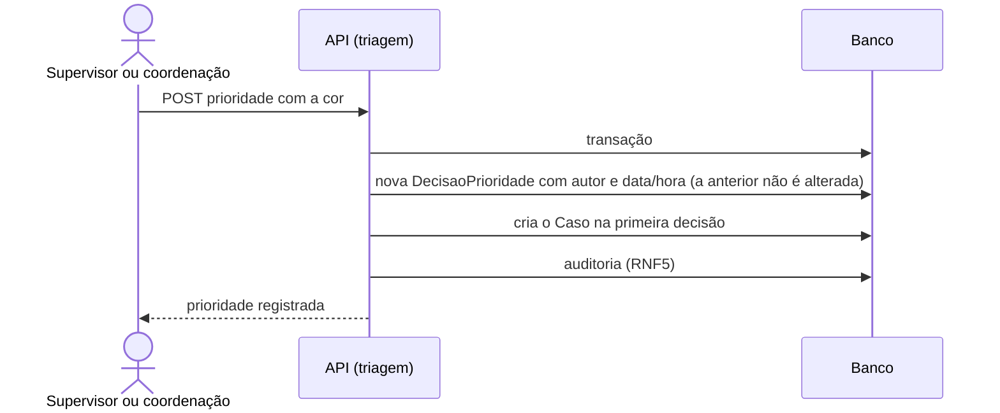

| Regra | Critério de aceitação |
| --- | --- |
| Histórico somente inserção, com trava no banco; a vigente é a mais recente (RNF5) | A alteração mantém a decisão anterior no histórico, sem alterá-la |
| A tela mostra a referência vermelha/amarela/verde como texto, sem cor pré-selecionada | Nenhuma sugestão automática de cor |
| Sem decisão vigente, a fila e a distribuição tratam o caso como pendente | Inscrição sem classificação aparece como pendente |

**Dados de teste:** uma inscrição sem decisão; uma com decisão amarela que muda para vermelha; uma secretaria tentando registrar (recebe 403).

---

## Fila de espera (CP3)

A fila não tem tabela própria. Ela é a lista dos casos nas situações `aguardando_distribuicao`, `aguardando_vinculo` e `aguardando_vaga` (RF38), que são as que esperam um estagiário, ordenada no `FilaService`. O caso nasce na primeira decisão de prioridade (RF6), então todo caso da fila tem prioridade registrada. Os casos `em_atendimento`, `encerrado` e `desligado_por_faltas` ficam fora. O mesmo serviço passa a ordenar a lista de casos aguardando distribuição (RF18), para as duas nunca ficarem diferentes.

**Classe alterada:** `Caso` ganha `entradaNaFilaEm`. Quando um paciente volta à fila por perda da vaga (RF43), ela recebe a data da volta ([DF33](../requisitos/decisoes-fbr.md#df33)). O preenchimento é feito em três lugares:

- **Migration:** cria a coluna anulável, preenche os casos existentes com o `inscricoes.criada_em` da inscrição e só depois a torna `NOT NULL`.
- **`registrarPrioridade`** (`triagem.service.ts`), que cria o caso: passa a gravar a data da inscrição.
- **`semear-carga.ts`:** a massa da carga também passa a preencher a coluna.

**O que o `FilaService` oferece às outras features:**

| Método | Usado por |
| --- | --- |
| `listar()`: a fila ordenada, com a posição | RF7 e a lista do RF18 |
| `posicaoDaInscricao(inscricaoId)`: a posição na fila inteira, ou nenhuma | RF8 e a consulta da secretaria |
| `proximoElegivel(supervisorId)`: o primeiro caso `aguardando_vinculo` do supervisor | RF37 |

### RF7 — Ordenar inscritos na fila de espera ([#140](https://github.com/mdsreq-fga-unb/REQ-2026.2-T02-ClinicaEscolaFBr/issues/140))

_Construída no Ciclo 4._

**Rota:** `GET /fila` (coordenação). Devolve a fila ordenada, com a posição, o número da inscrição, o nome, a prioridade vigente e a entrada na fila. À parte, devolve as inscrições ainda sem prioridade ("Prioridade pendente"), fora da ordenação, com o número, o nome e a data da inscrição.

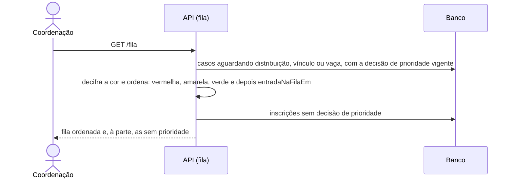

| Regra | Critério de aceitação |
| --- | --- |
| Só entra na fila o caso com decisão de prioridade vigente; o RF5 e as sinalizações não definem posição | Inscrito com prioridade confirmada entra na posição da prioridade; sinalização sem classificação não define posição |
| A ordem é calculada a cada consulta, a partir da decisão vigente | Uma nova prioridade confirmada atualiza a posição |
| O caso sai da fila quando recebe estagiário (RF21), é desligado (RF37) ou encerrado. A distribuição a um supervisor (RF20) não tira o caso da fila: ele continua `aguardando_vinculo` até o vínculo. As posições dos outros são recalculadas, e as decisões continuam no histórico do RF6 | Mudança de situação recalcula os afetados e preserva o histórico |
| Desempate por `entradaNaFilaEm` e, nela, pela ordem da inscrição | Na mesma prioridade, fica à frente quem se inscreveu primeiro |

**Decisões de projeto:**

1. **Situações da fila.** A fila inclui os casos aguardando distribuição, aguardando vínculo e aguardando vaga (RF38), porque todos esperam um estagiário. A ordenação acontece na aplicação, depois de decifrar a cor, como no RF18. Se o RF7 entrar antes do RF37 e do RF38, o filtro usa só as duas situações que já existem.
2. **Prancha 6-1, "Mudanças recentes".** O texto "saiu da fila: caso distribuído a…" passa a "saiu da fila: estagiário vinculado", como a regra acima. A prancha é ajustada.
3. **Histórico de mudanças da fila.** A prancha 6-1 mostra o botão "Histórico de mudanças", o painel "Mudanças recentes" ("passou da posição 2 para 3"), o selo "Posição atualizada" e, no acesso negado, "Tentativa registrada". Como a fila é calculada a cada consulta, as posições anteriores não ficam guardadas, e o `PerfisGuard` só nega o acesso, sem registrar. O "histórico preservado" do RF7 é o das decisões do RF6. A pergunta foi levada à FBr em 06/11:
    - **se a FBr não pedir o histórico,** o painel, o selo e a frase da tentativa saem da prancha;
    - **se pedir,** entra uma rota de histórico montada com as `decisoes_prioridade` e a auditoria da distribuição e do vínculo, sem a variação de posição.

    Até a resposta, a tela não tem esses elementos.

**Telas:** item "Fila de espera" no menu da coordenação (proposta levada à FBr em 06/11), com a posição, a prioridade e a entrada na fila, e a seção "Prioridade pendente". A marca "Voltou à fila" só aparece com o RF43, do Ciclo 6. Protótipo: [prancha 6-1](prototipos.md#rf7).

**Estados e mensagens esperadas — RF7:**
- **Fila vazia:** quando não houver casos elegíveis na fila, apresentar "Não há inscritos na fila de espera". A seção "Prioridade pendente" permanece disponível quando houver inscrições sem classificação clínica.
- **Prioridade pendente:** apresentar separadamente as inscrições ainda sem prioridade confirmada, com número da inscrição, nome e data da inscrição, sem atribuir posição na fila.
- **Acesso negado:** para usuários sem perfil autorizado, apresentar "Você não tem acesso à fila de espera". A API deve retornar HTTP 403 sem expor informações dos inscritos.
- **Mudança de prioridade:** após uma nova classificação clínica confirmada, apresentar a fila na ordem recalculada, sem afirmar que existe histórico das posições anteriores.
- **Histórico de mudanças:** não apresentar botão, painel de histórico, selo de posição atualizada ou mensagem de tentativa registrada enquanto essas funcionalidades não forem definidas pela FBr e suportadas pelo projeto.

**Dados de teste:** três casos vermelhos, amarelos e verdes inscritos em ordem trocada; dois casos amarelos inscritos em dias diferentes; um caso que muda de verde para vermelha; um caso `aguardando_vinculo` (continua na fila); um caso que recebe estagiário, um desligado e um encerrado (saem da fila); uma inscrição sem prioridade; a secretaria, o estagiário e o supervisor tentando abrir a fila (403); a lista do RF18 na mesma ordem depois da troca para o `FilaService`; um caso existente, criado antes da migration, com a `entradaNaFilaEm` preenchida pela data da inscrição.

---

### RF8 — Consultar posição individual na fila ([#155](https://github.com/mdsreq-fga-unb/REQ-2026.2-T02-ClinicaEscolaFBr/issues/155))

_Construída no Ciclo 4._

**Rotas** (módulo `fila`, num controller próprio, separado do `GET /fila`, que tem os guards internos na classe):

- `GET /fila/minha-situacao` (pública, com o `VerificacaoGuard` do RF52). Usa só a inscrição ligada à verificação, em `req.inscricaoVerificada`, e devolve uma de quatro situações, pela `casos.situacao`. Não devolve a prioridade nem nenhum dado clínico. Responde com `Cache-Control: no-store`, porque a consulta pode ser feita num computador compartilhado.
- `GET /fila/situacao?numero=` (secretaria): a consulta presencial, para quem informou só o celular (RF52, [DF24](../requisitos/decisoes-fbr.md#df24)) e para quem recebeu "procure a secretaria". Devolve a mesma resposta da rota pública, com a situação e a posição, sem a cor (RNF17). A secretaria confere a identidade da pessoa no balcão, e a consulta fica na auditoria.

| Situação do caso | Resposta |
| --- | --- |
| Sem caso (inscrição sem prioridade) | Aguardando triagem |
| `aguardando_distribuicao`, `aguardando_vinculo` ou `aguardando_vaga` | Na fila de espera, com a posição na fila inteira |
| `em_atendimento` | Em atendimento |
| `encerrado` ou `desligado_por_faltas` | Procure a secretaria |

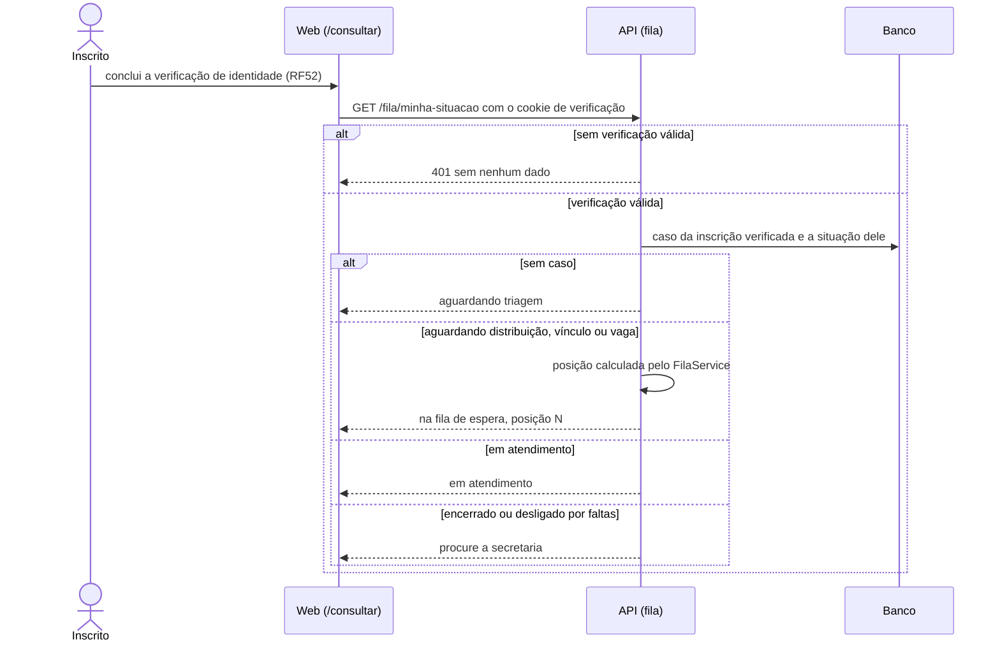

| Regra | Critério de aceitação |
| --- | --- |
| A rota só lê `req.inscricaoVerificada` e nunca recebe um id de inscrição (RNF6) | Depois da verificação, o inscrito vê a própria posição e situação |
| Sem verificação válida, `401` sem dado | Sem verificação, a consulta é negada |
| A posição vem do mesmo `FilaService` do RF7, calculada na hora | Depois de mudanças na fila, uma nova consulta mostra a posição atualizada |

**Decisões de projeto:** a posição é a da fila inteira, e não dentro da cor, porque informar a cor revelaria a prioridade clínica (proposta levada à FBr). A resposta vem com o aviso de que a posição pode mudar e não garante data (RNF7). O "procure a secretaria", para o caso encerrado ou desligado, é uma situação a mais que as três da prancha 1-3 e é uma proposta da equipe, registrada nas pendências de validação. O horário "Consulta feita em…" vem da API, junto com a resposta.

**Acessibilidade (RNF56 a RNF58):** o resultado, que carrega depois da verificação, é anunciado com `role="status"`. O aviso do 401 usa `role="alert"`, recebe o foco e traz o botão "Confirmar identidade", que recarrega a página para recomeçar a verificação (se o componente da #202 ganhar uma função para recomeçar, ela substitui o recarregamento). A situação tem ícone e texto, e não só cor, e a página é conferida a 320 px sem rolagem lateral.

**Telas:** página `/consultar`, depois dos dois passos do RF52. O componente da #202 já mostra o título, o aviso "Identidade confirmada" e o "Encerrar consulta"; o RF8 mostra só o cartão do resultado, nas três situações do protótipo, mais o "procure a secretaria" e o acesso negado. Para a secretaria, a consulta pelo número fica na lista de Pacientes. Protótipo: [pranchas 1-3 e 1-4](prototipos.md#rf8).

**Dados de teste:** uma inscrição sem prioridade, uma na posição 3, uma `aguardando_vinculo` (continua na fila), uma em atendimento, uma encerrada e uma desligada (procure a secretaria), cada uma com e-mail para o código; uma verificação expirada (401); uma consulta antes e depois de outro caso passar à frente; a inscrição A verificada pedindo a rota com o número de B na query (a resposta continua sendo a de A); a secretaria consultando pelo número (sem a cor) e o estagiário tentando a mesma rota (403). O teste de compreensão do aviso (RNF7) entra no teste de usabilidade da área pública, com o RF52.

**Dependências e riscos:** o RF8 usa o `FilaService` e a `entradaNaFilaEm` do RF7 (#140), as situações novas do RF37 e do RF38 e a verificação do RF52 (#202, ainda aberta). Se entrar antes do RF37 e do RF38, trata só o `encerrado` como "procure a secretaria". O RF7 entra no `depende` do RF8 no `requisitos.yml`, ao lado do RF52.

---

## Distribuição de casos (CP5)

### RF18 — Listar casos aguardando distribuição ([#92](https://github.com/mdsreq-fga-unb/REQ-2026.2-T02-ClinicaEscolaFBr/issues/92))

_Construída no Ciclo 3._

**Rota:** `GET /casos/aguardando-distribuicao` (coordenação e supervisor). Devolve os casos com a situação `aguardando_distribuicao`, ordenados pela cor (vermelha, amarela, verde, decifrada na aplicação) e pela data da inscrição, da mais antiga para a mais recente. Cada item traz só o número da inscrição, o nome, a cor e a data.

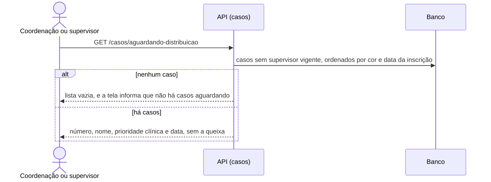

**Dados de teste:** casos vermelho, amarelo e verde, com datas diferentes; dois casos vermelhos para testar o desempate; um caso já distribuído (não aparece).

### RF19 — Registrar áreas de especialidade do supervisor ([#93](https://github.com/mdsreq-fga-unb/REQ-2026.2-T02-ClinicaEscolaFBr/issues/93))

_Construída no Ciclo 3._

**Removido em 24/10/2026.** A FBr não divide os atendimentos por área de especialidade ([DF26](../requisitos/decisoes-fbr.md#df26)). Não há rotas nem tabelas de áreas no Ciclo 3.

### RF20 — Distribuir caso a supervisor ([#94](https://github.com/mdsreq-fga-unb/REQ-2026.2-T02-ClinicaEscolaFBr/issues/94))

_Construída no Ciclo 3._

**Rotas:**
- `GET /supervisores/disponibilidade` (coordenação): devolve os supervisores ativos com a contagem de casos ativos (com atribuição vigente e situação diferente de `encerrado`) e o parâmetro `limite_casos_supervisor` (padrão de 50).
- `POST /casos/:id/supervisor` (coordenação): recebe o supervisor.

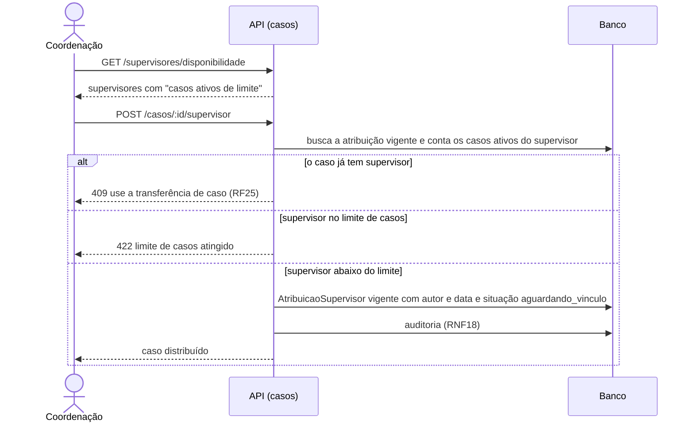

| Regra | Critério de aceitação |
| --- | --- |
| A contagem e a atribuição acontecem na mesma transação, com bloqueio da linha do supervisor | Supervisor no limite não recebe novo caso, mesmo com duas distribuições simultâneas |
| Limite vindo do parâmetro `limite_casos_supervisor` ([DF17](../requisitos/decisoes-fbr.md#df17)) | A lista mostra "12 de 50" e o motivo quando o supervisor está no limite |
| `@Perfis('coordenacao')` | Usuário sem perfil de coordenação não distribui casos |

**Dados de teste:** um supervisor com 12 casos; um supervisor com 50 casos (no limite); todos os supervisores no limite (mensagem de nenhum disponível); um caso já distribuído.

### RF21 — Vincular paciente a estagiário responsável ([#95](https://github.com/mdsreq-fga-unb/REQ-2026.2-T02-ClinicaEscolaFBr/issues/95))

_Construída no Ciclo 3._

**Rota:** `POST /casos/:id/estagiario` (supervisor responsável pelo caso). Mostra como opções apenas estagiários com a situação `ativo`, cada um com a quantidade de pacientes em atendimento, como no protótipo. O vínculo e a criação do prontuário (RF66) acontecem na mesma transação. O caso tem um único estagiário responsável vigente, garantido por índice único parcial; os estagiários de apoio só observam e não são vinculados ([DF27](../requisitos/decisoes-fbr.md#df27)).

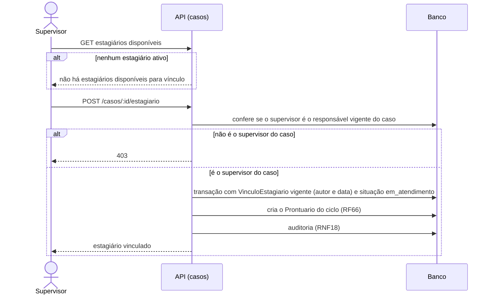

**Dados de teste:** um caso distribuído ao supervisor S; um supervisor T tentando vincular (recebe 403); um estagiário desativado, que não aparece nas opções.

---

### RF22 — Consultar responsáveis pelo caso ([#145](https://github.com/mdsreq-fga-unb/REQ-2026.2-T02-ClinicaEscolaFBr/issues/145))

_Construída no Ciclo 4._

**Rotas** (módulo `casos`):

- `GET /pacientes?busca` (secretaria e coordenação): a lista de Pacientes, com o nome do paciente, os nomes do estagiário e do supervisor e a situação do caso, sem dado clínico. Para a secretaria, a resposta traz só esses campos (RNF17); o número da inscrição vem só para a coordenação. É a página que hoje dá 404 no menu.
- `GET /casos/:id/responsaveis` (secretaria, coordenação e o estagiário e o supervisor responsáveis): os dois nomes, ou "pendente de distribuição" no que faltar.

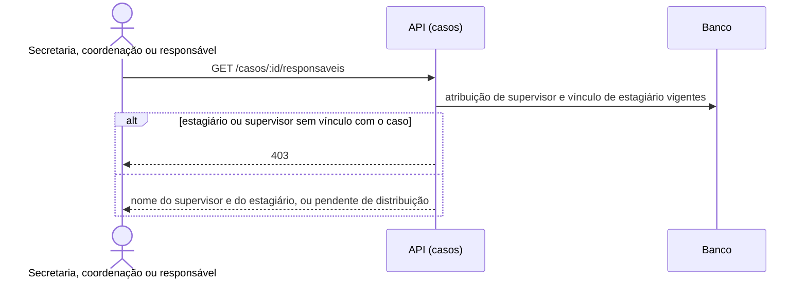

| Regra | Critério de aceitação |
| --- | --- |
| A resposta só traz nomes e a situação; nunca a queixa, a prioridade ou o prontuário (RNF17) | A consulta mostra os responsáveis, sem dados clínicos |
| Sem atribuição ou sem vínculo vigente, o campo vem como `null`, e a tela mostra "pendente de distribuição" | O caso sem um dos responsáveis aparece como pendente, sem nome |

**Telas:** lista de Pacientes (secretaria e coordenação) e ficha do paciente, já existente nos dados administrativos, com o quadro "Responsáveis". Protótipo: [prancha 2-3](prototipos.md#rf22).

**Dados de teste:** um caso em atendimento, um aguardando vínculo (sem estagiário) e um aguardando distribuição (sem os dois); um estagiário de outro caso (403).

**Na implementação (PR do RF22):**

- **Rotas:**
    - `GET /pacientes?busca` devolve `{ pacientes, cortada }`. A lista vem em ordem alfabética, com até 200 pacientes. Quando há mais, `cortada` é `true`, e a tela pede para buscar pelo nome. A busca usa `ILIKE` com `%` e `_` escapados.
    - `GET /casos/:id/responsaveis` não tem `@Perfis`: o serviço libera a secretaria e a coordenação, e o estagiário e o supervisor só nos casos com vínculo ou atribuição vigente. Para eles, o caso inexistente responde como o negado (`403`), sem revelar o que existe.
    - As duas rotas respondem com `Cache-Control: no-store`.
- **Número da inscrição:** não vem para a secretaria (RNF17). Vem para a coordenação e para o estagiário e o supervisor responsáveis, que já o veem nas próprias telas.
- **Situação de distribuição:** a prancha 2-3 tem três selos, calculados pelos responsáveis vigentes (`situacaoDistribuicao`, em `@clinica/shared`):
    - "Distribuído", com os dois responsáveis;
    - "Aguardando vínculo de estagiário", só com o supervisor;
    - "Pendente de distribuição", sem supervisor.

    O nome que falta aparece como "—".
- **Lista de Pacientes:**
    - a busca espera a pessoa parar de digitar (300 ms) antes de consultar a API;
    - a contagem "Mostrando N pacientes." é anunciada ao leitor de tela;
    - a tabela aparece a partir de 1024 px, e abaixo disso a lista vira cartões.
- **Ficha do paciente:**
    - o quadro "Responsáveis pelo caso" fica no topo, depois do aviso do conteúdo clínico;
    - a secretaria e a coordenação veem a ficha completa (RF55) a partir da distribuição;
    - antes da distribuição, e para o estagiário e o supervisor responsáveis, a ficha mostra só o quadro e a identificação, como na prancha;
    - o supervisor chega pelo nome do paciente em "Meus casos";
    - o quadro mostra a orientação de cada perfil: a coordenação vai à distribuição, e o supervisor vincula o estagiário pelo diálogo do RF21. O vínculo só é oferecido nas situações em que o RF21 o aceita (`aguardando_vinculo` e `aguardando_vaga`): o caso desligado por faltas volta pela reversão (RF38);
    - o botão "Transferir caso" da coordenação (RF25) passa para dentro do quadro, como na prancha 4-3.
- **Trilha do estagiário:** aponta para "Meus pacientes", que é do RF23 e já existe.

---

### RF23 — Consultar casos sob responsabilidade do estagiário ou supervisor ([#146](https://github.com/mdsreq-fga-unb/REQ-2026.2-T02-ClinicaEscolaFBr/issues/146))

_Construída no Ciclo 4._

**Rota:** `GET /casos/meus?estagiarioId` (estagiário e supervisor). A rota já existe para o supervisor ("Meus casos"); ela passa a aceitar o estagiário, que vê só os casos com vínculo vigente dele, e o supervisor ganha o filtro por estagiário.

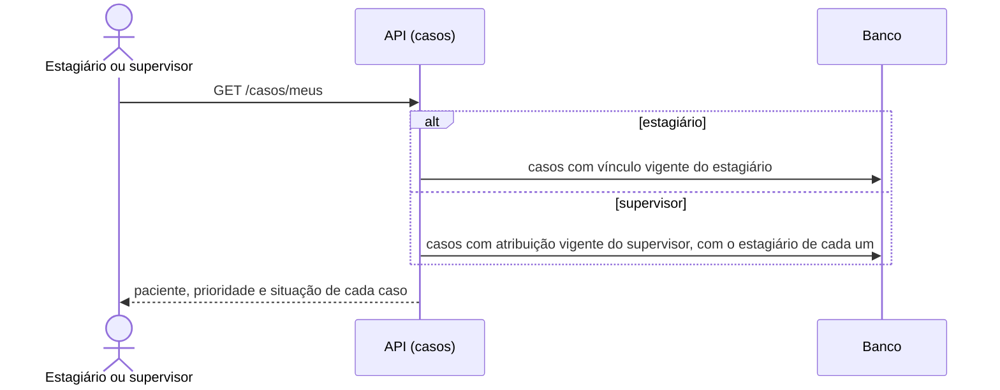

| Regra | Critério de aceitação |
| --- | --- |
| Filtro pelo vínculo vigente do estagiário | O estagiário vê só os casos vinculados a ele |
| Filtro pela atribuição vigente do supervisor, que já inclui os casos dos estagiários dele | O supervisor vê os casos dele e os dos estagiários |
| O acesso direto a um caso de outro segue o RF55, com `403` sem dado | Quem não tem vínculo não vê o caso na lista e tem o acesso direto negado |

**Telas:** "Meus pacientes" do estagiário (a página que hoje dá 404 depois da entrada, #160) e "Meus casos" do supervisor, com o filtro por estagiário. Protótipo: [prancha 4-1](prototipos.md#rf23).

**Dados de teste:** dois estagiários do mesmo supervisor, com dois casos cada; um caso aguardando vínculo; um estagiário sem casos (estado vazio); um estagiário abrindo o prontuário de um caso do outro (403).

**Na implementação (PR do RF23):**

- **Rota:** `GET /casos/meus` aceita o estagiário e o supervisor e responde com `Cache-Control: no-store`. O estagiário recebe só os casos com vínculo vigente dele; o supervisor, os casos com atribuição vigente dele, que já incluem os dos seus estagiários. O caso encerrado não entra. A resposta ganhou os campos:
    - `estagiarioId`: o estagiário do vínculo vigente;
    - `estagiarioAnterior` e `estagiarioAnteriorId`: o último estagiário do caso desligado por faltas (RF37), que a prancha mostra ao supervisor junto com a data;
    - `supervisor`: o supervisor do caso, mostrado na lista do estagiário.
- **Filtro por estagiário (diferença do projeto):** o projeto previa `GET /casos/meus?estagiarioId`. A lista do supervisor é pequena (o limite é de 50 casos ativos por supervisor, parâmetro do RF20), e as opções do filtro vêm dela, então o filtro é feito na tela e a rota não aceita o `estagiarioId`. A opção do filtro é o id do estagiário (`estagiarioId`, ou `estagiarioAnteriorId` no caso desligado), e o nome é só o rótulo: dois estagiários com o mesmo nome são duas opções. Se a opção escolhida sai da lista (o caso foi transferido, por exemplo), o filtro volta para "Todos".
- **Caso desligado por faltas (diferença da prancha 4-1):** a prancha mostra o caso desligado ("Desligado por faltas · Em 28/10/2026") também ao estagiário, com "Ver ficha" e "Abrir prontuário". O desligamento (RF37) encerra o vínculo, e o RF55 não deixa o estagiário sem vínculo vigente abrir o prontuário. Por isso o caso desligado aparece só para o supervisor, com o último estagiário e a data, e sai de "Meus pacientes". Quando a reversão do desligamento (RF38) volta o caso ao atendimento, com um novo vínculo, ele volta à lista do estagiário.
- **"Meus pacientes":** é a página inicial do estagiário (#160). Tem o resumo por situação, a tabela (a partir de 1024 px; abaixo disso, cartões), o supervisor de cada caso e o estado vazio. A prioridade clínica é a exceção do RNF17 para os próprios casos; a queixa e os dados de triagem não vêm na resposta.
- **"Meus casos":** ganhou as colunas da prancha e perdeu o número da inscrição (RNF17). O filtro é um grupo de opções ("Todos", cada estagiário e "Sem estagiário"), que só aparece quando há mais de uma opção, e a quantidade de casos filtrados é anunciada ao leitor de tela.
- **Acesso direto negado:** o prontuário de outro caso e a ficha de outro caso (`/pacientes/:casoId`, aberta por "Ver ficha") mostram a mesma tela da prancha 4-1: cadeado, orientação, "Voltar para meus pacientes" (ou "meus casos", ou "pacientes") e "Tentativa registrada em …", sem o nome do paciente. A tela é o componente `AcessoNegado`, que as duas páginas usam. Para a informação ser verdadeira, `GET /casos/:id/responsaveis` passou a registrar a tentativa negada na auditoria (`consultar_responsaveis_negada`, RNF52), como o prontuário já fazia. A ficha antes mostrava o aviso vermelho do RF22.
- **Evidência dos RNFs:** os testes de leitor de tela do RNF24 (VoiceOver) cobrem "Meus pacientes" e o filtro de "Meus casos", e o teste de carga do RNF21 inclui o estagiário abrindo "Meus pacientes" e o RF23 na lista de RFs.

---

### RF25 — Transferir caso para outro estagiário ou supervisor ([#147](https://github.com/mdsreq-fga-unb/REQ-2026.2-T02-ClinicaEscolaFBr/issues/147))

_Construída no Ciclo 4._

```mermaid
classDiagram
    direction LR
    class TransferenciaCaso {
      +uuid id
      +string tipo
      +uuid estagiarioAnteriorId
      +uuid estagiarioNovoId
      +uuid supervisorAnteriorId
      +uuid supervisorNovoId
      +string motivoCifrado
      +uuid transferidoPor
      +datetime transferidoEm
    }
    class Caso
    class VinculoEstagiario
    class AtribuicaoSupervisor
    Caso "1" -- "0..*" TransferenciaCaso : registra
    TransferenciaCaso --> VinculoEstagiario : encerra o anterior e cria o novo
    TransferenciaCaso --> AtribuicaoSupervisor : encerra a anterior e cria a nova
```

**Rota:** `POST /casos/:id/transferencia` (supervisor responsável ou coordenação). Recebe o `motivo`, obrigatório, e o novo estagiário, o novo supervisor ou os dois.

```mermaid
sequenceDiagram
    actor U as Supervisor responsável ou coordenação
    participant A as API (casos)
    participant DB as Banco
    U->>A: POST /casos/:id/transferencia com novo responsável e motivo
    alt supervisor tentando trocar o supervisor, ou estagiário de outro supervisor
        A-->>U: 403 com a orientação de pedir à coordenação
    else sem motivo ou caso não ativo
        A-->>U: 400 ou 422
    else válido
        A->>DB: transação: encerra o vínculo e, se for o caso, a atribuição vigentes
        A->>DB: cria o novo vínculo e, se for o caso, a nova atribuição
        A->>DB: TransferenciaCaso com os anteriores, os novos, o motivo e o autor
        A->>DB: auditoria (RNF18)
        A-->>U: transferido, com o mesmo prontuário
    end
```

| Regra | Critério de aceitação |
| --- | --- |
| O supervisor só troca o estagiário, e só para um estagiário dele, pela definição única do início da CP4; um estagiário sem caso vigente não é de nenhum supervisor, e a transferência para ele é feita pela coordenação | O supervisor transfere para outro estagiário dele, e o anterior perde o acesso |
| Estagiário de outro supervisor: `403`, com a orientação de pedir à coordenação | O supervisor A não transfere para estagiário do supervisor B |
| A coordenação troca o supervisor e, se indicar, o estagiário | A transferência pela coordenação registra os novos responsáveis e revoga o acesso dos anteriores |
| O prontuário do ciclo não muda; o acesso segue o vínculo vigente (RF55) | O novo responsável vê o histórico preservado (RF27) |
| `TransferenciaCaso` é só de inserção e fica no banco, mesmo sem a tela do RF26 | O histórico de transferências existe inteiro desde já |

**Decisões de projeto** (a conferir na inspeção):

1. **"Estagiário do supervisor".** O modelo não liga o estagiário a um supervisor: o vínculo é por caso. Vale a definição única do início da CP4, a mesma do RF11 e do RF37.
2. **Sessões futuras do estagiário anterior.** Ficam canceladas como `administrativo`, com a origem de quem transferiu (`supervisor` ou `coordenacao`), sem falta para ninguém, e a tela lista as sessões para reagendar com o novo estagiário.
3. **Supervisor no limite de 50 casos:** até a resposta da FBr, vale o bloqueio da [DF17](../requisitos/decisoes-fbr.md#df17), como no RF20 (`casos.service.ts`): o supervisor no limite aparece desabilitado, com o motivo. Deixar a coordenação escolhê-lo com um aviso é uma proposta levada à FBr em 06/11 e registrada nas pendências de validação.

**Telas:** "Transferir caso" na ficha do caso, com os casos ativos de cada opção, o motivo e a confirmação. Protótipo: [prancha 4-3](prototipos.md#rf25).

**Dados de teste:** um caso com sessões futuras transferido entre dois estagiários do mesmo supervisor; uma tentativa do supervisor A com estagiário do supervisor B e outra com um estagiário sem caso (403); um supervisor com 50 casos, desabilitado na escolha da coordenação; uma transferência pela coordenação para outro supervisor, com e sem novo estagiário; uma sem motivo; o estagiário anterior tentando abrir o prontuário depois (403).

**Na implementação (PR do RF25):**

- **Rotas:** `GET /casos/:id/transferencia` devolve o caso, os responsáveis atuais e as opções de quem pede: para o supervisor, os estagiários dele com conta ativa, sem o atual, com os pacientes em atendimento de cada um; para a coordenação, todos os estagiários ativos e os supervisores ativos, com os casos ativos e o limite. `POST /casos/:id/transferencia` faz a transferência. As duas rotas são do supervisor responsável e da coordenação; para a secretaria, o estagiário e outro supervisor, `403`.
- **Situações:** a transferência vale para o caso `em_atendimento`, `aguardando_vinculo` e `aguardando_vaga`. O caso que aguarda distribuição vai pela distribuição (RF20), e o desligado por faltas, pela reversão (RF38): `422` com a orientação. O caso sem estagiário não é transferido pelo supervisor, que usa "Vincular estagiário" (RF21).
- **Coordenação:** escolhe o novo supervisor e, se quiser, o novo estagiário, ou mantém o supervisor ("Manter …") e troca só o estagiário. Sem novo estagiário, o vínculo anterior é encerrado e o caso fica `aguardando_vinculo`, em "Meus casos" do novo supervisor, que vincula o estagiário pelo RF21 com o mesmo prontuário.
- **Mesmo prontuário:** o vínculo novo aponta para o prontuário do ciclo, que não muda; o acesso segue o vínculo e a atribuição vigentes (RF55).
- **Sessões futuras:** canceladas como `administrativo`, com a origem de quem transferiu e sem falta. A resposta traz o horário de cada uma, e o aviso de sucesso as lista para a secretaria reagendar em "Agendar sessão".
- **Motivo:** obrigatório, até 1.000 caracteres, gravado cifrado em `transferencias_caso.motivo_cifrado` (RNF51) e fora da auditoria. A auditoria `transferir_caso` (RNF18) guarda os responsáveis anteriores e os novos.
- **Histórico:** a migration `0013_transferencia_de_caso` cria a tabela `transferencias_caso` com a trava `impedir_alteracao_registro`, como as outras tabelas só de inserção. A consulta do histórico é do RF26, fora do MVP.
- **Concorrência:** o caso, o estagiário e o supervisor escolhidos são travados (`FOR UPDATE`) na transação; duas transferências ao mesmo tempo resultam em uma só, e a outra recebe `409`.
- **Telas:** o supervisor transfere em "Meus casos", no caso em atendimento com estagiário; a coordenação, pelo botão "Transferir caso" na ficha do paciente. O formulário segue a prancha 4-3: o resumo do caso, a escolha com os pacientes ou os casos de cada opção, o supervisor no limite desabilitado, o motivo, o aviso de quem perde e quem ganha o acesso, o resumo de erros com links para os campos e a confirmação com "De", "Para" e "Motivo".
- **Diferenças da prancha 4-3:**
    - O resumo mostra o número da inscrição, porque o prontuário não tem número próprio.
    - O botão fica em "Meus casos" e na ficha do paciente, porque o painel "Responsáveis pelo caso" do RF22 ainda não existe.
    - Não há a lista do histórico de transferências, que é do RF26.
    - A opção "Manter …" deixa a coordenação trocar só o estagiário, como o RF25 permite.
    - Para a coordenação, a lista mostra todos os estagiários ativos, e não só os do novo supervisor: pela definição de "estagiário do supervisor", quem ainda não tem caso não é de nenhum supervisor, e a transferência para ele é feita pela coordenação.
    - O supervisor no limite de 50 casos aparece com o aviso da prancha, mas desabilitado, pela decisão 3 acima, até a FBr responder a proposta.

---

## Agendamento, confirmação e cancelamento (CP4)

As três features de sessão do Ciclo 4 mudam o status da `SessaoAtendimento` criada pelo RF10 e usam o `LinkConfirmacao` que ele já gera. O cancelamento ganha uma tabela própria, porque guarda a origem, a classificação e a justificativa.

```mermaid
classDiagram
    direction LR
    class SessaoAtendimento {
      +string status
      +datetime confirmadaEm
      +string confirmadaPor
    }
    class LinkConfirmacao {
      +string tokenHash
      +datetime expiraEm
      +datetime usadoEm
    }
    class CancelamentoSessao {
      +uuid id
      +string origem
      +string classificacao
      +string justificativaCifrada
      +uuid registradoPor
      +datetime registradoEm
      +int antecedenciaMinutos
    }
    SessaoAtendimento "1" -- "1" LinkConfirmacao : tem
    SessaoAtendimento "1" -- "0..1" CancelamentoSessao : cancelada por
```

- **Status da sessão:** `agendada`, `confirmada` (RF14), `cancelada` (RF15, RF16, RF25 e RF37), `realizada` e `falta_paciente` (RF34).
- **Ajustes no código do Ciclo 3 que acompanham os status novos.** Hoje todo status é tratado igual, e três lugares precisam mudar junto com o enum:
    - **Sobreposição (RNF9):** as restrições `sessoes_estagiario_sem_sobreposicao` e `sessoes_caso_sem_sobreposicao` ganham `WHERE (sessao_ocupa_horario(status))`, uma função que compara o status como texto (veja a regra única da migration, abaixo), como a migration `0003` já prevê. Sem isso, a sessão cancelada continua ocupando o horário, e não dá para remarcar.
    - **Agenda:** o `STATUS_QUE_OCUPAM_AGENDA` (`dominio-ciclo-3.ts`) passa a incluir `confirmada`, para a sessão confirmada continuar bloqueando conflitos.
    - **Sessão realizada:** o `marcarSessaoRealizada` e a próxima sessão dos dados administrativos (`prontuarios.service.ts`) passam a aceitar `agendada` ou `confirmada`. Sem isso, a sessão confirmada não poderia ser marcada como realizada nem receber evolução (RF28).
- **Regra única para a migration:** os três valores novos do enum (`confirmada`, `cancelada` e `falta_paciente`) e os três ajustes acima saem numa migration só, na **primeira PR que entrar entre o RF14, o RF15 e o RF34**. As outras reaproveitam. O valor novo do enum não pode ser usado na transação em que é criado, e o `migrate` do Drizzle aplica todas as migrations pendentes numa transação só (o `migrar.ts` da implantação usa esse `migrate`). Por isso, separar em duas migrations não basta: as restrições comparam o status como texto, sem consultar o valor novo do enum. Como a condição de uma restrição de exclusão só aceita funções imutáveis, e a conversão do enum para texto não é, a comparação `status::text <> 'cancelada'` fica numa função PL/pgSQL marcada como imutável, `sessao_ocupa_horario(status)`, e a restrição usa `WHERE (sessao_ocupa_horario(status))`. Foi assim que a migration `0007` entrou, no RF34. O mesmo vale para qualquer outro uso dos valores novos na mesma PR, como um `CHECK` ou um índice parcial com `'confirmada'` ou `'falta_paciente'`. Os testes de integração não pegam esse erro, porque o PGlite roda cada comando à parte; quem pega é o `pnpm db:migrate` do CI.
- **`CancelamentoSessao.origem`:** quem registrou o cancelamento: `link` (o paciente, sem login), `secretaria`, `estagiario`, `supervisor` (ausência do estagiário no RF16 e transferência no RF25) ou `coordenacao` (desligamento no RF37 e transferência no RF25). **`classificacao`:** `no_prazo`, `fora_do_prazo`, `administrativo`, `ausencia_estagiario` (RF16) ou `desligamento` (RF37). A `justificativaCifrada` pode ficar vazia só nas classificações `desligamento` e `administrativo` da transferência (RF25), em que o motivo fica no `DesligamentoPorFaltas` ou na `TransferenciaCaso`. O cancelamento por desligamento guarda o `desligamentoId`, para o RF38 listar as sessões a reagendar.
- **Parâmetros novos** (tabela `parametros`, configuráveis pela coordenação): `prazo_confirmacao_horas` (24, [DF45](../requisitos/decisoes-fbr.md#df45)), que substitui a constante usada hoje, e `antecedencia_minima_cancelamento_minutos` (60, [DF20](../requisitos/decisoes-fbr.md#df20)).
- **Link (RNF59):** o `expiraEm` passa a ser o início da sessão, porque o cancelamento pelo link vale até lá. O prazo de confirmação é conferido à parte. Hoje o link expira no fim do prazo de confirmação (`sessoes.service.ts`); a migration do RF14 (`0009`, porque a `0007` do RF34 e a `0008` do RF37 não trouxeram esse ajuste) atualiza o `expira_em` dos links ainda não usados das sessões futuras para o início da sessão, para os links já enviados também permitirem o cancelamento.
- **"Estagiário do supervisor"** (uma definição para o RF11, o RF25 e o RF37): o estagiário que tem vínculo vigente num caso cuja atribuição de supervisor vigente é desse supervisor. Um estagiário sem caso vigente não é de nenhum supervisor. Como um estagiário pode ter casos com supervisores diferentes, o que cada supervisor vê dele se limita aos casos do próprio supervisor (RNF16).

### RF10 — Agendar sessão do paciente ([#96](https://github.com/mdsreq-fga-unb/REQ-2026.2-T02-ClinicaEscolaFBr/issues/96))

_Construída no Ciclo 3._

**Rota:** `POST /sessoes` (secretaria, ou o estagiário responsável pelo caso). Recebe o caso, o início e, opcionalmente, o término. Sem término, ele é calculado com o parâmetro `duracao_sessao_minutos` (padrão de 50). O fim do intervalo para anotações é `termino + intervalo_anotacoes_minutos` (padrão de 10) ([DF18](../requisitos/decisoes-fbr.md#df18)).

**Escopo no Ciclo 3:** o agendamento gera o link de confirmação. Com e-mail como canal preferencial, a API envia o link por e-mail; com WhatsApp ou ligação, a resposta traz a mensagem pronta e o endereço `https://wa.me/55<celular>?text=<mensagem>`, e a interface mostra o botão "Enviar pelo WhatsApp", que chama `POST /sessoes/:id/whatsapp` para registrar `mensagemWhatsappEm` ([DF24](../requisitos/decisoes-fbr.md#df24)). O SMS não é usado. A página que confirma a presença entra com o RF14, no Ciclo 4.

```mermaid
sequenceDiagram
    actor U as Secretaria ou estagiário responsável
    participant A as API (agendamento)
    participant DB as Banco
    participant M as E-mail
    U->>A: POST /sessoes com caso, início e término opcional
    A->>DB: confere o perfil, o vínculo vigente e o estagiário responsável
    alt sem estagiário vinculado, ou usuário sem permissão
        A-->>U: 403 ou 422 com o motivo
    else término menor ou igual ao início
        A-->>U: 422 término deve ser posterior ao início
    else sobreposição com sessão do estagiário ou do paciente
        A-->>U: 409 conflito de horário
    else horário livre
        A->>DB: SessaoAtendimento agendada e LinkConfirmacao
        A->>DB: auditoria (RNF10)
        alt canal preferencial e-mail
            A->>M: envia o link de confirmação de presença
            A-->>U: sessão agendada, link enviado por e-mail
        else canal WhatsApp ou ligação
            A-->>U: sessão agendada, com a mensagem pronta e o endereço do WhatsApp
        end
    end
```

**Garantia no banco (RNF9):** além da verificação na API, duas restrições de exclusão na tabela `sessoes_atendimento` impedem a sobreposição mesmo com duas requisições simultâneas; a API traduz a violação em 409.

**Regra de sobreposição:** para o mesmo estagiário, existe conflito quando outra sessão `agendada` tem `inicio < novoFimIntervalo` e `fimIntervaloAnotacoes > novoInicio`; para o mesmo paciente, quando `inicio < novoTermino` e `termino > novoInicio`. Como as desigualdades são estritas, uma sessão do estagiário das 14h00 às 14h50, com anotações até as 15h00, não conflita com outra que começa às 15h00.

**Dados de teste:** uma sessão existente das 14h00 às 14h50, com anotações até as 15h00, e as tentativas do mesmo estagiário às 14h50 (bloqueada) e às 15h00 (permitida); um paciente com e-mail e outro com WhatsApp como canal; um paciente sem estagiário; um estagiário que não é o responsável; um término anterior ao início.

---

### RF11 — Consultar agenda de sessões do estagiário ([#141](https://github.com/mdsreq-fga-unb/REQ-2026.2-T02-ClinicaEscolaFBr/issues/141))

_Construída no Ciclo 4._

**Rota:** `GET /agenda?estagiarioId&de&ate&status` (estagiário: só a própria agenda, com o `estagiarioId` ignorado; supervisor: só os estagiários que ele supervisiona). Por padrão, mostra as sessões agendadas, confirmadas e realizadas da semana; as canceladas e as faltas aparecem só quando o filtro as pede.

```mermaid
sequenceDiagram
    actor U as Estagiário ou supervisor
    participant A as API (agendamento)
    participant DB as Banco
    U->>A: GET /agenda com período, situação e estagiário
    alt estagiário
        A->>DB: sessões do próprio estagiário no período, só dos casos com vínculo vigente dele
    else supervisor
        A->>DB: confere se o estagiário tem caso vigente supervisionado por ele
        alt não supervisiona
            A-->>U: 403, sem nenhuma sessão
        end
        A->>DB: sessões do estagiário no período, só dos casos com atribuição vigente do supervisor
    end
    A-->>U: nome do paciente, data, início, término e situação (RNF13)
```

| Regra | Critério de aceitação |
| --- | --- |
| Filtro de período (`de`, `ate`) e de situação, com o padrão agendada, confirmada e realizada | O estagiário vê as próprias sessões, com filtro por período |
| "Estagiário do supervisor" segue a definição única do início da CP4 | O supervisor vê a agenda dos estagiários dele |
| Para o supervisor, a consulta filtra as sessões pelos casos com atribuição vigente dele; as sessões do mesmo estagiário em casos de outro supervisor não vêm (RNF16) | O supervisor vê só as sessões dos casos que supervisiona |
| `403` sem sessão para quem não supervisiona; o estagiário nunca vê a agenda de outro | Sem vínculo de supervisão, não acessa a agenda |
| Para o estagiário, a consulta filtra as sessões pelos casos com vínculo vigente dele, inclusive as sessões passadas (RNF16, RF25) | Encerrado o vínculo, por transferência ou desligamento, as sessões do caso e o nome do paciente deixam de aparecer |

**Telas:** item "Agenda" do estagiário e, para o supervisor, "Agenda" com a escolha do estagiário (proposta levada à FBr). A sessão realizada leva ao prontuário. Depois da entrada, o estagiário cai em `/meus-pacientes`, construída pelo RF23 (#160). A "Agenda" da secretaria, que também dá 404 hoje, é construída pelo RF14, com a seção "Sem confirmação". Protótipo: [prancha 4-2](prototipos.md#rf11).

**Na implementação (PR do RF11):**

- **Rotas:** `GET /agenda` e `GET /agenda/estagiarios` (só o supervisor, para o campo "Estagiário") ficam num controller próprio, como pediu a inspeção, separado da `GET /sessoes/agenda` do RF10, que mostra só os horários ocupados. O período vai até 93 dias.
- **"Esta semana":** de segunda a domingo. Os dias úteis aparecem sempre, com "Nenhuma sessão neste dia"; o sábado e o domingo, só quando têm sessão, porque o agendamento não proíbe o fim de semana. Nos períodos maiores que uma semana, só os dias com sessão.
- **Situação:** "Cancelada" e "Falta do paciente" entram como opções desmarcadas, como o projeto já previa (a prancha 4-2 deixava "a confirmar").
- **Ações de cada linha:** "Abrir prontuário" na sessão realizada; "Registrar falta do paciente" na sessão que já passou sem registro, para o estagiário com vínculo vigente (o diálogo do RF34); "Cancelar sessão" nas futuras, com o diálogo do RF15 e do RF16; para o supervisor, "Registrar ausência do estagiário". As ações seguem a mesma regra das rotas.
- **Página:** `/agenda` mostra o conteúdo de cada perfil: "Sem confirmação" para a secretaria (RF14), a agenda do estagiário e a "Agenda dos estagiários" do supervisor, com o escolhido no endereço (`?estagiario=`). A coordenação não tem agenda. O supervisor ganha o item "Agenda" no menu, entre "Distribuição de casos" e "Meus casos", como na proposta da prancha.
- **Acesso negado:** a tentativa do supervisor de abrir a agenda de um estagiário que não é dele fica na auditoria (`consultar_agenda_negada`), como diz a tela.
- **Fim do vínculo:** a agenda do estagiário segue a mesma regra do prontuário: só os casos com vínculo vigente. A agenda não guarda um histórico dos antigos pacientes; se a FBr pedir esse histórico, ele precisa ser validado como exceção ao RNF16.

**Dados de teste:** um estagiário com sessões na semana em todas as situações; um período sem sessões; um supervisor com dois estagiários; um estagiário com casos de dois supervisores (cada um vê só as sessões dos próprios casos); um supervisor pedindo a agenda de um estagiário de outro (403); um estagiário com o vínculo encerrado e com o caso transferido, com as sessões do caso fora da agenda.

---

### RF14 — Confirmar presença em sessão agendada ([#142](https://github.com/mdsreq-fga-unb/REQ-2026.2-T02-ClinicaEscolaFBr/issues/142))

_Construída no Ciclo 4._

**Rotas:**

- `GET /confirmacao/:token` (pública): devolve só a data e o horário da sessão, o primeiro nome do paciente (RNF59), a situação (`agendada` ou `confirmada`) e se ainda dá para confirmar.
- `POST /confirmacao/:token/confirmar` (pública).
- `GET /sessoes/sem-confirmacao` (secretaria): sessões futuras agendadas cujo prazo terminou sem confirmação, com o canal preferencial e o caminho para os contatos do paciente, que ficam na ficha, e não na linha (RNF13 e prancha 2-1).
- `POST /sessoes/:id/confirmacao` (secretaria): confirmação feita por telefone, como no protótipo.

```mermaid
sequenceDiagram
    actor P as Paciente
    participant W as Web (/confirmacao)
    participant A as API (agendamento)
    participant DB as Banco
    P->>W: abre o link recebido no agendamento
    W->>A: GET /confirmacao/:token
    A->>DB: busca o link pelo hash do token
    alt link inexistente, vencido ou sessão cancelada
        A-->>W: link não é mais válido (mesma resposta)
    else sessão já confirmada
        A-->>W: presença já confirmada, só com a opção de cancelar (RF15)
    else sessão agendada
        A-->>W: data, horário e primeiro nome do paciente, com o prazo para confirmar
    end
    P->>W: confirmar presença
    W->>A: POST /confirmacao/:token/confirmar
    alt sessão já confirmada
        A-->>W: 409 presença já confirmada
    else depois do prazo (início menos prazo_confirmacao_horas)
        A-->>W: 422 prazo encerrado, procure a secretaria
    else dentro do prazo
        A->>DB: status confirmada, confirmadaEm e confirmadaPor = link
        A->>DB: auditoria (RNF10)
        A-->>W: presença confirmada
    end
```

| Regra | Critério de aceitação |
| --- | --- |
| Confirma se `agora <= inicio - prazo_confirmacao_horas` | Sessão às 14h00: a confirmação até as 14h00 do dia anterior muda para "confirmada" e é auditada |
| Depois disso, `422` com a orientação de procurar a secretaria | A confirmação depois das 14h00 do dia anterior é recusada |
| A lista da secretaria é uma consulta: status `agendada`, `inicio` futuro e prazo vencido; nenhuma falta é criada | Sessão sem confirmação no fim do prazo vai para a secretaria, sem falta |
| Sessão `cancelada` responde como link não mais válido | Sessão cancelada não pode ser confirmada |
| Sessão `confirmada`: a página informa que a presença já foi confirmada e só oferece cancelar; uma nova confirmação responde `409` (RNF59) | Depois da confirmação, o link não confirma de novo e continua permitindo cancelar |
| A página do link mostra só a data, o horário e o primeiro nome do paciente, sem o nome do estagiário (RNF59) | O link não expõe outros dados da sessão |

**Decisão de projeto:** não há tarefa agendada. A sinalização para a secretaria é a própria consulta, então a sessão aparece na lista assim que o prazo vence.

**Telas:** página pública `/confirmacao/:token`, com os sete estados do protótipo, compartilhada com o RF15; a página "Agenda" da secretaria (`/agenda`), construída nesta feature, com a seção "Sem confirmação", o link "Ver contatos do paciente" e "Registrar confirmação". Protótipo: [pranchas 1-5, 1-6](prototipos.md#rf14-rf15-link) e [2-1](prototipos.md#rf14).

**O que fica para depois (registrado na PR do RF14):**

- o botão "Não vou poder ir: cancelar sessão" e os três estados do cancelamento entram com o RF15, para a página não ter um botão sem função (entraram na PR do RF15 e do RF16);
- a tabela diária "Hoje" da prancha 2-1 não tem rota neste projeto e fica como pendência da Agenda da secretaria;
- o rodapé "Dúvidas: [TELEFONE DA CLÍNICA]" das pranchas 1-5 e 1-6 fica de fora até a clínica informar o número;
- **a configuração dos parâmetros pela coordenação** (apontada na revisão da PR #217): o `prazo_confirmacao_horas` fica na tabela `parametros`, com o padrão de 24 horas (DF45), e a API lê o valor a cada uso, então a mudança vale sem nova versão. Mas nenhuma tela ou rota deixa a coordenação alterar os parâmetros, nem este nem os do Ciclo 3 (`duracao_sessao_minutos`, `intervalo_anotacoes_minutos`, `limite_casos_supervisor` e `validade_convite_horas`), e nenhum RF cobre essa configuração. Até uma feature própria, a alteração é feita direto na tabela, por quem administra a implantação, a pedido da coordenação.

**Dados de teste:** uma sessão às 14h00 de depois de amanhã (confirma); uma às 14h00 de amanhã, com o relógio às 14h01 de hoje (recusa); uma já confirmada (informa e só oferece cancelar; nova confirmação, 409); uma cancelada; um token inexistente; uma sessão sem confirmação com o prazo vencido (aparece na lista).

---

### RF15 — Registrar cancelamento de sessão pelo paciente ([#143](https://github.com/mdsreq-fga-unb/REQ-2026.2-T02-ClinicaEscolaFBr/issues/143))

_Construída no Ciclo 4._

**Rotas:**

- `POST /confirmacao/:token/cancelar` (pública): o paciente cancela pelo link, com a justificativa obrigatória.
- `POST /sessoes/:id/cancelamento` (secretaria; estagiário responsável só no tipo administrativo): recebe a justificativa e o tipo, `pedido_paciente` ou `administrativo`. É a **única rota do cancelamento administrativo para remarcação**, também quando ele vem do diálogo do estagiário (RF16); o supervisor não registra esse tipo. O cancelamento administrativo avisa o paciente pelo mesmo caminho do RF16, porque a sessão muda sem o pedido dele; o pedido do paciente não gera aviso.

```mermaid
sequenceDiagram
    actor U as Paciente (link), secretaria ou estagiário
    participant A as API (agendamento)
    participant F as FaltasService (CP9)
    participant DB as Banco
    U->>A: cancelamento com justificativa
    alt sem justificativa
        A-->>U: 400 justificativa
    else sessão já iniciada, realizada, cancelada ou com falta
        A-->>U: 422 a sessão não pode mais ser cancelada
    else válido
        A->>A: antecedência = início - agora
        alt tipo administrativo
            A->>A: classificação administrativo
        else antecedência >= antecedencia_minima_cancelamento_minutos
            A->>A: classificação no_prazo
        else
            A->>A: classificação fora_do_prazo
        end
        A->>DB: transação: status cancelada, CancelamentoSessao, link usado e auditoria (RNF10)
        opt fora_do_prazo
            A->>F: registrarCancelamentoForaDoPrazo(sessão), na mesma transação
        end
        A-->>U: sessão cancelada, com a classificação
    end
```

| Regra | Critério de aceitação |
| --- | --- |
| Antecedência >= 60 minutos: `no_prazo` | Sessão às 14h00: o cancelamento até as 13h00 fica "no prazo", com a justificativa, e é auditado |
| Antecedência < 60 minutos, antes do início: `fora_do_prazo`, que vira falta pelo `FaltasService` na mesma transação | A partir das 13h01, fica "fora do prazo" e gera a falta para a CP9 |
| Justificativa obrigatória, cifrada | Sem justificativa, não registra, e o campo é indicado |
| O link recebe `usadoEm` na mesma transação do cancelamento e da auditoria, com `UPDATE` condicional (`usado_em is null`), e toda operação depois disso responde como link não mais válido (RNF59) | Pelo link, o paciente cancela, e depois o link não permite mais nada |
| `inicio <= agora`, ou status `realizada`, recusa | Sessão iniciada ou realizada não pode ser cancelada |
| Tipo `administrativo` só pela secretaria ou pelo estagiário, sem falta, qualquer que seja a antecedência | O cancelamento administrativo não gera falta |

**Decisão de projeto:** o valor do parâmetro é lido no momento do cancelamento e guardado com a antecedência em minutos no `CancelamentoSessao`, para a classificação poder ser conferida depois, mesmo que o parâmetro mude. Valem as regras de desmarcação da DF20, mais recentes que as do contrato da clínica (12 horas).

**Telas:** "Cancelar" na página do link, com a justificativa; diálogo "Cancelar sessão" na agenda da secretaria e do estagiário, com o tipo. Protótipo: [pranchas 1-5, 1-6](prototipos.md#rf14-rf15-link) e [2-2](prototipos.md#rf15-rf16).

**Na implementação (PR do RF15 e do RF16):**

- **Migration `0010`:** só o parâmetro `antecedencia_minima_cancelamento_minutos` (60). A tabela `cancelamentos_sessao` veio na `0008`, do RF37, e o status `cancelada` e a liberação do horário vieram na `0007`, do RF34.
- **Onde fica o botão:** "Cancelar sessão" entra nas listas de sessões que já existem: "Sessões do ciclo" na ficha do paciente, para a secretaria, e as sessões do prontuário, para o estagiário e o supervisor do caso. Só aparece nas sessões agendadas ou confirmadas que ainda não começaram, e só para quem a API aceita, pela mesma regra das rotas, como os botões de falta do RF34. A Agenda da prancha 2-2 depende da tabela "Hoje" e do RF11, e passa a usar o mesmo diálogo quando eles forem feitos (a agenda do estagiário e a do supervisor já usam, desde o RF11; a tabela "Hoje" da secretaria continua pendente). Por isso, a tela "Você não tem acesso a esta sessão" da prancha não tem onde aparecer: quem não tem acesso não vê o botão, e a API responde 403.
- **Justificativa:** até 1.000 caracteres, o mesmo limite do motivo da falta (a prancha 1-5 deixava "a confirmar"). Fica cifrada no `CancelamentoSessao` e não aparece em nenhuma lista nem na auditoria, que guarda a classificação, a origem, a antecedência e o id do cancelamento, onde o motivo está (RNF51, CFP art. 9º). Nenhuma tela mostra a justificativa por enquanto.
- **Resultado na página do link:** quando o cancelamento fica fora do prazo, a mensagem final diz que ele conta como falta (a prancha 1-5 deixava "a confirmar").
- **A sessão não pode mais ser cancelada:** realizada, cancelada ou com falta (422, com o motivo); pelo link, a mesma resposta do link inválido (RNF59).

**Dados de teste:** sessão às 14h00 cancelada às 12h59, às 13h00 e às 13h01; uma já iniciada; uma sem justificativa; um cancelamento administrativo 10 minutos antes; o link usado depois do cancelamento; um estagiário que não é o responsável tentando cancelar (403).

---

### RF16 — Registrar cancelamento de sessão pelo estagiário ([#144](https://github.com/mdsreq-fga-unb/REQ-2026.2-T02-ClinicaEscolaFBr/issues/144))

_Construída no Ciclo 4._

**Rota:** `POST /sessoes/:id/ausencia-estagiario` (estagiário responsável, supervisor responsável ou secretaria). Recebe o motivo, obrigatório, e registra só a ausência real do estagiário. O cancelamento administrativo para remarcação, que o RF16 também distingue, usa a rota do RF15 (`POST /sessoes/:id/cancelamento` com o tipo `administrativo`), feita pela secretaria ou pelo estagiário, como dizem os dois requisitos; assim, o tipo tem uma implementação só, que também avisa o paciente.

```mermaid
sequenceDiagram
    actor U as Estagiário, supervisor ou secretaria
    participant A as API (agendamento)
    participant DB as Banco
    participant M as E-mail
    U->>A: POST /sessoes/:id/ausencia-estagiario com motivo
    alt sem vínculo com a sessão
        A-->>U: 403
    else sem motivo, ou sessão já iniciada
        A-->>U: 400 ou 422
    else válido
        A->>DB: transação: status cancelada, CancelamentoSessao (ausencia_estagiario, com a origem de quem registrou) e auditoria (RNF10)
        alt canal e-mail
            A->>M: avisa o paciente do cancelamento
            A-->>U: registrado, paciente avisado por e-mail
        else WhatsApp ou ligação
            A-->>U: registrado, com a mensagem pronta para a secretaria (DF24)
        end
    end
```

| Regra | Critério de aceitação |
| --- | --- |
| O registro muda o status e avisa o paciente pelo canal preferencial | O registro com motivo atualiza a sessão e dispara a notificação ao paciente |
| `403` para quem não é o estagiário, o supervisor do caso ou a secretaria | Quem não tem vínculo com a sessão não registra a ausência |
| `ausencia_estagiario` fica guardado para o RF39 e o RF40, dos Ciclos 5 e 6 | A ausência real conta nas faltas do estagiário |
| `administrativo` vem só da rota do RF15 e não entra na contagem do estagiário; o supervisor não registra esse tipo | O cancelamento para remarcar não conta |

**Decisão de projeto:** o aviso ao paciente usa o mesmo caminho do link do RF10 (e-mail automático ou mensagem pronta para o WhatsApp). O RF17, do Ciclo 5, completa a notificação. Isso fica registrado como entrega parcial (R1.7).

**Telas:** o mesmo diálogo "Cancelar sessão" do RF15, com a opção "Ausência do estagiário"; a opção "Para remarcar" do diálogo chama a rota do RF15. Protótipo: [prancha 2-2](prototipos.md#rf15-rf16).

**Na implementação (PR do RF15 e do RF16):**

- **Aviso ao paciente:** com a DF48, a inscrição não pede mais o canal preferencial. A ausência e o cancelamento para remarcar avisam por e-mail sempre que o paciente tem e-mail, sem o motivo do cancelamento (CFP art. 9º). Sem e-mail, ou se o envio falhar, a tela diz que o paciente ainda não foi avisado e quem deve entrar em contato. O aviso à secretaria com o botão "Enviar pelo WhatsApp" fica para o RF17, como na prancha 2-2 (entrega parcial, R1.7).
- **Quem vê o quê no diálogo:** a secretaria vê as três opções; o estagiário responsável, a ausência e o cancelamento para remarcar; o supervisor do caso, só a ausência. O vínculo e a atribuição vigentes valem, e não o estagiário de cada sessão.

**Dados de teste:** uma ausência real registrada pelo estagiário e outra pelo supervisor; um cancelamento administrativo pela secretaria, pela rota do RF15; um paciente com e-mail e outro sem; uma falha no envio do e-mail; um estagiário e um supervisor de outro caso (403); uma sessão já iniciada.

---

## Prontuário (CP6)

### RF27 — Consultar prontuário do paciente ([#148](https://github.com/mdsreq-fga-unb/REQ-2026.2-T02-ClinicaEscolaFBr/issues/148))

_Construída no Ciclo 4._

**Rota:** `GET /prontuarios/:id`, que já existe (estagiário e supervisor responsáveis; coordenação só para leitura, com o acesso registrado, [DF32](../requisitos/decisoes-fbr.md#df32)). O Ciclo 4 completa a resposta com o que faltava dos elementos mínimos.

| Elemento mínimo | De onde vem | Sem registro |
| --- | --- | --- |
| Identificação do paciente, do caso e do ciclo | `Caso`, `Inscricao`, `Prontuario` | — |
| Dados iniciais | RF69 | "Sem registro neste ciclo" |
| Responsáveis e histórico | `VinculoEstagiario`, `AtribuicaoSupervisor` e `TransferenciaCaso` (RF25) | — |
| Sessões do ciclo, com a situação e as faltas | `SessaoAtendimento`, `FaltaPaciente` (CP9) | "Sem registro neste ciclo" |
| Evoluções, com correções, complementos e validação | RF28; RF29, RF30 e RF67 nos Ciclos 5 e 6 | "Nenhuma" em cada contador, até essas features existirem |
| Encerramento por alta | RF68 | "Sem registro neste ciclo" |
| Relatório final | RF33 | "Sem registro neste ciclo" |

```mermaid
sequenceDiagram
    actor U as Responsável ou coordenação
    participant A as API (acompanhamento-clinico)
    participant DB as Banco
    U->>A: GET /prontuarios/:id
    A->>DB: confere o vínculo vigente (RF55) e registra o acesso (RNF52)
    alt sem vínculo e não é coordenação
        A-->>U: 403 sem nenhum dado
    else
        A->>DB: lê e decifra os elementos do ciclo
        A-->>U: prontuário com todas as seções, as ausentes marcadas
    end
```

| Regra | Critério de aceitação |
| --- | --- |
| A resposta tem uma chave para cada elemento mínimo, mesmo vazia | O responsável vê todos os elementos do ciclo |
| Elemento vazio vem como `null` e a tela mostra a ausência, sem conteúdo presumido | O elemento sem registro aparece como ausente |
| O acesso segue o vínculo vigente, e os registros ficam ligados ao prontuário, e não ao responsável | Depois da transferência, o novo responsável vê os registros anteriores |
| `403` sem dado para quem não tem vínculo, com a coordenação só lendo | Sem vínculo, não acessa; a coordenação só lê |

**Telas:** o prontuário nas seções do modelo da clínica, com a barra "Ir para", as evoluções e o histórico de responsáveis fechados e "Marcar sessão como realizada" na sessão que já terminou, como hoje. Protótipo: [prancha 5-1](prototipos.md#rf27).

**Dados de teste:** um prontuário completo (dados iniciais, sessões realizadas, uma falta e evoluções) e um recém-criado; um caso transferido (RF25); a coordenação lendo; um estagiário sem vínculo (403).

---

### RF66 — Criar e inicializar o prontuário do paciente ([#97](https://github.com/mdsreq-fga-unb/REQ-2026.2-T02-ClinicaEscolaFBr/issues/97))

_Construída no Ciclo 3._

**Criação:** automática, na mesma transação do vínculo (RF21). Não há rota própria: o prontuário nasce com a identificação do paciente, do caso, do ciclo de atendimento, do estagiário responsável e do supervisor.

**Fora do Ciclo 3:** o registro da anamnese e do contrato terapêutico foi separado no [RF69](../requisitos/funcionais.md#rf69) em 24/10/2026 e entra no Ciclo 4, depois que a FBr enviar os modelos. No Ciclo 3, a tela do prontuário mostra a identificação e o espaço dos dados iniciais ainda vazio.

| Regra | Critério de aceitação |
| --- | --- |
| A criação acontece só dentro da transação do RF21 | Caso sem estagiário vinculado não tem prontuário |
| Índice único em `(caso_id, ciclo_atendimento)` | Não é criado um segundo prontuário no mesmo ciclo |
| A criação guarda a data/hora e o vínculo que a originou | O prontuário mostra quando e por qual vínculo foi criado |

**Dados de teste:** um caso recém-vinculado; uma tentativa de vincular de novo no mesmo ciclo.

---

### RF69 — Registrar anamnese e contrato terapêutico do paciente ([#130](https://github.com/mdsreq-fga-unb/REQ-2026.2-T02-ClinicaEscolaFBr/issues/130))

_Construída no Ciclo 4._

**O que já existe:** a rota `POST /prontuarios/:id/dados-iniciais` grava a anamnese como um texto só e o contrato da DF41 (data, termo para pesquisa e via guardada), tudo de uma vez e uma vez só.

**O que muda:**

- **Anamnese nas seis seções** da ficha da clínica ([DF37](../requisitos/decisoes-fbr.md#df37)): `anamneseCifrada` passa a guardar as seções num JSON cifrado (`queixaPrincipal`, `historiaProblemaAtual`, `historicoFamiliar`, `desenvolvimento`, `historicoMedico`, `aspectosPsicossociais`). Os registros antigos, com o texto único, aparecem como a queixa principal.
- **Anamnese e contrato salvos separados**, como no protótipo: `POST /prontuarios/:id/anamnese` e `POST /prontuarios/:id/contrato`, cada um uma vez, com autor e data/hora próprios (`anamnesePor`, `anamneseEm`, `contratoPor`, `contratoEm`). Assim, o estagiário registra a anamnese antes de a via assinada estar guardada. A migration copia os `dados_iniciais_por` e `dados_iniciais_em` dos prontuários que já têm dados iniciais para as quatro colunas novas, porque o registro antigo gravava as duas partes juntas.
- **Limite de 1.000 caracteres por seção:** proposta da equipe, que não está no RF69 e foi registrada nas [pendências de validação com a FBr](../requisitos/analise-feedback.md#pendencias-de-validacao-com-a-fbr).
- **Queixa principal preenchida** com a queixa da inscrição (RF1), decifrada na hora de abrir o formulário.

```mermaid
sequenceDiagram
    actor E as Estagiário responsável
    participant A as API (acompanhamento-clinico)
    participant DB as Banco
    E->>A: GET /prontuarios/:id (formulário com a queixa da inscrição)
    E->>A: POST /prontuarios/:id/anamnese com as seis seções
    alt não é o estagiário responsável, ou caso sem prontuário
        A-->>E: 403 ou 404
    else sem queixa principal, ou seção com mais de 1.000 caracteres
        A-->>E: 400 com o campo indicado
    else anamnese já registrada
        A-->>E: 409
    else
        A->>DB: anamnese cifrada, com autor e data/hora
        A->>DB: auditoria
        A-->>E: anamnese registrada
    end
    E->>A: POST /prontuarios/:id/contrato com data, termo para pesquisa e via guardada
    A->>DB: mesmas conferências, e 400 sem a via guardada
    A-->>E: contrato registrado
```

| Regra | Critério de aceitação |
| --- | --- |
| Cada parte grava autor e data/hora próprios | A anamnese e o contrato ficam como dados iniciais, com autor e data/hora |
| Seis seções, com a queixa principal vinda da inscrição | A anamnese segue as seis seções, com a queixa da inscrição |
| Só a queixa principal é obrigatória; as outras ficam `null` e aparecem como "não informado" | Sem queixa principal, não salva; as seções em branco aparecem como "não informado" |
| O contrato guarda a data e o aceite do termo para pesquisa; a via guardada é obrigatória (proposta da equipe) | O contrato registra a data e o aceite do termo |
| `403` para quem não é o estagiário responsável | Outro usuário não registra |
| `404` sem prontuário (RF66) | Caso sem prontuário não aceita o registro |

**Telas:** formulário de dados iniciais com a anamnese em seis campos e o quadro do contrato, cada um com o seu botão de salvar, e a leitura pelo supervisor. Protótipo: [prancha 5-2](prototipos.md#rf69).

**Dados de teste:** um prontuário novo; uma anamnese só com a queixa principal e outra completa; uma seção com 1.001 caracteres; um contrato sem a via guardada; uma segunda anamnese no mesmo prontuário (409); o supervisor tentando registrar (403); um registro antigo, com o texto único.

---

## Registro de evolução (CP7)

### RF28 — Registrar evolução da sessão realizada ([#149](https://github.com/mdsreq-fga-unb/REQ-2026.2-T02-ClinicaEscolaFBr/issues/149))

_Construída no Ciclo 4._

**O que já existe:** `POST /prontuarios/:id/sessoes/:sessaoId/realizada` (o estagiário marca a sessão como realizada depois do término) e `POST /prontuarios/:id/sessoes/:sessaoId/evolucoes`, que grava a evolução com dois campos, a queixa e o planejamento ([DF23](../requisitos/decisoes-fbr.md#df23)).

**O que muda:** a evolução passa a seguir a ficha da [DF38](../requisitos/decisoes-fbr.md#df38). A tabela `evolucoes` ganha cinco colunas cifradas, `humorAparencia`, `conteudoTrabalhado`, `tecnicasUtilizadas`, `intervencoesEncaminhamentos` (opcional) e `planoProximaSessao`, e as antigas (`queixa` e `planejamento`) ficam só para leitura das evoluções já registradas, como o texto livre do contrato antigo. Como `queixa_cifrada` e `planejamento_cifrado` são `NOT NULL` hoje, a migration as torna anuláveis.

```mermaid
sequenceDiagram
    actor E as Estagiário responsável
    participant A as API (acompanhamento-clinico)
    participant DB as Banco
    E->>A: POST .../sessoes/:sessaoId/realizada (depois do término)
    A->>DB: status realizada
    E->>A: POST .../sessoes/:sessaoId/evolucoes com os cinco campos
    alt sem vínculo vigente, ou sessão de outro paciente
        A-->>E: 403
    else sessão não realizada (agendada, confirmada, cancelada ou com falta)
        A-->>E: 422
    else campo obrigatório vazio ou com mais de 1.000 caracteres
        A-->>E: 400 com os campos indicados
    else
        A->>DB: evolução cifrada, com autor, data/hora e a sessão de origem
        A->>DB: auditoria
        A->>DB: conta as sessões realizadas do ciclo
        A-->>E: evolução registrada e, a cada 10ª sessão, o aviso de fechamento avaliativo
    end
```

| Regra | Critério de aceitação |
| --- | --- |
| A evolução fica ligada à sessão (índice único), ao prontuário e ao ciclo, com autor e data/hora | A evolução válida fica associada à sessão, ao paciente e ao ciclo |
| Confere que a sessão é do caso do prontuário e que o estagiário tem o vínculo vigente | Não registra em sessão de outro paciente nem sem vínculo |
| Só aceita sessão `realizada` | Sessão não realizada não aceita evolução |
| O número da sessão no ciclo, a data, o horário e o comparecimento vêm da sessão, sem campo no formulário | O registro mostra os dados da sessão, sem digitação |
| Quatro obrigatórios e `intervencoesEncaminhamentos` opcional, cada um com até 1.000 caracteres (proposta da equipe) | Sem um obrigatório, não salva; mais de 1.000 caracteres é recusado |
| O aviso é calculado pelo número da sessão da evolução no ciclo (a ordem dela entre as realizadas), e não pelo total no momento do registro: aparece só quando esse número é múltiplo de 10, e não se repete nas evoluções seguintes | Na 10ª sessão realizada do ciclo, os dois veem o aviso |

**Decisão de projeto:** as evoluções já registradas com os campos antigos aparecem no prontuário com os rótulos "Evolução da queixa" e "Planejamento", sem migração do conteúdo, porque não dá para separar o texto nos campos novos sem mudar o que foi escrito.

**Telas:** formulário de evolução aberto pela ação "Registrar evolução" do prontuário, com os dados da sessão só para leitura e os cinco campos; o aviso de fechamento avaliativo no topo do prontuário e em "Meus casos" do supervisor. Protótipo: [prancha 5-3](prototipos.md#rf28).

**Dados de teste:** uma sessão realizada; sessões agendada, cancelada e com falta (422); um estagiário sem vínculo (403); uma evolução sem técnicas utilizadas; um campo com 1.001 caracteres; um paciente com 9 sessões realizadas que registra a 10ª; uma evolução antiga, com os dois campos.

---

## Controle de assiduidade e alertas (CP9)

As cinco features da CP9 trabalham sobre os mesmos registros: a falta (`FaltaPaciente`), o desligamento (`DesligamentoPorFaltas`) e a vaga liberada (`VagaLiberada`). A contagem e o alerta não têm tabela própria: são calculados a partir das faltas, para que nunca fiquem diferentes delas (RNF32). O módulo novo da API é o `assiduidade`.

**Classes novas** (somam-se ao modelo acima e ao do Ciclo 3):

```mermaid
classDiagram
    direction LR
    class SessaoAtendimento {
      +uuid id
      +string status
      +datetime inicio
    }
    class Caso {
      +uuid id
      +string situacao
      +int cicloAtendimento
    }
    class FaltaPaciente {
      +uuid id
      +string origem
      +int cicloAtendimento
      +uuid registradaPor
      +bool registradaPeloPaciente
      +datetime registradaEm
      +bool justificada
      +string motivoJustificativaCifrado
      +uuid justificadaPor
      +datetime justificadaEm
      +uuid retiradaPor
      +datetime retiradaEm
    }
    class DesligamentoPorFaltas {
      +uuid id
      +int cicloAtendimento
      +date dataDecisao
      +uuid decididoPor
      +datetime decididoEm
      +uuid revertidoPor
      +datetime revertidoEm
      +string motivoReversaoCifrado
    }
    class VagaLiberada {
      +uuid id
      +uuid estagiarioId
      +uuid supervisorId
      +datetime liberadaEm
      +datetime ocupadaEm
      +uuid ocupadaPorVinculoId
      +datetime encerradaEm
    }
    SessaoAtendimento "1" -- "0..1" FaltaPaciente : gera
    Caso "1" -- "0..*" FaltaPaciente : acumula
    Caso "1" -- "0..*" DesligamentoPorFaltas : sofre
    DesligamentoPorFaltas "1" -- "1" VagaLiberada : libera
    DesligamentoPorFaltas "0..*" -- "2..*" FaltaPaciente : fundamentado por
    DesligamentoPorFaltas "0..1" -- "0..*" FaltaPaciente : retira da contagem na reversão
```

- **`FaltaPaciente.origem`:** `falta`, quando a sessão aconteceu sem o paciente (RF34), ou `cancelamento_fora_do_prazo`, quando o RF15 classifica o cancelamento assim. Uma sessão gera no máximo uma falta (índice único em `sessao_id`).
- **Autor da falta:** `registradaPor` é o usuário logado. No cancelamento pelo link do RF15 não há usuário: `registradaPor` fica vazio e `registradaPeloPaciente` é verdadeiro, e a auditoria identifica o paciente pelo link, como o RNF10 prevê. Uma restrição do banco exige um dos dois.
- **Faltas que fundamentam o desligamento (RF37, RF38):** o desligamento não tem motivo digitado, porque o motivo é sempre o limite de faltas atingido. Em vez disso, a tabela `desligamento_faltas` grava as faltas que contavam no momento da decisão (`desligamentoId`, `faltaId`). É o "motivo" do desligamento que o critério do RF38 pede, com autor e data/hora no `DesligamentoPorFaltas`.
- **Status novo da sessão:** `falta_paciente`, que se soma ao `confirmada` e ao `cancelada` do RF14 e do RF15. A migration segue a regra única da CP4: sai na primeira PR que entrar entre o RF14, o RF15 e o RF34, com os ajustes do código do Ciclo 3.
- **Situações novas do caso:** `desligado_por_faltas` (RF37) e `aguardando_vaga` (RF38, quando a vaga já foi ocupada).
- **Cifrados (RNF51):** o motivo da justificativa e o motivo da reversão podem trazer informação de saúde, como um atestado, por isso ficam em colunas `*_cifrado`.
- **Quem lê o motivo da justificativa:** quem pode justificar a falta (a secretaria e o estagiário e o supervisor responsáveis) e a coordenação, que lê o prontuário (DF32). O texto aparece só na linha da falta, nos dados administrativos e no prontuário; nunca na agenda, na faixa de alertas ou nas listas. A leitura pela secretaria segue o protótipo (prancha 3-2, "atestado médico"), mas, como o motivo pode trazer informação de saúde e o RF55 limita a secretaria a dados administrativos, ela é confirmada com a FBr em 06/11. Até a resposta, vale a regra acima. O motivo da reversão é lido só pela coordenação.
- **Motivos fora da auditoria em texto legível:** a coluna `dados_novos` da auditoria é `jsonb` sem cifra. Por isso, a justificativa e a reversão gravam na auditoria só `justificada: true`, `motivoInformado: true` e os ids das faltas retiradas, nunca o texto do motivo.
- **Somente inserção, com campos que só são preenchidos uma vez (RNF32):** nenhuma falta é apagada nem tem a origem trocada. A justificativa e a retirada da contagem preenchem campos vazios com um `UPDATE` condicional (`justificada_em is null`, `retirada_em is null`), e cada operação vai para a auditoria com o estado anterior e o novo.
- **Permissões no banco (RNF32):** essas tabelas precisam de `UPDATE` para a justificativa, a retirada, a reversão e a vaga, então não podem usar o gatilho `impedir_alteracao_registro`, que também bloqueia `UPDATE`. Por isso, o `usuario-da-aplicacao.sql` ganha um `REVOKE DELETE, TRUNCATE` explícito em `faltas_paciente`, `desligamentos_por_faltas`, `desligamento_faltas` e `vagas_liberadas` (hoje o `DELETE` é concedido em todas as tabelas e só retirado das que têm aquele gatilho). Um gatilho novo, `proteger_campos_preenchidos`, recusa no `UPDATE` a troca dos campos de identidade (`origem`, `sessao_id`, `caso_id`, `ciclo_atendimento`, `registrada_*`, `decidido_*`, `liberada_em`) e de qualquer campo de preenchimento único que já esteja preenchido (`justificada_*`, `retirada_*`, `revertido_*`, `ocupada_*`, `encerrada_em`). A `desligamento_faltas` é só de inserção e usa o `impedir_alteracao_registro`.

**Contagem (RF35):** `FaltasService.contar(casoId)` conta as `FaltaPaciente` do ciclo vigente do caso com `retiradaEm` vazio. Ela aparece no prontuário (RF27) e nos dados administrativos da secretaria, como "Faltas no ciclo: N de 2". Ela não aparece na agenda nem na resposta que a alimenta, porque o RNF13 limita cada sessão da agenda ao nome do paciente, à data, ao início, ao término e ao status.

---

### RF34 — Registrar falta do paciente na sessão ([#150](https://github.com/mdsreq-fga-unb/REQ-2026.2-T02-ClinicaEscolaFBr/issues/150))

_Construída no Ciclo 4._

**Rotas** (módulo `assiduidade`):

- `POST /sessoes/:id/falta`: secretaria ou estagiário responsável pelo caso. Recebe, opcionalmente, `justificada` e `motivo`, para quem já tem o comprovante na hora.
- `POST /faltas/:id/justificativa`: secretaria, estagiário responsável ou supervisor responsável. Recebe o `motivo`, obrigatório. É a justificativa feita depois, a partir da lista de sessões do paciente: nos dados administrativos, para a secretaria, e no prontuário, para o estagiário e o supervisor.

```mermaid
sequenceDiagram
    actor U as Secretaria ou estagiário responsável
    participant A as API (assiduidade)
    participant DB as Banco
    U->>A: POST /sessoes/:id/falta, com justificativa opcional
    A->>DB: confere o perfil e o vínculo vigente com o caso
    alt sem permissão
        A-->>U: 403, sem dado da sessão
    else sessão futura, já cancelada, já realizada ou já com falta
        A-->>U: 422 com o motivo
    else justificada sem motivo
        A-->>U: 400 com o campo indicado
    else sessão presencial já passada, agendada ou confirmada
        A->>DB: transação com status falta_paciente e FaltaPaciente (origem falta)
        A->>DB: auditoria (RNF10, RNF32)
        A->>DB: conta as faltas do ciclo (RF35)
        A-->>U: falta registrada, com a contagem e o aviso ou o alerta
    end
```

| Regra | Critério de aceitação |
| --- | --- |
| Só aceita sessão com `inicio` no passado e status `agendada` ou `confirmada`; a confirmação do RF14 não muda nada | Falta em sessão presencial já passada, sem realização nem cancelamento, confirmada ou não, muda o status para "falta do paciente", com data, horário e usuário |
| `422` para `cancelada`, `realizada` ou `falta_paciente` | Sessão cancelada ou realizada não aceita falta |
| A transação grava a `FaltaPaciente`, que é o evento consumido pela contagem | Cada falta gera o evento da contagem (RF35) |
| A justificativa preenche `justificada`, o motivo cifrado, `justificadaPor` e `justificadaEm`, e não muda a origem nem a contagem | A secretaria ou os responsáveis justificam, na hora ou depois, com autor e data/hora |
| `403` para quem não é a secretaria nem o estagiário ou o supervisor responsáveis | Outro usuário não justifica a falta |

**Telas:** diálogo "Registrar falta do paciente" na agenda e na lista de sessões, com a caixa "Falta justificada" e o campo de motivo, que só aparece quando ela é marcada; "Marcar como justificada" na linha da falta, depois. Na agenda, a sessão com falta mostra só o status "Falta do paciente": quem registrou e quando aparecem na linha da falta, nos dados administrativos e no prontuário, e não na agenda nem na resposta que a alimenta (RNF13). A prancha 3-1 mostra "Registrada por…" na agenda; a implementação segue o RNF13, e a prancha é ajustada. Protótipo: [prancha 3-1](prototipos.md#rf34).

**Dados de teste:** uma sessão das 14h00 de ontem confirmada e outra não confirmada (aceitam a falta); uma sessão de amanhã, uma cancelada e uma realizada (recusam); uma falta justificada no registro e outra justificada depois; um estagiário e um supervisor sem vínculo com o caso tentando justificar (403); a resposta da agenda e a auditoria de uma falta justificada, sem o autor da falta na agenda e sem o texto do motivo na auditoria; o `clinica_app` tentando apagar uma falta e trocar a origem dela (recusado pelo banco).

---

### RF35 — Contabilizar faltas do paciente no ciclo ([#151](https://github.com/mdsreq-fga-unb/REQ-2026.2-T02-ClinicaEscolaFBr/issues/151))

_Construída no Ciclo 4._

**Sem rota própria.** A contagem é o `FaltasService.contar(casoId)`, chamado pelas telas que mostram o paciente e no fim das transações que criam ou retiram falta. A falta vem de dois lugares: do RF34 e do cancelamento do RF15, que chama `FaltasService.registrarCancelamentoForaDoPrazo(tx, sessaoId, autor)` na mesma transação, quando classifica o cancelamento como fora do prazo. O `tx` é a transação do RF15, e o `autor` é o usuário logado (secretaria) ou `{ pacientePeloLink: true }` no cancelamento pelo link. A assinatura é combinada entre a PR do RF15 (Nicolas) e a do RF35.

```mermaid
sequenceDiagram
    participant F as RF34 ou RF15
    participant S as FaltasService
    participant DB as Banco
    F->>S: falta ou cancelamento fora do prazo, na mesma transação
    S->>DB: FaltaPaciente com a origem
    S->>DB: conta as faltas do ciclo com retiradaEm vazio
    alt contagem = 1
        S-->>F: aviso de que uma nova falta resulta em desligamento
        Note over S: o aviso fica visível para a secretaria e o estagiário pela consulta de alertas, mesmo quando quem causou a falta foi o paciente pelo link
    else contagem >= 2
        S-->>F: limite atingido (alerta do RF36)
    end
```

| Regra | Critério de aceitação |
| --- | --- |
| Conta as faltas do `cicloAtendimento` vigente do caso, consecutivas ou não, e nunca zera por sessão realizada | A 1ª falta ou o 1º cancelamento fora do prazo leva a 1 e avisa; uma nova falta, mesmo depois de sessões realizadas, leva a 2 e dispara o alerta |
| Só o RF15 com classificação `fora_do_prazo` cria falta; `no_prazo` e `administrativo` não chamam o serviço | Cancelamento no prazo e cancelamento administrativo não alteram a contagem |
| A falta de confirmação (RF14) não cria registro nenhum | Quem não confirmou, mas compareceu, não ganha falta |
| O aviso da 1ª falta não depende de quem chamou: o `GET /faltas/alertas` do RF36 devolve também os casos `em_atendimento` com contagem 1, como aviso, para a secretaria e o estagiário responsável. Assim, a falta que vem do cancelamento pelo link, feito pelo paciente, também avisa os dois | Na 1ª falta, a secretaria e o estagiário veem o aviso, qualquer que seja a origem |
| `justificada` não entra no filtro da contagem | A falta justificada continua contando |
| O filtro usa o ciclo vigente do caso | Num novo ciclo, a contagem começa em zero |
| A reversão (RF38) preenche `retiradaEm` e `retiradaPor` só nas faltas indicadas | Na reversão, as faltas indicadas deixam de contar e continuam no histórico, com autor e data/hora |

**Onde o aviso da 1ª falta aparece:** na mesma faixa da área interna do RF36, com ícone de alerta em âmbar e o texto "1 falta no ciclo: uma nova falta resulta em desligamento", o nome do paciente e o link para ele. Ela aparece para a secretaria e para o estagiário responsável a partir do registro da falta e some quando a próxima sessão do paciente termina (realizada, com falta ou cancelada), quando o caso deixa de estar `em_atendimento` ou quando a contagem muda. Assim, o aviso chega aos dois mesmo quando a falta veio do cancelamento pelo link, sem ninguém abrir a ficha. Depois disso, o aviso continua só no contador da ficha e do prontuário. Quem registra a falta pelo RF34 também vê o aviso na resposta, logo depois do registro.

**Telas:** contador "Faltas no ciclo: N de 2", no prontuário e nos dados administrativos (fora da agenda, pelo RNF13), com o histórico do que conta e do que não conta e a falta retirada marcada como desconsiderada. Protótipo: [prancha 3-2](prototipos.md#rf35).

**Dados de teste:** paciente sem falta; com uma falta; com uma falta, duas sessões realizadas e uma nova falta; cancelamentos no prazo (2 horas antes), fora do prazo (30 minutos antes) e administrativo (10 minutos antes); paciente que não confirmou e compareceu; falta justificada; paciente no ciclo 2 com duas faltas no ciclo 1; um cancelamento fora do prazo pelo link (falta com `registradaPeloPaciente`, sem `registradaPor`, e aviso na faixa da secretaria e do estagiário); o aviso sumindo depois da sessão seguinte.

---

### RF36 — Emitir alerta de limite de faltas atingido ([#152](https://github.com/mdsreq-fga-unb/REQ-2026.2-T02-ClinicaEscolaFBr/issues/152))

_Construída no Ciclo 4._

**Rota:** `GET /faltas/alertas` (secretaria e coordenação: todos os casos; estagiário: só os casos dele; supervisor: lista vazia, porque a faixa é carregada em toda página e o alerta não é dele). Devolve os casos `em_atendimento` com contagem 2 ou mais, sem desligamento vigente no ciclo, com o nome do paciente e a data da última falta, sem o motivo das faltas. À parte, para a secretaria e o estagiário responsável, devolve os avisos da 1ª falta (contagem 1) do RF35, enquanto valem as condições de exibição definidas no RF35.

**O alerta não tem tabela:** ele existe enquanto a condição vale. Por isso, some sozinho quando o desligamento é registrado (o caso deixa de estar `em_atendimento`) e não volta depois de uma reversão que deixe a contagem abaixo de 2.

```mermaid
sequenceDiagram
    actor U as Secretaria, coordenação ou estagiário
    participant W as Web (área interna)
    participant A as API (assiduidade)
    U->>W: qualquer página da área interna
    W->>A: GET /faltas/alertas
    A-->>W: casos com limite atingido, conforme o perfil
    W-->>U: faixa vermelha "Limite de faltas atingido" com o nome do paciente
```

| Regra | Critério de aceitação |
| --- | --- |
| Contagem >= 2 e caso `em_atendimento` | Na 2ª falta do ciclo, consecutiva ou não, o alerta aparece para a secretaria, o estagiário responsável e a coordenação |
| O caso desligado sai do filtro | O registro do desligamento (RF37) remove o alerta |

**Telas (RNF33):** faixa no topo da área interna, carregada pelo layout em toda página, com ícone, o texto "Limite de faltas atingido", o nome do paciente e o link para o paciente (a ficha, para a secretaria e a coordenação; o prontuário, para o estagiário). A faixa não acompanha a rolagem: com vários pacientes, ela cobriria o conteúdo das páginas; `role="status"`, para o leitor de tela anunciar sem roubar o foco; o vermelho nunca é o único sinal. A consulta fica em cache no navegador (TanStack Query, como o total da triagem no menu), para não pesar na navegação. O menu não tem contador de faltas hoje (`menu.ts`): se a FBr quiser um, ele é novo e fica com o RF36. Protótipo: [prancha 3-3](prototipos.md#rf36).

**Dados de teste:** um paciente com 1 falta (sem alerta) e outro com 2 (com alerta), vistos pelos três perfis; a coordenação com três pacientes no limite; um estagiário que não é o responsável (não vê o alerta do paciente); o mesmo paciente depois do desligamento (o alerta some).

---

### RF37 — Desligar paciente por faltas e liberar vaga ([#153](https://github.com/mdsreq-fga-unb/REQ-2026.2-T02-ClinicaEscolaFBr/issues/153))

_Construída no Ciclo 4._

**Rotas:**

- `POST /casos/:id/desligamento` (secretaria ou coordenação), sem corpo. A `dataDecisao` é o dia do registro, sem edição, como no protótipo. Não recebe motivo: o motivo é o limite atingido, e as faltas que o fundamentam são gravadas na `desligamento_faltas`.
- `GET /vagas/liberadas` (coordenação: todas; supervisor: as vagas com `supervisorId` igual ao dele, isto é, as liberadas em casos que ele supervisionava), com o próximo inscrito elegível da fila, que vem do RF7. A vaga guarda o supervisor do caso desligado, e não depende da definição de "estagiário do supervisor", porque o estagiário pode ficar sem caso vigente depois do desligamento.

**Próximo inscrito elegível** (a combinar com o Jônatas na PR do RF7): é o primeiro, na ordem da fila do RF7, entre os casos `aguardando_vinculo` com atribuição vigente do mesmo supervisor da vaga, porque só esses o supervisor pode vincular ao estagiário dela (RF21). Se não houver nenhum, vem vazio, e a tela orienta pedir à coordenação a distribuição do próximo da fila (RF20). O método é `FilaService.proximoElegivel(supervisorId)`. Os campos são os mesmos da lista do RF18, que o supervisor já consulta: número da inscrição, nome, prioridade e entrada na fila, sem a queixa (RNF17). A cor da prioridade aparece porque o RF18 já a mostra ao supervisor.

```mermaid
sequenceDiagram
    actor U as Secretaria ou coordenação
    participant A as API (assiduidade)
    participant F as Fila (RF7)
    participant DB as Banco
    U->>A: POST /casos/:id/desligamento
    A->>DB: transação: trava o caso (FOR UPDATE) e confere o perfil e a contagem do ciclo
    alt sem alerta pendente (contagem menor que 2, caso fora de em_atendimento ou desligamento vigente no ciclo)
        A-->>U: 422 paciente sem alerta de limite pendente
    else limite atingido
        A->>DB: DesligamentoPorFaltas, faltas que o fundamentam e caso desligado_por_faltas
        A->>DB: encerra o vínculo vigente com o estagiário
        A->>DB: cancela as sessões futuras (classificação desligamento, ligadas ao desligamento, sem falta)
        A->>DB: VagaLiberada do estagiário e do supervisor
        A->>DB: auditoria (RNF10, RNF32)
        A->>F: próximo inscrito elegível
        A-->>U: desligado, vaga liberada aguardando realocação
    end
```

| Regra | Critério de aceitação |
| --- | --- |
| `422` fora da mesma condição do alerta do RF36: contagem do ciclo de 2 ou mais, caso `em_atendimento` e sem desligamento vigente no ciclo. A conferência acontece depois de travar o caso com `FOR UPDATE`, como o `vincularEstagiario` faz; assim, dois pedidos simultâneos não geram dois desligamentos nem duas vagas | Paciente sem alerta pendente não pode ser desligado por faltas |
| O desligamento grava, na `desligamento_faltas`, as faltas que contavam na decisão | A decisão fica registrada com data, responsável e as faltas que a fundamentaram |
| Uma transação só: desligamento, situação do caso, vínculo encerrado, sessões futuras canceladas e vaga liberada | A confirmação registra a decisão com data e responsável, muda o status, encerra o vínculo, cancela as sessões futuras e sinaliza a vaga, com o próximo inscrito da fila |
| As sessões canceladas pelo desligamento não geram falta nem notificação de ausência do estagiário | O desligamento não aumenta a contagem nem conta como falta do estagiário |
| `VagaLiberada.ocupadaEm` só é preenchido pelo RF21, quando o supervisor vincula um novo paciente ao mesmo estagiário | Nenhum inscrito é vinculado sozinho; a vaga só deixa de estar pendente com o novo vínculo |
| Tudo na mesma transação, sem fila de mensagens nem tarefa agendada | A vaga aparece como liberada em até 5 segundos (RNF34) |

**Mudanças no código do Ciclo 3 que a CP9 faz** (`casos.service.ts`):

1. **Vínculo ocupa a vaga:** ao registrar um vínculo novo pelo RF21, o `CasosService` procura a `VagaLiberada` aberta mais antiga do mesmo estagiário e preenche `ocupadaEm` e `ocupadaPorVinculoId`. Os vínculos criados pela transferência (RF25) e pela reversão (RF38) não ocupam vaga: o da reversão volta para a própria vaga do desligamento, que é encerrada, e o da transferência não é um paciente novo da fila. Por isso, o método recebe a origem do vínculo, e só a do RF21 ocupa vaga.
2. **O RF21 recusa o caso desligado:** hoje o `vincularEstagiario` só recusa `encerrado`. Num caso `desligado_por_faltas`, a atribuição do supervisor continua vigente, e um vínculo novo devolveria o caso a `em_atendimento` sem registrar reversão, contornando o RF38. O RF21 passa a responder `409` "Caso desligado por faltas: só a coordenação reverte (RF38)". O caso `aguardando_vaga` continua aceitando o vínculo, porque a reversão já foi feita pela coordenação (veja o RF38).
3. **Caso desligado fora do limite do supervisor (DF17):** o `casosAtivos` conta todo caso não `encerrado`. Ele passa a excluir também `desligado_por_faltas`, que não está em atendimento. O caso continua em "Meus casos" do supervisor, como na prancha 3-4, com a situação "Desligado por faltas". O `aguardando_vaga` continua contando, porque o caso volta ao atendimento.

**Telas:** botão "Desligar por faltas" só no paciente com alerta, com diálogo de confirmação que lista as sessões futuras que serão canceladas; cartão "Vaga liberada aguardando realocação" na distribuição (coordenação) e em "Meus casos" (supervisor), com o próximo inscrito elegível. Protótipo: [prancha 3-4](prototipos.md#rf37).

**Aviso ao paciente:** o RF37 não pede aviso, e nenhuma mensagem é enviada quando as sessões futuras são canceladas pelo desligamento. Como o paciente pode ir à clínica para uma sessão que não existe mais, a pergunta foi levada à FBr em 06/11: a secretaria avisa por fora do sistema, ou o aviso vira requisito? Até a resposta, a tela de confirmação do desligamento lembra a secretaria de avisar o paciente.

**Dados de teste:** um paciente com 2 faltas e duas sessões futuras; um paciente com 1 falta (recusado); dois pedidos de desligamento simultâneos do mesmo caso (um aceito, o outro 422); uma fila com o próximo inscrito elegível do mesmo supervisor, uma com inscrito só de outro supervisor (vem vazio) e uma fila vazia; o desligamento pela secretaria e pela coordenação; a vaga vista pelo supervisor do estagiário e por outro supervisor (que não vê); o supervisor tentando vincular estagiário ao caso desligado (409); um supervisor com 50 casos, um deles desligado (pode receber um novo caso).

---

### RF38 — Reverter desligamento de paciente por faltas ([#154](https://github.com/mdsreq-fga-unb/REQ-2026.2-T02-ClinicaEscolaFBr/issues/154))

_Construída no Ciclo 4._

**Rotas:** `GET /casos/aguardando-vaga` (só coordenação), para a seção "Reversões aguardando estagiário" da Distribuição, e `POST /desligamentos/:id/reversao` (só coordenação), com o `motivo`, obrigatório, e a lista `faltasRetiradas`, com os ids das faltas do ciclo que deixam de contar (RF35). A lista pode vir vazia ou retirar só parte das faltas. Quando a **contagem resultante** (as faltas do ciclo que continuam contando depois da retirada) for de 2 ou mais, o paciente voltaria ao atendimento já no limite, com o alerta do RF36 na hora. Isso acontece com a lista vazia, mas também, por exemplo, retirando 1 de 3 faltas. Por isso, sempre que a contagem resultante for de 2 ou mais, a reversão só é aceita com `manterContagem: true`, e a tela pede a confirmação "O paciente volta com o limite de faltas atingido".

```mermaid
sequenceDiagram
    actor C as Coordenação
    participant A as API (assiduidade)
    participant DB as Banco
    C->>A: POST /desligamentos/:id/reversao, com motivo e faltas retiradas
    alt outro perfil
        A-->>C: 403
    else sem motivo, ou falta de outro caso ou ciclo
        A-->>C: 400 com o campo indicado
    else desligamento já revertido
        A-->>C: 409
    else contagem resultante de 2 ou mais, sem manterContagem
        A-->>C: 422 com a contagem resultante, pedindo a confirmação
    else reversão válida
        A->>DB: transação: trava o caso, marca o desligamento como revertido, com autor, data e motivo cifrado
        A->>DB: retira da contagem as faltas indicadas
        alt vaga livre e estagiário com conta ativa
            A->>DB: novo vínculo vigente com o mesmo estagiário e caso em_atendimento
            A->>DB: encerra a VagaLiberada
            A-->>C: revertido, com as sessões canceladas a reagendar
        else vaga ocupada por outro paciente, ou estagiário desativado
            A->>DB: caso aguardando_vaga, sem mexer no vínculo novo, e encerra a VagaLiberada se ainda estiver aberta
            A-->>C: revertido, aguardando um estagiário pelo supervisor ou pela coordenação
        end
        A->>DB: auditoria (RNF10, RNF32)
    end
```

| Regra | Critério de aceitação |
| --- | --- |
| Vaga sem `ocupadaEm` e estagiário com conta ativa: o caso volta para `em_atendimento` com um novo `VinculoEstagiario` do mesmo estagiário; o vínculo antigo continua no histórico | Com a vaga livre, o paciente volta ao atendimento com o mesmo estagiário, a sinalização sai e as sessões canceladas aparecem para reagendar |
| Vaga com `ocupadaEm`, ou estagiário desativado (RF54, o RF21 exige conta ativa): o vínculo do novo paciente não é tocado, e o caso fica `aguardando_vaga` | Com a vaga já ocupada, o novo paciente continua e a reversão fica pendente de tratamento manual |
| Saída do `aguardando_vaga`: o caso mantém a atribuição do supervisor e aparece em "Meus casos" dele, com a ação "Vincular estagiário" (RF21, que aceita essa situação). Se o supervisor também precisar mudar, a coordenação usa a transferência (RF25). O caso aparece ainda numa seção "Reversões aguardando estagiário" na Distribuição, para a coordenação acompanhar. O `distribuir` (RF20) não é usado, porque o caso já tem supervisor | A reversão pendente tem dono e lugar para ser resolvida |
| Sessões a reagendar: as sessões futuras canceladas pelo desligamento ficam ligadas a ele (`CancelamentoSessao.desligamentoId`). Depois da reversão, elas aparecem como "A reagendar" na agenda da secretaria e na lista de sessões do prontuário do estagiário, até o caso ter uma sessão nova agendada (RF10) ou até a data de cada uma passar | A secretaria e o estagiário veem as sessões que precisam remarcar |
| `@Perfis('coordenacao')` | Outro perfil não reverte |
| O desligamento recebe os campos da reversão, e nenhum registro é apagado. O motivo do desligamento é o limite atingido, com as faltas da `desligamento_faltas`; o da reversão é digitado e cifrado | O desligamento e a reversão continuam na auditoria, cada um com autor, data/hora e motivo |

**Telas:** diálogo "Reverter desligamento" com o motivo obrigatório e a lista das faltas do ciclo, cada uma com uma caixa "Deixa de contar"; depois, a lista das sessões canceladas a reagendar, com o atalho para o agendamento. A escolha das faltas é uma proposta levada à FBr em 06/11. Protótipo: [prancha 3-5](prototipos.md#rf38).

**Dados de teste:** um desligamento com a vaga livre e duas sessões canceladas (aparecem "A reagendar" para a secretaria e o estagiário); um com a vaga já ocupada por outro paciente; um com o estagiário desativado depois do desligamento (fica `aguardando_vaga`); um caso `aguardando_vaga` vinculado pelo supervisor; uma reversão sem motivo (recusada); uma reversão com uma falta retirada de duas (a contagem volta a 1); uma com uma falta retirada de três, sem e com `manterContagem` (422 e aceita); tentativas da secretaria, do supervisor e do estagiário (403); uma segunda reversão do mesmo desligamento (409).

---

**Decisões de projeto da CP9** (a conferir na inspeção):

1. **Contagem e alerta calculados, sem tabela.** Assim, não há como a contagem divergir das faltas, e a reversão ajusta tudo só preenchendo `retiradaEm`. O custo é uma consulta por tela, coberta por um índice em `(caso_id, ciclo_atendimento)` na `faltas_paciente`.
2. **Cancelamento fora do prazo vira `FaltaPaciente`.** O RF15 (Nicolas) chama o `FaltasService` na mesma transação do cancelamento. A interface entre os dois é só esse método, combinado entre as duas PRs.
3. **Sessões canceladas pelo desligamento.** Ficam `cancelada`, com a classificação `desligamento`, que não é nenhuma das três do RF15. Elas não contam como falta do paciente nem do estagiário.
4. **Novo vínculo na reversão, em vez de reativar o antigo.** Preserva o histórico de responsáveis do RF27 e respeita o índice de um vínculo vigente por caso.
5. **Situação `aguardando_vaga`.** O RF38 não diz em que situação o caso fica quando a vaga já foi ocupada. O protótipo mostra "aguarda vaga". O caso mantém o supervisor, que vincula um estagiário quando houver vaga (RF21); se o supervisor também mudar, a coordenação usa a transferência (RF25). A mesma situação vale quando o estagiário foi desativado depois do desligamento.
6. **Fila (RF7) ainda não existe.** Até o RF7 entrar, o `GET /vagas/liberadas` devolve o próximo inscrito elegível como vazio, e a tela mostra "Fila de espera disponível com o RF7".
7. **Motivo do desligamento.** O desligamento não tem motivo digitado: o motivo é o limite atingido, registrado com as faltas que contavam na decisão (`desligamento_faltas`).

**Construção (07/11/2026):** o RF36, o RF37 e o RF38 entraram juntos, com a migration `0008_desligamento_por_faltas`. Como o RF37 é o primeiro a cancelar sessões, a tabela `cancelamentos_sessao` (o `CancelamentoSessao` da CP4) entrou com ele, com as colunas, as origens e as classificações do projeto; o RF15 reaproveita a tabela e não a cria de novo. Ela é só de inserção (gatilho `impedir_alteracao_registro`), e as restrições do banco exigem o `desligamentoId` só na classificação `desligamento` e a justificativa fora do `desligamento` e do `administrativo`.

**Dependências e riscos:** a migration dos status sai na primeira PR que entrar entre o RF14, o RF15 (Nicolas) e o RF34, pela regra única da CP4. Se o RF34 entrar antes, ele leva a migration e os ajustes; até o RF14 e o RF15 entrarem, os testes do RF34 criam as sessões confirmadas e canceladas direto no banco, como no Ciclo 3. O RF7 (Jônatas) traz a fila. Nenhuma integração externa: não há e-mail, SMS nem PDF na CP9.

---

## Roteiro da inspeção de design

A inspeção é feita pelo Líder de Feature com o revisor da issue, que nunca pode ser o autor do design. Para cada feature, o resultado é registrado num comentário da issue, usando os itens abaixo:

```text
## Inspeção de design (DoD 1) — <feature> (#NN)
Data: <dd/mm/aaaa>    Participantes: <Líder>, <revisor>
D1.1 Modelo, diagrama de sequência, rotas e regras revisados: sim | não
D1.2 Classes e relacionamentos usados: <lista>  — consistentes com o modelo de domínio: sim | não
D1.3 Viabilidade técnica: <tecnologias e integrações> · dados de teste: <ok> · riscos: <lista ou "nenhum">
D1.4 Acessibilidade (RNF56–RNF58, quando houver tela pública): <resultado>
D1.5 Segurança e LGPD (RNFs da CP12 aplicáveis): <resultado>
D1.6 Normas do CRP consideradas: <resultado>
D1.7 Modalidade presencial considerada: <resultado>
Resultado: aprovado | aprovado com ajustes | reprovado
Apontamentos: <lista>
```

No Ciclo 4, como o Gabriel escreveu o projeto, ele não inspecionou nenhuma feature, nem as que tem como revisor na issue (RF11, RF14, RF15, RF16 e RF69). Nelas, o Líder faz a inspeção com outro integrante, definido na reunião da equipe de 05/11/2026: o Jônatas, com o Nicolas (RF11, RF14, RF15 e RF16), e a Maria Clara, com o Luís (RF69). Nas features do Gabriel (RF34 a RF38), a inspeção é do Nicolas, o revisor das issues.
