# Protótipos

Os protótipos das telas foram gerados com uma ferramenta de prototipação assistida por IA (Claude Design), a partir dos requisitos funcionais e não funcionais da [requisitos](../requisitos/funcionais.md) e do [projeto das features](projeto-features.md). A equipe conferiu cada tela contra os critérios de aceitação e os RNFs de acessibilidade (RNF56 a RNF58) e pediu as correções necessárias. A revisão final de cada tela faz parte da inspeção de design da feature, registrada na sua issue.

As telas estão organizadas pelo fluxo do sistema, uma seção por feature, e cada feature diz em que ciclo foi prototipada. Cada imagem reúne os estados da tela (padrão, erro, vazio, bloqueio e acesso negado), identificados no topo de cada quadro, com o perfil que vê cada um. As páginas públicas aparecem no computador (1366 px) e no celular (360 px). Os dados mostrados são fictícios. Clique numa imagem para abri-la em tamanho original.

| Ciclo | Projeto de design | PDF | Validação com a FBr |
| --- | --- | --- | --- |
| Ciclo 3 | [Abrir no Claude Design](https://claude.ai/artifact/Ad1CLwRmS2AFtZHDj8vtwo#page-dcb81aee8d83){ target="_blank" rel="noopener" } | [PDF de 24/10/2026 (24 MB)](../assets/prototipos-ciclo-3/prototipos-ciclo-3.pdf){ target="_blank" rel="noopener" } | Aprovados com ajustes na [reunião de 23/10/2026](../historico/unidade-3/reunioes.md#reuniao-de-validacao-do-prototipo-do-ciclo-3-com-a-fbr) |
| Ciclo 4 | [Abrir o projeto de design](https://claude.ai/artifact/46j4XDcdd3JK7Dev5ixcDW){ target="_blank" rel="noopener" } | [PDF (13 MB)](../assets/prototipos-ciclo-4/prototipos-ciclo-4.pdf){ target="_blank" rel="noopener" } | Enviados à FBr em 06/11/2026, com as propostas abaixo ([ata](../historico/unidade-3/reunioes.md#reuniao-de-validacao-do-ciclo-3-com-a-fbr)) |

O Claude Design do Ciclo 3 e as imagens da inscrição (RF1) e do prontuário (RF66) já têm as decisões de 31/10/2026: os dados da ficha de identificação e o contrato da Clínica Escola. Os protótipos do Ciclo 4 seguem as cores, a tipografia e os componentes aprovados no Ciclo 3 e, para reduzir a rolagem, mostram aberto só o que é usado na hora: o conteúdo de consulta começa fechado e abre com um botão, as seções sem registro ocupam uma linha só e os campos com erro ficam sempre à vista.

!!! info "Ajustes da validação com a FBr (23/10/2026)"
    A FBr aprovou estes protótipos na [reunião de 23/10/2026](../historico/unidade-3/reunioes.md#reuniao-de-validacao-do-prototipo-do-ciclo-3-com-a-fbr), com ajustes, já aplicados às imagens do Ciclo 3 em 24/10/2026: sem área de especialidade (o RF19 foi removido e o RF20 passa a mostrar os casos ativos de cada supervisor em relação ao limite de 50), canal preferencial entre e-mail, WhatsApp e ligação, sem SMS, triagem sem o selo "Além do prazo", bloqueio do login na 3ª tentativa, sessão de 50 minutos mais 10 de anotações com o botão "Enviar pelo WhatsApp" no agendamento prontuário da secretaria sem a contribuição social e consulta de todos os prontuários pela coordenação, só para leitura. As decisões estão no [Registro de Decisões com a FBr](../requisitos/decisoes-fbr.md).

!!! info "Valores definidos pela FBr e valores provisórios"
    O prazo de confirmação de presença é de **24 horas antes da sessão**, como a FBr definiu em 31/10/2026. Continuam provisórios, e aparecem assim nas telas: o texto do termo de consentimento (RF57), que a equipe redigiu e a FBr ainda aprova; e os campos obrigatórios e o limite de 1.000 caracteres da anamnese (RF69) e da evolução (RF28).

!!! question "Propostas para validar com a FBr"
    - **Itens novos no menu:** "Agenda" para o supervisor (agenda dos seus estagiários, RF11) e "Fila de espera" para a coordenação (RF7). Os dois estão marcados como proposta nas telas.
    - **Fila (RF8):** o inscrito vê uma de três situações, "Aguardando triagem", "Na fila de espera" (com a posição na fila inteira) e "Em atendimento".
    - **Reversão do desligamento (RF38):** a coordenação escolhe, no diálogo, quais faltas deixam de contar.
    - **Transferência (RF25):** a coordenação pode escolher um supervisor que já está no limite de 50 casos, com aviso.

## 1. Público: inscrição, termo, verificação, fila e link da sessão

### RF1 — Registrar solicitação de atendimento on-line { #rf1 }

_Ciclo 3._ [RF1](../requisitos/funcionais.md#rf1) · issue [#88](https://github.com/mdsreq-fga-unb/REQ-2026.2-T02-ClinicaEscolaFBr/issues/88). Etapas de dados e contatos, triagem e revisão, mais a tela de erros ao continuar. O canal preferencial é e-mail, WhatsApp ou ligação, e o RG é pedido como está no documento. O aviso do CVV e do SAMU fica visível em todas as etapas. Desde 31/10/2026, a etapa 1 pede também os dados da ficha de identificação da Clínica Escola ([DF43](../requisitos/decisoes-fbr.md#df43)), todos opcionais: sexo, profissão, escolaridade, bairro, cidade/UF, CEP, WhatsApp e contato de emergência, e, para menor de idade, o CPF do responsável e o documento que comprova a responsabilidade. A revisão mostra esses dados nas seções de endereço e de contato de emergência.

**No computador**

[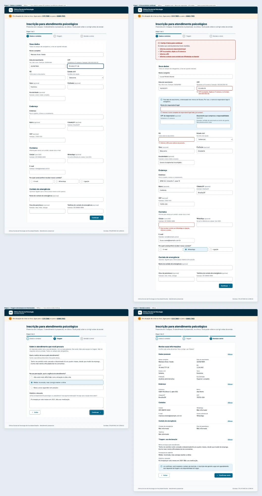](../assets/prototipos-ciclo-3/1-1-inscricao-computador.webp){ target="_blank" }

**No celular**

[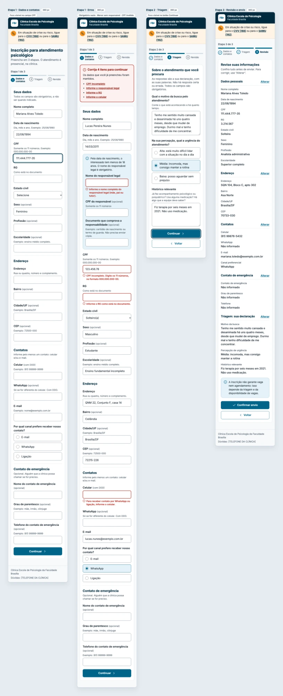](../assets/prototipos-ciclo-3/1-2-inscricao-celular.webp){ target="_blank" }

### RF2 — Emitir comprovante de inscrição { #rf2 }

_Ciclo 3._ [RF2](../requisitos/funcionais.md#rf2) · issue [#89](https://github.com/mdsreq-fga-unb/REQ-2026.2-T02-ClinicaEscolaFBr/issues/89). Comprovante com número, data e hora, sem a queixa nem dados clínicos, no computador e no celular.

[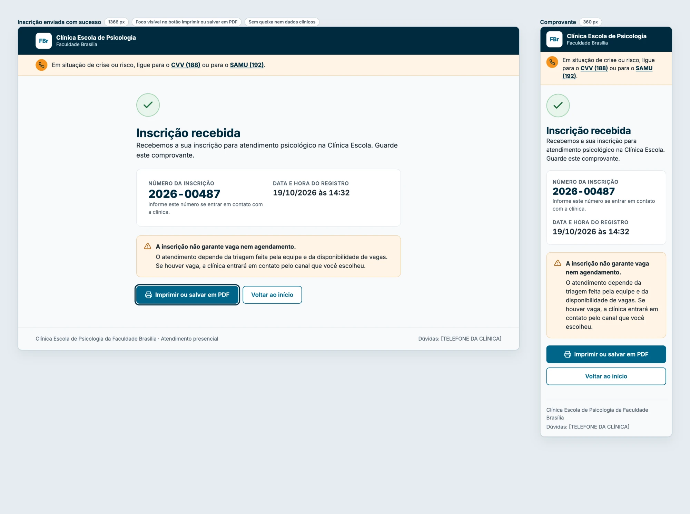](../assets/prototipos-ciclo-3/1-3-comprovante.webp){ target="_blank" }

### RF57 — Registrar consentimento para tratamento de dados { #rf57 }

_Ciclo 4._ [RF57](../requisitos/funcionais.md#rf57) · issue [#52](https://github.com/mdsreq-fga-unb/REQ-2026.2-T02-ClinicaEscolaFBr/issues/52). O termo fica na etapa 3 da inscrição, depois do resumo da revisão. No resumo, cada bloco de dados ocupa uma linha e pode ser aberto. O termo traz a versão e cinco tópicos que a pessoa abre para ler: o que é coletado, para que, quem tem acesso, o prazo de guarda de 5 anos e como revogar. A caixa de concordância fica sempre à vista e começa desmarcada. São quatro estados:

- **maior de idade:** termo e caixa de concordância antes de "Concluir inscrição";
- **erro sem aceite:** a inscrição não é concluída, com o resumo no topo e a mensagem junto da caixa;
- **menor de idade:** o responsável legal vê o nome e o CPF dele, informados na etapa 1, só para leitura, concorda e vê o aviso de que o aceite on-line não substitui a autorização assinada na clínica;
- **erro do menor de idade:** CPF do responsável não informado na etapa 1, com a orientação de voltar e corrigir, e caixa desmarcada, cada mensagem junto do seu item.

**No computador**

[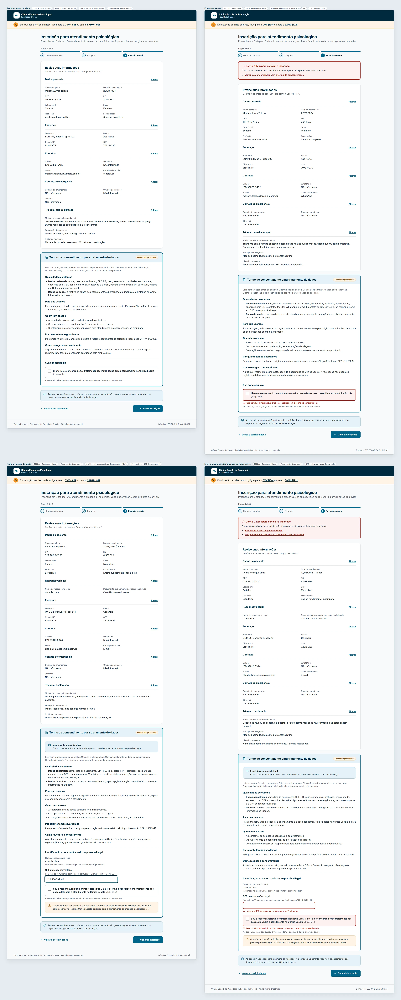](../assets/prototipos-ciclo-4/1-1-termo-computador.webp){ target="_blank" }

**No celular**

[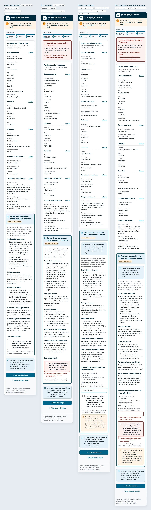](../assets/prototipos-ciclo-4/1-2-termo-celular.webp){ target="_blank" }

### RF52 — Verificar identidade do paciente ou responsável { #rf52 }

_Ciclo 4._ [RF52](../requisitos/funcionais.md#rf52) · issue [#47](https://github.com/mdsreq-fga-unb/REQ-2026.2-T02-ClinicaEscolaFBr/issues/47). Antes de consultar a fila (RF8) ou pedir uma declaração (CP10), o paciente ou o responsável informa o CPF ou o número da inscrição e o código de 6 dígitos enviado ao e-mail cadastrado. São quatro estados:

- **identificação:** com o aviso para quem informou só o celular;
- **código enviado:** com a mesma mensagem, haja ou não e-mail cadastrado, e o reenvio liberado só depois de 60 segundos;
- **código inválido ou expirado:** com uma mensagem única para qualquer falha;
- **limite de pedidos:** depois de 3 códigos em 60 minutos, com o horário de liberação.

**No computador**

[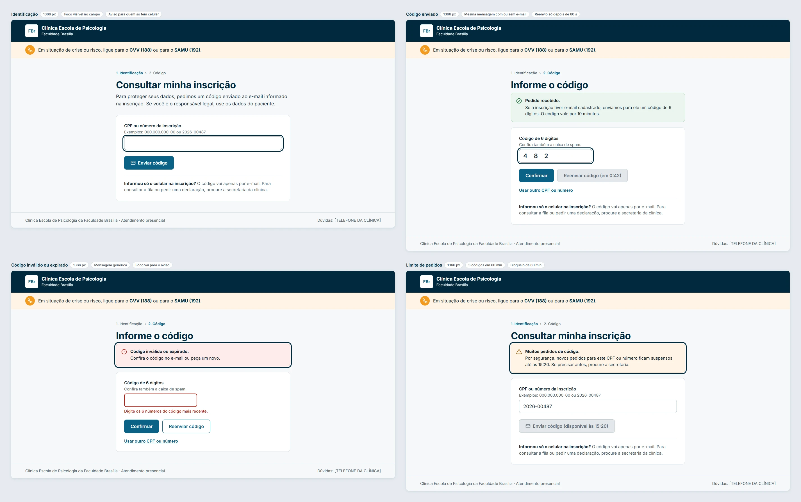](../assets/prototipos-ciclo-4/7-1-verificacao-computador.webp){ target="_blank" }

**No celular**

[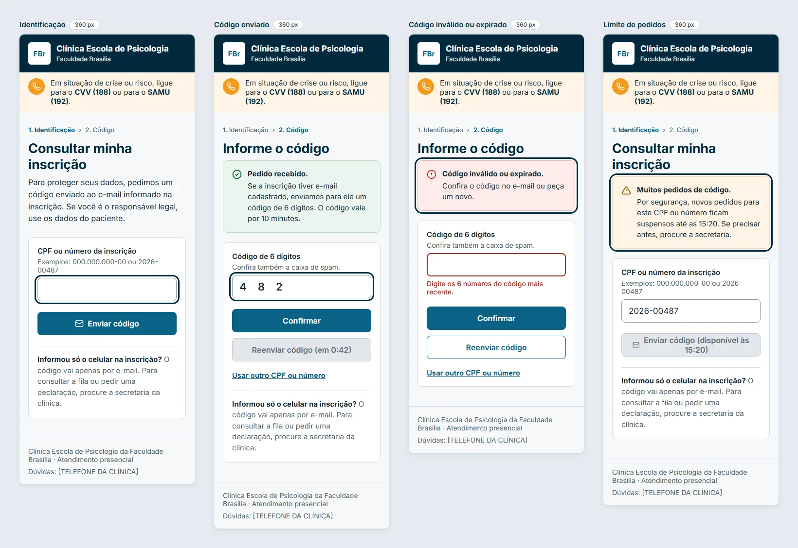](../assets/prototipos-ciclo-4/7-2-verificacao-celular.webp){ target="_blank" }

### RF8 — Consultar posição individual na fila { #rf8 }

_Ciclo 4._ [RF8](../requisitos/funcionais.md#rf8) · issue [#155](https://github.com/mdsreq-fga-unb/REQ-2026.2-T02-ClinicaEscolaFBr/issues/155). Depois da verificação de identidade (RF52), o inscrito vê a situação da inscrição. O aviso de que a posição pode mudar e não garante data fica junto do resultado. São quatro estados:

- **na fila de espera:** com a posição em destaque;
- **aguardando triagem:** sem posição, explicando o próximo passo;
- **em atendimento:** sem posição, indicando a secretaria para dúvidas;
- **acesso negado:** sem verificação válida ou depois de 15 minutos, sem nenhum dado da inscrição e com o botão para confirmar a identidade de novo.

**No computador**

[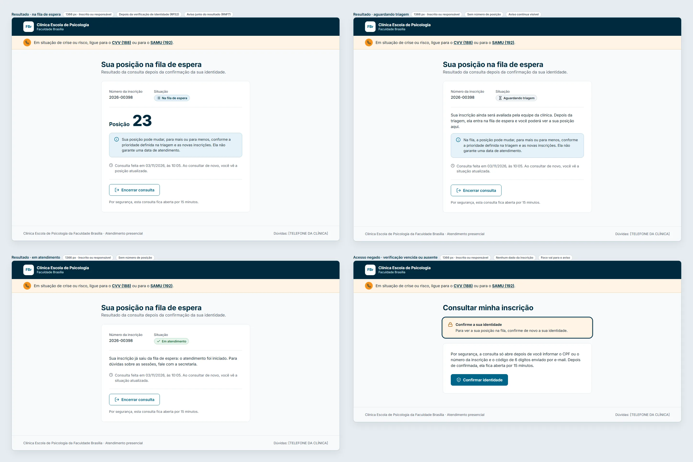](../assets/prototipos-ciclo-4/1-3-fila-computador.webp){ target="_blank" }

**No celular**

[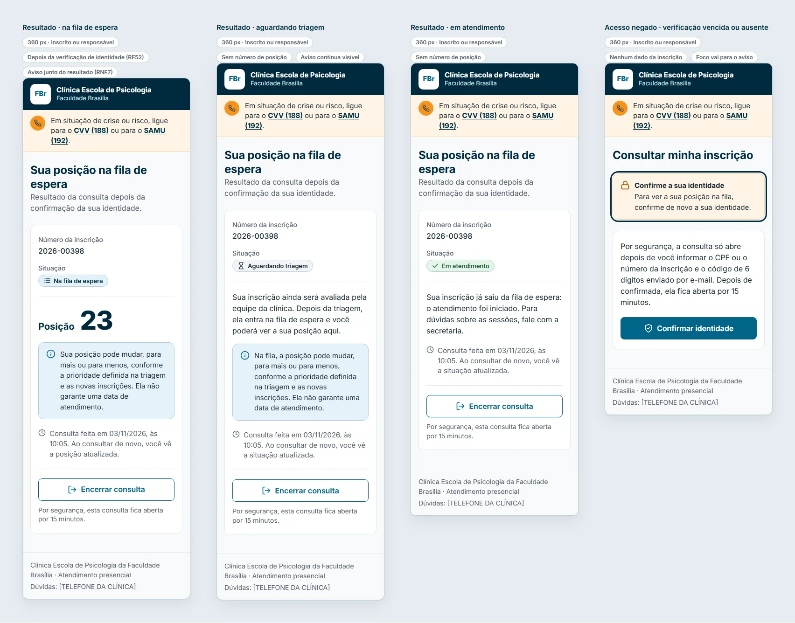](../assets/prototipos-ciclo-4/1-4-fila-celular.webp){ target="_blank" }

### RF14 e RF15 — Página do link da sessão { #rf14-rf15-link }

_Ciclo 4._ [RF14](../requisitos/funcionais.md#rf14) e [RF15](../requisitos/funcionais.md#rf15) · issues [#142](https://github.com/mdsreq-fga-unb/REQ-2026.2-T02-ClinicaEscolaFBr/issues/142) e [#143](https://github.com/mdsreq-fga-unb/REQ-2026.2-T02-ClinicaEscolaFBr/issues/143). O paciente abre o link recebido no agendamento, sem login, e confirma a presença até 24 horas antes da sessão ou cancela com justificativa. São sete estados:

- **sessão agendada:** com o prazo para confirmar e as opções de confirmar ou cancelar;
- **presença confirmada;**
- **prazo encerrado:** a confirmação não está mais disponível, e a página indica a secretaria;
- **link não é mais válido:** sessão já cancelada ou link vencido;
- **cancelar:** formulário com a justificativa obrigatória;
- **erro sem justificativa;**
- **sessão cancelada.**

**No computador**

[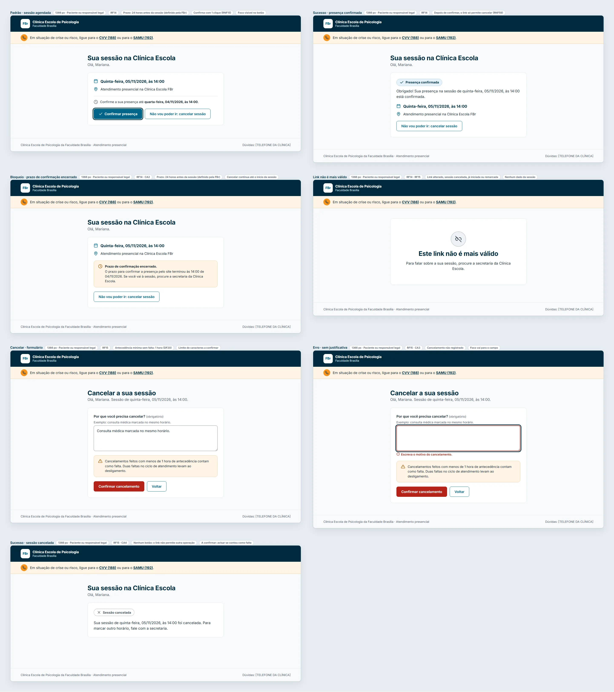](../assets/prototipos-ciclo-4/1-5-link-sessao-computador.webp){ target="_blank" }

**No celular**

[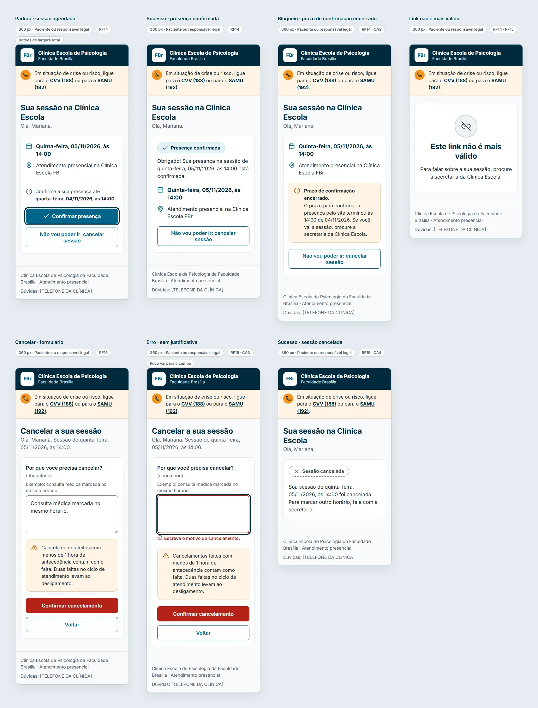](../assets/prototipos-ciclo-4/1-6-link-sessao-celular.webp){ target="_blank" }

## 2. Acesso: login, ativação e usuários

### RF50 — Autenticar usuário institucional { #rf50 }

_Ciclo 3._ [RF50](../requisitos/funcionais.md#rf50) · issue [#45](https://github.com/mdsreq-fga-unb/REQ-2026.2-T02-ClinicaEscolaFBr/issues/45). Tela de entrada, erro genérico de credenciais e conta bloqueada por 15 minutos depois de 3 tentativas.

[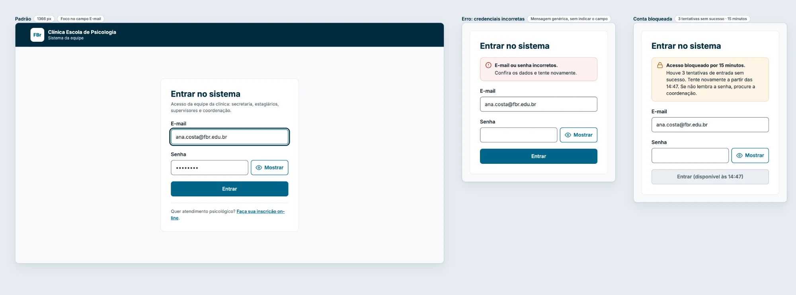](../assets/prototipos-ciclo-3/2-1-entrar.webp){ target="_blank" }

### RF53 — Ativação da conta pelo convite { #rf53-ativacao }

_Ciclo 3._ [RF53](../requisitos/funcionais.md#rf53) · issue [#48](https://github.com/mdsreq-fga-unb/REQ-2026.2-T02-ClinicaEscolaFBr/issues/48). Definição da senha com as regras visíveis, erro na confirmação e link vencido ou já usado.

[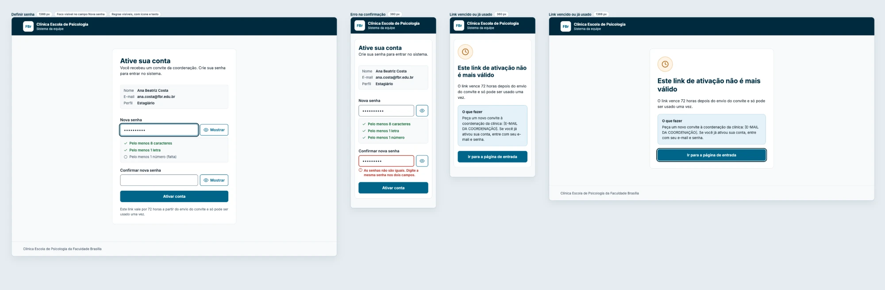](../assets/prototipos-ciclo-3/2-2-ativacao.webp){ target="_blank" }

### RF53 e RF54 — Cadastrar, convidar e desativar usuários { #rf53-rf54 }

_Ciclo 3._ [RF53](../requisitos/funcionais.md#rf53) e [RF54](../requisitos/funcionais.md#rf54) · issues [#48](https://github.com/mdsreq-fga-unb/REQ-2026.2-T02-ClinicaEscolaFBr/issues/48) e [#49](https://github.com/mdsreq-fga-unb/REQ-2026.2-T02-ClinicaEscolaFBr/issues/49). Lista de usuários com a situação de cada conta, cadastro com e-mail já existente, confirmação de desativação e reenvio de convite.

[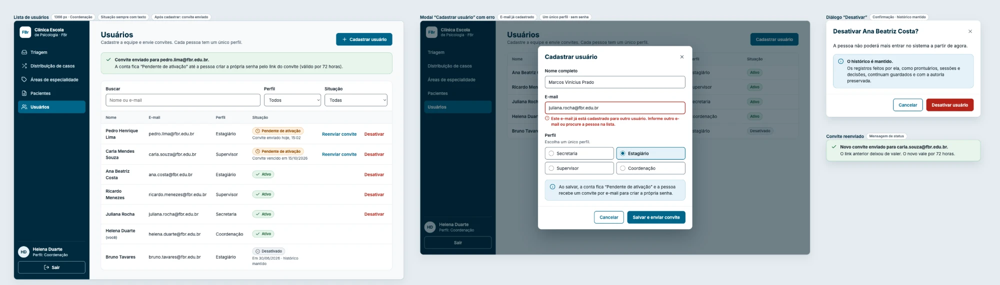](../assets/prototipos-ciclo-3/2-3-usuarios.webp){ target="_blank" }

## 3. Triagem e fila de espera

### RF4 — Organizar informações da inscrição para triagem { #rf4 }

_Ciclo 3._ [RF4](../requisitos/funcionais.md#rf4) · issue [#90](https://github.com/mdsreq-fga-unb/REQ-2026.2-T02-ClinicaEscolaFBr/issues/90). Lista com os dias que cada inscrição aguarda, sem prazo máximo, inscrição aberta com o bloco "Declarado pelo interessado" e lista vazia.

[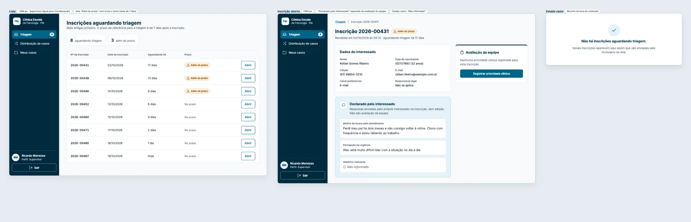](../assets/prototipos-ciclo-3/3-1-triagem.webp){ target="_blank" }

### RF6 — Registrar prioridade clínica do inscrito { #rf6 }

_Ciclo 3._ [RF6](../requisitos/funcionais.md#rf6) · issue [#91](https://github.com/mdsreq-fga-unb/REQ-2026.2-T02-ClinicaEscolaFBr/issues/91). Escolha da prioridade sem cor pré-selecionada, referência da clínica, área opcional, histórico de decisões, erro sem prioridade escolhida e confirmação do registro.

[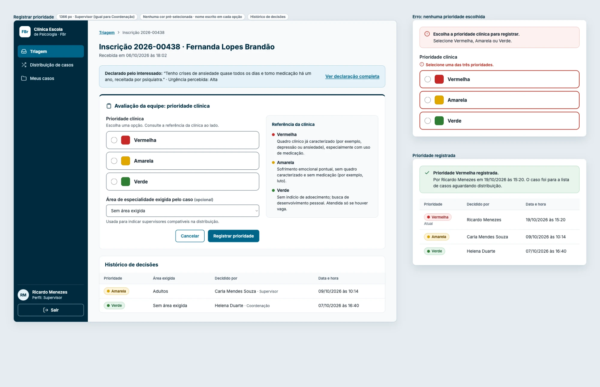](../assets/prototipos-ciclo-3/3-2-prioridade.webp){ target="_blank" }

### RF7 — Ordenar inscritos na fila de espera { #rf7 }

_Ciclo 4._ [RF7](../requisitos/funcionais.md#rf7) · issue [#140](https://github.com/mdsreq-fga-unb/REQ-2026.2-T02-ClinicaEscolaFBr/issues/140). A fila ordenada pela prioridade clínica confirmada na triagem e, na mesma prioridade, pela data de entrada na fila, com as inscrições ainda sem prioridade numa seção à parte, fora da ordenação. Aparecem a fila depois de uma mudança de prioridade, o estado vazio e o acesso negado para a secretaria.

[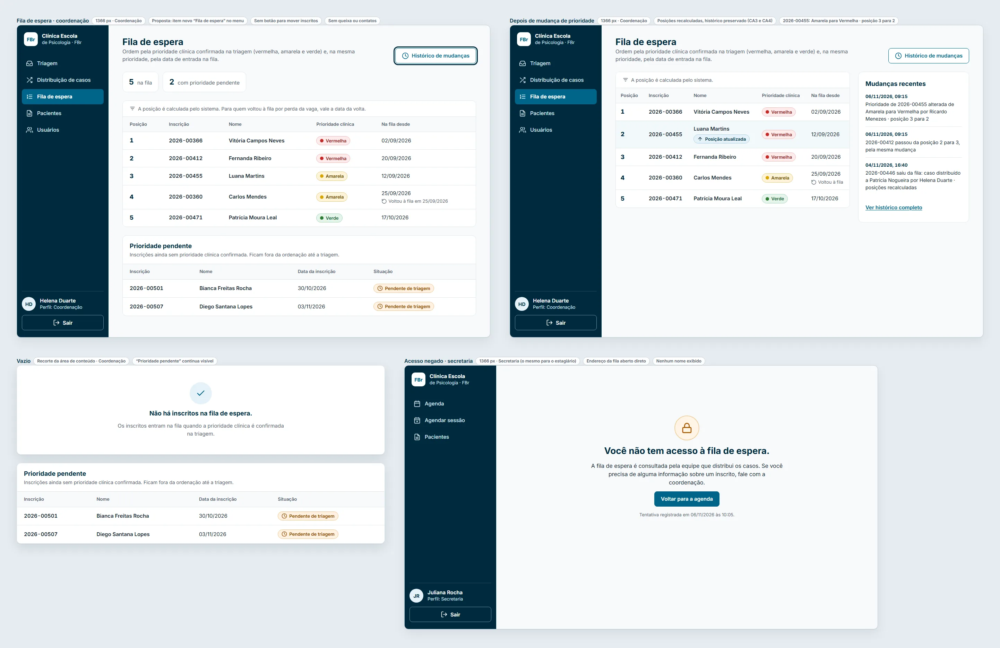](../assets/prototipos-ciclo-4/6-1-fila-espera.webp){ target="_blank" }

## 4. Distribuição, casos e responsáveis

### RF18 — Listar casos aguardando distribuição { #rf18 }

_Ciclo 3._ [RF18](../requisitos/funcionais.md#rf18) · issue [#92](https://github.com/mdsreq-fga-unb/REQ-2026.2-T02-ClinicaEscolaFBr/issues/92). Lista da coordenação no computador e no celular, lista vazia e a visão do supervisor, somente para consulta.

[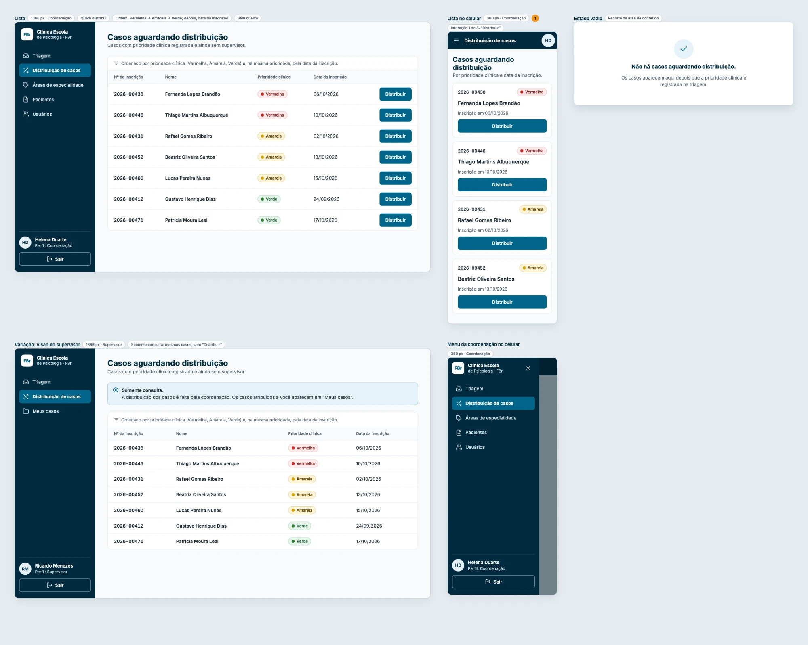](../assets/prototipos-ciclo-3/4-1-casos-aguardando.webp){ target="_blank" }

### RF20 — Distribuir caso a supervisor { #rf20 }

_Ciclo 3._ [RF20](../requisitos/funcionais.md#rf20) · issue [#94](https://github.com/mdsreq-fga-unb/REQ-2026.2-T02-ClinicaEscolaFBr/issues/94). Painel de distribuição da coordenação com os casos ativos de cada supervisor (limite de 50), todos os supervisores no limite, caso que já tem supervisor e o fluxo de três passos no celular.

[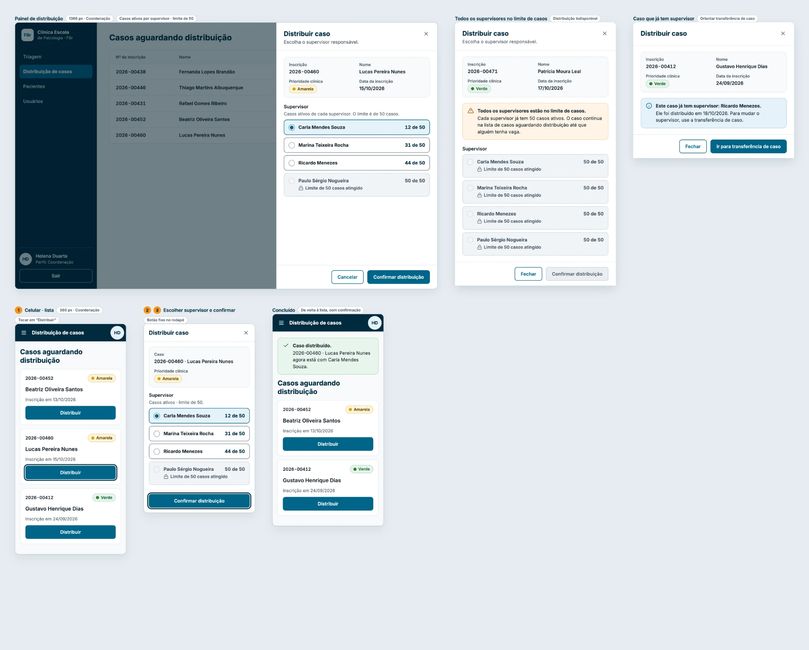](../assets/prototipos-ciclo-3/4-3-distribuir.webp){ target="_blank" }

### RF21 — Vincular paciente a estagiário responsável { #rf21 }

_Ciclo 3._ [RF21](../requisitos/funcionais.md#rf21) · issue [#95](https://github.com/mdsreq-fga-unb/REQ-2026.2-T02-ClinicaEscolaFBr/issues/95). Vínculo pelo supervisor, confirmação com o prontuário criado, falta de estagiários disponíveis e o fluxo no celular.

[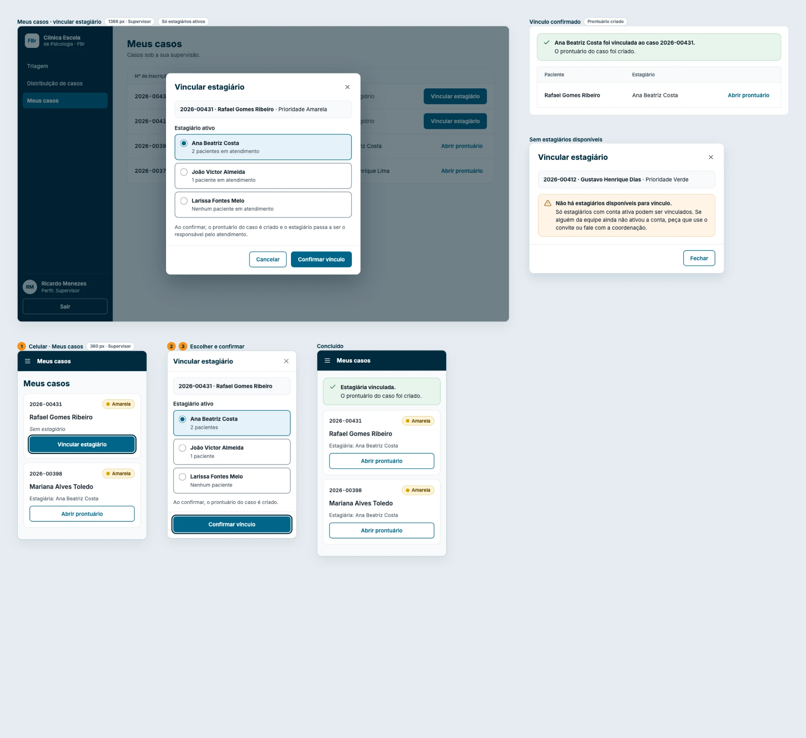](../assets/prototipos-ciclo-3/4-4-vincular.webp){ target="_blank" }

### RF22 — Consultar responsáveis pelo caso { #rf22 }

_Ciclo 4._ [RF22](../requisitos/funcionais.md#rf22) · issue [#145](https://github.com/mdsreq-fga-unb/REQ-2026.2-T02-ClinicaEscolaFBr/issues/145). A lista de Pacientes e a ficha mostram o estagiário e o supervisor de cada caso, ou indicam que o caso ainda não tem um deles, sem dado clínico.

[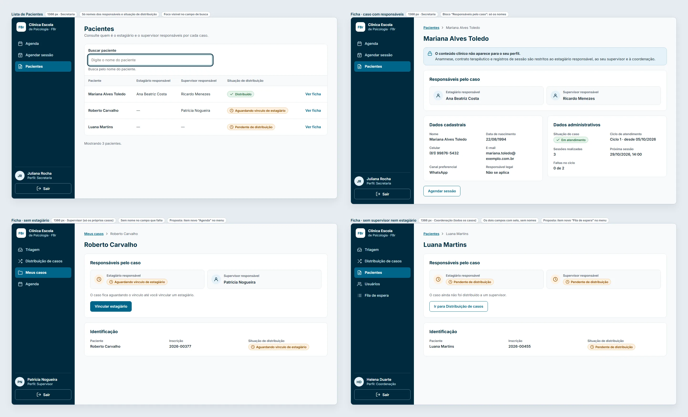](../assets/prototipos-ciclo-4/2-3-responsaveis.webp){ target="_blank" }

### RF23 — Consultar casos sob responsabilidade do estagiário ou supervisor { #rf23 }

_Ciclo 4._ [RF23](../requisitos/funcionais.md#rf23) · issue [#146](https://github.com/mdsreq-fga-unb/REQ-2026.2-T02-ClinicaEscolaFBr/issues/146). "Meus pacientes" do estagiário e "Meus casos" do supervisor, com o filtro por estagiário, o caso aguardando vínculo, o estado vazio e o acesso negado a um caso de outro estagiário.

[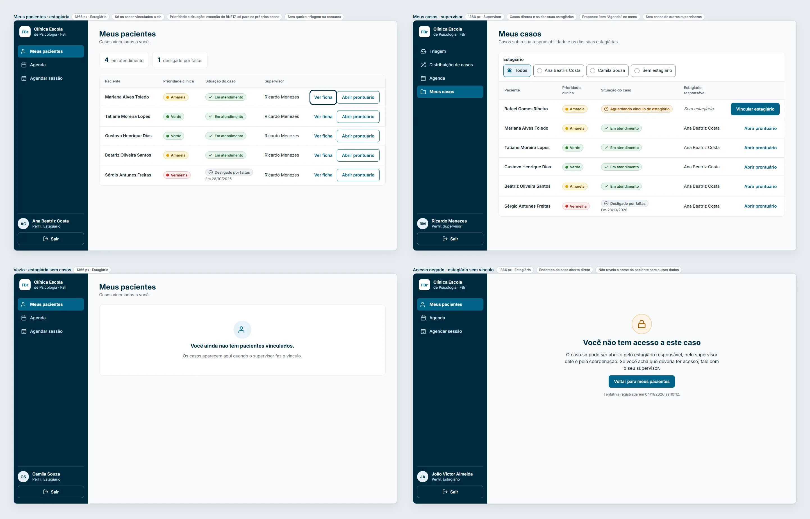](../assets/prototipos-ciclo-4/4-1-casos.webp){ target="_blank" }

### RF25 — Transferir caso para outro estagiário ou supervisor { #rf25 }

_Ciclo 4._ [RF25](../requisitos/funcionais.md#rf25) · issue [#147](https://github.com/mdsreq-fga-unb/REQ-2026.2-T02-ClinicaEscolaFBr/issues/147). O supervisor transfere o caso para outro estagiário seu, e a coordenação, para outro supervisor, vendo os casos ativos de cada um. A transferência pede motivo e confirmação, guarda o histórico e tira o acesso do responsável anterior.

[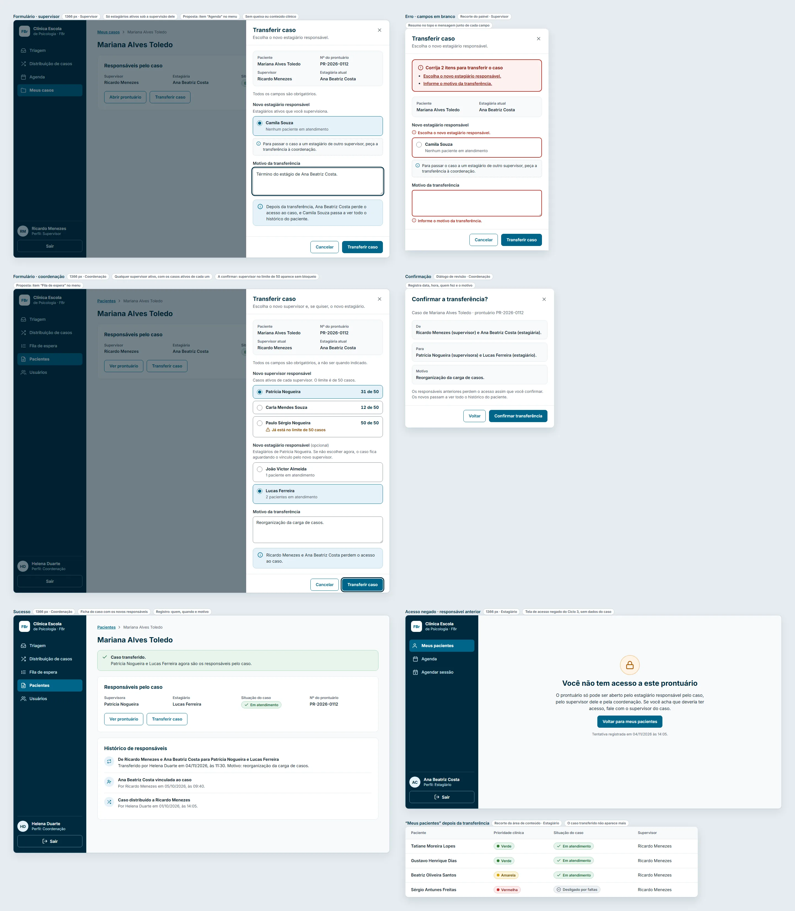](../assets/prototipos-ciclo-4/4-3-transferir.webp){ target="_blank" }

## 5. Agenda e sessões

### RF10 — Agendar sessão do paciente { #rf10 }

_Ciclo 3._ [RF10](../requisitos/funcionais.md#rf10) · issue [#96](https://github.com/mdsreq-fga-unb/REQ-2026.2-T02-ClinicaEscolaFBr/issues/96). Formulário com o término calculado e o bloco de 60 minutos (sessão e anotações), sessão agendada com envio por e-mail e com o botão "Enviar pelo WhatsApp", conflito de horário, término anterior ao início e paciente sem estagiário vinculado.

[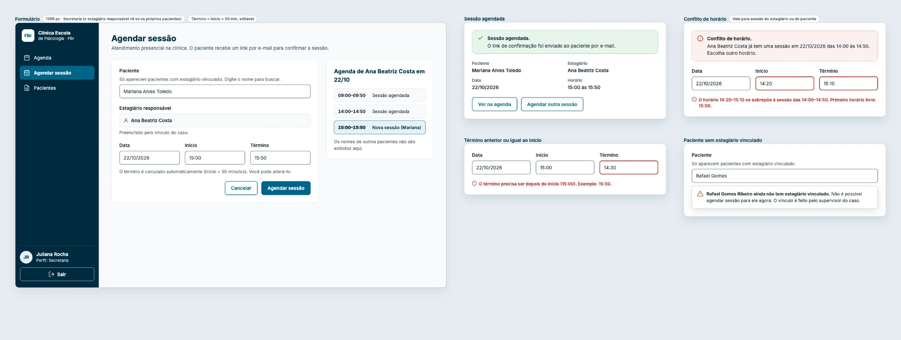](../assets/prototipos-ciclo-3/5-1-agendar.webp){ target="_blank" }

### RF11 — Consultar agenda de sessões do estagiário { #rf11 }

_Ciclo 4._ [RF11](../requisitos/funcionais.md#rf11) · issue [#141](https://github.com/mdsreq-fga-unb/REQ-2026.2-T02-ClinicaEscolaFBr/issues/141). A agenda da semana do estagiário, com filtros por período e situação, e a agenda dos estagiários do supervisor, que só mostra os estagiários dele.

[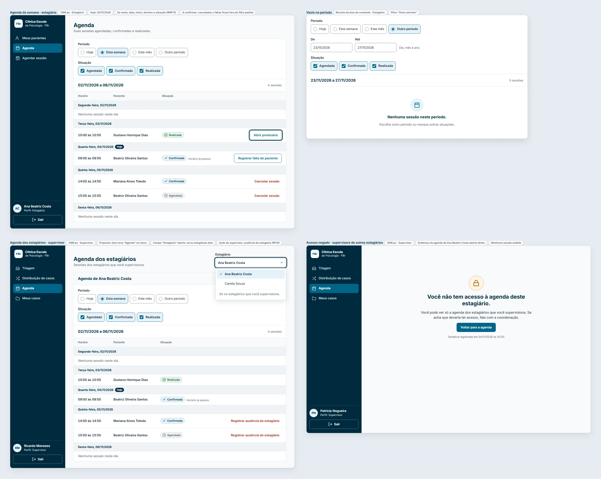](../assets/prototipos-ciclo-4/4-2-agenda-estagiario.webp){ target="_blank" }

### RF14 — Sessões sem confirmação na agenda { #rf14 }

_Ciclo 4._ [RF14](../requisitos/funcionais.md#rf14) · issue [#142](https://github.com/mdsreq-fga-unb/REQ-2026.2-T02-ClinicaEscolaFBr/issues/142). Na Agenda, a secretaria vê as sessões cujo prazo de confirmação acabou sem resposta do paciente, com o canal preferencial, o caminho para os contatos e a opção de registrar a confirmação feita por telefone. Também aparece o estado vazio.

[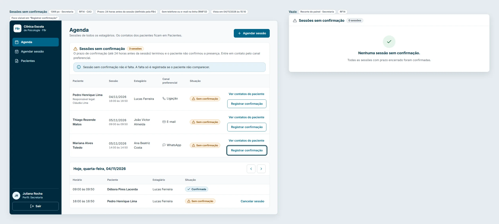](../assets/prototipos-ciclo-4/2-1-agenda-confirmacao.webp){ target="_blank" }

### RF15 e RF16 — Cancelar sessão { #rf15-rf16 }

_Ciclo 4._ [RF15](../requisitos/funcionais.md#rf15) e [RF16](../requisitos/funcionais.md#rf16) · issues [#143](https://github.com/mdsreq-fga-unb/REQ-2026.2-T02-ClinicaEscolaFBr/issues/143) e [#144](https://github.com/mdsreq-fga-unb/REQ-2026.2-T02-ClinicaEscolaFBr/issues/144). O mesmo diálogo "Cancelar sessão" registra o pedido do paciente (no prazo ou fora dele, quando conta como falta), o cancelamento para remarcar (que não conta falta para ninguém) e a ausência do estagiário. Aparecem também a sessão já iniciada, que não pode mais ser cancelada, o erro sem justificativa e o acesso negado para o estagiário que não é o responsável.

[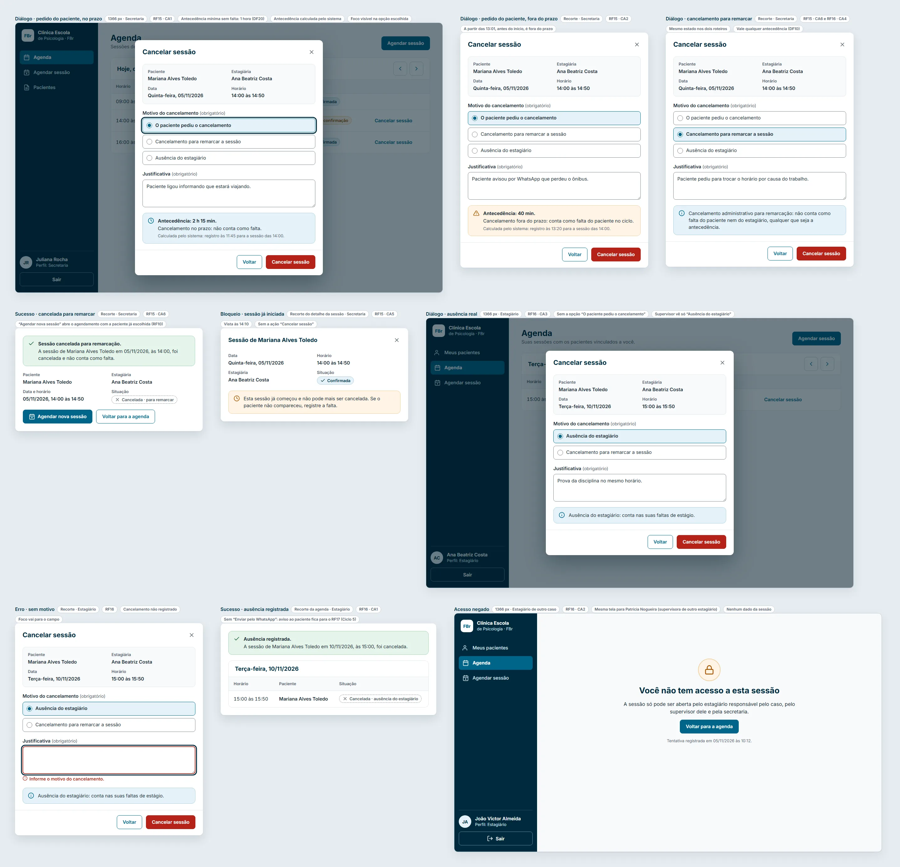](../assets/prototipos-ciclo-4/2-2-cancelar-sessao.webp){ target="_blank" }

## 6. Prontuário e evolução

### RF66 e RF55 — Criar o prontuário e restringir o acesso { #rf66-rf55 }

_Ciclo 3._ [RF66](../requisitos/funcionais.md#rf66) e [RF55](../requisitos/funcionais.md#rf55) · issues [#97](https://github.com/mdsreq-fga-unb/REQ-2026.2-T02-ClinicaEscolaFBr/issues/97) e [#50](https://github.com/mdsreq-fga-unb/REQ-2026.2-T02-ClinicaEscolaFBr/issues/50). Visão do estagiário responsável com os dados iniciais, visão da secretaria só com dados cadastrais e administrativos, visão da coordenação, que abre qualquer prontuário só para leitura, com o acesso registrado ([DF32](../requisitos/decisoes-fbr.md#df32)), e acesso negado a outro estagiário. Os dados iniciais mostrados na visão do estagiário são do [RF69](../requisitos/funcionais.md#rf69), separado do RF66 em 24/10/2026 e previsto para o Ciclo 4. Desde 31/10/2026, o contrato terapêutico segue o "Contrato de Prestação de Serviço" da Clínica Escola, assinado em papel ([DF41](../requisitos/decisoes-fbr.md#df41)): o prontuário registra a data de assinatura, o aceite do termo de consentimento para pesquisa, que é opcional, e a guarda da via assinada. A anamnese continua ilustrativa nesta imagem.

[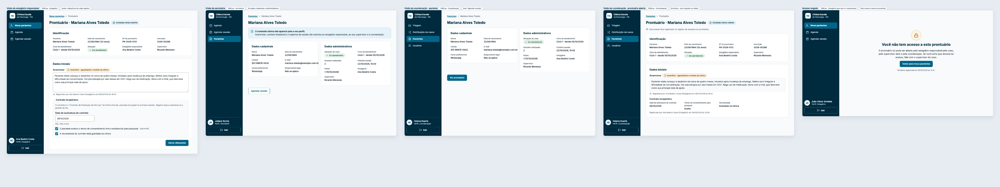](../assets/prototipos-ciclo-3/6-1-prontuario.webp){ target="_blank" }

### RF27 — Consultar prontuário do paciente { #rf27 }

_Ciclo 4._ [RF27](../requisitos/funcionais.md#rf27) · issue [#148](https://github.com/mdsreq-fga-unb/REQ-2026.2-T02-ClinicaEscolaFBr/issues/148). O prontuário, nas seções do modelo da clínica, para o estagiário, o supervisor e a coordenação (só leitura, com o acesso registrado). Aparecem também o prontuário sem registros, o histórico depois de uma transferência e o acesso negado, que não sugere a existência de conteúdo clínico. As evoluções e o histórico de responsáveis começam fechados, as seções sem registro ocupam uma linha e a barra "Ir para" fica fixa no topo ao rolar. Em "Sessões do ciclo", a sessão que já terminou mostra à estagiária responsável a ação "Marcar sessão como realizada", como o sistema já faz. O contrato aparece como no Ciclo 3: data de assinatura, termo de consentimento para pesquisa e via assinada.

[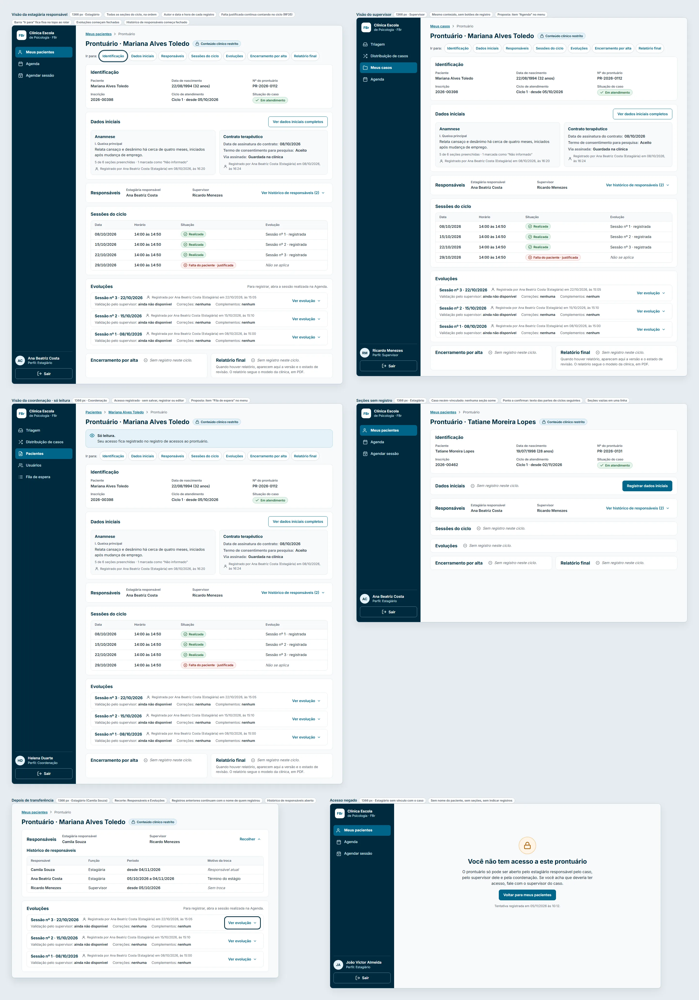](../assets/prototipos-ciclo-4/5-1-prontuario.webp){ target="_blank" }

### RF69 — Registrar anamnese e contrato terapêutico do paciente { #rf69 }

_Ciclo 4._ [RF69](../requisitos/funcionais.md#rf69) · issue [#130](https://github.com/mdsreq-fga-unb/REQ-2026.2-T02-ClinicaEscolaFBr/issues/130). O estagiário registra a anamnese, com a queixa trazida da inscrição, e o contrato terapêutico. O contrato é o "Contrato de Prestação de Serviço" da Clínica Escola, assinado em papel na primeira sessão. No sistema ficam a data de assinatura, o aceite do termo de consentimento para pesquisa (opcional) e a guarda da via assinada na clínica (obrigatória). Aparecem os erros de campo obrigatório, de limite de caracteres e de via assinada não marcada, o registro salvo, a leitura pelo supervisor e o bloqueio do caso sem prontuário.

[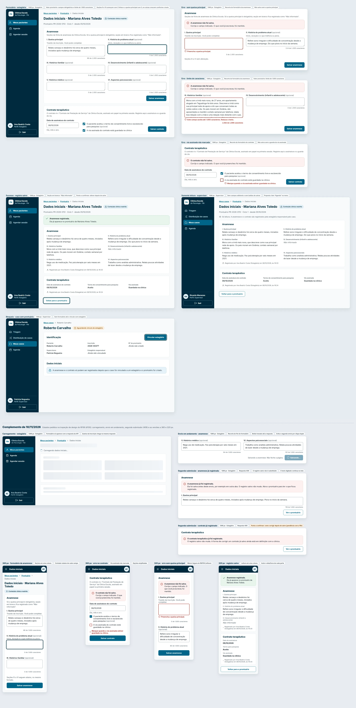](../assets/prototipos-ciclo-4/5-2-dados-iniciais.webp){ target="_blank" }

### RF28 — Registrar evolução da sessão realizada { #rf28 }

_Ciclo 4._ [RF28](../requisitos/funcionais.md#rf28) · issue [#149](https://github.com/mdsreq-fga-unb/REQ-2026.2-T02-ClinicaEscolaFBr/issues/149). O estagiário registra a evolução pelo prontuário, na seção "Sessões do ciclo", como o sistema já faz: depois que a sessão termina, ele a marca como realizada, e então a ação "Registrar evolução" abre o formulário. Depois de salva, a evolução não pode ser editada. Na agenda, a sessão realizada leva ao prontuário. Aparecem os erros, a evolução salva, o aviso de fechamento avaliativo na 10ª sessão, as ações de cada sessão no prontuário (sem "Registrar evolução" antes de a sessão ser marcada como realizada) e o acesso negado.

[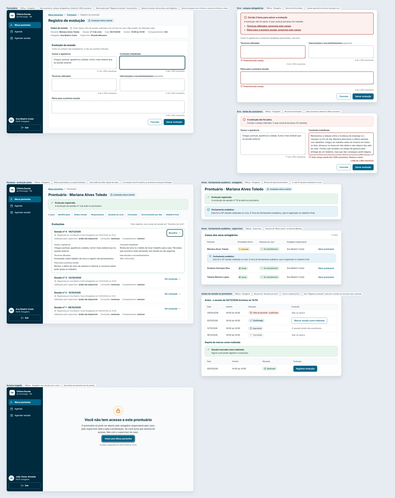](../assets/prototipos-ciclo-4/5-3-evolucao.webp){ target="_blank" }

## 7. Faltas e desligamento

### RF34 — Registrar falta do paciente na sessão { #rf34 }

_Ciclo 4._ [RF34](../requisitos/funcionais.md#rf34) · issue [#150](https://github.com/mdsreq-fga-unb/REQ-2026.2-T02-ClinicaEscolaFBr/issues/150). A falta é registrada na sessão, com a opção de marcá-la como justificada na hora ou depois. A falta justificada continua contando. Aparecem o erro de justificativa sem motivo, as sessões que não aceitam falta e o acesso negado.

[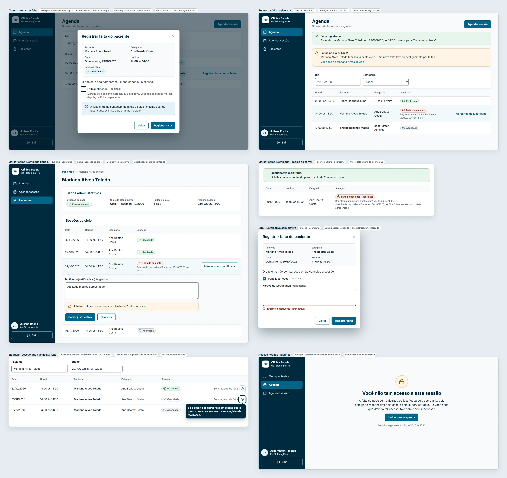](../assets/prototipos-ciclo-4/3-1-falta.webp){ target="_blank" }

### RF35 — Contabilizar faltas do paciente no ciclo { #rf35 }

_Ciclo 4._ [RF35](../requisitos/funcionais.md#rf35) · issue [#151](https://github.com/mdsreq-fga-unb/REQ-2026.2-T02-ClinicaEscolaFBr/issues/151). O contador "Faltas no ciclo: 1 de 2" aparece para a secretaria e para o estagiário, com o histórico do que conta e do que não conta, e com a falta desconsiderada depois de uma reversão.

[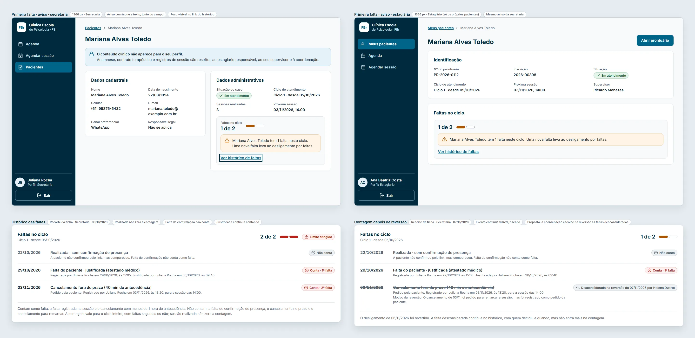](../assets/prototipos-ciclo-4/3-2-contagem-faltas.webp){ target="_blank" }

### RF36 — Emitir alerta de limite de faltas atingido { #rf36 }

_Ciclo 4._ [RF36](../requisitos/funcionais.md#rf36) · issue [#152](https://github.com/mdsreq-fga-unb/REQ-2026.2-T02-ClinicaEscolaFBr/issues/152). Na 2ª falta do ciclo, uma faixa de alerta aparece para a secretaria, a coordenação e o estagiário, sem o motivo das faltas, e só sai depois da decisão sobre o desligamento.

[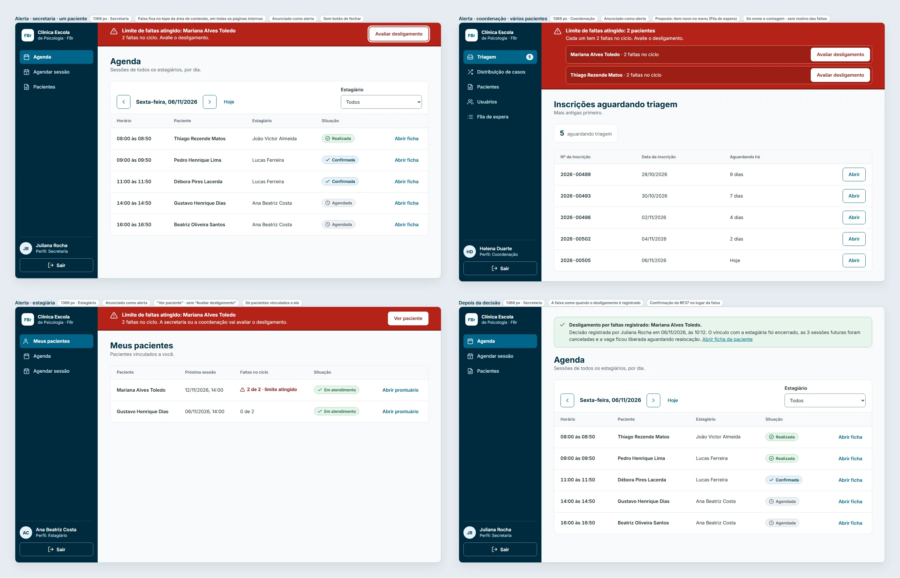](../assets/prototipos-ciclo-4/3-3-alerta-faltas.webp){ target="_blank" }

### RF37 — Desligar paciente por faltas e liberar vaga { #rf37 }

_Ciclo 4._ [RF37](../requisitos/funcionais.md#rf37) · issue [#153](https://github.com/mdsreq-fga-unb/REQ-2026.2-T02-ClinicaEscolaFBr/issues/153). A secretaria confirma o desligamento, que cancela as sessões futuras e libera a vaga. A coordenação e o supervisor veem a vaga liberada e o próximo inscrito elegível da fila. O paciente sem alerta não tem a ação.

[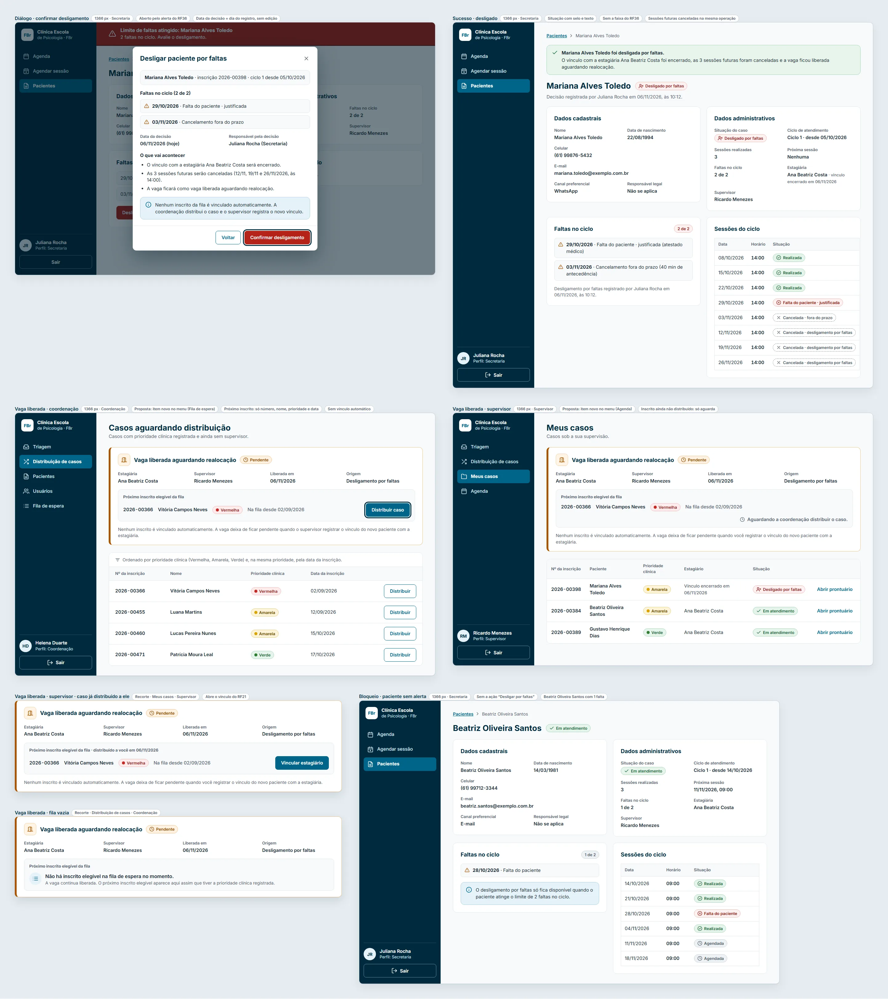](../assets/prototipos-ciclo-4/3-4-desligamento.webp){ target="_blank" }

### RF38 — Reverter desligamento de paciente por faltas { #rf38 }

_Ciclo 4._ [RF38](../requisitos/funcionais.md#rf38) · issue [#154](https://github.com/mdsreq-fga-unb/REQ-2026.2-T02-ClinicaEscolaFBr/issues/154). A coordenação reverte o desligamento com motivo obrigatório e escolhe as faltas que deixam de contar. O caso volta ao atendimento com o mesmo estagiário, ou aguarda vaga se ela já foi ocupada, e a secretaria reagenda as sessões.

[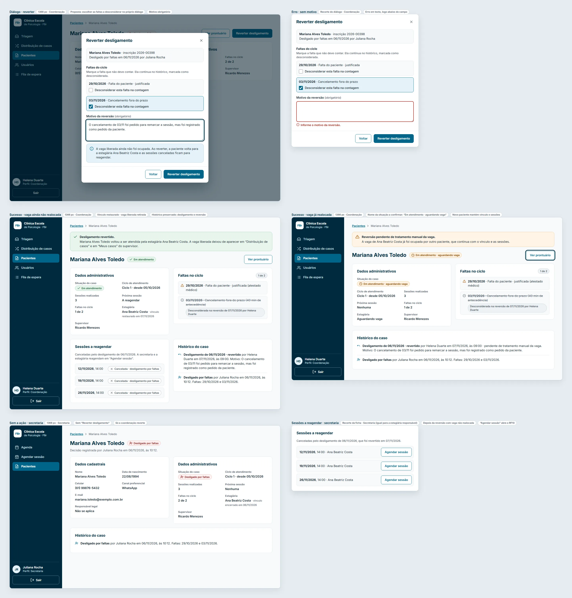](../assets/prototipos-ciclo-4/3-5-reversao.webp){ target="_blank" }

## 8. Navegação interna por perfil { #navegacao }

_Ciclo 3._ Menu de cada perfil (secretaria, estagiário, supervisor e coordenação) e o menu no celular.

[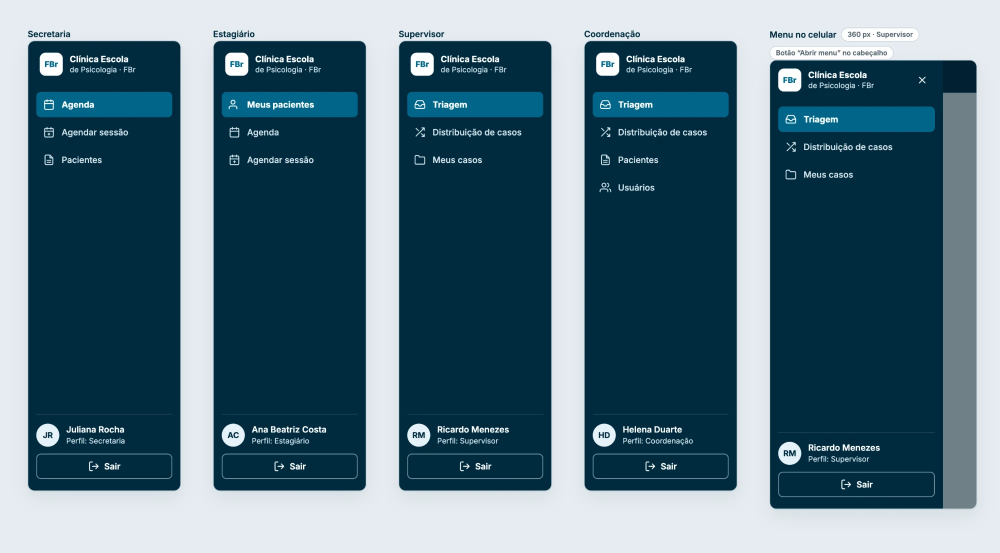](../assets/prototipos-ciclo-3/7-1-navegacao.webp){ target="_blank" }
