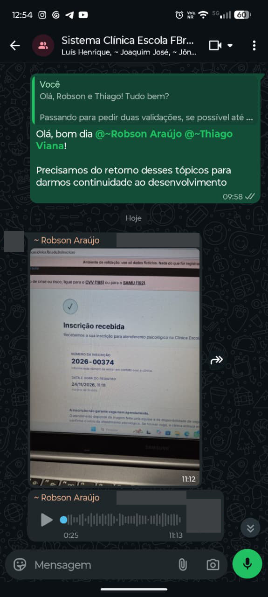
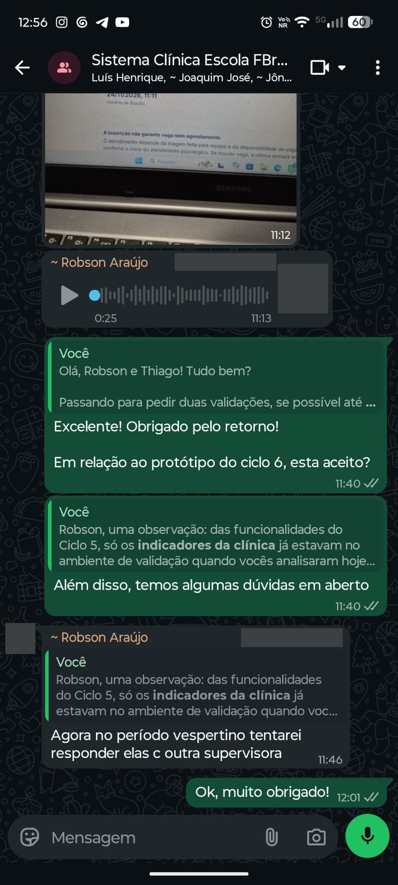
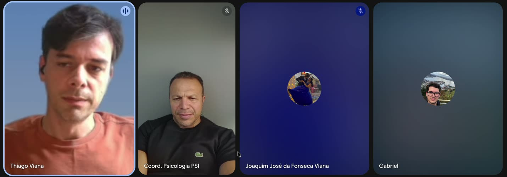

# Reuniões da Unidade 4

Esta página reúne os registros das reuniões e das respostas da FBr durante a Unidade 4, iniciada depois da entrega da Unidade 3 em 17/11/2026: a validação das funcionalidades do Ciclo 5, as respostas às dúvidas pendentes e a validação final do sistema com a FBr. Os registros anteriores estão em [Reuniões da Unidade 3](../unidade-3/reunioes.md).

## Validação das funcionalidades do Ciclo 5 pela FBr (24/11) { #validacao-das-funcionalidades-do-ciclo-5-pela-fbr }

**Data:** 24/11/2026
**Local:** grupo "Sistema Clínica Escola FBr" no WhatsApp
**Participantes:** pela FBr, Robson Araújo, que analisou o sistema com os professores Alexandre e Lauana e com a supervisora de estágio Elaine; pela equipe, Gabriel da Cunha Barbaceli e os demais integrantes do grupo.

Depois da entrega da Unidade 3, a equipe pediu no grupo duas validações, com prazo até 20/11:

1. **Protótipos do Ciclo 6**, as telas das 14 features do ciclo, com os quatro pontos da capa do PDF: quem registra o complemento da evolução (RF30), a reclassificação da falta do estagiário (RF40 e RF63), o modelo da declaração de comparecimento (RF45) e a base legal da revogação do consentimento (RF65).
2. **As seis features do Ciclo 5 que entraram no ambiente de validação depois da [validação de 16/11](../unidade-3/reunioes.md#validacao-do-ciclo-5-pela-fbr)**, com um roteiro do passo a passo de cada uma, a conta a usar e o que conferir:
    - **Contribuição social (RF41):** a secretaria registra o pagamento, e a coordenação define o valor da contribuição;
    - **Correção de evolução (RF29):** o estagiário corrige a evolução, e a versão anterior fica guardada;
    - **Faltas dos estagiários (RF39):** a consulta do supervisor e da coordenação;
    - **Registro de acessos ao prontuário (RF56):** a consulta da coordenação;
    - **Aviso de ausência do estagiário (RF17):** o paciente recebe o aviso por e-mail, e, quando o e-mail não chega, a secretaria vê na Agenda a mensagem pronta para o WhatsApp;
    - **Sessões com presença registrada (RF44):** a lista para o paciente, depois da verificação de identidade (RF52), e para a secretaria, na ficha do paciente.

Sem resposta no prazo, a equipe voltou a pedir o retorno no grupo, marcando Robson Araújo e Thiago Viana. Em 24/11, às 11h12, Robson Araújo mandou uma foto da tela de uma inscrição feita por ele no ambiente de validação (a inscrição 2026-00374, registrada às 11h11) e, às 11h13, um áudio de 25 segundos com a validação. Às 11h40, a equipe agradeceu e perguntou se o protótipo do Ciclo 6 estava aceito, lembrando que há dúvidas em aberto. Às 11h46, ele respondeu que tentaria responder à tarde, com outra supervisora.

{ width="300" }
{ width="300" }

_Figura 23 — Validação das funcionalidades do Ciclo 5 por Robson Araújo no grupo da FBr, em 24/11/2026. O telefone e as fotos de perfil foram cobertos, e o áudio não foi publicado._

### Resposta de Robson Araújo

Transcrição do áudio:

> Olá, bom dia, tudo bem? Acabei aqui, tô aqui junto com o professor Alexandre, professor Lauana, e também a supervisora de estágio Elaine. Tô deixando aqui rapidinho para a gente ver. Tá tudo ok, tá a contento, consegue gerar todas as informações que a gente precisa para qualquer documento que já tá existente e rodando hoje dos documentos que são exigidos pelo Conselho Regional de Psicologia.

Mensagem escrita, em resposta à pergunta da equipe:

> Agora no período vespertino tentarei responder elas c outra supervisora

### Resultado

| Ponto | Resposta | Registro |
| --- | --- | --- |
| As seis features do Ciclo 5 no ambiente de validação (RF41, RF29, RF39, RF56, RF17 e RF44) | "Tá tudo ok, tá a contento", depois da análise com os professores Alexandre e Lauana e com a supervisora Elaine | [DF62](../../requisitos/decisoes-fbr.md#df62); demonstração e aceite (D5 e D6) das seis features |
| Documentos exigidos pelo CRP | O sistema gera todas as informações que a clínica precisa para os documentos exigidos pelo Conselho Regional de Psicologia que ela já usa | [DF62](../../requisitos/decisoes-fbr.md#df62) |
| Protótipos do Ciclo 6 e os quatro pontos da capa do PDF | Ainda sem resposta; Robson Araújo disse que tentaria responder na tarde de 24/11, com outra supervisora | O R7.3 das 14 features do Ciclo 6 continua aberto, e os quatro pontos continuam nas [pendências de validação](../../requisitos/analise-feedback.md#pendencias-de-validacao-com-a-fbr), com os valores padrão adotados |

## Respostas da FBr às dúvidas pendentes (25/11) { #respostas-da-fbr-as-duvidas-pendentes-2511 }

**Data:** 25/11/2026
**Local:** grupo "Sistema Clínica Escola FBr" no WhatsApp
**Participantes:** pela FBr, Robson Araújo; pela equipe, Gabriel da Cunha Barbaceli e os demais integrantes do grupo.

Depois da [validação de 24/11](#validacao-das-funcionalidades-do-ciclo-5-pela-fbr), a equipe explicou no grupo, às 11h09, que as dúvidas em aberto tratam de como as funcionalidades do sistema vão funcionar, umas já implementadas e outras ainda por implementar, e mandou de novo o link dos [protótipos do Ciclo 6](../../construcao/prototipos.md), que ainda precisam do aceite. Às 11h11, listou as dúvidas: sete do e-mail de 14/11 e cinco novas, do Ciclo 6, cada uma com o valor que a equipe adotou até a resposta. Às 11h33, Robson Araújo respondeu cada uma, logo abaixo da pergunta, e às 11h34 mandou o link com os documentos usados na Clínica Escola, já registrados no Conselho de Psicologia. A equipe disse que mandaria o passo a passo da dúvida 7 e que aguarda a confirmação dos protótipos do Ciclo 6. Às 15h50, mandou o passo a passo em PDF e perguntou se o "a qualquer momento" da dúvida 1 do Ciclo 6 se referia ao complemento. Às 17h10, mandou o termo de consentimento da inscrição para revisão, com os cinco pontos que dependem da FBr.

### Resultado

As respostas estão transcritas em letras minúsculas; no grupo, foram escritas em maiúsculas.

| Dúvida | Resposta de Robson Araújo | Registro |
| --- | --- | --- |
| 1. Termo de consentimento: quem do Jurídico revisa e quando, a base legal dos dados de saúde e o canal dos direitos do titular | "Termo de consentimento tem no link dos documentos enviados" | O termo da pasta é o Termo de Consentimento Livre e Esclarecido do contrato terapêutico, para pesquisa ([DF63](../../requisitos/decisoes-fbr.md#df63)). O Jurídico, a base legal e o canal continuam nas [pendências](../../requisitos/analise-feedback.md#pendencias-de-validacao-com-a-fbr); às 17h10, a equipe mandou o termo da inscrição para revisão |
| 2. Contato de emergência: bastam nome e telefone? | "Sim, somente estes dados" | [DF64](../../requisitos/decisoes-fbr.md#df64) |
| 3. Consulta da fila: o que o inscrito vê depois que o caso é encerrado ou desligado? | "Desligado, procure a secretaria" | [DF65](../../requisitos/decisoes-fbr.md#df65) |
| 4. Correção da evolução: o supervisor tem o mesmo prazo do estagiário? | "Sim" | [DF66](../../requisitos/decisoes-fbr.md#df66) |
| 5. Anamnese e contrato: precisam poder ser corrigidos depois de salvos? | "Seria bom deixar a possibilidade de corrigir" | [DF67](../../requisitos/decisoes-fbr.md#df67); a equipe propõe o RF70, fora do MVP |
| 6. Cópia de segurança: onde guardar as cópias, fora do servidor, e quem cuida delas? | "Não sei" | A pergunta vai para Thiago Viana, da infraestrutura, e fica nas pendências |
| 7. Voluntários: a secretaria pode testar a inscrição e a confirmação de presença com voluntários, sem dados reais? | "A monitora olhou mas não soube mexer no sistema" | A equipe mandou o passo a passo em PDF às 15h50; fica nas pendências até o teste |
| Ciclo 6, 1. Complemento da evolução: o supervisor pode registrar o complemento? Há prazo? | "Os supervisores devem poder corrigir a qualquer momento" | Leitura da equipe, ainda por confirmar: o "a qualquer momento" valeria para o complemento pelo supervisor. A equipe perguntou de novo às 15h50; fica nas [pendências](../../requisitos/analise-feedback.md#pendencias-de-validacao-com-a-fbr) |
| Ciclo 6, 2. Falta do estagiário registrada por engano: a coordenação pode reclassificar, com motivo, e a contagem é refeita? | "Isso mesmo" | [DF69](../../requisitos/decisoes-fbr.md#df69) |
| Ciclo 6, 3. Declaração de comparecimento: o modelo e quem assina e carimba | "Todos documentos no link abaixo" | O modelo da pasta da Clínica Escola ([DF70](../../requisitos/decisoes-fbr.md#df70)) |
| Ciclo 6, 4. CRP do supervisor: pode ser informado pela coordenação no cadastro? | "Deixa para colocar com o carimbo que já vem o CRP" | [DF71](../../requisitos/decisoes-fbr.md#df71): o CRP sai do cadastro (RF53) e vem no carimbo |
| Ciclo 6, 5. Autorização de menores: a secretaria registra no sistema que recebeu a autorização? | "Sim, com a data" | [DF72](../../requisitos/decisoes-fbr.md#df72) |

Os protótipos do Ciclo 6 ainda não foram aceitos: o R7.3 das features do ciclo continua aberto.

## Validação final com a FBr (27/11) { #validacao-final-com-a-fbr-2711 }

**Data:** 27/11/2026, das 09h42 às 10h58
**Local:** Google Meet, gravado com a autorização dos participantes para gravar e publicar o vídeo
**Participantes:** pela FBr, Robson Araújo (coordenador do curso de Psicologia, responsável pela Clínica Escola) e Thiago Viana (Diretor Financeiro e de Tecnologia); pela equipe, Gabriel da Cunha Barbaceli, que conduziu a reunião e a demonstração, e Joaquim José da Fonseca Viana.

_Figura 24 — Reunião de validação final com a Clínica Escola FBr, realizada em 27/11/2026 pelo Google Meet._

  <video controls preload="metadata" title="Validação final com a FBr — Clínica Escola FBr (27/11/2026)">
    <source src="../../../assets/videos/validacao-final-fbr-27-11-2026.mp4" type="video/mp4">
    Seu navegador não reproduz vídeo. <a href="../../../assets/videos/validacao-final-fbr-27-11-2026.mp4">Abra o arquivo do vídeo</a>.
  </video>

▶ **[Abrir o vídeo em outra aba](../../assets/videos/validacao-final-fbr-27-11-2026.mp4)**

[Consultar ata completa em PDF](../../assets/atas-reunioes/Ata_Reuniao_Validacao_Final_FBr_27-11-2026.pdf)

### Pauta

1. Autorização para gravar e publicar o vídeo.
2. O problema de partida: a operação manual da clínica em agosto.
3. Demonstração do sistema no ambiente de validação, citando em cada passo os RFs e os RNFs atendidos:
    - **Parte A, ao vivo:** uma paciente nova, da inscrição on-line até a primeira sessão agendada e confirmada pelo link do e-mail (RF1, RF57, RF2, RF4, RF6, RF7, RF8, RF52, RF18, RF20, RF21, RF66, RF10 e RF14);
    - **Parte B, com um caso já em atendimento:** prontuário (RF27), evolução e histórico (RF31 e RF32), complemento e validação pelo supervisor (RF30 e RF67), relatório final (RF33), contribuição social (RF41, RF42 e RF43), declaração de comparecimento (RF44 e RF45), alta (RF68), faltas e reprovação do estagiário (RF40, RF63 e RF64), revogação do consentimento (RF65), indicadores e relatório em PDF (RF48 e RF49) e registro de acessos (RF56). Foi mostrado também que as telas funcionam no celular e no tablet.
4. Avaliação e aceite da FBr.
5. Pontos em aberto: o termo de consentimento e a base legal do tratamento dos dados.

### Pedidos da FBr

| Pedido | Quem pediu | Combinado | Registro |
| --- | --- | --- | --- |
| Na inscrição, preencher o endereço a partir do CEP, por um serviço de consulta gratuito, com o CEP antes do endereço: o bairro e a cidade diferentes do CEP causam problema na nota fiscal | Thiago Viana | Até 01/12/2026, se for viável, ou depois | [DF75](../../requisitos/decisoes-fbr.md#df75) |
| Enviar o comprovante da inscrição também para o e-mail informado, como mais uma prova da inscrição | Thiago Viana | Até 01/12/2026, se for viável, ou depois | [DF76](../../requisitos/decisoes-fbr.md#df76) |
| No registro de acessos, mostrar o que foi acessado ou feito em cada linha (o prontuário, as sessões, o pagamento), e não só "visualização" | Thiago Viana | Confirmado até 01/12/2026 | [DF77](../../requisitos/decisoes-fbr.md#df77) |
| Declaração de comparecimento digital, com os dados do supervisor e um QR Code que confirme no sistema que foi gerada pela FBr; o relatório final continua impresso e assinado presencialmente | Thiago Viana, com Robson Araújo | Depois da entrega; Thiago Viana vai confirmar com Robson Araújo | [DF78](../../requisitos/decisoes-fbr.md#df78) |

Também ficou registrada uma observação, sem pedido de mudança. Robson Araújo previu que os alunos, muitos de faixa etária maior e em segunda graduação, vão precisar de treinamento e de tutoriais. Thiago Viana perguntou o que acontece quando alguém consulta um CPF ou número de inscrição que não é seu ou que não existe. A equipe explicou que o código só vai para o e-mail cadastrado e que a tela não confirma se o número existe, por segurança, e ele concordou com o comportamento.

### Avaliação da FBr

- **O que ficou melhor do que esperavam:** a agilidade do processo, com o estagiário registrando tudo nos 10 minutos depois da sessão, sem acúmulo de trabalho (Robson Araújo), e o tempo de desenvolvimento, do zero até a entrega final (Thiago Viana).
- **Funcionalidades novas do Ciclo 6** (validação da evolução, relatório final, alta, contribuição, declaração, faltas do estagiário e revogação): "Nesse momento está tudo ótimo", dentro do documento da clínica e das exigências do conselho. A FBr vai acompanhar o desempenho quando o sistema estiver em uso com mais de 100 pacientes.
- **O que falta para o dia a dia:** "Nesse momento, não". Novas demandas podem vir com a ampliação da clínica para outros parceiros, como segurança pública e justiça.
- **Documentos do CRP:** "Sim, ele gera" as informações dos documentos exigidos.
- **Perfil com mais dificuldade:** os alunos, no início, por falta de destreza digital, o que se resolve com treinamento e tutoriais.

### Aceite

Robson Araújo deu o aceite pelo serviço da Clínica Escola e pela coordenação do curso: "Dá o aceite sim, parabeniza pela produção, foi muito boa, e pela agilidade". Thiago Viana deu o aceite institucional, com uma ressalva: o compromisso de entregar até 01/12/2026 os pedidos da reunião que a equipe confirmou como possíveis até essa data ([DF73](../../requisitos/decisoes-fbr.md#df73)). Na reunião, a equipe confirmou o registro de acessos para até 01/12; o CEP e o comprovante por e-mail ficaram para até 01/12, se forem viáveis, e a declaração digital, para depois da entrega.

A equipe se dispôs a continuar o projeto depois da disciplina, com o que ficou fora do MVP, conforme a disponibilidade dos integrantes.

### Pontos em aberto

| Ponto | Resposta | Registro |
| --- | --- | --- |
| Aprovação do termo de consentimento da inscrição (RF57 e RF65), enviado por e-mail e no grupo | A FBr vai levar ao Jurídico; a equipe pediu a confirmação até 30/11/2026 | Continua nas [pendências de validação](../../requisitos/analise-feedback.md#pendencias-de-validacao-com-a-fbr); o R4.4 do RF57 e do RF65 segue aberto |
| Base legal do tratamento dos dados | "Os dois": o consentimento do paciente e a tutela da saúde | [DF74](../../requisitos/decisoes-fbr.md#df74) |

### Relação com a equipe

Os dois avaliaram o trabalho com a equipe como tranquilo e satisfatório. Thiago Viana reconheceu que a FBr às vezes demorou a responder e comparou com grupos que passaram um mês sem confirmação do cliente.

### Encaminhamentos

- Publicar esta ata e o vídeo no site e mandar o link para a FBr conferir.
- Registrar a demonstração e o aceite (D5 e D6) nas issues das features do Ciclo 6.
- Entregar até 01/12/2026 o registro de acessos detalhado e, se viáveis, o endereço pelo CEP e o comprovante por e-mail; a declaração digital fica para depois da entrega.
