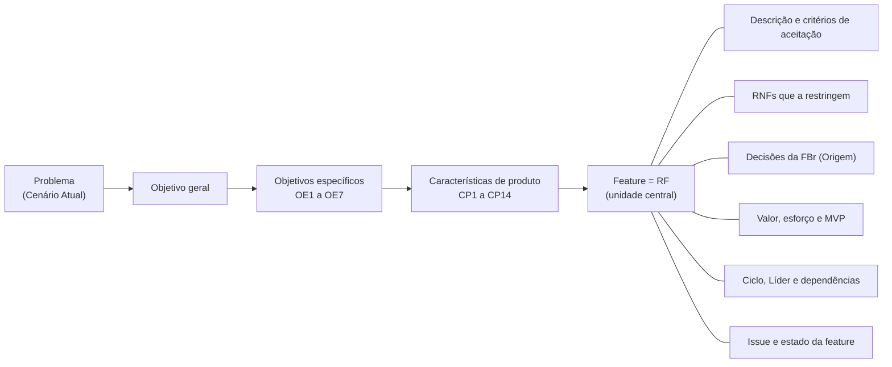
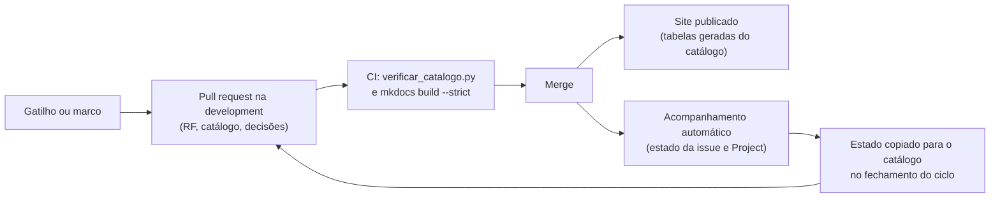

# Organização e atualização dos requisitos

Esta página explica como a documentação está organizada, onde fica a informação vigente de cada assunto, como a estrutura de requisitos é mantida atualizada e onde consultar as versões entregues em cada unidade. Ela é o ponto de partida para quem chega ao site por qualquer página.

## 1. Como a documentação está organizada

O menu separa a **referência vigente**, que é atualizada ao longo de todo o projeto, do **histórico das unidades**, que guarda o que foi produzido e entregue em cada uma.

| Parte do menu | O que tem | Situação |
| --- | --- | --- |
| Visão geral | O andamento do projeto: cronograma geral, features e backlog, e a execução do processo | Vigente |
| Produto | O problema, a solução proposta (objetivo geral, objetivos específicos e características do produto) e a intervenção social | Vigente |
| Requisitos | Requisitos funcionais e não funcionais, decisões com a FBr, análise do feedback, DoR e DoD, e priorização e recorte do MVP | Vigente |
| Processo e equipe | Estratégia de engenharia de software (FDD), engenharia de requisitos, interação com o cliente e boas práticas no GitHub | Vigente |
| Construção do MVP | Arquitetura, projetos das features, protótipos, implantação e segurança | Vigente, cresce a cada ciclo |
| Histórico das unidades | Página inicial, cronograma, reuniões e lições aprendidas de cada unidade | Histórico, não é reescrito |

Os endereços das páginas não mudaram com a reorganização do menu; por isso, os links já citados em issues, atas e pull requests continuam funcionando. Os números das seções (1 a 10) vêm do documento de visão das Unidades 1 e 2 e foram mantidos, porque as issues de avaliação e as atas os citam.

## 2. Estrutura de requisitos

A unidade central da estrutura é a **feature**. No FDD, cada feature é declarada por um **requisito funcional (RF)**: a feature "Registrar falta do paciente na sessão" é o RF34, com o mesmo nome. A equipe não usa histórias de usuário nem casos de uso; o RF é a forma de declaração da feature, e a correspondência é de um para um. Subindo a árvore, cada RF pertence a uma característica de produto (CP), que atende a objetivos específicos (OE), que vêm do objetivo geral e do problema.

Todos os atributos ficam pendurados no RF. Os que são compartilhados por vários RFs, ou que têm descrição longa, ficam numa página própria, e o RF aponta para eles por código:

| Atributo do RF | Onde é declarado (fonte única) | Como o RF aponta para ele |
| --- | --- | --- |
| Descrição, critérios de aceitação e rastreabilidade (Feature → CP → OE) | [Requisitos Funcionais (8.1)](unidade-2/requisitos/funcionais.md) | — é o próprio RF |
| Objetivos específicos e características de produto | [Solução Proposta (2)](unidade-1/solucao-proposta.md) | Linha de rastreabilidade do RF |
| RNFs que restringem a feature | [Requisitos Não Funcionais (8.2)](unidade-2/requisitos/nao-funcionais.md) | Campo "relacionado" de cada RNF no catálogo |
| Decisões da Clínica Escola | [Registro de Decisões com a FBr (8.4)](unidade-2/requisitos/decisoes-fbr.md) | "Origem: DFnn" na rastreabilidade do RF |
| Valor, esforço, MVP, ciclo, ordem, Líder, dependências e estado | [Catálogo de requisitos](unidade-2/requisitos/backlog.md#catalogo-de-requisitos) (`documentacao/dados/requisitos.yml`) | Uma entrada por RF |
| Evidências da construção (inspeções, testes, demonstração e aceite) | Issue da feature no GitHub | Campo "issue" do catálogo e link no título do RF |
| Projeto da feature (modelo, diagramas e rotas) | Projetos das features ([Ciclo 3](unidade-3/projeto-features-ciclo-3.md) e [Ciclo 4](unidade-3/projeto-features-ciclo-4.md)) | Seção do RF, com o número da issue |

As visões que juntam muitos RFs, como a priorização, o recorte do MVP, o backlog por ciclo, a situação por ciclo e a coluna "Requisitos" das decisões, **não são escritas à mão**: são geradas do catálogo quando o site é publicado. Assim, cada informação tem uma fonte só, e as listas não divergem.

### Recorte do MVP

O MVP é a lista de RFs com `mvp: true` no catálogo, decidida pelas [regras de priorização (10.2)](unidade-2/requisitos/backlog.md#102-priorizacao-e-recorte-do-mvp) e conferida pela [regra de limite de capacidade](unidade-2/requisitos/backlog.md#limite-de-capacidade). Hoje, **{{ n.rfs_mvp }} dos {{ n.rfs_vigentes }} RFs vigentes** estão no MVP. A priorização, a tabela do MVP, o backlog e a situação por ciclo saem da mesma lista; o `verificar_catalogo.py`, que roda no CI das pull requests que mexem na documentação, recusa um RF sem Líder, com ciclo ou estado desconhecido, com dependência inexistente ou com o nome diferente do registro na página 8.1.

## 3. Estratégia de atualização

### Marcos de atualização

A estrutura é conferida em momentos fixos do processo, além dos gatilhos da seção seguinte:

| Marco | O que é atualizado |
| --- | --- |
| Avaliação do DoR, antes da construção | O texto do RF, os critérios, as dependências e os RNFs, conferidos pelo checklist do DoR |
| Inspeção de design (DoD 1) | O projeto da feature e, se a inspeção mudar uma regra, o RF |
| Merge da pull request da feature | O estado da feature na issue (automático) e as decisões de construção no projeto da feature |
| Demonstração e aceite da FBr (DoD 5 e 6) | O estado da feature e, se a FBr pedir correções, as decisões e os RFs |
| Fechamento de cada ciclo | O estado das features no catálogo, o previsto e o realizado no [Cronograma geral](visao-geral/cronograma.md) e a carga do ciclo seguinte |
| Entrega de cada unidade | O histórico da unidade, a versão do site e a marcação da versão entregue no repositório |

### Gatilhos

| Gatilho | Exemplo | Onde a mudança entra |
| --- | --- | --- |
| Decisão ou resposta da FBr | Prazo de confirmação de 24 horas (DF45) | Nova DF no catálogo e o RF que ela fundamenta |
| Avaliação do professor ou dos monitores | Issues de avaliação da Unidade 2 | Pull request que cita a issue, com a versão no histórico |
| Novo entendimento da equipe | Inspeção de design que encontra uma regra ambígua | RF, projeto da feature e, se preciso, pergunta às pendências com a FBr |
| Construção | Tabela de cancelamento que entra com o desligamento (RF37) | Projeto da feature, na seção "Construção" |
| Mudança de escopo ou de capacidade | RF33 incluído no MVP; RF19 removido | Catálogo (`mvp`, `ciclo` ou `removido`), com a decisão registrada |

### O que é manual e o que é automático

| O que muda | Como é atualizado | Quem confere |
| --- | --- | --- |
| Texto, critérios e rastreabilidade do RF | Manual, em `funcionais.md`, por pull request | Revisor da pull request e avaliação do DoR |
| Atributos do RF e as decisões da FBr | Manual, no catálogo (`requisitos.yml`), por pull request | `verificar_catalogo.py` no CI e o revisor |
| Priorização, MVP, backlog, situação por ciclo, índice das decisões e contagens da página inicial | Automático, geradas do catálogo pelas macros do MkDocs a cada publicação | Build estrito no CI |
| Estado da feature na issue e Status no Project | Automático, pelo [acompanhamento das features](unidade-1/gestao/boas-praticas-github.md#acompanhamento-automatico-das-features), a partir do checklist, das pull requests e dos comandos `/de-acordo`, `/demonstrada` e `/aceite` | A equipe, pelos comentários do robô na issue |
| Verificação dos RNFs (D4.5) | Automático, pelos relatórios dos testes da `development`; os RNFs sem teste usam o comando `/rnf` | A equipe, pelo comentário do robô na issue |
| Estado da feature no catálogo | Manual, copiado da issue no fechamento do ciclo ou na pull request da feature | Revisor da pull request |
| Publicação do site | Automática, a cada merge na `development` que mexe na documentação | Workflow de publicação |

As issues de feature não copiam o texto dos requisitos: elas apontam para o RF e guardam só as decisões e as evidências da construção, para não criar versões paralelas.

## 4. Como a estrutura evoluiu

| Unidade | Estrutura | O que foi preservado |
| --- | --- | --- |
| Unidade 1 (entregue em 07/09/2026) | Problema, objetivo geral, objetivos específicos e características de produto, no documento de visão | A relação Problema → OG → OE → CP, que continua na [Solução Proposta](unidade-1/solucao-proposta.md) |
| Unidade 2 (entregue em 13/10/2026) | RFs e RNFs por CP, rastreabilidade, priorização, MVP, DoR e DoD | A numeração dos RFs, RNFs e seções, e a rastreabilidade de cada RF até a CP e os OEs |
| Unidade 3 (em andamento) | Catálogo único de requisitos, registro das decisões com a FBr, issues de feature com o estado do FDD, visão geral do projeto e execução do processo | Todas as relações anteriores; as decisões passaram a ser citadas como Origem do RF, e as listas passaram a ser geradas do catálogo |

As mudanças de cada versão, com a data e o autor, estão no [histórico de revisão](index.md#historico-de-revisao).

## 5. Versões anteriores

O site mostra a versão vigente. As versões entregues ficam no repositório, sem reescrever as páginas:

| Versão | Onde consultar |
| --- | --- |
| Entrega da Unidade 1 (07/09/2026) | [Repositório na versão entregue](https://github.com/mdsreq-fga-unb/REQ-2026.2-T02-ClinicaEscolaFBr/tree/c4601b23320d9dd120a6f7982d863ff75291743d) e [apresentação em vídeo](https://youtu.be/ysMmYmttAH8) |
| Entrega da Unidade 2 (13/10/2026) | [Release `unidade-2`](https://github.com/mdsreq-fga-unb/REQ-2026.2-T02-ClinicaEscolaFBr/releases/tag/unidade-2) e [apresentação em vídeo](https://youtu.be/XUJEFZv7Pn8) |
| Entrega da Unidade 3 (17/11/2026) | Será marcada como a release `unidade-3` na entrega |

As páginas do grupo **Histórico das unidades** guardam o cronograma, as reuniões e as lições aprendidas de cada unidade como foram registrados, e as páginas vigentes que nasceram numa unidade avisam no topo que continuam sendo atualizadas.
