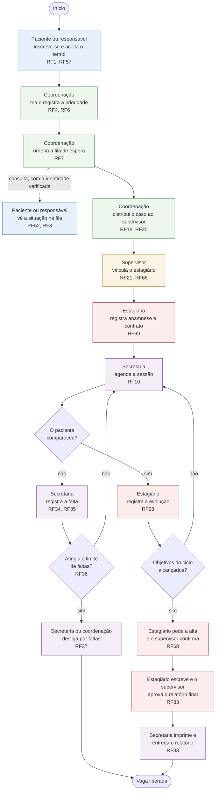

# Representação de requisitos

Esta página reúne as técnicas de representação usadas no projeto e mostra cada uma aplicada à Clínica Escola. As técnicas foram escolhidas no [processo de engenharia de requisitos](../processo/engenharia-requisitos.md#representacao-de-requisitos), e cada uma responde a uma pergunta diferente:

- **o contexto:** quem participa e onde está o problema;
- **o domínio:** quais conceitos existem e como se relacionam;
- **o comportamento:** o que o sistema faz, em que ordem e para quem.

## Técnicas e onde estão aplicadas

| Técnica | O que representa | Onde está aplicada | Quando é atualizada |
| --- | --- | --- | --- |
| Rich Picture | O cenário atual da clínica: atores, relações, problemas e ambiente | [Cenário atual](../produto/cenario-atual.md#13-rich-picture) | Unidade 1, na elicitação |
| Estrutura dos requisitos | A ligação do problema aos objetivos, às características de produto (CPs), aos requisitos funcionais e aos não funcionais | [Organização e atualização](../visao-geral/organizacao-e-atualizacao.md#2-estrutura-de-requisitos) | A cada mudança de requisito |
| Lista de features (FDD) | Cada funcionalidade no formato `<ação> <resultado> <objeto>`, agrupada por área e conjunto | [Requisitos funcionais](funcionais.md) e [Features e backlog](../visao-geral/backlog.md) | A cada ciclo |
| Declaração do requisito com critérios de aceitação | A regra de cada feature e os critérios verificáveis, em lista | [Requisitos funcionais](funcionais.md) e [não funcionais](nao-funcionais.md) | No DoR de cada feature |
| Modelo de domínio (diagrama de classes) | Os conceitos da clínica e suas relações, integrando as CPs | [Execução do processo](../visao-geral/execucao-do-processo.md#1-modelo-abrangente-do-dominio) | No "Desenvolver um modelo abrangente" e a cada ciclo |
| Diagrama de sequência | O caminho de cada operação entre o usuário, a API e o banco, com os desvios de acesso e de erro | [Projeto das features](../construcao/projeto-features.md) | No "Projetar por feature" |
| Protótipo de alta fidelidade | As telas de cada feature, com os estados de erro, vazio e acesso negado | [Protótipos](../construcao/prototipos.md) | No "Projetar por feature", validado com a FBr |
| Diagrama de atividades | A jornada do paciente na clínica, de ponta a ponta | [Abaixo](#diagrama-de-atividades-jornada-do-paciente) | Unidade 4 |
| Mapa de histórias (USM) | As atividades do usuário, as features de cada uma e a entrega em que cada feature entrou | [Abaixo](#mapa-de-historias) | Gerado do catálogo a cada publicação |
| Especificação de caso de uso | O diálogo entre o ator e o sistema numa feature, com os fluxos alternativos e de exceção | [Abaixo](#especificacao-de-caso-de-uso-encerrar-caso-por-alta) | Unidade 4 |

## Diagrama de atividades: jornada do paciente { #diagrama-de-atividades-jornada-do-paciente }

O diagrama mostra o caminho de um paciente no MVP, da inscrição ao encerramento. Cada atividade diz quem a faz, com uma cor por perfil, e o requisito que a implementa. As decisões em losango são as que mudam o caminho do paciente. Os caminhos de exceção mais longos, como a reversão do desligamento ([RF38](funcionais.md#rf38)) e a transferência de caso ([RF25](funcionais.md#rf25)), ficam no projeto de cada feature.

## Mapa de histórias { #mapa-de-historias }

O mapa de histórias (User Story Mapping) organiza o produto pela jornada de quem usa:

- **espinha dorsal:** as atividades do usuário, que no projeto são as características de produto (CPs), na ordem em que acontecem na clínica;
- **corpo:** as features de cada atividade, as histórias do mapa, escritas como features do FDD;
- **fatias:** as entregas, com os ciclos de construção do MVP e as versões posteriores.

O primeiro ciclo de construção (Ciclo 3) atravessa a jornada inteira, da inscrição ao prontuário, para que o primeiro incremento já fosse utilizável de ponta a ponta. Os ciclos seguintes aprofundam cada atividade. O mapa é gerado do [catálogo de requisitos](priorizacao-e-mvp.md#catalogo-de-requisitos), a mesma fonte do backlog, e por isso não fica desatualizado.

{{ mapa_historias() }}

## Especificação de caso de uso: encerrar caso por alta { #especificacao-de-caso-de-uso-encerrar-caso-por-alta }

A especificação segue o modelo de caso de uso da disciplina e detalha o [RF68](funcionais.md#rf68). Foi escolhida por ter três atores, um fluxo que só termina com a confirmação de outra pessoa e várias regras de exceção. O projeto técnico da feature, com as rotas e o diagrama de sequência, está no [projeto das features](../construcao/projeto-features.md).

**UC-RF68 — Encerrar caso por alta**

**1. Breve descrição.** O estagiário responsável pede o encerramento do acompanhamento por alta, com a data e o motivo. O supervisor do caso confirma ou recusa. Com a confirmação, o caso é encerrado, o histórico é preservado e a vaga é liberada. A coordenação pode reabrir o caso no mesmo semestre e ciclo.

**2. Atores.**

- **Estagiário responsável** (ator principal): pede a alta e pode cancelar o próprio pedido.
- **Supervisor do caso:** confirma ou recusa a alta.
- **Coordenação:** reabre o caso encerrado por alta.

**3. Pré-condições.**

- O caso está "em atendimento", com estagiário vinculado ([RF21](funcionais.md#rf21)) e supervisor atribuído ([RF20](funcionais.md#rf20)).
- O ator entrou no sistema com a conta institucional ([RF50](funcionais.md#rf50)).
- Não há outro pedido de alta aberto no caso.

**4. Fluxo básico.**

1. O estagiário abre a ficha do paciente e escolhe "Registrar alta".
2. O sistema mostra o formulário com a data da alta, o motivo, o supervisor que vai confirmar e, se houver, as sessões realizadas ainda sem evolução no ciclo.
3. O estagiário informa a data e o motivo e envia.
4. O sistema registra o pedido, com o autor e a data/hora, e mostra o caso como "Alta aguardando confirmação do supervisor". O caso continua em atendimento.
5. O supervisor abre o pedido, com a data, o motivo e quem pediu, e escolhe "Confirmar alta".
6. O sistema, numa transação só:
    - encerra o caso por alta;
    - encerra o vínculo do estagiário;
    - cancela as sessões futuras sem contar falta;
    - libera a vaga.
7. O sistema mostra o caso "Encerrado por alta", com a confirmação, a vaga liberada e o agendamento indisponível. O caso termina.

**5. Fluxos alternativos.**

- **A1. Cancelamento do pedido (passo 4).** O estagiário que pediu escolhe "Cancelar pedido de alta" e informa o motivo. O sistema registra o cancelamento, com o autor e a data/hora, e o caso continua em atendimento. Um novo pedido pode ser feito.
- **A2. Recusa pelo supervisor (passo 5).** O supervisor escolhe "Recusar alta" e informa o motivo. O sistema registra a recusa, e o caso continua em atendimento.
- **A3. Reabertura pela coordenação (depois do passo 7).** A coordenação escolhe "Reabrir caso", indica quem pediu (o estagiário cujo atendimento a alta encerrou ou o supervisor do caso) e o motivo. O sistema registra a reabertura e devolve o caso a "em atendimento", com o mesmo prontuário e ocupando uma vaga. Se o estagiário não estiver mais ativo, o caso volta a aguardar vínculo, com o supervisor mantido.
- **A4. Transferência ou desligamento com pedido aberto.** Se o caso for transferido ([RF25](funcionais.md#rf25)) ou desligado por faltas ([RF37](funcionais.md#rf37)) antes da confirmação, o pedido é encerrado com essa forma e não pode mais ser confirmado.

**6. Fluxos de exceção.**

- **E1. Data inválida (passo 3).** A data é futura, ou anterior ao início do atendimento pelo estagiário no caso ou ao início do semestre. O sistema recusa e indica o campo.
- **E2. Motivo vazio ou longo demais (passo 3).** O sistema recusa e indica o campo.
- **E3. Perfil sem permissão.** Só o estagiário responsável pede, só o supervisor do caso confirma ou recusa e só a coordenação reabre. Qualquer outro perfil recebe a negação, e a tentativa fica na auditoria.
- **E4. Reabertura fora do prazo (A3).** A alta é de um semestre ou ciclo anterior. O sistema não oferece a reabertura e informa que o retorno exige uma nova inscrição ([RF1](funcionais.md#rf1)).

**7. Pós-condições.**

- **Com a confirmação:** o caso está "encerrado por alta" e não aceita agendamento ([RF10](funcionais.md#rf10)) nem evolução ([RF28](funcionais.md#rf28)). A vaga está liberada, e o caso deixa de contar como atendimento ativo nos indicadores ([RF48](funcionais.md#rf48)).
- **Em qualquer desfecho:** o pedido, a confirmação, o cancelamento, a recusa e a reabertura ficam registrados e não podem ser alterados nem apagados.

Os fluxos A1, A2 e A4 e a exceção E1 não estão no texto do RF68. Eles vêm da revisão do código da feature ([#301](https://github.com/mdsreq-fga-unb/REQ-2026.2-T02-ClinicaEscolaFBr/pull/301)), que mostrou que um pedido errado não tinha saída e que uma data antiga impedia a reabertura. Essas decisões estão em "Na implementação", no projeto da feature.

**8. Regras de negócio.** A alta é distinta do desligamento por faltas e aparece como "Alta" no histórico. A reabertura só vale no mesmo semestre e ciclo, porque cada semestre exige uma nova inscrição. As regras foram confirmadas pela Clínica Escola em 30/10/2026.

**9. Requisitos especiais.**

- [RNF27](nao-funcionais.md#rnf27): integridade e proveniência dos registros.
- [RNF51](nao-funcionais.md#rnf51): os motivos ficam cifrados.
- [RNF17](nao-funcionais.md#rnf17): a secretaria vê a alta sem o motivo.

**10. Rastreabilidade.** Feature "Encerrar caso por alta" → CP7 — Registro de evolução por sessão → OE5/OE2. Issue [#273](https://github.com/mdsreq-fga-unb/REQ-2026.2-T02-ClinicaEscolaFBr/issues/273).
