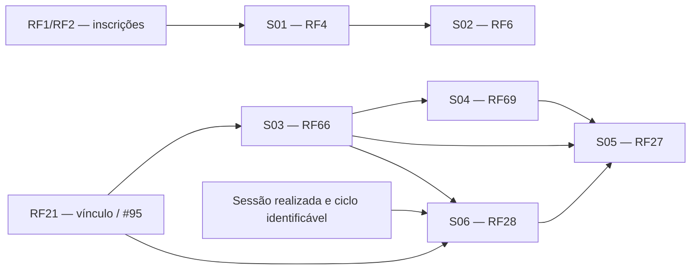

# Plano de specs — Luís Henrique (Donnk61)

Data da análise: 27/10/2026. Status: proposta para inspeção de design; não representa aceite, implementação concluída ou alteração do status das issues.

## Objetivo e fontes

Implementar as seis features atribuídas a Luís Henrique, em incrementos completos de contrato, banco, API, interface e testes. Reutilizar os módulos existentes e preservar as regras clínicas aprovadas.

Fontes de comportamento: [requisitos funcionais](../unidade-2/requisitos/funcionais.md), [requisitos não funcionais](../unidade-2/requisitos/nao-funcionais.md), [projeto do Ciclo 3](projeto-features-ciclo-3.md), [DoR e DoD](../unidade-2/requisitos/dor-dod.md) e as issues abaixo, consultadas na data desta análise. Rotas novas e decisões técnicas identificadas como propostas precisam de inspeção; não substituem requisitos aprovados.

| Spec / issue | Feature | Ciclo | Revisor |
| --- | --- | --- | --- |
| S01 / [#90](https://github.com/mdsreq-fga-unb/REQ-2026.2-T02-ClinicaEscolaFBr/issues/90) | RF4 — Organizar informações da inscrição para triagem | 3 | Nicolas |
| S02 / [#91](https://github.com/mdsreq-fga-unb/REQ-2026.2-T02-ClinicaEscolaFBr/issues/91) | RF6 — Registrar prioridade clínica do inscrito | 3 | Joaquim |
| S03 / [#97](https://github.com/mdsreq-fga-unb/REQ-2026.2-T02-ClinicaEscolaFBr/issues/97) | RF66 — Criar e inicializar o prontuário do paciente | 3 | Gabriel |
| S04 / [#130](https://github.com/mdsreq-fga-unb/REQ-2026.2-T02-ClinicaEscolaFBr/issues/130) | RF69 — Registrar anamnese e contrato terapêutico | 4 | Gabriel |
| S05 / [#148](https://github.com/mdsreq-fga-unb/REQ-2026.2-T02-ClinicaEscolaFBr/issues/148) | RF27 — Consultar prontuário do paciente | 4 | Maria Clara |
| S06 / [#149](https://github.com/mdsreq-fga-unb/REQ-2026.2-T02-ClinicaEscolaFBr/issues/149) | RF28 — Registrar evolução da sessão realizada | 4 | Maria Clara |

## Evidências no código local

| Componente | Estado observado | Consequência para o plano |
| --- | --- | --- |
| `apps/api/src/modules/triagem/triagem.module.ts` | Módulo vazio | Implementar serviço e controller de RF4/RF6 |
| `packages/database/src/schema/inscricao.ts` | Respostas clínicas cifradas; campos obrigatórios | Reutilizar armazenamento; definir representação de ausência legada sem enfraquecer RF1 |
| `packages/database/src/schema/casos.ts` | Decisões de prioridade, casos e vínculos já definidos | Reutilizar tabelas e avaliar somente lacunas de integridade/histórico |
| `apps/api/src/modules/casos/casos.module.ts` | Módulo vazio | Integração RF21/RF66 depende da implementação da #95 |
| `packages/database/src/schema/prontuario.ts` | Unicidade por caso/ciclo, origem do vínculo, campos cifrados de anamnese/contrato | Evitar recriar o modelo do prontuário |
| `apps/api/src/modules/acompanhamento-clinico/` | Consulta, política de acesso e testes de política existentes | Ampliar a implementação atual de RF27 e reutilizar RF55 |
| `apps/web/src/app/(interno)/prontuarios/[id]/page.tsx` | Identificação, dados iniciais e recusa de acesso | Completar seções e formulários nesta experiência |
| `PoliticaProntuario.exigirAcesso` | Modo de escrita também aceita supervisor vinculado | RF69/RF28 precisam de autorização específica por operação |
| `packages/shared/src/dominio-ciclo-3.ts` e schema de agendamento | Único status de sessão: `agendada`; sessão sem ciclo explícito | Resolver estado realizado e associação estável ao ciclo antes de RF28 |
| Auditoria e criptografia | Serviços/helpers existentes | Reutilizar; nunca gravar conteúdo clínico em logs genéricos |

Esta inspeção descreve o checkout local; não certifica outras branches, PRs ou ambiente publicado. Antes de iniciar cada incremento, conferir mudanças integradas e reaproveitar o trabalho que já tiver chegado.

## Andamento da implementação

Atualizado em 27/10/2026. O código cobre os seguintes caminhos até aqui:

| Issue | Andamento no checkout |
| --- | --- |
| #90 | API autenticada e tela de inscrições pendentes, com respostas declaradas, espera e ordenação |
| #91 | API transacional, histórico imutável com ligação à decisão anterior e fila interna de distribuição ordenada pela prioridade vigente |
| #97 | O endpoint RF21 grava vínculo, prontuário e auditoria na mesma transação; unicidade do prontuário protege duplicidade |
| #130 | Endpoint e formulário de texto livre provisório, gravação cifrada, autoria e bloqueio de substituição |
| #148 | Consulta agora inclui sessões por ciclo e evoluções; alta e relatório final ainda dependem de produtores RF68/RF33 ausentes |
| #149 | Status de sessão realizada, associação por ciclo e evolução original cifrada/imutável implementados; formulário explicita sessão, limites e imutabilidade |

Decisões confirmadas pelo responsável em 27/10/2026: ausência legada é nula e exibida como não informada; prioridade vigente ordena a fila e orienta distribuição; RF21 cria prontuário na mesma transação; RF69 usa texto livre provisório até os modelos da FBr; RF27 inclui sessões/evoluções por ciclo e aplica a política de acesso vigente após transferência; RF28 exige sessão realizada e ciclo explícito.

Validação executada em 27/10/2026 com Node 24.22.1 e pnpm 10.30.3: `pnpm typecheck` passou em todos os seis pacotes; `pnpm test` passou com 113 testes (API e web); os dois cenários adicionados de RF69 e RF28 passaram na suíte focada, elevando a cobertura conhecida para 115 testes. Os testes aplicam as migrations em PGlite descartável. `git diff --check` passou.

O snapshot 0003 foi reconstruído a partir do schema gerado pelo Drizzle, preservando o SQL já aplicado. O índice de sessões por caso/ciclo foi incluído também no schema TypeScript. Nova geração termina com “No schema changes”. O SQL mantém seus nomes personalizados de foreign keys e o trigger de imutabilidade, que não é representado pelo snapshot.

A prioridade recebe um horário estritamente posterior ao da decisão anterior, sob a trava transacional da inscrição. Isso evita que o início de uma transação concorrente ou um relógio adiantado façam uma decisão antiga aparecer como vigente. O teste de regressão passou junto dos outros 14 testes da suíte de prontuário.

### Decisões técnicas assumidas pelo responsável

- Incluir a integração de alta (RF68) e relatório final (RF33) no escopo necessário para concluir #148; implementar seus produtores e contratos antes de declarar essa consulta completa. Essa implementação ainda está pendente.
- Usar os campos e regras já descritos nos requisitos funcionais, incluindo confirmação de alta pelo supervisor e versões/estados de revisão do relatório. Não inferir conteúdo clínico.
- Manter texto livre provisório em RF69 até a entrega dos modelos institucionais, sem registrar confirmação da FBr que ainda não ocorreu.
- Registrar evidências técnicas nesta página e nas futuras revisões; testes automatizados não substituem avaliação de usabilidade com estagiários nem aceite da FBr.
- Preservar os revisores indicados na tabela inicial. Uma revisão do próprio implementador não constitui revisão independente.
- Considerar uma issue tecnicamente concluída somente quando todos os seus critérios estiverem implementados e comprovados. O encerramento formal continua condicionado ao DoD institucional.

A issue #148 permanece incompleta: consulta ainda retorna alta e relatório final como nulos porque RF68/RF33 não têm tabelas nem produtores neste checkout. A avaliação de usabilidade RNF30 com estagiários, revisão de design, registro formal DoR/DoD, revisão independente, demonstração e aceite da FBr continuam pendentes.

## Dependências e sequência de entrega

1. **Preparação:** revisar DoR, confirmar contratos com os responsáveis por RF21 e sessões, resolver as decisões abaixo e inspecionar o design com os revisores.
2. **Ciclo 3:** S01 → S02; S03 assim que o contrato transacional de RF21 estiver disponível. O ciclo termina em 27/10; esta proposta não presume que essas entregas caibam no tempo restante.
3. **Ciclo 4:** entregar a base de leitura de S05, S04 e S06; completar S05 com os produtores de dados disponíveis. RF27 só pode ser considerado completo após validar todos os elementos mínimos exigidos.
4. **Consolidação:** integração entre features, RNFs, demonstração e aceite. Para #148/#149, as issues indicam inspeção de design até 31/10; o Ciclo 4 termina em 10/11.

Um PR por issue, com dependências explícitas. S05 pode precisar de um PR inicial e outro de integração, ambos vinculados à #148. Fixtures podem permitir desenvolvimento isolado, mas não substituem a prova de integração com RF21 ou com o registro real de sessão realizada.

## Regras compartilhadas das specs

- Contratos Zod e tipos reutilizáveis em `packages/shared/src`; regras de negócio e autorização na API; interface não decide permissões.
- Sessão autenticada e perfil verificados nas rotas internas. Para dados clínicos, verificar vínculo vigente e permissão da operação antes de decifrar/retornar conteúdo.
- Estagiário responsável e supervisor vinculado consultam o prontuário; coordenação consulta qualquer prontuário somente para leitura. Somente o estagiário responsável registra RF69 e RF28. Secretaria e pessoas sem vínculo não recebem conteúdo nem indicadores da existência de seções clínicas.
- Reaproveitar `PoliticaProntuario`, estendendo a autorização por operação sem impedir futuras operações próprias do supervisor, como validação. A tentativa de escrita negada deve ser auditada como negada, não como permitida seguida de recusa em outra camada.
- Revalidar vínculo e invariantes dentro da transação de escrita, evitando que uma transferência concorrente permita uma gravação indevida. Auditoria de sucesso acompanha a transação; auditoria de recusa precisa sobreviver ao rollback.
- Cifrar dados clínicos usando a infraestrutura existente. DTOs de resposta devem selecionar campos explicitamente; erros, logs e trilhas genéricas não devem conter texto clínico.
- Preservar a resposta genérica para acesso clínico negado/inexistente. Limpar dados clínicos da interface após perda de acesso; não persistir formulários em armazenamento local do navegador.
- Migrations apenas quando necessárias, com geração pelo Drizzle, inspeção do SQL, teste em banco descartável e plano de recuperação que preserve registros. Não executar reset de banco como parte dessas features.

## S01 — RF4 / #90: triagem

**Resultado:** supervisor e coordenação consultam inscrições pendentes, distinguindo respostas do interessado da avaliação da equipe.

**Contrato existente no design:** `GET /triagem/inscricoes`, com ordenação por dias aguardando. Resposta deve conter identificador, número de inscrição, data de registro, `diasAguardando` e os três campos declarados: queixa, percepção de urgência e histórico relevante. Nome e sentido do parâmetro de ordenação serão fixados na inspeção; usar desempate estável.

**Implementação:** criar controller/service no módulo `triagem`; consultar inscrições sem decisão vigente; decifrar somente após autorização; criar tela interna de triagem e contrato compartilhado. Calcular espera no servidor com relógio testável. Proposta: dias completos decorridos desde o registro, sem alertas de prazo; confirmar essa convenção antes de codificar.

**Aceitação e provas:**

- [ ] Supervisor e coordenação recebem os três campos de inscrições on-line e assistidas, identificados como declaração do interessado.
- [ ] Ausência legada aparece como “Não informado”, sem texto inferido; mapear como o legado é representado, pois o schema atual usa `NOT NULL`.
- [ ] Inscrição criada hoje e outra há oito dias têm contagem e ordenação corretas; empates não tornam a lista instável.
- [ ] Lista vazia informa ausência de inscrições pendentes; carregamento e falha possuem estados próprios.
- [ ] Secretaria, estagiário e requisição sem sessão não recebem as respostas clínicas, inclusive pela API direta.

**Limite:** sem prazo máximo, cor automática, importador de legado ou implementação de RF5. RNFs: RNF3 e RNF51; restrições de CP12.

## S02 — RF6 / #91: prioridade clínica

**Resultado:** supervisor/coordenação confirma uma cor e pode registrar nova decisão sem apagar a anterior.

**Contrato existente no design:** `POST /triagem/inscricoes/:id/prioridade`, corpo `{ cor }`, validado por `corSchema`. Autor e horário vêm do servidor. A primeira decisão cria um caso `aguardando_distribuicao`; decisões posteriores mantêm o caso existente.

**Implementação:** transação envolvendo decisão, criação inicial do caso e auditoria. Serializar decisões concorrentes da mesma inscrição; definir seleção determinística da vigente. RNF5 exige vínculo com a decisão anterior: verificar se a auditoria existente o expressa suficientemente ou adicionar referência explícita com migration. Reusar `decisoesPrioridade`, `casos`, `CORES` e criptografia.

**Interface:** seleção sem cor pré-marcada, referência textual da FBr, confirmação, prioridade vigente e histórico autorizado. Como a lista RF4 exclui classificados, prever acesso de supervisor/coordenação às inscrições já classificadas para reclassificação; detalhar leitura de decisão/histórico como contrato de apoio de RF6, sem mudar a semântica da lista pendente.

**Aceitação e provas:**

- [ ] Cada cor válida registra responsável e instante; cor inválida é recusada sem gravação parcial.
- [ ] Amarela → vermelha mantém ambos os registros e disponibiliza somente a vigente para os consumidores de CP3/CP5.
- [ ] Sem decisão, prioridade permanece pendente, sem valor inferido.
- [ ] Concorrência na primeira decisão não duplica caso; empate temporal não torna ambígua a decisão vigente.
- [ ] Falha em qualquer etapa reverte a transação; trilha anterior não pode ser alterada ou excluída.
- [ ] Perfil não autorizado não altera prioridade nem recebe dados clínicos; texto de apoio não calcula cor.

**Limite:** não implementar ordenação completa da fila RF7 nem distribuição RF20. Confirmar contrato com esses consumidores. RNFs: RNF5 e RNF51.

## S03 — RF66 / #97: criação automática do prontuário

**Resultado:** vínculo confirmado em RF21 cria exatamente um prontuário por caso/ciclo, com paciente, responsáveis e origem identificáveis.

**Contrato:** operação interna chamada pela transação de `POST /casos/:id/estagiario` de RF21; não criar endpoint público de criação manual. Proposta: serviço de criação que receba a transação do chamador e o vínculo validado.

**Implementação:** reutilizar `prontuarios` e sua chave única `(casoId, cicloAtendimento)`. Inserir usando o mesmo contexto transacional do vínculo; manter `vinculoOrigemId` e data/hora. Confirmar com a #95 como preservar também a identificação do supervisor original e o histórico, sem depender apenas de joins com o responsável atual.

**Aceitação e provas:**

- [ ] Vínculo válido produz prontuário com paciente/caso/ciclo e responsáveis corretos.
- [ ] Caso sem vínculo não produz prontuário.
- [ ] Repetição e concorrência não criam um segundo prontuário no mesmo ciclo.
- [ ] Falha na criação reverte também o vínculo; falha no vínculo não deixa prontuário órfão.
- [ ] Novo ciclo admite seu próprio prontuário, preservando o anterior.

**Limite:** sem anamnese/contrato nesta issue. Prova de integração depende de RF21; teste apenas do helper não encerra #97. RNFs: RNF25, RNF51 e RNF52; RF55 rege a consulta.

## S04 — RF69 / #130: dados iniciais

!!! note "Atualização de 31/10/2026"
    A FBr enviou a ficha de anamnese em 30/10/2026 ([DF37](../unidade-2/requisitos/decisoes-fbr.md)). O RF69 passou a pedir as seis seções da ficha, com a queixa principal preenchida a partir da inscrição. O texto livre continua só para o contrato terapêutico, cujo modelo ainda não chegou.

**Resultado:** estagiário responsável registra anamnese, contrato e data de assinatura, com autor e instante.

**Contrato proposto:** `POST /prontuarios/:id/dados-iniciais`, com `anamnese`, `contrato` e `dataAssinaturaContrato`. Validar textos e data no contrato compartilhado; definir limites de tamanho e possibilidade de gravação separada na inspeção, pois o RF não os especifica.

**Implementação:** reutilizar colunas cifradas e metadados existentes; autorização específica de registro; persistência atômica; formulário na página atual do prontuário. Refletir o resultado salvo na leitura de S05 e remover a mensagem atual que condiciona o registro ao recebimento dos modelos.

**Aceitação e provas:**

- [ ] Estagiário responsável registra e relê os dados com autoria e data/hora; contrato inclui data de assinatura.
- [ ] Campos inválidos são apontados e não geram gravação parcial.
- [ ] Supervisor, coordenação, secretaria e estagiário de outro caso não registram os dados.
- [ ] Prontuário inexistente ou vínculo revogado não aceita registro e não revela conteúdo.
- [ ] Banco armazena conteúdo cifrado; logs e respostas negadas não o expõem.

**Decisões antes da implementação:** texto livre é o comportamento declarado no RF69 até chegarem os modelos; a issue ainda mantém R4.4 bloqueante e o design do Ciclo 3 diz “depois que a FBr enviar os modelos”. Conciliar esses registros com Gabriel e registrar a avaliação do DoR. Definir comportamento de um segundo envio: proposta de rejeitar substituição silenciosa e tratar correção como decisão explícita de produto. Não criar editor de modelos ou fluxo de assinatura digital.

## S05 — RF27 / #148: consulta completa do prontuário

**Resultado:** ampliar `GET /prontuarios/:id` e a página existente para reunir os registros do ciclo sob RF55.

**Contrato:** identificação do paciente/caso/ciclo; dados iniciais e autoria; responsáveis atuais e histórico; sessões com data/situação; evoluções originais, correções, complementos e validação; alta; relatório final com versão e estado de revisão. Definir DTO compartilhado e representação explícita de ausência, sem omitir seções.

**Implementação:** estender `ProntuariosService.consultar` após autorização, filtrar cada conjunto pelo ciclo correto e preservar proveniência. Integrar produtores existentes quando disponíveis. A ausência de implementação de um produtor é uma dependência técnica, não evidência de que não há registros clínicos.

**Aceitação e provas:**

- [ ] Estagiário responsável e supervisor veem todas as seções previstas; coordenação vê o mesmo conteúdo somente para leitura.
- [ ] Seção implementada sem registros aparece como ausente, sem dados inventados.
- [ ] Registros de outro ciclo não aparecem misturados; histórico do ciclo continua preservado após transferência.
- [ ] Após transferência, novo responsável acessa e antigo responsável perde acesso, inclusive na API direta.
- [ ] Prontuários completos e vazios produzem a mesma recusa genérica para pessoas não autorizadas; não vazam existência/quantidade de seções.
- [ ] Acessos permitidos e negados deixam trilha; a interface só afirma auditoria realizada com confirmação do servidor, não pelo relógio do navegador.

**Integrações:** RF69, RF28, RF29/RF30 (correções/complementos), RF67 (validação), RF68 (alta), RF33 e fluxo de revisão do relatório, além de sessões e transferência RF25. A leitura pode evoluir por incrementos, mas placeholders não bastam para declarar RF27 concluído. Não implementar essas operações de escrita dentro de #148. Resolver R2.7 e R3.5 com Maria Clara na inspeção. RNFs: RNF25 e RNF52.

## S06 — RF28 / #149: evolução por sessão

!!! note "Atualização de 31/10/2026"
    A FBr enviou a ficha de registro de evolução em 30/10/2026 ([DF38](../unidade-2/requisitos/decisoes-fbr.md)), que substitui os campos da DF23. O RF28 passou a pedir humor e aparência, conteúdo trabalhado, técnicas utilizadas, intervenções e encaminhamentos e plano para a próxima sessão; número, data, horário e comparecimento vêm da sessão. O contrato proposto abaixo, com "evolução da queixa" e "planejamento", e o código que já está na `main` precisam seguir os campos novos.

**Resultado:** estagiário responsável registra evolução de sessão realizada no paciente/ciclo correto.

**Contrato proposto:** `POST /prontuarios/:id/sessoes/:sessaoId/evolucoes`, com data da sessão, evolução da queixa e planejamento da próxima sessão. Derivar paciente/caso/ciclo/autor no servidor; validar a data contra a sessão. Queixa obrigatória, até 1.000 caracteres; explicitar com o revisor como aferir as 10 linhas do requisito, sem depender da quebra visual responsiva.

**Implementação:** adicionar schema de evolução com referência estável à sessão e ao prontuário/ciclo, conteúdo cifrado, autor e instante. Proposta: um original por sessão, sem sobrescrita; correções pertencem a RF29. Revalidar sessão realizada e vínculo na transação; rejeitar associação cruzada. Criar formulário acessível com limite visível e confirmação do salvamento.

**Dependência bloqueante:** o schema atual só aceita `agendada`. Alinhar com os responsáveis por agendamento/presença a transição oficial para realizada; não inferir realização porque a data passou. Definir como sessões pertencem ao ciclo, pois hoje só referenciam o caso. Se necessário, migrar a associação com regra de backfill revisada, sem atribuir sessões antigas automaticamente ao ciclo corrente.

**Aceitação e provas:**

- [ ] Sessão realizada aceita registro do responsável, conservando paciente, ciclo, sessão, autoria e instante.
- [ ] Agendada, confirmada, cancelada ou com falta não aceita evolução; outro paciente/ciclo e vínculo revogado são recusados.
- [ ] Campos ausentes e queixa com 1.001 caracteres são recusados; limite de 1.000 é aceito.
- [ ] Reenvio/concorrência não duplica o original; não existe atualização que sobrescreva o registro original.
- [ ] Ao atingir 10 sessões realizadas do ciclo, estagiário e supervisor veem aviso de fechamento avaliativo; testar também 9 e 20. Contar sessões realizadas, não evoluções salvas. Definir persistência/dispensa do aviso na inspeção.
- [ ] Conteúdo e indicadores de existência não aparecem em respostas negadas; original e vínculo com o ciclo sobrevivem à transferência.
- [ ] RNF30: prova de tarefa com pelo menos 10 estagiários, orientação até 15 minutos; ao menos 90% concluem corretamente na primeira tentativa em até 3 minutos e 6 interações, sem contar digitação.

**Limite:** sem correção, complemento, validação pelo supervisor, alta ou geração de relatório neste PR. O aviso encaminha para o fluxo de relatório quando disponível. RNFs: RNF25, RNF27, RNF30 e criptografia transversal; incluir RNF29 no patamar aplicável do backlog, sem declarar desempenho comprovado apenas por testes funcionais.

## Pendências de design e DoR

| Pendência | Responsável proposto | Condição para avançar |
| --- | --- | --- |
| R8.1 desmarcado nas seis issues | Luís + revisor de cada feature | Equipe entende, estima e registra resultado do DoR |
| Semântica de ausência legada e dias aguardando | Luís + Nicolas | Exemplos e contrato definidos para S01 |
| Ordem concorrente e vínculo entre decisões; acesso à reclassificação | Luís + Joaquim | Design de S02 cobre histórico e concorrência |
| Contrato transacional RF21/RF66 | Luís + responsável pela #95 + Gabriel | Dono da transação e integração definidos |
| R4.4, texto livre/modelos e segundo registro de dados iniciais | Luís + Gabriel; FBr se houver mudança de regra | Resolver divergência documental e registrar decisão de S04 |
| R2.7/R3.5 e produtores das seções de RF27 | Luís + Maria Clara + responsáveis pelos produtores | Matriz de acesso e dependências de S05 inspecionadas |
| Sessão realizada, ciclo, 10 linhas e recorrência do aviso | Luís + Maria Clara + responsável por sessões | Contratos de S06 inspecionados |
| Protótipos e massa de testes pendentes | Luís + revisores | Completar R7/R8 aplicáveis com evidências |

As responsabilidades acima são propostas de coordenação; este documento não envia mensagens nem atribui novas tarefas no GitHub. Não marcar critérios bloqueantes como satisfeitos apenas pela existência deste plano.

## Validação e definição de conclusão

Para cada spec, converter os itens de aceitação em testes com ligação ao RF/critério e ao PR. Reutilizar Jest/API, Vitest/interface e Playwright/axe já adotados. Usar apenas dados fictícios, com dois pacientes, dois ciclos, responsáveis distintos, coordenação, secretaria, transferência de vínculo e registros completos/incompletos.

1. **Unidade:** validações, permissões por operação, contagem de dias/sessões e escolha da decisão vigente.
2. **Integração:** HTTP + banco descartável; criptografia, auditoria, transações, unicidade e rollback. Para travas/concorrência/migrations, comprovar no PostgreSQL, sem depender só de mocks.
3. **Interface e ponta a ponta:** fluxo feliz, recusa por perfil, vazio, erro, validação, teclado, foco, nomes acessíveis e ausência de vazamento após perda de acesso. Para RF6, cor sempre acompanhada de texto.
4. **Verificações do PR:** `pnpm lint`, `pnpm typecheck`, testes afetados e `pnpm build`; usar `pnpm --filter @clinica/web test:e2e` com ambiente preparado. Inspecionar scripts vigentes antes de executar; o atual `test:integration` da API é específico de inscrição e não cobre automaticamente estas features.
5. **RNFs:** anexar provas de sigilo, auditoria e criptografia; executar avaliação humana do RNF30 e desempenho no patamar aplicável do RNF29, registrando ambiente e limitações.
6. **DoD:** design inspecionado; código concluído e revisado por outro integrante; integração e CI aprovados; demonstração com cenários da clínica; aceite formal da FBr e pendências registrados. Merge não equivale a demonstração ou aceite.

**Condição de parada:** todos os critérios da issue e RNFs aplicáveis comprovados, sem ampliar a feature para operações vizinhas. Se faltar integração externa ao escopo, registrar dependência e evidência parcial; não declarar a issue concluída.
