# Projeto das features do Ciclo 3

Esta página registra o processo **Projetar por Feature** do FDD para as 14 features do Ciclo 3: o modelo detalhado, os diagramas de sequência, as rotas da API, as regras ligadas aos critérios de aceitação e os dados de teste de cada feature. Ela é o material da **inspeção de design** (marco 1 do [DoD](../unidade-2/requisitos/dor-dod.md#1-design-inspecionado)). O resultado da inspeção de cada feature é registrado na sua issue.

Os requisitos de origem estão na [seção 8.1](../unidade-2/requisitos/funcionais.md), e os itens do ciclo, no [Backlog de Produto](../unidade-2/requisitos/backlog.md#1012-itens-de-trabalho-do-mvp).

## Convenções

- **API:** NestJS, um módulo por área do FDD (`acesso`, `inscricao`, `triagem`, `casos`, `agendamento`, `acompanhamento-clinico`). As rotas internas exigem sessão e usam o `PerfisGuard` com o decorator `@Perfis(...)`. As rotas públicas (inscrição e ativação de conta) não exigem sessão.
- **Banco:** PostgreSQL com Drizzle, em `packages/database`. Os nomes de tabela e coluna seguem o português sem acento, como as tabelas `usuarios` e `auditoria` da base técnica.
- **Validação:** esquemas Zod em `packages/shared`, usados tanto pela API quanto pela interface.
- **Auditoria:** toda operação que altera dados relevantes chama o `AuditoriaService`, que grava na tabela `auditoria` (somente inserção) o autor, a operação, a entidade, o estado anterior e o novo.
- **Datas:** gravadas com fuso horário (`timestamptz`) e exibidas no horário de Brasília.
- **Dados de teste:** sempre fictícios. Nenhum dado real de paciente entra no repositório, no banco de desenvolvimento ou em prints.

## Modelo detalhado do Ciclo 3

O diagrama reúne as classes usadas pelas 14 features. Ele detalha o [modelo de domínio](../unidade-2/requisitos/funcionais.md) de cada CP no nível de implementação.

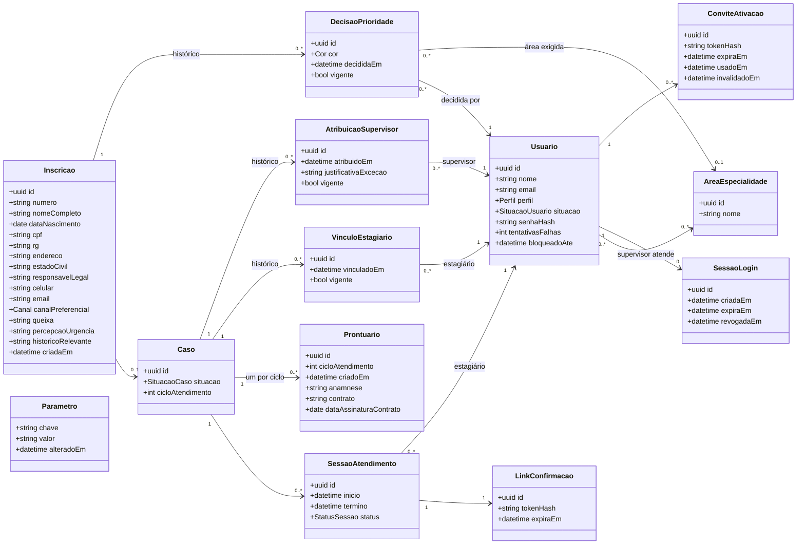

**Valores dos tipos enumerados:**

- `Perfil`: secretaria, estagiario, supervisor, coordenacao (já existe em `@clinica/shared`).
- `SituacaoUsuario`: pendente_ativacao, ativo, desativado. Substitui a coluna booleana `ativo` da base técnica, que não representa o estado "pendente de ativação" do RF53.
- `Canal`: celular, email.
- `Cor`: vermelha, amarela, verde.
- `SituacaoCaso`: aguardando_distribuicao, aguardando_vinculo, em_atendimento, encerrado.
- `StatusSessao`: agendada (os demais status entram com o RF14, o RF15 e o RF16 no Ciclo 4).

**Restrições de integridade no banco** (RNF19, RNF9):

- No máximo uma `DecisaoPrioridade` vigente por inscrição, uma `AtribuicaoSupervisor` vigente por caso e um `VinculoEstagiario` vigente por caso. São índices únicos parciais `WHERE vigente`.
- Um `Prontuario` por caso e ciclo de atendimento: índice único em `(caso_id, ciclo_atendimento)`.
- `SessaoAtendimento.termino` maior que `inicio`, garantido por restrição `CHECK`.

**Parâmetros iniciais** (tabela `parametros`, alterados pela coordenação):

| Chave | Valor padrão | Usado em |
| --- | --- | --- |
| `prazo_maximo_triagem_dias` | 7 | RF4 |
| `duracao_sessao_minutos` | 50 | RF10 |
| `validade_convite_horas` | 72 | RF53 |

---

## Acesso e segurança (CP12)

### RF50 — Autenticar usuário institucional ([#45](https://github.com/mdsreq-fga-unb/REQ-2026.2-T02-ClinicaEscolaFBr/issues/45))

**Rotas:**
- `POST /auth/login` (pública): recebe e-mail e senha e devolve um cookie de sessão `httpOnly`.
- `POST /auth/logout`.

O `SessaoGuard` valida a sessão em cada requisição e preenche `req.usuario`, que o `PerfisGuard` já usa.

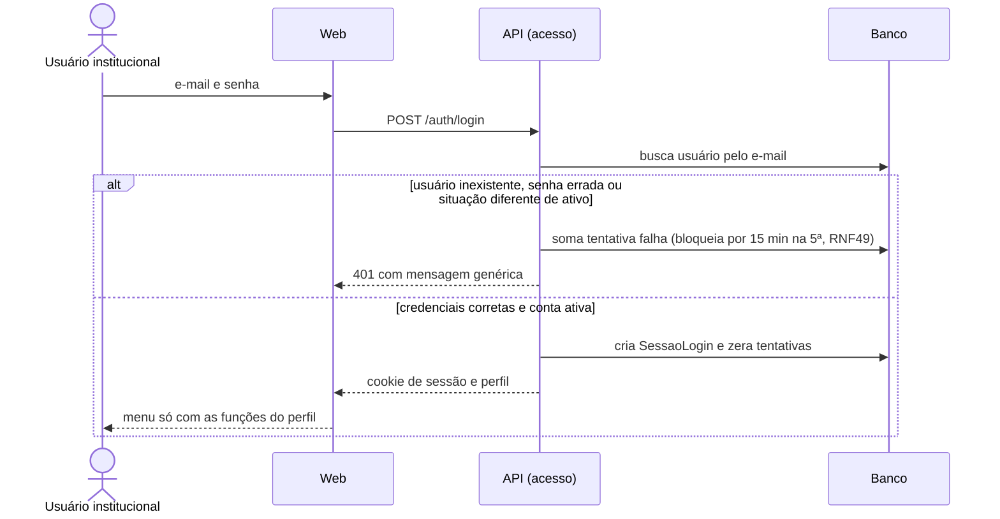

| Regra | Critério de aceitação |
| --- | --- |
| A senha é comparada com o hash (bcrypt ou Argon2), e a mesma mensagem é usada para qualquer falha | E-mail ou senha incorretos negam o acesso sem indicar o campo |
| Só a situação `ativo` autentica | Usuário desativado (RF54) não entra; usuário pendente (RF53) também não |
| O menu e as rotas são filtrados pelo perfil (`PerfisGuard`) | Usuário ativo vê apenas as funcionalidades do seu perfil |

**Dados de teste:** um usuário de cada perfil, ativo; um desativado; um pendente de ativação; um com 4 tentativas falhas (para testar o bloqueio na 5ª).

### RF53 — Cadastrar usuário institucional com perfil de acesso ([#48](https://github.com/mdsreq-fga-unb/REQ-2026.2-T02-ClinicaEscolaFBr/issues/48))

**Rotas:**
- `POST /usuarios` (coordenação);
- `POST /usuarios/:id/convite` (coordenação, para reenviar o convite);
- `POST /ativacao` (pública): recebe o token e a nova senha.

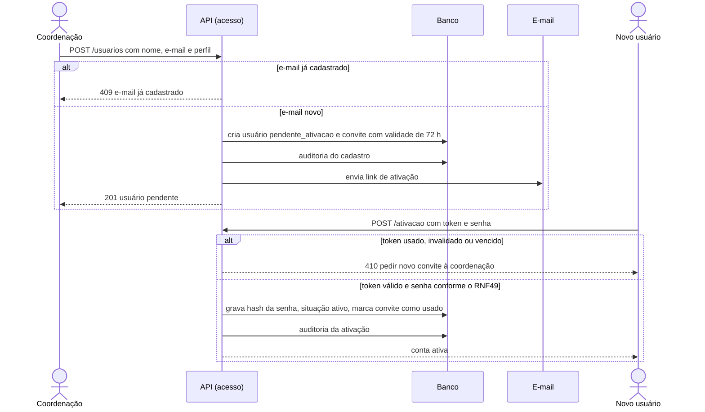

| Regra | Critério de aceitação |
| --- | --- |
| O token é guardado só como hash, é de uso único e vale 72 h (parâmetro) | Link já usado ou com mais de 72 horas é recusado |
| O reenvio marca o convite anterior como `invalidadoEm` e cria outro | O reenvio invalida o link anterior |
| Índice único no e-mail | E-mail já cadastrado não pode ser cadastrado de novo |
| Rota com `@Perfis('coordenacao')` | Usuário sem perfil de coordenação não cadastra |
| O cadastro, o reenvio e a ativação chamam o `AuditoriaService` | Operações registradas com autor, usuário afetado e data/hora |

**Dados de teste:** um convite válido, um vencido (criado há 73 h) e um já usado. Em desenvolvimento, o e-mail chega ao Mailpit (`http://localhost:8025`).

### RF54 — Desativar usuário institucional ([#49](https://github.com/mdsreq-fga-unb/REQ-2026.2-T02-ClinicaEscolaFBr/issues/49))

**Rota:** `POST /usuarios/:id/desativacao` (coordenação).

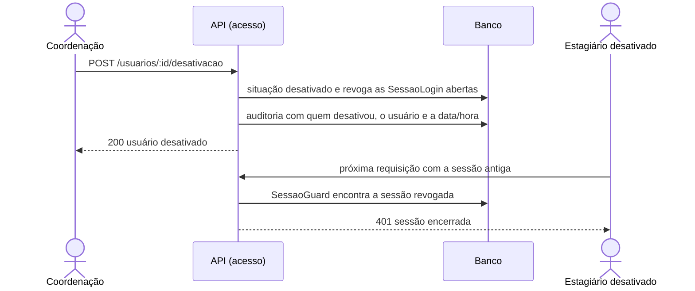

| Regra | Critério de aceitação |
| --- | --- |
| Revogar as sessões e conferir a situação do usuário a cada requisição | A próxima requisição do desativado é recusada, mesmo com sessão aberta |
| Nada é apagado: os registros continuam ligados ao `usuarioId` | Registros anteriores continuam visíveis, com o nome de quem os fez |
| `@Perfis('coordenacao')` | Usuário sem perfil de coordenação não desativa |

**Dados de teste:** um estagiário ativo com sessão aberta e registros de auditoria em seu nome.

### RF55 — Restringir acesso ao prontuário do paciente ([#50](https://github.com/mdsreq-fga-unb/REQ-2026.2-T02-ClinicaEscolaFBr/issues/50))

**Escopo no Ciclo 3:**
- **O que entra agora:** a regra de acesso protege o prontuário criado pelo RF66 e os seus dados iniciais.
- **O que entra depois:** a mesma política passa a valer para a evolução (CP7, a partir do Ciclo 4). O critério da transferência entre estagiários é verificado quando a transferência (RF25) for construída, no Ciclo 4. O relatório final (CP8) está fora do MVP.

**Rotas:**
- `GET /prontuarios/:id`: estagiário responsável e supervisor do caso.
- `GET /pacientes/:id/dados-administrativos`: secretaria e coordenação.

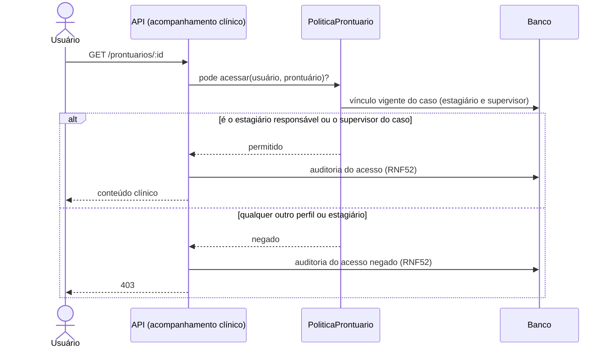

| Regra | Critério de aceitação |
| --- | --- |
| A verificação acontece na API (`PoliticaProntuario`), não só na interface | Estagiário não responsável tem o acesso negado, inclusive com requisição direta ao servidor |
| A rota administrativa devolve apenas nome, data de nascimento, contatos, responsável legal, situação do caso, sessões, faltas e contribuição | Secretaria e coordenação veem só os dados cadastrais e administrativos |
| Os dados são criptografados em repouso e em trânsito (RNF51) | Inspeção do banco e do HTTPS no ambiente de homologação |

**Dados de teste:** um caso com estagiário A e supervisor S; outro estagiário B; uma secretaria; uma coordenação.

---

## Inscrição on-line (CP1)

### RF1 — Registrar solicitação de atendimento on-line ([#88](https://github.com/mdsreq-fga-unb/REQ-2026.2-T02-ClinicaEscolaFBr/issues/88))

**Rota:** `POST /inscricoes` (pública), validada pelo esquema `inscricaoSchema` em `@clinica/shared`. A interface tem 3 etapas, com o aviso do CVV e do SAMU fixo em todas:
1. dados e contatos;
2. triagem (queixa, percepção de urgência e histórico relevante);
3. revisão e confirmação.

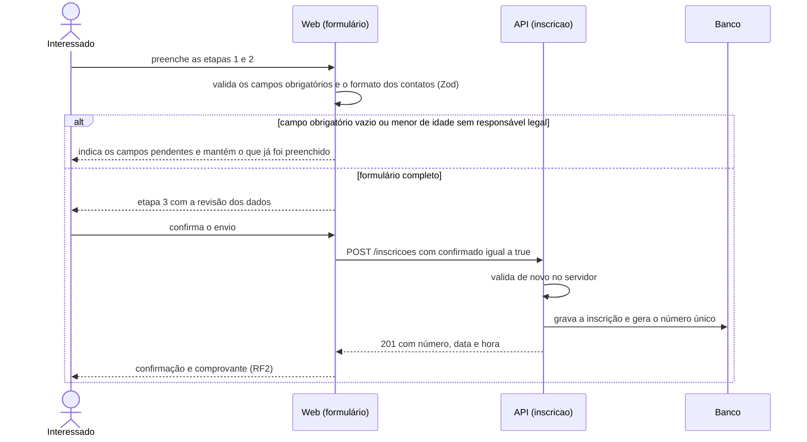

| Regra | Critério de aceitação |
| --- | --- |
| O mesmo esquema Zod é usado na interface e na API | Envio com campo obrigatório vazio é bloqueado, e os dados são mantidos |
| A idade é calculada a partir da data de nascimento, e o responsável legal é obrigatório para menores de 18 anos | Menor de idade sem responsável legal é bloqueado |
| Pelo menos um canal (celular ou e-mail) e o canal preferencial são obrigatórios | Formato validado, um canal exigido e o preferencial registrado |
| CPF e RG são campos de texto, sem upload | Nenhum envio de cópia do documento |
| A API só grava com `confirmado: true` | Sem confirmação, a solicitação não é registrada |
| A interface só mostra a confirmação após a resposta 201 | Nenhuma confirmação sem registro efetivo |
| Componente `AvisoEmergencia` fixo no layout do formulário | Aviso do CVV e do SAMU em todas as etapas |

**Dados de teste:** um adulto com e-mail; um menor com responsável legal e só celular; uma inscrição com CPF em formato inválido.

### RF2 — Emitir comprovante de inscrição ([#89](https://github.com/mdsreq-fga-unb/REQ-2026.2-T02-ClinicaEscolaFBr/issues/89))

O comprovante é montado na interface a partir da resposta do `POST /inscricoes` (número, data e hora) e pode ser impresso ou salvo em PDF pelo navegador. Não há rota pública para consultar um comprovante por número, o que evita a enumeração de inscrições.

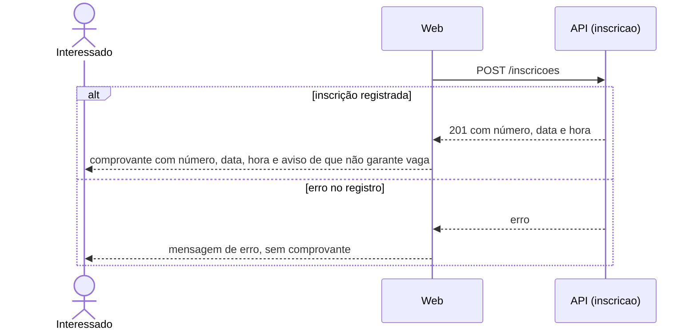

| Regra | Critério de aceitação |
| --- | --- |
| O comprovante só existe a partir da resposta 201 | Nenhum comprovante para inscrição não concluída |
| O componente recebe apenas o número, a data e a hora | O comprovante não contém a queixa nem dados clínicos |
| Texto fixo sobre triagem e vagas | Informa que o atendimento depende da triagem e das vagas |

---

## Triagem (CP2)

### RF4 — Organizar informações da inscrição para triagem ([#90](https://github.com/mdsreq-fga-unb/REQ-2026.2-T02-ClinicaEscolaFBr/issues/90))

**Rota:** `GET /triagem/inscricoes` (supervisor e coordenação). Devolve as inscrições sem decisão de prioridade vigente, com o campo calculado `alemDoPrazo`, que é verdadeiro quando o tempo desde `criadaEm` passa do parâmetro `prazo_maximo_triagem_dias` (padrão de 7).

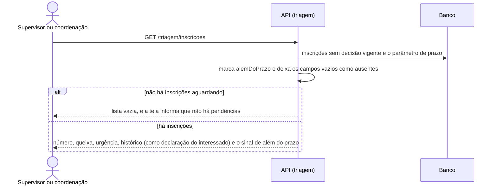

| Regra | Critério de aceitação |
| --- | --- |
| `@Perfis('supervisor','coordenacao')` | Usuários sem autorização não veem as respostas |
| Campo vazio é enviado como `null`, e a interface mostra "não informado" | Campo sem resposta aparece como ausente |
| As respostas aparecem num bloco "Declarado pelo interessado", separado da decisão da equipe | Declaração separada da avaliação da equipe |
| Prazo vindo do parâmetro (padrão de 7 dias corridos) | Sinalização além do prazo à coordenação |

**Dados de teste:** uma inscrição de hoje; uma de 8 dias atrás sem triagem (aparece além do prazo); uma inscrição legada com o histórico vazio.

### RF6 — Registrar prioridade clínica do inscrito ([#91](https://github.com/mdsreq-fga-unb/REQ-2026.2-T02-ClinicaEscolaFBr/issues/91))

**Rota:** `POST /triagem/inscricoes/:id/prioridade` (supervisor e coordenação). Recebe a cor e, opcionalmente, a área de especialidade exigida. A primeira decisão cria o `Caso` com a situação `aguardando_distribuicao`.

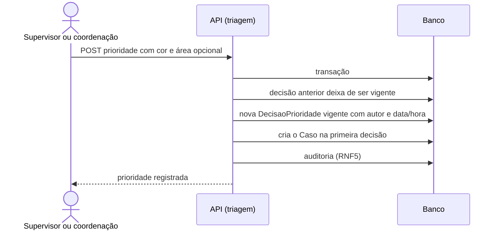

| Regra | Critério de aceitação |
| --- | --- |
| Histórico com `vigente` e índice único parcial | A alteração mantém a decisão anterior no histórico |
| A tela mostra a referência vermelha/amarela/verde como texto, sem cor pré-selecionada | Nenhuma sugestão automática de cor |
| Sem decisão vigente, a fila e a distribuição tratam o caso como pendente | Inscrição sem classificação aparece como pendente |
| A área é opcional e fica na decisão vigente | A área exigida fica disponível para o RF20 |

**Dados de teste:** uma inscrição sem decisão; uma com decisão amarela que muda para vermelha; uma secretaria tentando registrar (recebe 403).

---

## Distribuição de casos (CP5)

### RF18 — Listar casos aguardando distribuição ([#92](https://github.com/mdsreq-fga-unb/REQ-2026.2-T02-ClinicaEscolaFBr/issues/92))

**Rota:** `GET /casos/aguardando-distribuicao` (coordenação e supervisor). Devolve os casos com a situação `aguardando_distribuicao`, ordenados pela cor (vermelha, amarela, verde) e pela data da inscrição, da mais antiga para a mais recente. Cada item traz só o número da inscrição, o nome, a cor e a data.

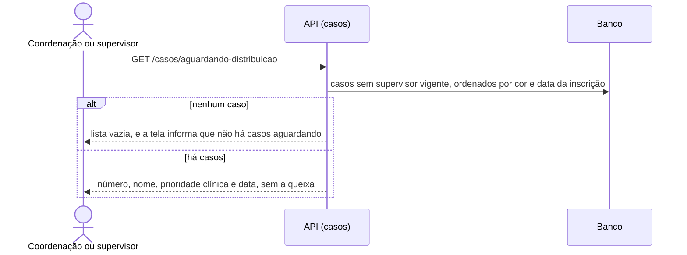

**Dados de teste:** casos vermelho, amarelo e verde, com datas diferentes; dois casos vermelhos para testar o desempate; um caso já distribuído (não aparece).

### RF19 — Registrar áreas de especialidade do supervisor ([#93](https://github.com/mdsreq-fga-unb/REQ-2026.2-T02-ClinicaEscolaFBr/issues/93))

**Rotas:**
- `GET /areas`;
- `POST /areas` (coordenação), para o catálogo;
- `PUT /supervisores/:id/areas` (coordenação), que recebe a lista de áreas do supervisor.

Remover uma área do supervisor não mexe nas atribuições já feitas.

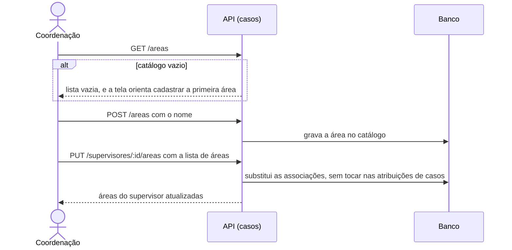

**Dados de teste:** catálogo vazio; catálogo com "Infância e adolescência", "Adultos" e "Casal e família"; um supervisor com duas áreas.

### RF20 — Distribuir caso a supervisor conforme área de especialidade ([#94](https://github.com/mdsreq-fga-unb/REQ-2026.2-T02-ClinicaEscolaFBr/issues/94))

**Rota:** `POST /casos/:id/supervisor` (coordenação). Recebe o supervisor e uma `justificativaExcecao`, obrigatória quando não há compatibilidade de área.

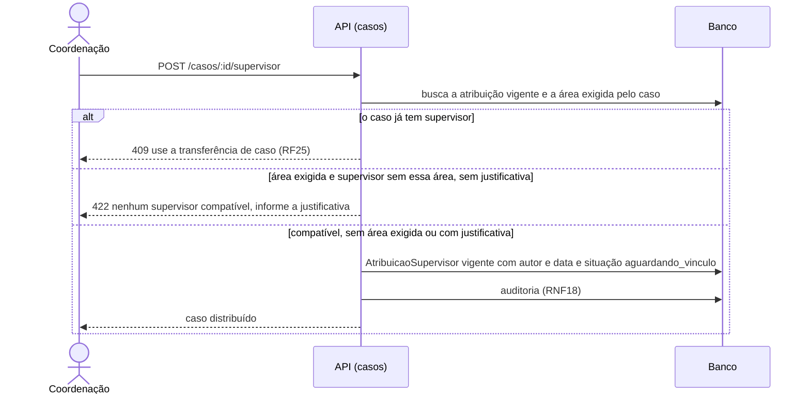

**Dados de teste:** um caso com área "Infância e adolescência" e um supervisor compatível; um caso com área que nenhum supervisor atende; um caso sem área; um caso já distribuído.

### RF21 — Vincular paciente a estagiário responsável ([#95](https://github.com/mdsreq-fga-unb/REQ-2026.2-T02-ClinicaEscolaFBr/issues/95))

**Rota:** `POST /casos/:id/estagiario` (supervisor responsável pelo caso). Mostra como opções apenas estagiários com a situação `ativo`. O vínculo e a criação do prontuário (RF66) acontecem na mesma transação. Até a resposta da FBr sobre o atendimento em dupla (RN5.9), o caso tem um único vínculo vigente, garantido por índice único parcial.

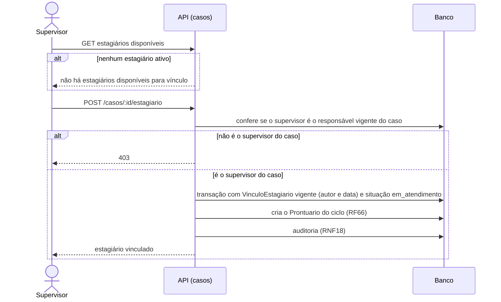

**Dados de teste:** um caso distribuído ao supervisor S; um supervisor T tentando vincular (recebe 403); um estagiário desativado, que não aparece nas opções.

---

## Agendamento (CP4)

### RF10 — Agendar sessão do paciente ([#96](https://github.com/mdsreq-fga-unb/REQ-2026.2-T02-ClinicaEscolaFBr/issues/96))

**Rota:** `POST /sessoes` (secretaria, ou o estagiário responsável pelo caso). Recebe o caso, o início e, opcionalmente, o término. Sem término, ele é calculado com o parâmetro `duracao_sessao_minutos` (padrão de 50).

**Escopo no Ciclo 3:** o agendamento gera o link de confirmação e o envia por e-mail. O envio por SMS e a página que confirma a presença entram com o RF14, no Ciclo 4.

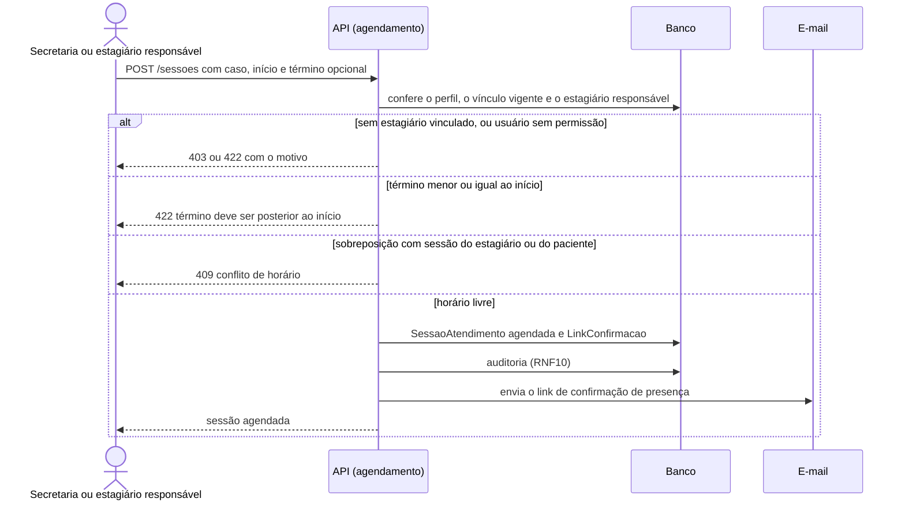

**Regra de sobreposição:** existe conflito quando outra sessão `agendada` do mesmo estagiário ou do mesmo paciente tem `inicio < novoTermino` e `termino > novoInicio`. Como as desigualdades são estritas, uma sessão que termina às 14h50 não conflita com outra que começa às 14h50.

**Dados de teste:** uma sessão existente das 14h00 às 14h50 e as tentativas às 14h30 (bloqueada) e às 14h50 (permitida); um paciente sem estagiário; um estagiário que não é o responsável; um término anterior ao início.

---

## Prontuário (CP6)

### RF66 — Criar e inicializar o prontuário do paciente ([#97](https://github.com/mdsreq-fga-unb/REQ-2026.2-T02-ClinicaEscolaFBr/issues/97))

**Criação:** automática, na mesma transação do vínculo (RF21). Não há rota própria: o prontuário nasce com a identificação do paciente, do caso, do ciclo de atendimento, do estagiário responsável e do supervisor.

**Fora do Ciclo 3:** o registro da anamnese e do contrato terapêutico foi separado no [RF69](../unidade-2/requisitos/funcionais.md#rf69) em 24/10/2026 e entra no Ciclo 4, depois que a FBr enviar os modelos. No Ciclo 3, a tela do prontuário mostra a identificação e o espaço dos dados iniciais ainda vazio.

| Regra | Critério de aceitação |
| --- | --- |
| A criação acontece só dentro da transação do RF21 | Caso sem estagiário vinculado não tem prontuário |
| Índice único em `(caso_id, ciclo_atendimento)` | Não é criado um segundo prontuário no mesmo ciclo |
| A criação guarda a data/hora e o vínculo que a originou | O prontuário mostra quando e por qual vínculo foi criado |

**Dados de teste:** um caso recém-vinculado; uma tentativa de vincular de novo no mesmo ciclo.

---

## Roteiro da inspeção de design

A inspeção é feita pelo Líder de Feature com o revisor da issue, que nunca pode ser o autor do design. Para cada feature, o resultado é registrado num comentário da issue, usando os itens abaixo:

```text
Inspeção de design — <feature> (#NN)
Data: <dd/mm/aaaa>    Participantes: <Líder>, <revisor>
D1.1 Modelo, diagrama de sequência, rotas e regras revisados: sim | não
D1.2 Classes e relacionamentos usados: <lista>  — consistentes com o modelo de domínio: sim | não
D1.3 Viabilidade técnica: <tecnologias e integrações> · dados de teste: <ok> · riscos: <lista ou "nenhum">
D1.4 Acessibilidade (RNF56–RNF58, quando houver tela pública): <resultado>
D1.5 Segurança e LGPD (RNFs da CP12 aplicáveis): <resultado>
D1.6 Normas do CRP consideradas: <resultado>
D1.7 Modalidade presencial considerada: <resultado>
Resultado: aprovado | aprovado com ajustes | reprovado
Apontamentos: <lista>
```
