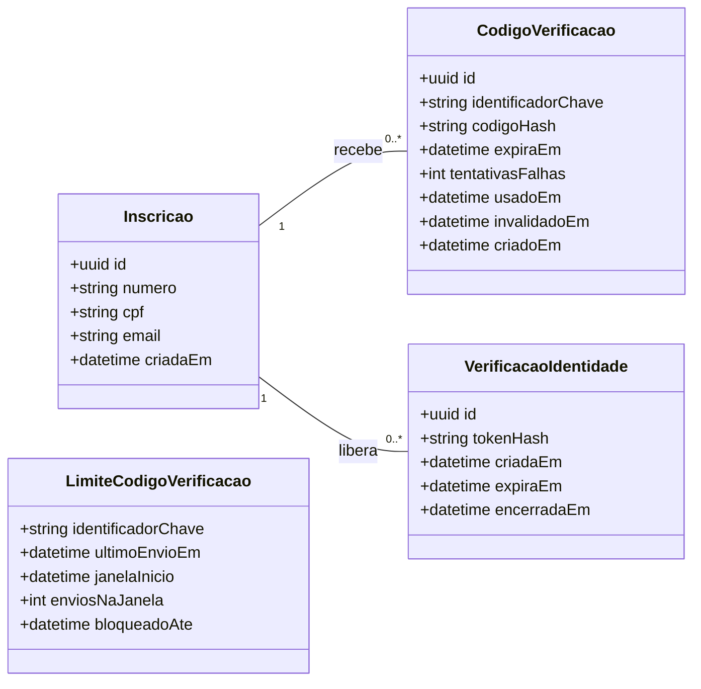
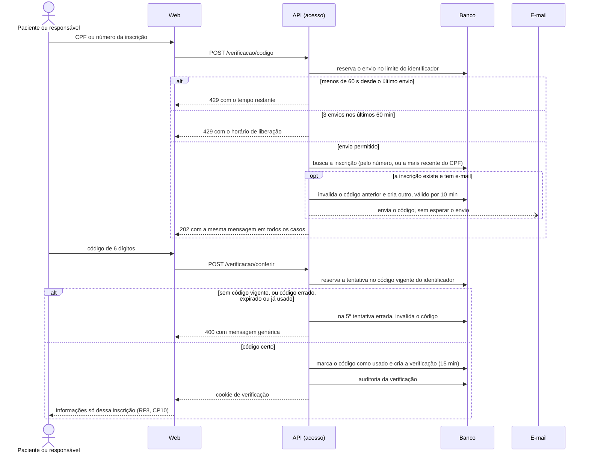
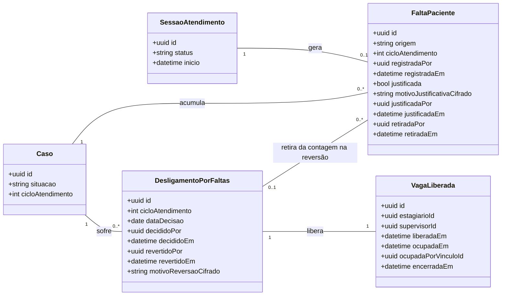
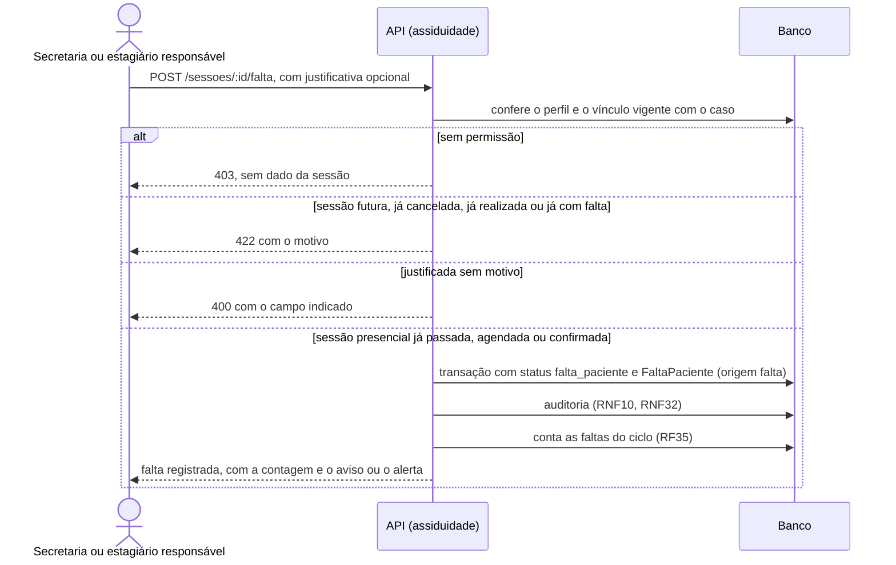
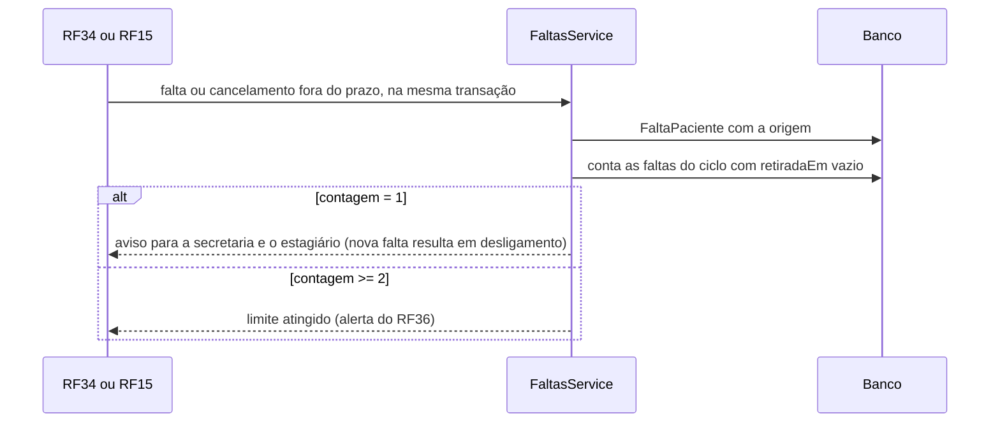
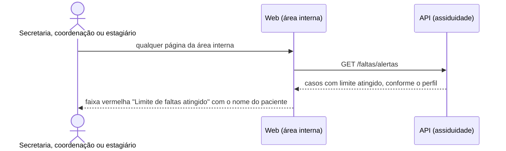
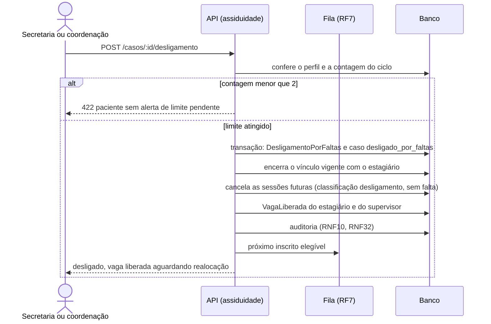
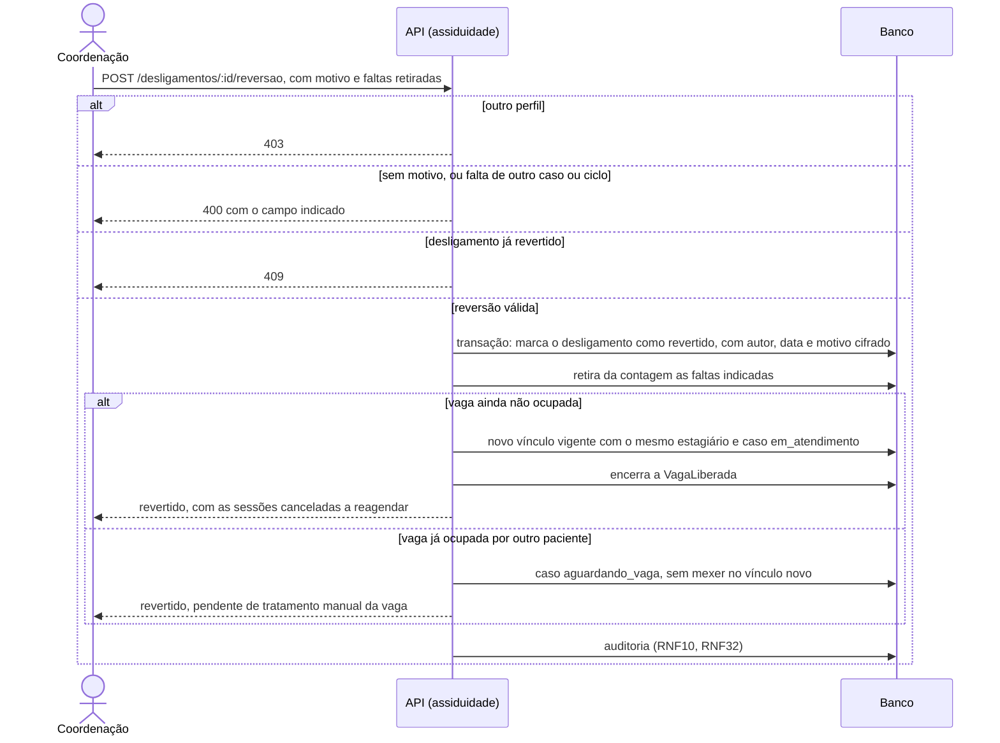

# Projeto das features do Ciclo 4

Esta página registra o processo **Projetar por Feature** do FDD para as features do Ciclo 4: o modelo detalhado, os diagramas de sequência, as rotas da API, as regras ligadas aos critérios de aceitação e os dados de teste de cada feature. Como no Ciclo 3, ela é o material da **inspeção de design** (marco 1 do [DoD](../unidade-2/requisitos/dor-dod.md#1-design-inspecionado)), e o resultado da inspeção de cada feature é registrado na sua issue.

Cada Líder de Feature acrescenta aqui a seção da sua feature, agrupada pela CP, e as classes novas no modelo detalhado. Os requisitos de origem estão na [seção 8.1](../unidade-2/requisitos/funcionais.md), e os itens do ciclo, em [Features e backlog](../visao-geral/backlog.md#ciclo-4).

## Convenções

Valem as [convenções do Ciclo 3](projeto-features-ciclo-3.md#convencoes), inclusive a de citar o RF e a DF em vez de repetir a regra de negócio, com um acréscimo:

- **Rotas públicas do paciente:** o paciente e o responsável legal não têm conta (critério R6.2 do DoR). As rotas que mostram dados de uma inscrição, como a consulta da fila (RF8) e as declarações da CP10, usam o `VerificacaoGuard` do RF52, que só libera a inscrição cuja identidade foi verificada.

## Modelo detalhado do Ciclo 4

Classes novas do ciclo, que se somam ao [modelo do Ciclo 3](projeto-features-ciclo-3.md#modelo-detalhado-do-ciclo-3). A `Inscricao` aparece só com os atributos usados aqui.

`LimiteCodigoVerificacao` não tem chave estrangeira: ele é guardado pelo identificador informado, exista ou não uma inscrição com ele.

## Acesso e segurança (CP12)

### RF52 — Verificar identidade do paciente ou responsável ([#47](https://github.com/mdsreq-fga-unb/REQ-2026.2-T02-ClinicaEscolaFBr/issues/47))

O RF52 não mostra dados por conta própria: ele confirma a identidade e entrega às outras features uma verificação ligada a uma única inscrição. Quem usa a verificação é a consulta da posição na fila (RF8, [#155](https://github.com/mdsreq-fga-unb/REQ-2026.2-T02-ClinicaEscolaFBr/issues/155)) e, mais adiante, as declarações de comparecimento da CP10 (RF44 a RF46). O código vai só por e-mail ([DF24](../unidade-2/requisitos/decisoes-fbr.md#df24)).

**Rotas** (módulo `acesso`, todas públicas):

- `POST /verificacao/codigo`: recebe o identificador, que pode ser o CPF (com ou sem pontuação) ou o número da inscrição (`AAAA-NNNNN`). Responde sempre `202` com a mesma mensagem, ou `429` com `segundosRestantes` (pedido antes de 60 segundos) ou `bloqueadoAte` (limite de 3 códigos em 60 minutos).
- `POST /verificacao/conferir`: recebe o identificador e o código. Com o código certo, responde `200` e grava o cookie `verificacao`. Em qualquer outro caso, responde `400` com a mesma mensagem.
- `POST /verificacao/encerrar`: encerra a verificação e apaga o cookie.

O `VerificacaoGuard` lê o cookie `verificacao`, confere se a verificação está dentro do prazo e não foi encerrada e preenche `req.inscricaoVerificada` com o id da inscrição. Sem verificação válida, a rota responde `401` sem nenhum dado. O cookie é `httpOnly`, `Secure` e `SameSite=Lax`, como o da sessão do RF50, e só o hash do token fica no banco.

| Regra | Critério de aceitação |
| --- | --- |
| A verificação fica ligada a uma única inscrição, e o `VerificacaoGuard` só entrega o id dela às rotas do paciente | O CPF ou o número, com o código informado em até 10 minutos, libera acesso apenas às informações desse paciente |
| Sem verificação válida, as rotas do paciente respondem `401` sem dado; a conferência responde sempre a mesma mensagem, exista ou não a inscrição | Sem código, ou com código incorreto ou expirado, nada é exibido e a existência da inscrição não é confirmada |
| Para inscrição sem e-mail, nada é enviado, e a resposta é o mesmo `202` de qualquer pedido | Inscrição sem e-mail não recebe código, e a resposta é a mesma de qualquer pedido |
| `usadoEm` é gravado com um `UPDATE` condicional (`usado_em is null`), e só uma conferência simultânea passa | Código já utilizado é recusado |
| `tentativasFalhas` é reservada antes da comparação, como no RF50; na 5ª tentativa errada, o código recebe `invalidadoEm` | Na quinta tentativa incorreta, o código é invalidado e nem o correto passa a ser aceito |
| `ultimoEnvioEm` no limite do identificador; o novo código invalida o anterior | Novo código pedido antes de 60 segundos é recusado, informando o tempo restante |
| `enviosNaJanela` e `janelaInicio` contam os envios em 60 minutos; no 3º, `bloqueadoAte` recebe a hora do envio mais 60 minutos | Depois de 3 códigos em 60 minutos, o quarto pedido é recusado, e o bloqueio dura 60 minutos |

**Decisões de projeto** (a conferir na inspeção):

1. **Identificador guardado como chave, e não em texto.** `identificadorChave` é um HMAC-SHA256 do identificador normalizado (`cpf:<11 dígitos>` ou `numero:<AAAA-NNNNN>`), com uma chave do servidor. O CPF não fica gravado nas tabelas novas.
2. **Limites pelo identificador, e não pela inscrição.** Os limites valem igual para um CPF ou número que existe e para um que não existe, para que o `429` não revele a inscrição; é a mesma ideia do bloqueio do RF50 para e-mail sem conta. Como o CPF e o número são identificadores diferentes, alternando os dois uma mesma inscrição pode receber até 6 códigos por hora. O risco é aceito: cada código aceita só 5 tentativas.
3. **CPF com mais de uma inscrição:** vale a mais recente, que é a que está na fila.
4. **Duração da verificação:** 15 minutos, sem renovação (`MINUTOS_VERIFICACAO`). O RF52 não define esse prazo. Ele é curto porque a consulta é rápida e pode ser feita num computador compartilhado. Depois do prazo, a pessoa pede um novo código.
5. **Envio do e-mail fora da resposta:** a API responde sem esperar o envio, para que o tempo de resposta não indique se a inscrição existe ou tem e-mail.
6. **Código:** gerado com `crypto.randomInt` e guardado como HMAC, nunca em texto.
7. **Auditoria:** a verificação concluída grava `verificar_identidade` na auditoria, sem usuário e com a inscrição como entidade, para rastrear o acesso aos dados dela. O pedido de código não altera dado da inscrição e não é auditado.

**Telas:** página pública `/consultar`, em dois passos (identificador e código), usada pelo RF8 antes de mostrar a posição na fila. O código é digitado num campo único com `inputmode="numeric"` e `autocomplete="one-time-code"`. As mensagens de erro usam `role="alert"` e recebem o foco, e o botão de reenvio mostra o tempo restante. As telas estão nos [protótipos do Ciclo 4](prototipos-ciclo-4.md#rf52).

**Dados de teste:**

- Inscrições fictícias: uma com e-mail, uma só com celular e um CPF com duas inscrições.
- Identificadores sem inscrição: um CPF e um número inexistentes.
- Códigos: um vencido (criado há 11 minutos), um já usado e um com 4 tentativas erradas.
- Limites: um identificador com envio há 30 segundos, um com 2 envios na janela e um bloqueado.
- Em desenvolvimento, o e-mail chega ao Mailpit (`http://localhost:8025`).

**Riscos:** o remetente oficial de e-mail depende da FBr, como no RF53. O RF1, de que o RF52 depende, já está na `main` ([#139](https://github.com/mdsreq-fga-unb/REQ-2026.2-T02-ClinicaEscolaFBr/pull/139)).

## Controle de assiduidade e alertas (CP9)

As cinco features da CP9 trabalham sobre os mesmos registros: a falta (`FaltaPaciente`), o desligamento (`DesligamentoPorFaltas`) e a vaga liberada (`VagaLiberada`). A contagem e o alerta não têm tabela própria: são calculados a partir das faltas, para que nunca fiquem diferentes delas (RNF32). O módulo novo da API é o `assiduidade`.

**Classes novas** (somam-se ao modelo acima e ao do Ciclo 3):

- **`FaltaPaciente.origem`:** `falta`, quando a sessão aconteceu sem o paciente (RF34), ou `cancelamento_fora_do_prazo`, quando o RF15 classifica o cancelamento assim. Uma sessão gera no máximo uma falta (índice único em `sessao_id`).
- **Status novo da sessão:** `falta_paciente`, que se soma ao `confirmada` e ao `cancelada` do RF14 e do RF15. Como o RF15 e o RF34 mexem no mesmo `status_sessao`, a migration que acrescenta os três valores sai na primeira PR das duas, e a outra só a reaproveita.
- **Situações novas do caso:** `desligado_por_faltas` (RF37) e `aguardando_vaga` (RF38, quando a vaga já foi ocupada).
- **Cifrados (RNF51):** o motivo da justificativa e o motivo da reversão podem trazer informação de saúde, como um atestado, por isso ficam em colunas `*_cifrado`.
- **Somente inserção, com campos que só são preenchidos uma vez (RNF32):** nenhuma falta é apagada nem tem a origem trocada. A justificativa e a retirada da contagem preenchem campos vazios com um `UPDATE` condicional (`justificada_em is null`, `retirada_em is null`), e cada operação vai para a auditoria com o estado anterior e o novo. O usuário da aplicação no banco (`clinica_app`) não recebe `DELETE` nessas tabelas.

**Contagem (RF35):** `FaltasService.contar(casoId)` conta as `FaltaPaciente` do ciclo vigente do caso com `retiradaEm` vazio. Ela aparece no prontuário (RF27), nos dados administrativos da secretaria e na agenda, como "Faltas no ciclo: N de 2".

---

### RF34 — Registrar falta do paciente na sessão ([#150](https://github.com/mdsreq-fga-unb/REQ-2026.2-T02-ClinicaEscolaFBr/issues/150))

**Rotas** (módulo `assiduidade`):

- `POST /sessoes/:id/falta`: secretaria ou estagiário responsável pelo caso. Recebe, opcionalmente, `justificada` e `motivo`, para quem já tem o comprovante na hora.
- `POST /faltas/:id/justificativa`: secretaria, estagiário responsável ou supervisor responsável. Recebe o `motivo`, obrigatório. É a justificativa feita depois, a partir da lista de sessões do paciente: nos dados administrativos, para a secretaria, e no prontuário, para o estagiário e o supervisor.

| Regra | Critério de aceitação |
| --- | --- |
| Só aceita sessão com `inicio` no passado e status `agendada` ou `confirmada`; a confirmação do RF14 não muda nada | Falta em sessão presencial já passada, sem realização nem cancelamento, confirmada ou não, muda o status para "falta do paciente", com data, horário e usuário |
| `422` para `cancelada`, `realizada` ou `falta_paciente` | Sessão cancelada ou realizada não aceita falta |
| A transação grava a `FaltaPaciente`, que é o evento consumido pela contagem | Cada falta gera o evento da contagem (RF35) |
| A justificativa preenche `justificada`, o motivo cifrado, `justificadaPor` e `justificadaEm`, e não muda a origem nem a contagem | A secretaria ou os responsáveis justificam, na hora ou depois, com autor e data/hora |
| `403` para quem não é a secretaria nem o estagiário ou o supervisor responsáveis | Outro usuário não justifica a falta |

**Telas:** diálogo "Registrar falta do paciente" na agenda e na lista de sessões, com a caixa "Falta justificada" e o campo de motivo, que só aparece quando ela é marcada; "Marcar como justificada" na linha da falta, depois. Protótipo: [prancha 3-1](prototipos-ciclo-4.md#rf34).

**Dados de teste:** uma sessão das 14h00 de ontem confirmada e outra não confirmada (aceitam a falta); uma sessão de amanhã, uma cancelada e uma realizada (recusam); uma falta justificada no registro e outra justificada depois; um estagiário e um supervisor sem vínculo com o caso tentando justificar (403).

---

### RF35 — Contabilizar faltas do paciente no ciclo ([#151](https://github.com/mdsreq-fga-unb/REQ-2026.2-T02-ClinicaEscolaFBr/issues/151))

**Sem rota própria.** A contagem é o `FaltasService.contar(casoId)`, chamado pelas telas que mostram o paciente e no fim das transações que criam ou retiram falta. A falta vem de dois lugares: do RF34 e do cancelamento do RF15, que chama `FaltasService.registrarCancelamentoForaDoPrazo(sessaoId)` na mesma transação, quando classifica o cancelamento como fora do prazo.

| Regra | Critério de aceitação |
| --- | --- |
| Conta as faltas do `cicloAtendimento` vigente do caso, consecutivas ou não, e nunca zera por sessão realizada | A 1ª falta ou o 1º cancelamento fora do prazo leva a 1 e avisa; uma nova falta, mesmo depois de sessões realizadas, leva a 2 e dispara o alerta |
| Só o RF15 com classificação `fora_do_prazo` cria falta; `no_prazo` e `administrativo` não chamam o serviço | Cancelamento no prazo e cancelamento administrativo não alteram a contagem |
| A falta de confirmação (RF14) não cria registro nenhum | Quem não confirmou, mas compareceu, não ganha falta |
| `justificada` não entra no filtro da contagem | A falta justificada continua contando |
| O filtro usa o ciclo vigente do caso | Num novo ciclo, a contagem começa em zero |
| A reversão (RF38) preenche `retiradaEm` e `retiradaPor` só nas faltas indicadas | Na reversão, as faltas indicadas deixam de contar e continuam no histórico, com autor e data/hora |

**Telas:** contador "Faltas no ciclo: N de 2", com o histórico do que conta e do que não conta e a falta retirada marcada como desconsiderada. Protótipo: [prancha 3-2](prototipos-ciclo-4.md#rf35).

**Dados de teste:** paciente sem falta; com uma falta; com uma falta, duas sessões realizadas e uma nova falta; cancelamentos no prazo (2 horas antes), fora do prazo (30 minutos antes) e administrativo (10 minutos antes); paciente que não confirmou e compareceu; falta justificada; paciente no ciclo 2 com duas faltas no ciclo 1.

---

### RF36 — Emitir alerta de limite de faltas atingido ([#152](https://github.com/mdsreq-fga-unb/REQ-2026.2-T02-ClinicaEscolaFBr/issues/152))

**Rota:** `GET /faltas/alertas` (secretaria e coordenação: todos os casos; estagiário: só os casos dele). Devolve os casos `em_atendimento` com contagem 2 ou mais, sem desligamento vigente no ciclo, com o nome do paciente e a data da última falta, sem o motivo das faltas.

**O alerta não tem tabela:** ele existe enquanto a condição vale. Por isso, some sozinho quando o desligamento é registrado (o caso deixa de estar `em_atendimento`) e não volta depois de uma reversão que deixe a contagem abaixo de 2.

| Regra | Critério de aceitação |
| --- | --- |
| Contagem >= 2 e caso `em_atendimento` | Na 2ª falta do ciclo, consecutiva ou não, o alerta aparece para a secretaria, o estagiário responsável e a coordenação |
| O caso desligado sai do filtro | O registro do desligamento (RF37) remove o alerta |

**Telas (RNF33):** faixa no topo da área interna, carregada pelo layout em toda página, com ícone, o texto "Limite de faltas atingido", o nome do paciente e o link para o paciente; `role="status"`, para o leitor de tela anunciar sem roubar o foco; o vermelho nunca é o único sinal. A consulta usa o mesmo cache do contador do menu, para não pesar na navegação. Protótipo: [prancha 3-3](prototipos-ciclo-4.md#rf36).

**Dados de teste:** um paciente com 1 falta (sem alerta) e outro com 2 (com alerta), vistos pelos três perfis; a coordenação com três pacientes no limite; um estagiário que não é o responsável (não vê o alerta do paciente); o mesmo paciente depois do desligamento (o alerta some).

---

### RF37 — Desligar paciente por faltas e liberar vaga ([#153](https://github.com/mdsreq-fga-unb/REQ-2026.2-T02-ClinicaEscolaFBr/issues/153))

**Rotas:**

- `POST /casos/:id/desligamento` (secretaria ou coordenação), com a `dataDecisao`.
- `GET /vagas/liberadas` (coordenação: todas; supervisor: as dos estagiários dele), com o próximo inscrito elegível da fila, que vem do RF7.

| Regra | Critério de aceitação |
| --- | --- |
| `422` quando a contagem do ciclo é menor que 2 | Paciente sem alerta pendente não pode ser desligado por faltas |
| Uma transação só: desligamento, situação do caso, vínculo encerrado, sessões futuras canceladas e vaga liberada | A confirmação registra a decisão com data e responsável, muda o status, encerra o vínculo, cancela as sessões futuras e sinaliza a vaga, com o próximo inscrito da fila |
| As sessões canceladas pelo desligamento não geram falta nem notificação de ausência do estagiário | O desligamento não aumenta a contagem nem conta como falta do estagiário |
| `VagaLiberada.ocupadaEm` só é preenchido pelo RF21, quando o supervisor vincula um novo paciente ao mesmo estagiário | Nenhum inscrito é vinculado sozinho; a vaga só deixa de estar pendente com o novo vínculo |
| Tudo na mesma transação, sem fila de mensagens nem tarefa agendada | A vaga aparece como liberada em até 5 segundos (RNF34) |

**Integração com o RF21:** ao registrar um vínculo, o `CasosService` procura a `VagaLiberada` aberta mais antiga do mesmo estagiário e preenche `ocupadaEm` e `ocupadaPorVinculoId`. É a única mudança no código do Ciclo 3.

**Telas:** botão "Desligar por faltas" só no paciente com alerta, com diálogo de confirmação que lista as sessões futuras que serão canceladas; cartão "Vaga liberada aguardando realocação" na distribuição (coordenação) e em "Meus casos" (supervisor), com o próximo inscrito elegível. Protótipo: [prancha 3-4](prototipos-ciclo-4.md#rf37).

**Dados de teste:** um paciente com 2 faltas e duas sessões futuras; um paciente com 1 falta (recusado); uma fila com o próximo inscrito elegível e uma fila vazia; o desligamento pela secretaria e pela coordenação; a vaga vista pelo supervisor do estagiário e por outro supervisor (que não vê).

---

### RF38 — Reverter desligamento de paciente por faltas ([#154](https://github.com/mdsreq-fga-unb/REQ-2026.2-T02-ClinicaEscolaFBr/issues/154))

**Rota:** `POST /desligamentos/:id/reversao` (só coordenação), com o `motivo`, obrigatório, e a lista `faltasRetiradas`, com os ids das faltas do ciclo que deixam de contar (RF35). A lista pode vir vazia.

| Regra | Critério de aceitação |
| --- | --- |
| Vaga sem `ocupadaEm`: o caso volta para `em_atendimento` com um novo `VinculoEstagiario` do mesmo estagiário; o vínculo antigo continua no histórico | Com a vaga livre, o paciente volta ao atendimento com o mesmo estagiário, a sinalização sai e as sessões canceladas aparecem para reagendar |
| Vaga com `ocupadaEm`: o vínculo do novo paciente não é tocado; o caso fica `aguardando_vaga` | Com a vaga já ocupada, o novo paciente continua e a reversão fica pendente de tratamento manual |
| `@Perfis('coordenacao')` | Outro perfil não reverte |
| O desligamento recebe os campos da reversão, e nenhum registro é apagado | O desligamento e a reversão continuam na auditoria, cada um com autor, data/hora e motivo |

**Telas:** diálogo "Reverter desligamento" com o motivo obrigatório e a lista das faltas do ciclo, cada uma com uma caixa "Deixa de contar"; depois, a lista das sessões canceladas a reagendar, com o atalho para o agendamento. A escolha das faltas é uma proposta levada à FBr em 06/11. Protótipo: [prancha 3-5](prototipos-ciclo-4.md#rf38).

**Dados de teste:** um desligamento com a vaga livre e duas sessões canceladas; um com a vaga já ocupada por outro paciente; uma reversão sem motivo (recusada); uma reversão com uma falta retirada (a contagem volta a 1); tentativas da secretaria, do supervisor e do estagiário (403); uma segunda reversão do mesmo desligamento (409).

---

**Decisões de projeto da CP9** (a conferir na inspeção):

1. **Contagem e alerta calculados, sem tabela.** Assim, não há como a contagem divergir das faltas, e a reversão ajusta tudo só preenchendo `retiradaEm`. O custo é uma consulta por tela, coberta por um índice em `(caso_id, ciclo_atendimento)` na `faltas_paciente`.
2. **Cancelamento fora do prazo vira `FaltaPaciente`.** O RF15 (Nicolas) chama o `FaltasService` na mesma transação do cancelamento. A interface entre os dois é só esse método, combinado entre as duas PRs.
3. **Sessões canceladas pelo desligamento.** Ficam `cancelada`, com a classificação `desligamento`, que não é nenhuma das três do RF15. Elas não contam como falta do paciente nem do estagiário.
4. **Novo vínculo na reversão, em vez de reativar o antigo.** Preserva o histórico de responsáveis do RF27 e respeita o índice de um vínculo vigente por caso.
5. **Situação `aguardando_vaga`.** O RF38 não diz em que situação o caso fica quando a vaga já foi ocupada. O protótipo mostra "aguarda vaga", e a coordenação resolve depois, distribuindo de novo (RF20) ou vinculando quando surgir uma vaga.
6. **Fila (RF7) ainda não existe.** Até o RF7 entrar, o `GET /vagas/liberadas` devolve o próximo inscrito elegível como vazio, e a tela mostra "Fila de espera disponível com o RF7".

**Dependências e riscos:** o RF14 e o RF15 (Nicolas) trazem os status `confirmada` e `cancelada`; até eles entrarem, os testes do RF34 criam as sessões direto no banco, como no Ciclo 3. O RF7 (Jônatas) traz a fila. Nenhuma integração externa: não há e-mail, SMS nem PDF na CP9.

---

## Roteiro da inspeção de design

O mesmo do [Ciclo 3](projeto-features-ciclo-3.md#roteiro-da-inspecao-de-design): o Líder de Feature faz a inspeção com o revisor da issue e registra o resultado num comentário da issue.
