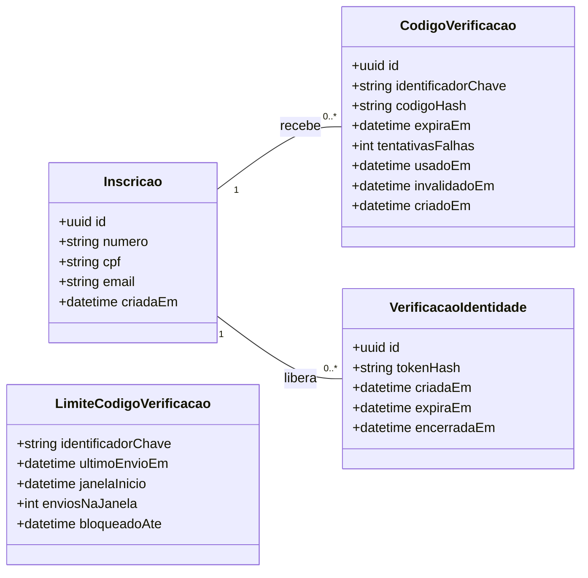
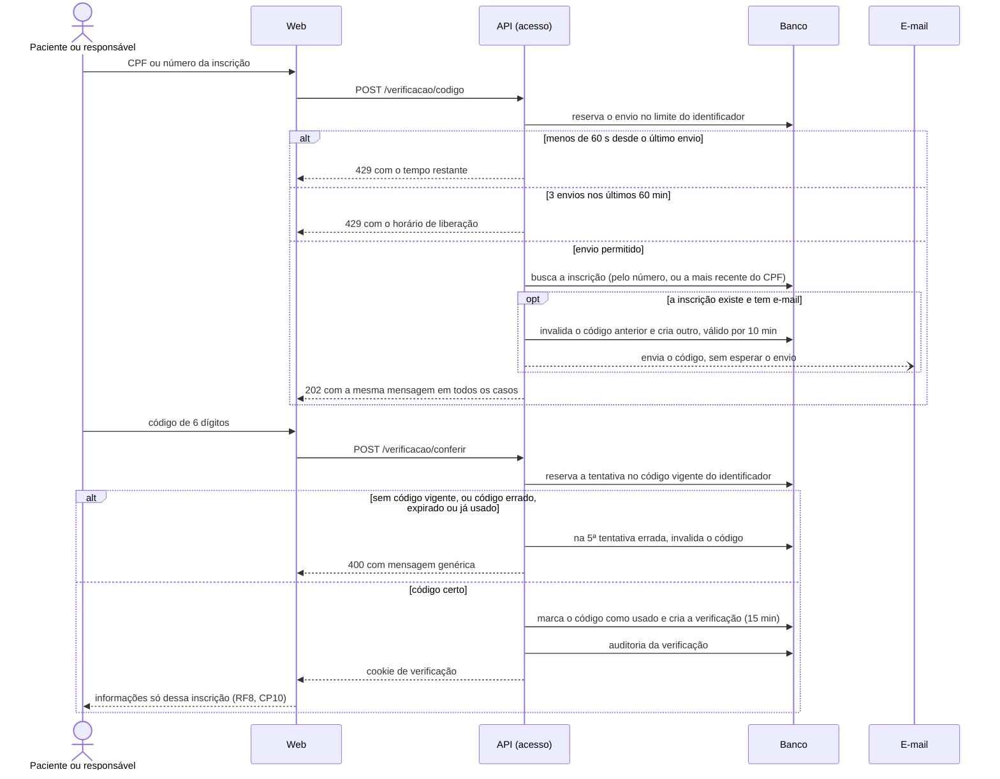

# Projeto das features do Ciclo 4

Esta página registra o processo **Projetar por Feature** do FDD para as features do Ciclo 4: o modelo detalhado, os diagramas de sequência, as rotas da API, as regras ligadas aos critérios de aceitação e os dados de teste de cada feature. Como no Ciclo 3, ela é o material da **inspeção de design** (marco 1 do [DoD](../unidade-2/requisitos/dor-dod.md#1-design-inspecionado)), e o resultado da inspeção de cada feature é registrado na sua issue.

Cada Líder de Feature acrescenta aqui a seção da sua feature, agrupada pela CP, e as classes novas no modelo detalhado. Os requisitos de origem estão na [seção 8.1](../unidade-2/requisitos/funcionais.md), e os itens do ciclo, em [Features e backlog](../visao-geral/backlog.md#ciclo-4).

## Convenções

Valem as [convenções do Ciclo 3](projeto-features-ciclo-3.md#convencoes), com um acréscimo:

- **Rotas públicas do paciente:** o paciente e o responsável legal não têm conta (critério R6.2 do DoR). As rotas que mostram dados de uma inscrição, como a consulta da fila (RF8) e as declarações da CP10, usam o `VerificacaoGuard` do RF52, que só libera a inscrição cuja identidade foi verificada.

## Modelo detalhado do Ciclo 4

Classes novas do ciclo, que se somam ao [modelo do Ciclo 3](projeto-features-ciclo-3.md#modelo-detalhado-do-ciclo-3). A `Inscricao` aparece só com os atributos usados aqui.

`LimiteCodigoVerificacao` não tem chave estrangeira: ele é guardado pelo identificador informado, exista ou não uma inscrição com ele.

## Acesso e segurança (CP12)

### RF52 — Verificar identidade do paciente ou responsável ([#47](https://github.com/mdsreq-fga-unb/REQ-2026.2-T02-ClinicaEscolaFBr/issues/47))

O RF52 não mostra dados por conta própria: ele confirma a identidade e entrega às outras features uma verificação ligada a uma única inscrição. Quem usa a verificação é a consulta da posição na fila (RF8, [#155](https://github.com/mdsreq-fga-unb/REQ-2026.2-T02-ClinicaEscolaFBr/issues/155)) e, mais adiante, as declarações de comparecimento da CP10 (RF44 a RF46). O código vai só por e-mail ([DF24](../unidade-2/requisitos/decisoes-fbr.md)).

**Rotas** (módulo `acesso`, todas públicas):

- `POST /verificacao/codigo`: recebe o identificador, que pode ser o CPF (com ou sem pontuação) ou o número da inscrição (`AAAA-NNNNN`). Responde sempre `202` com a mesma mensagem, ou `429` com `segundosRestantes` (pedido antes de 60 segundos) ou `bloqueadoAte` (limite de 3 códigos em 60 minutos).
- `POST /verificacao/conferir`: recebe o identificador e o código. Com o código certo, responde `200` e grava o cookie `verificacao`. Em qualquer outro caso, responde `400` com a mesma mensagem.
- `POST /verificacao/encerrar`: encerra a verificação e apaga o cookie.

O `VerificacaoGuard` lê o cookie `verificacao`, confere se a verificação está dentro do prazo e não foi encerrada e preenche `req.inscricaoVerificada` com o id da inscrição. Sem verificação válida, a rota responde `401` sem nenhum dado. O cookie é `httpOnly`, `Secure` e `SameSite=Lax`, como o da sessão do RF50, e só o hash do token fica no banco.

| Regra | Critério de aceitação |
| --- | --- |
| A verificação fica ligada a uma única inscrição, e o `VerificacaoGuard` só entrega o id dela às rotas do paciente | O CPF ou o número, com o código informado em até 10 minutos, libera acesso apenas às informações desse paciente |
| Sem verificação válida, as rotas do paciente respondem `401` sem dado; a conferência responde sempre a mesma mensagem, exista ou não a inscrição | Sem código, ou com código incorreto ou expirado, nada é exibido e a existência da inscrição não é confirmada |
| Para inscrição sem e-mail, nada é enviado, e a resposta é o mesmo `202` de qualquer pedido | Inscrição sem e-mail não recebe código, e a resposta é a mesma de qualquer pedido |
| `usadoEm` é gravado com um `UPDATE` condicional (`usado_em is null`), e só uma conferência simultânea passa | Código já utilizado é recusado |
| `tentativasFalhas` é reservada antes da comparação, como no RF50; na 5ª tentativa errada, o código recebe `invalidadoEm` | Na quinta tentativa incorreta, o código é invalidado e nem o correto passa a ser aceito |
| `ultimoEnvioEm` no limite do identificador; o novo código invalida o anterior | Novo código pedido antes de 60 segundos é recusado, informando o tempo restante |
| `enviosNaJanela` e `janelaInicio` contam os envios em 60 minutos; no 3º, `bloqueadoAte` recebe a hora do envio mais 60 minutos | Depois de 3 códigos em 60 minutos, o quarto pedido é recusado, e o bloqueio dura 60 minutos |

**Decisões de projeto** (a conferir na inspeção):

1. **Identificador guardado como chave, e não em texto.** `identificadorChave` é um HMAC-SHA256 do identificador normalizado (`cpf:<11 dígitos>` ou `numero:<AAAA-NNNNN>`), com uma chave do servidor. O CPF não fica gravado nas tabelas novas.
2. **Limites pelo identificador, e não pela inscrição.** Os limites valem igual para um CPF ou número que existe e para um que não existe, para que o `429` não revele a inscrição; é a mesma ideia do bloqueio do RF50 para e-mail sem conta. Como o CPF e o número são identificadores diferentes, alternando os dois uma mesma inscrição pode receber até 6 códigos por hora. O risco é aceito: cada código aceita só 5 tentativas.
3. **CPF com mais de uma inscrição:** vale a mais recente, que é a que está na fila.
4. **Duração da verificação:** 15 minutos, sem renovação (`MINUTOS_VERIFICACAO`). O RF52 não define esse prazo. Ele é curto porque a consulta é rápida e pode ser feita num computador compartilhado. Depois do prazo, a pessoa pede um novo código.
5. **Envio do e-mail fora da resposta:** a API responde sem esperar o envio, para que o tempo de resposta não indique se a inscrição existe ou tem e-mail.
6. **Código:** gerado com `crypto.randomInt` e guardado como HMAC, nunca em texto.
7. **Auditoria:** a verificação concluída grava `verificar_identidade` na auditoria, sem usuário e com a inscrição como entidade, para rastrear o acesso aos dados dela. O pedido de código não altera dado da inscrição e não é auditado.

**Telas:** página pública `/consultar`, em dois passos (identificador e código), usada pelo RF8 antes de mostrar a posição na fila. O código é digitado num campo único com `inputmode="numeric"` e `autocomplete="one-time-code"`. As mensagens de erro usam `role="alert"` e recebem o foco, e o botão de reenvio mostra o tempo restante. As telas estão nos [protótipos do Ciclo 4](prototipos-ciclo-4.md#rf52).

**Dados de teste:**

- Inscrições fictícias: uma com e-mail, uma só com celular e um CPF com duas inscrições.
- Identificadores sem inscrição: um CPF e um número inexistentes.
- Códigos: um vencido (criado há 11 minutos), um já usado e um com 4 tentativas erradas.
- Limites: um identificador com envio há 30 segundos, um com 2 envios na janela e um bloqueado.
- Em desenvolvimento, o e-mail chega ao Mailpit (`http://localhost:8025`).

**Riscos:** o remetente oficial de e-mail depende da FBr, como no RF53. O RF1, de que o RF52 depende, já está na `main` ([#139](https://github.com/mdsreq-fga-unb/REQ-2026.2-T02-ClinicaEscolaFBr/pull/139)).

## Roteiro da inspeção de design

O mesmo do [Ciclo 3](projeto-features-ciclo-3.md#roteiro-da-inspecao-de-design): o Líder de Feature faz a inspeção com o revisor da issue e registra o resultado num comentário da issue.
