# Protótipos do Ciclo 3

Os protótipos das telas do Ciclo 3 foram gerados com uma ferramenta de prototipação assistida por IA (Claude Design), a partir dos requisitos funcionais e não funcionais da [seção 8](../unidade-2/requisitos/funcionais.md) e do [projeto das features do Ciclo 3](projeto-features-ciclo-3.md). A equipe conferiu cada tela contra os critérios de aceitação e os RNFs de acessibilidade (RNF56 a RNF58) e pediu as correções necessárias, como a da distribuição de casos, que é feita somente pela coordenação (RF20). A revisão final de cada tela faz parte da inspeção de design da feature, registrada na sua issue.

!!! info "Ajustes da validação com a FBr (23/10/2026)"
    A FBr aprovou estes protótipos na [reunião de 23/10/2026](reunioes.md#reuniao-de-validacao-do-prototipo-do-ciclo-3-com-a-fbr), com ajustes que estão sendo aplicados às imagens: sem área de especialidade (o RF19 foi removido e o RF20 passa a mostrar os casos ativos de cada supervisor em relação ao limite de 50), canal preferencial entre e-mail, WhatsApp e ligação, sem SMS, triagem sem o selo "Além do prazo", bloqueio do login na 3ª tentativa, sessão de 50 minutos mais 10 de anotações com o botão "Enviar pelo WhatsApp" no agendamento e prontuário da secretaria sem a contribuição social. As decisões estão no [Registro de Decisões com a FBr](../unidade-2/requisitos/decisoes-fbr.md).

As telas estão organizadas pelo fluxo do sistema, uma seção por feature. Cada imagem reúne os estados da tela (padrão, erro, vazio, acesso negado), identificados no topo de cada quadro. As páginas públicas aparecem no computador (1366 px) e no celular (360 px). Os dados mostrados são fictícios. Clique numa imagem para abri-la em tamanho original.

Para ver os detalhes de cada tela, os protótipos completos também estão em PDF, em alta resolução.

[:material-file-pdf-box: Abrir os protótipos em PDF (25 MB)](../assets/prototipos-ciclo-3/prototipos-ciclo-3.pdf){ .md-button target="_blank" rel="noopener" }

## 1. Público: inscrição e comprovante

### RF1 — Registrar solicitação de atendimento on-line { #rf1 }

[RF1](../unidade-2/requisitos/funcionais.md#rf1) · issue [#88](https://github.com/mdsreq-fga-unb/REQ-2026.2-T02-ClinicaEscolaFBr/issues/88). Etapas de dados e contatos, triagem e revisão, mais a tela de erros ao continuar. O aviso do CVV e do SAMU fica visível em todas as etapas.

**No computador**

[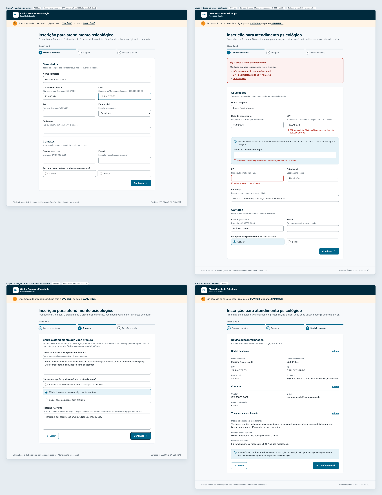](../assets/prototipos-ciclo-3/1-1-inscricao-computador.webp){ target="_blank" }

**No celular**

[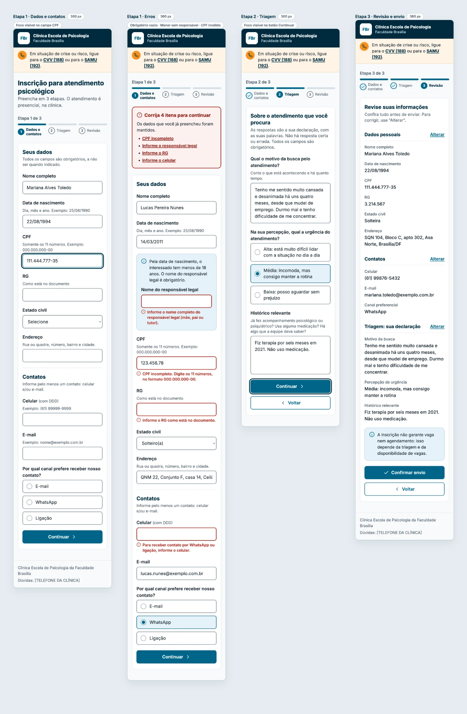](../assets/prototipos-ciclo-3/1-2-inscricao-celular.webp){ target="_blank" }

### RF2 — Emitir comprovante de inscrição { #rf2 }

[RF2](../unidade-2/requisitos/funcionais.md#rf2) · issue [#89](https://github.com/mdsreq-fga-unb/REQ-2026.2-T02-ClinicaEscolaFBr/issues/89). Comprovante com número, data e hora, sem a queixa nem dados clínicos, no computador e no celular.

[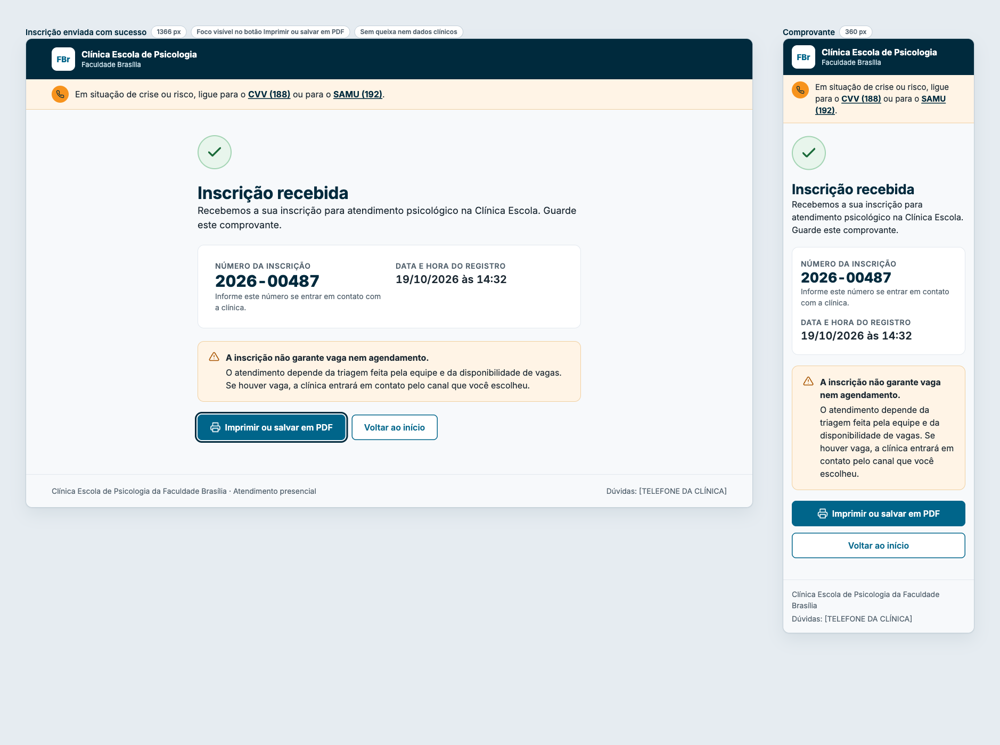](../assets/prototipos-ciclo-3/1-3-comprovante.png){ target="_blank" }

## 2. Acesso: login, ativação e usuários

### RF50 — Autenticar usuário institucional { #rf50 }

[RF50](../unidade-2/requisitos/funcionais.md#rf50) · issue [#45](https://github.com/mdsreq-fga-unb/REQ-2026.2-T02-ClinicaEscolaFBr/issues/45). Tela de entrada, erro genérico de credenciais e conta bloqueada por 15 minutos.

[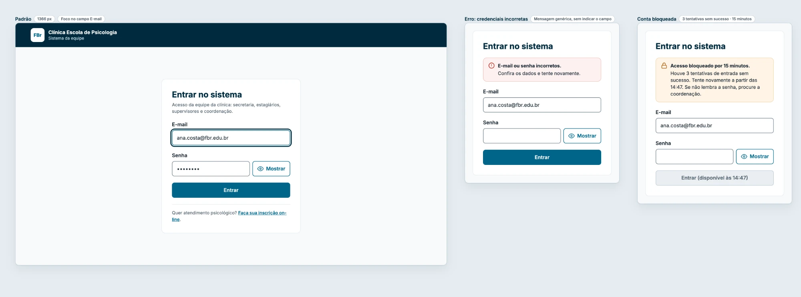](../assets/prototipos-ciclo-3/2-1-entrar.webp){ target="_blank" }

### RF53 — Ativação da conta pelo convite { #rf53-ativacao }

[RF53](../unidade-2/requisitos/funcionais.md#rf53) · issue [#48](https://github.com/mdsreq-fga-unb/REQ-2026.2-T02-ClinicaEscolaFBr/issues/48). Definição da senha com as regras visíveis, erro na confirmação e link vencido ou já usado.

[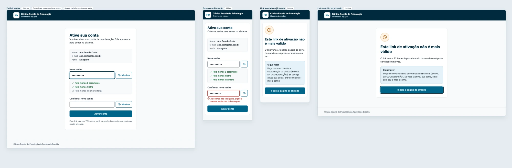](../assets/prototipos-ciclo-3/2-2-ativacao.webp){ target="_blank" }

### RF53 e RF54 — Cadastrar, convidar e desativar usuários { #rf53-rf54 }

[RF53](../unidade-2/requisitos/funcionais.md#rf53) e [RF54](../unidade-2/requisitos/funcionais.md#rf54) · issues [#48](https://github.com/mdsreq-fga-unb/REQ-2026.2-T02-ClinicaEscolaFBr/issues/48) e [#49](https://github.com/mdsreq-fga-unb/REQ-2026.2-T02-ClinicaEscolaFBr/issues/49). Lista de usuários com a situação de cada conta, cadastro com e-mail já existente, confirmação de desativação e reenvio de convite.

[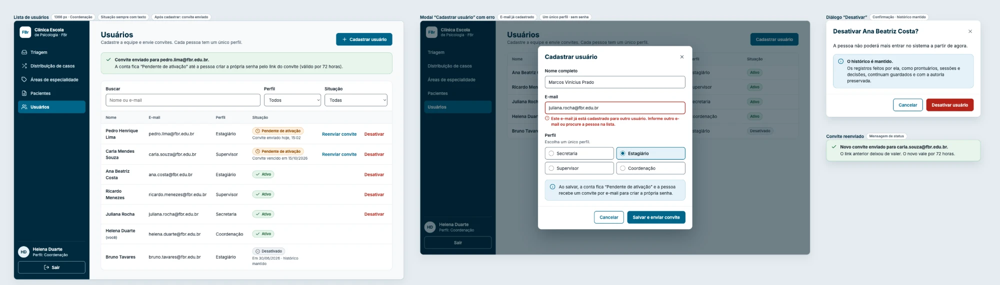](../assets/prototipos-ciclo-3/2-3-usuarios.webp){ target="_blank" }

## 3. Triagem

### RF4 — Organizar informações da inscrição para triagem { #rf4 }

[RF4](../unidade-2/requisitos/funcionais.md#rf4) · issue [#90](https://github.com/mdsreq-fga-unb/REQ-2026.2-T02-ClinicaEscolaFBr/issues/90). Lista com o selo "Além do prazo", inscrição aberta com o bloco "Declarado pelo interessado" e lista vazia.

[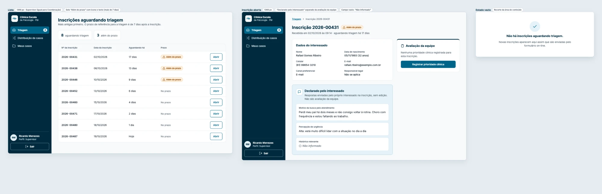](../assets/prototipos-ciclo-3/3-1-triagem.webp){ target="_blank" }

### RF6 — Registrar prioridade clínica do inscrito { #rf6 }

[RF6](../unidade-2/requisitos/funcionais.md#rf6) · issue [#91](https://github.com/mdsreq-fga-unb/REQ-2026.2-T02-ClinicaEscolaFBr/issues/91). Escolha da prioridade sem cor pré-selecionada, referência da clínica, área opcional, histórico de decisões, erro sem prioridade escolhida e confirmação do registro.

[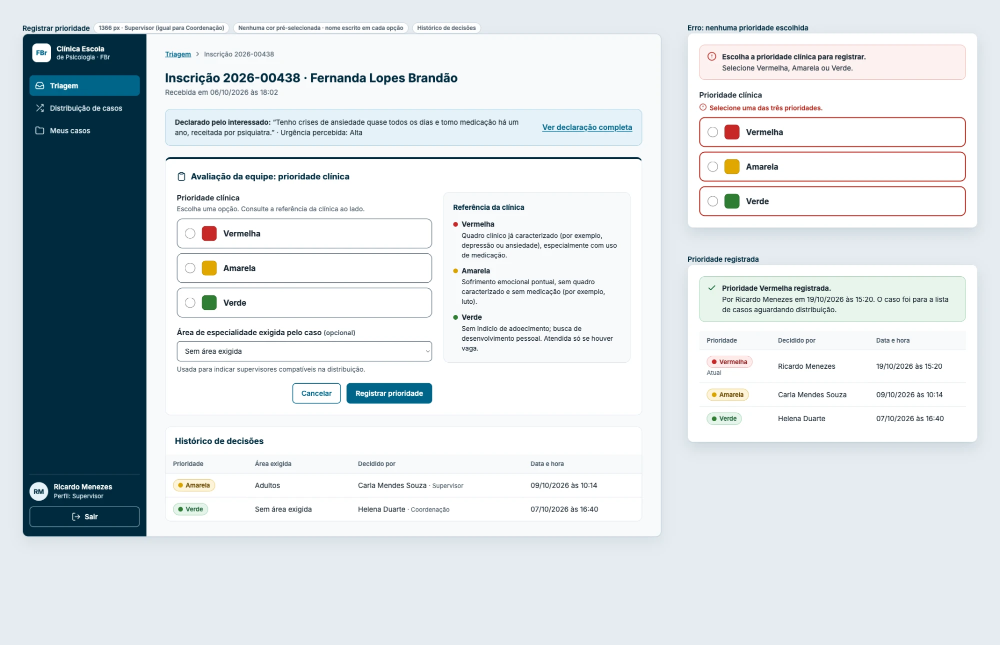](../assets/prototipos-ciclo-3/3-2-prioridade.webp){ target="_blank" }

## 4. Distribuição de casos e vínculo

### RF18 — Listar casos aguardando distribuição { #rf18 }

[RF18](../unidade-2/requisitos/funcionais.md#rf18) · issue [#92](https://github.com/mdsreq-fga-unb/REQ-2026.2-T02-ClinicaEscolaFBr/issues/92). Lista da coordenação no computador e no celular, lista vazia e a visão do supervisor, somente para consulta.

[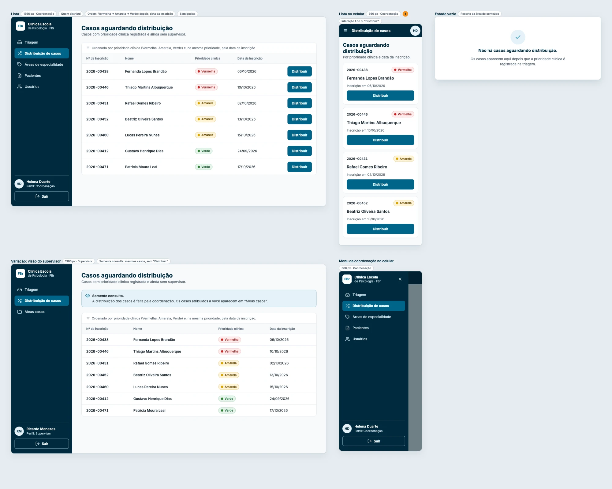](../assets/prototipos-ciclo-3/4-1-casos-aguardando.webp){ target="_blank" }

### RF20 — Distribuir caso a supervisor { #rf20 }

[RF20](../unidade-2/requisitos/funcionais.md#rf20) · issue [#94](https://github.com/mdsreq-fga-unb/REQ-2026.2-T02-ClinicaEscolaFBr/issues/94). Painel de distribuição da coordenação, exceção sem supervisor compatível, caso que já tem supervisor e o fluxo de três passos no celular.

[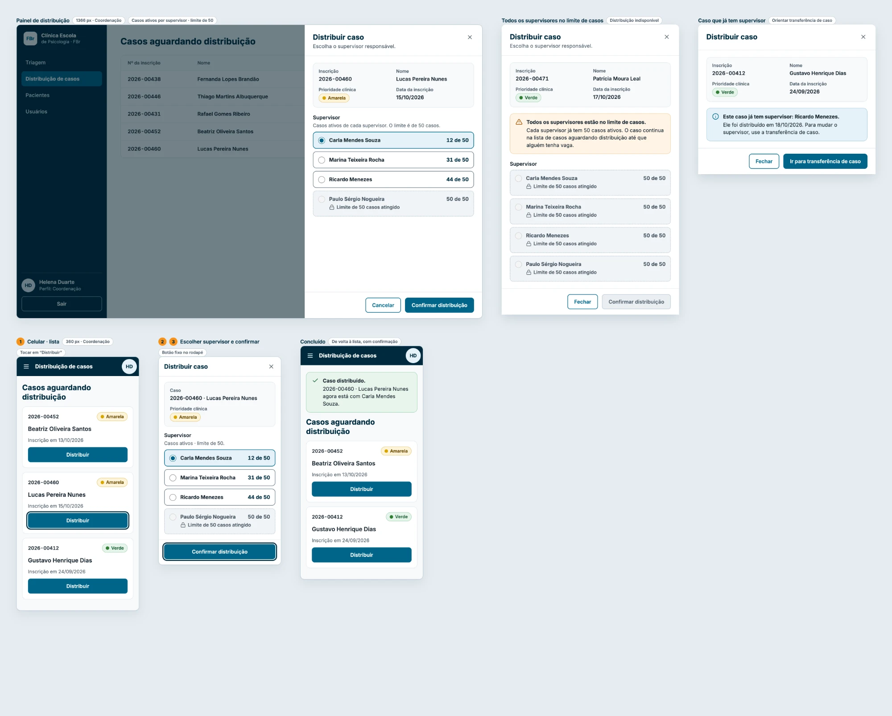](../assets/prototipos-ciclo-3/4-3-distribuir.webp){ target="_blank" }

### RF21 — Vincular paciente a estagiário responsável { #rf21 }

[RF21](../unidade-2/requisitos/funcionais.md#rf21) · issue [#95](https://github.com/mdsreq-fga-unb/REQ-2026.2-T02-ClinicaEscolaFBr/issues/95). Vínculo pelo supervisor, confirmação com o prontuário criado, falta de estagiários disponíveis e o fluxo no celular.

[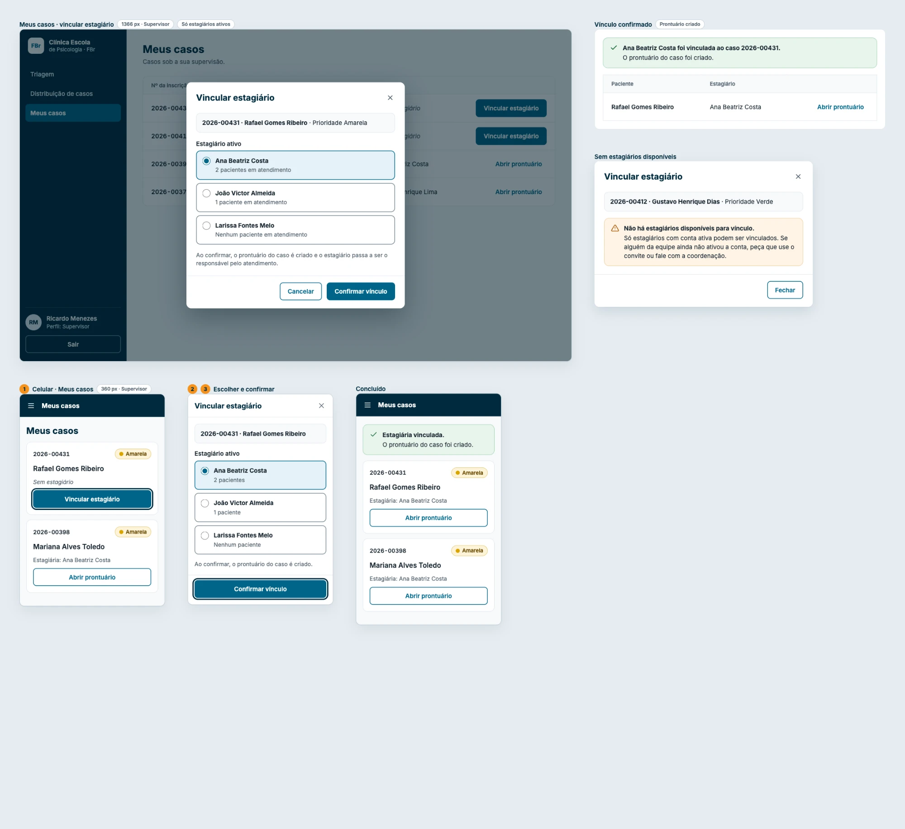](../assets/prototipos-ciclo-3/4-4-vincular.webp){ target="_blank" }

## 5. Agendamento

### RF10 — Agendar sessão do paciente { #rf10 }

[RF10](../unidade-2/requisitos/funcionais.md#rf10) · issue [#96](https://github.com/mdsreq-fga-unb/REQ-2026.2-T02-ClinicaEscolaFBr/issues/96). Formulário com o término calculado, sessão agendada, conflito de horário, término anterior ao início e paciente sem estagiário vinculado.

[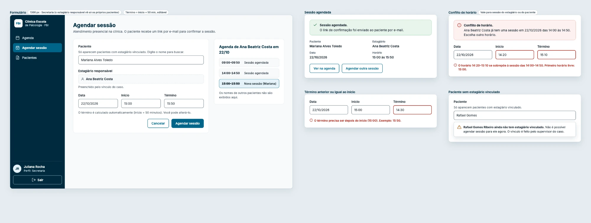](../assets/prototipos-ciclo-3/5-1-agendar.webp){ target="_blank" }

## 6. Prontuário

### RF66 e RF55 — Criar o prontuário e restringir o acesso { #rf66-rf55 }

[RF66](../unidade-2/requisitos/funcionais.md#rf66) e [RF55](../unidade-2/requisitos/funcionais.md#rf55) · issues [#97](https://github.com/mdsreq-fga-unb/REQ-2026.2-T02-ClinicaEscolaFBr/issues/97) e [#50](https://github.com/mdsreq-fga-unb/REQ-2026.2-T02-ClinicaEscolaFBr/issues/50). Visão do estagiário responsável com os dados iniciais, visão da secretaria só com dados cadastrais e administrativos e acesso negado a outro estagiário. Os campos de anamnese e contrato mostrados na visão do estagiário são do [RF69](../unidade-2/requisitos/funcionais.md#rf69), separado do RF66 em 24/10/2026 e previsto para o Ciclo 4, e continuam ilustrativos até a FBr enviar os modelos.

[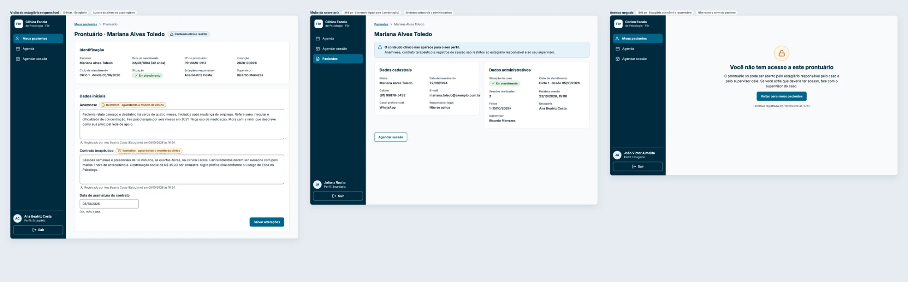](../assets/prototipos-ciclo-3/6-1-prontuario.webp){ target="_blank" }

## 7. Navegação interna por perfil { #navegacao }

Menu de cada perfil (secretaria, estagiário, supervisor e coordenação) e o menu no celular.

[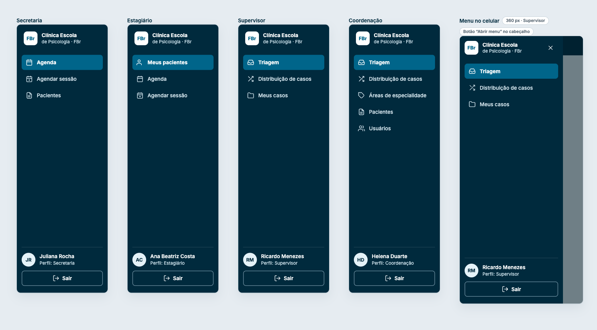](../assets/prototipos-ciclo-3/7-1-navegacao.png){ target="_blank" }
