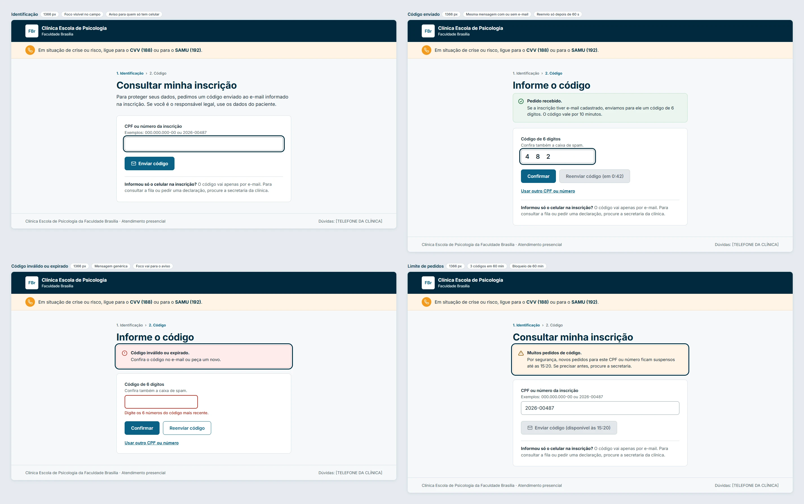
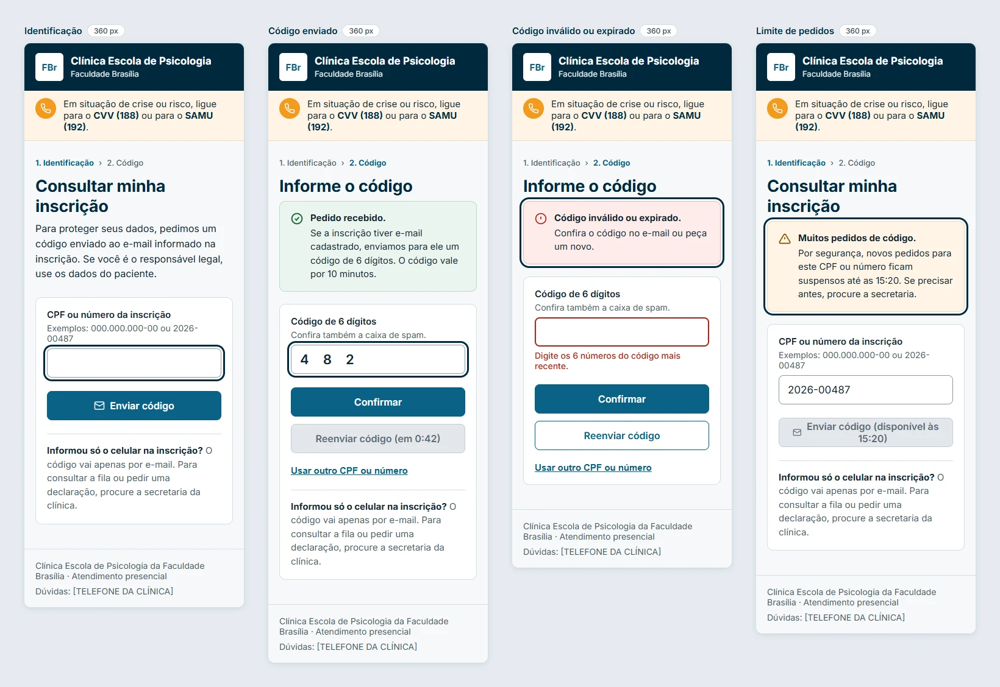

# Protótipos do Ciclo 4

Esta página reúne os protótipos das telas do Ciclo 4, uma seção por feature, a partir do [projeto das features do Ciclo 4](projeto-features-ciclo-4.md). Cada imagem traz os estados da tela (padrão, erro e bloqueio), identificados no topo de cada quadro. As páginas públicas aparecem no computador (1366 px) e no celular (360 px). Os dados mostrados são fictícios. Clique numa imagem para abri-la em tamanho original.

Os protótipos seguem as cores, a tipografia e os componentes das telas aprovadas pela FBr no [Ciclo 3](prototipos-ciclo-3.md). A revisão de cada tela faz parte da inspeção de design da feature, registrada na sua issue, e a validação com a FBr é feita na reunião seguinte do ciclo.

## Público: verificação de identidade

### RF52 — Verificar identidade do paciente ou responsável { #rf52 }

[RF52](../unidade-2/requisitos/funcionais.md#rf52) · issue [#47](https://github.com/mdsreq-fga-unb/REQ-2026.2-T02-ClinicaEscolaFBr/issues/47). Antes de consultar a fila (RF8) ou pedir uma declaração (CP10), o paciente ou o responsável informa o CPF ou o número da inscrição e o código de 6 dígitos enviado ao e-mail cadastrado. São quatro estados:

- **identificação:** com o aviso para quem informou só o celular;
- **código enviado:** com a mesma mensagem, haja ou não e-mail cadastrado, e o reenvio liberado só depois de 60 segundos;
- **código inválido ou expirado:** com uma mensagem única para qualquer falha;
- **limite de pedidos:** depois de 3 códigos em 60 minutos, com o horário de liberação.

**No computador**

{ target="_blank" }

**No celular**

{ target="_blank" }
