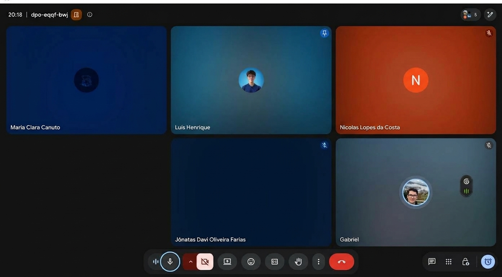
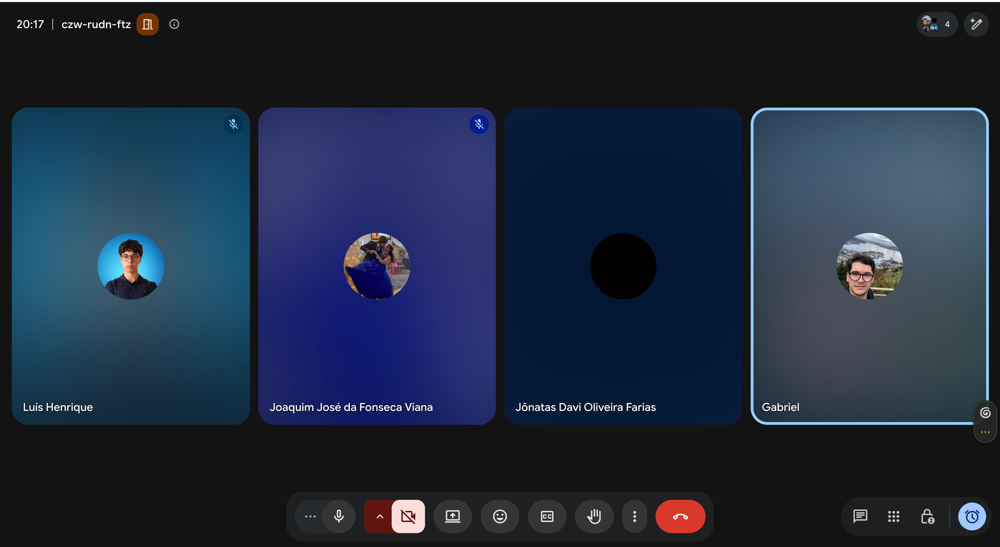
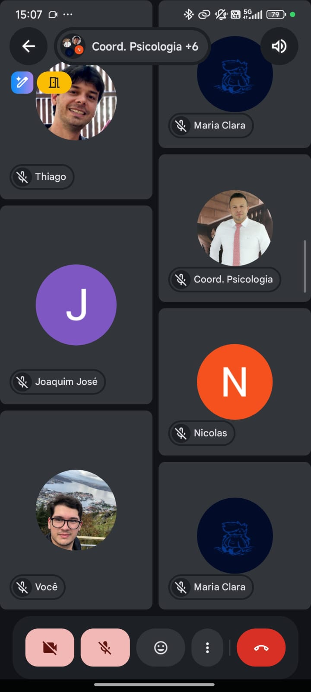
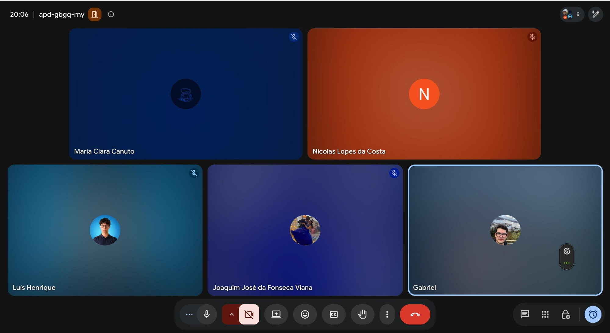

# Reuniões da Unidade 3

Esta página reúne os registros das reuniões realizadas durante a Unidade 3 para planejamento, acompanhamento, verificação e validação das features construídas no projeto Clínica Escola FBr.

## Reunião de planejamento do Ciclo 3: issues, DoR e estrutura do projeto

**Data:** 15/10/2026
**Local:** Reunião on-line (Google Meet)
**Participantes:** Gabriel da Cunha Barbaceli; Jônatas Davi Oliveira Farias; Luís Henrique; Maria Clara Canuto; Nicolas Lopes da Costa.

_Figura 14 — Registro da reunião de planejamento do Ciclo 3: issues, DoR e estrutura do projeto, realizada em 15/10/2026._

[Consultar ata completa em PDF](../assets/atas-reunioes/Ata_Reuniao_Ciclo_3_Planejamento_Issues_DOR_15-10-2026.pdf)

### Resumo

A reunião teve como objetivo organizar as atividades iniciais do Ciclo 3, alinhar o planejamento das issues e do DoR e preparar a estrutura do projeto para a Unidade 3.

### 1. Planejamento do Ciclo 3

- A divisão das atividades de construção do Ciclo 3 será compartilhada no grupo da equipe.
- O planejamento deve considerar as issues que o professor publicar no GitHub, identificando itens urgentes e dependências para as etapas seguintes.
- A distribuição definitiva das features e a confirmação do cronograma da semana seguinte ficaram pendentes até a publicação e a análise dessas issues.

### 2. Issues e estrutura do projeto

- Os modelos de issue já estão criados para features, bugs, tarefas técnicas e documentação.
- Os itens do [Backlog de Produto](../unidade-2/requisitos/backlog.md#101-backlog-do-produto) devem ser convertidos em issues no GitHub.
- A estrutura da Unidade 3 deve incluir a organização das pastas e dos arquivos necessários ao trabalho.

### 3. Definition of Ready (DoR)

- Neste primeiro ciclo, cada integrante fica responsável por levantar o DoR da feature em que vai trabalhar.
- Para os ciclos seguintes, foi sugerido antecipar o levantamento do DoR para o ciclo anterior, evitando atrasos no início do desenvolvimento. A divisão dessa atividade entre duas pessoas ainda não foi definida.

### 4. Base técnica e revisão

- A branch com o esqueleto técnico do projeto está pronta, como rascunho. A revisão e a aprovação para o merge na branch principal ocorrem após a liberação das issues pelo professor.
- Foi proposta a revisão por dois integrantes, com oportunidade para que todo o grupo examine a estrutura e registre dúvidas no canal de comunicação da equipe.
- Gabriel avisará Joaquim sobre a liberação da permissão de administrador do repositório.

### 5. Próximos passos e responsabilidades

- Todos os integrantes: analisar as issues assim que forem publicadas e levantar o DoR das próprias features neste primeiro ciclo.
- Gabriel: compartilhar a divisão de atividades do Ciclo 3, avisar Joaquim sobre a permissão de administrador e ajustar o cronograma se houver itens urgentes.
- Equipe: converter os itens do backlog em issues e revisar a branch técnica após a liberação das issues pelo professor, com dois revisores a confirmar.

### Encerramento

O planejamento detalhado do Ciclo 3 depende da publicação das issues pelo professor. Os modelos de issue e a branch técnica estão preparados; após a análise das issues, a equipe define a distribuição das tarefas, valida a base técnica e ajusta o cronograma conforme as prioridades identificadas.

## Reunião de PRs, requisitos DoR e planejamento de implementação do Ciclo 3

**Data:** 22/10/2026
**Local:** Reunião on-line (Google Meet)
**Participantes:** Gabriel da Cunha Barbaceli; Jônatas Davi Oliveira Farias; Luís Henrique Luna; Joaquim José da Fonseca Viana.

_Figura 15 — Registro da reunião de PRs, requisitos DoR e planejamento de implementação do Ciclo 3, realizada em 22/10/2026._

[Consultar ata completa em PDF](../assets/atas-reunioes/Ata_Reuniao_Ciclo_3_PRs_DORA_22-10-2026.pdf)

### Resumo

A reunião teve como objetivo alinhar a revisão das pull requests, a validação dos requisitos DoR e a organização da implementação do Ciclo 3.

### 1. Pull requests e dependências

- Duas pull requests já revisadas foram aprovadas. Permanece aberta a PR de ajuste do Dependabot, com Jônatas como revisor: a atualização automática para TypeScript 7 causou incompatibilidades. O projeto permanecerá no TypeScript 5 até haver compatibilidade estável.
- Após a aprovação do ajuste, o Dependabot deverá recriar a PR de atualização. Se os problemas persistirem, será feita correção manual.
- A PR de Joaquim deve ser conferida em relação às issues recém-publicadas pelo professor. Após os ajustes necessários, será revisada e enviada novamente para aprovação.

### 2. Requisitos DoR e preparação do Ciclo 3

- Cada responsável por feature deve revisar sua issue e marcar o requisito DoR 8.1, confirmando entendimento e capacidade de estimar e implementar a feature.
- O requisito 7.3, referente à validação do protótipo, deverá ser marcado após a reunião com a Clínica Escola FBr, prevista para 23/10.
- Na issue 97, falta confirmar com a FBr o modelo da ficha de anamnese e do contrato terapêutico. Os demais itens do DoR foram considerados prontos, sujeitos à resolução dessas pendências.

### 3. Implementação paralela e regras de trabalho

- Gabriel preparará o esquema de banco de dados para as features do Ciclo 3, com previsão de conclusão na manhã de sábado, 24/10, permitindo o desenvolvimento em paralelo com dados mockados.
- Cada feature deverá ter uma branch própria. Alterações posteriores em tabelas devem ser feitas por novas migrations; mudanças em tabelas compartilhadas devem ser alinhadas entre os responsáveis envolvidos.
- Gabriel ficará responsável por integrar as implementações e testar o fluxo completo, com previsão para 27/10, se não houver imprevistos.

### 4. Ajustes nos requisitos e protótipo

- Foi alinhado que a dependência entre os requisitos funcionais 1 e 2 pode permanecer marcada, pois ambos serão desenvolvidos no mesmo ciclo.
- Foi discutida a possibilidade de antecipar para o Ciclo 3 o termo de consentimento previsto para o Ciclo 4, por ser uma dependência do requisito funcional 1. Não houve decisão definitiva sobre essa antecipação.
- Há uma inconsistência entre o requisito funcional 1 e o protótipo quanto ao RG: o requisito prevê apenas os números, enquanto o protótipo solicita também órgão emissor e estado. Jônatas enviará a Gabriel uma lista dos pontos e justificativas para avaliação e possível ajuste do protótipo.

### 5. Revisões, reunião com a FBr e prazos

- Luís e Joaquim devem revisar as issues antes de 25/10, se possível, para permitir correções antes da entrega. A implementação poderá ser concluída até a manhã de 27/10.
- Na reunião com a FBr prevista para 23/10, a equipe apresentará o andamento do projeto e o protótipo do Ciclo 3 para validação e buscará respostas às dúvidas urgentes, incluindo a definição sobre o domínio do sistema.
- Gabriel compartilhará o roteiro da reunião no grupo. Se não conseguir apresentar por estar no aeroporto ou precisar sair antes, Jônatas poderá dar continuidade.
- Quem encontrar dificuldades com prazo ou implementação deve avisar no grupo para que a equipe possa ajudar e evitar acúmulo de tarefas nos ciclos seguintes.

### Encerramento

Ficaram encaminhadas a revisão das PRs e issues, a conclusão das pendências do DoR e a preparação do banco de dados para desenvolvimento paralelo. O próximo passo é validar o protótipo e esclarecer dependências com a FBr em 23/10, avançando para a implementação e integração até 27/10.

## Reunião de validação do protótipo do Ciclo 3 com a FBr

**Data:** 23/10/2026
**Horário:** Iniciada às 14h26; retomada às 15h29 após instabilidade de conexão.
**Participantes:** Gabriel da Cunha Barbaceli; Joaquim José da Fonseca Viana; Maria Clara Canuto; Thiago Viana; Robson; Nicolas Lopes da Costa.

_Figura 16 — Registro da reunião de validação do protótipo do Ciclo 3 com a Clínica Escola FBr, realizada em 23/10/2026._

[Consultar ata completa em PDF](../assets/atas-reunioes/Ata_Reuniao_Ciclo3_Validacao_Prototipo_FBr_23-10-2026.pdf)

!!! note "Correção de 24/10/2026"
    Conferido com a gravação da reunião, o resumo abaixo corrige três pontos da ata em PDF: o e-mail continua como canal de contato (só o SMS foi descartado), as 2 faltas que levam ao desligamento valem consecutivas ou não, e os 10 dias para o pagamento contam do vínculo com o estagiário. Também registra três pontos ditos na reunião e não incluídos na ata: a ausência de prazo de triagem, a consulta, pela coordenação, do conteúdo clínico de todos os prontuários e a volta à fila de quem perde a vaga por falta de pagamento. As decisões estão no [Registro de Decisões com a FBr](../unidade-2/requisitos/decisoes-fbr.md).

### Objetivo

Apresentar o andamento do projeto e o protótipo de alta fidelidade do Ciclo 3 à Clínica Escola FBr, validando as regras de negócio pendentes antes do início do desenvolvimento.

### Contexto

A equipe apresentou à FBr o protótipo de alta fidelidade das funcionalidades do Ciclo 3 — inscrição, triagem, distribuição de casos, vinculação de estagiário, agendamento e prontuário — para validação antes do início da implementação. Devido à instabilidade na conexão de Gabriel, Maria assumiu a apresentação de parte das telas.

### 1. Regras de negócio definidas

- **Prazo de pagamento:** o paciente selecionado terá 10 dias para pagar e efetivar a vaga, contados do vínculo com o estagiário. Sem pagamento, perde a vaga e volta para a fila, com a mesma prioridade clínica e a data da volta. Enquanto o prazo corre, o agendamento da 2ª sessão em diante fica bloqueado.
- **Prioridade em caso de empate:** considerar primeiro a gravidade clínica e, em seguida, a data de inscrição.
- **Limite de casos:** cada supervisor poderá acompanhar até 50 casos, limite ajustado para comportar o crescimento do número de estagiários. Para estagiários, não haverá limite fixo; a quantidade dependerá da disponibilidade.
- **Duração da sessão:** 50 minutos de atendimento, seguidos de 10 minutos para anotações.
- **Cancelamento pelo paciente:** permitido até 1 hora antes da sessão, com justificativa. O desligamento continua ao atingir 2 faltas no ciclo, consecutivas ou não, e o cancelamento fora desse prazo conta como falta.
- **Lembrete de sessão:** notificação automática enviada com até 24 horas de antecedência.
- **Capacidade simultânea:** estimativa de 30 usuários em horário de pico.
- **Registro de evolução:** campos obrigatórios para data, evolução da queixa (até 10 linhas) e planejamento. Deve haver fechamento avaliativo a cada 10 sessões.
- **Canais de contato:** o paciente escolhe entre e-mail, WhatsApp e ligação. Quem escolhe e-mail recebe as mensagens automáticas; quem escolhe WhatsApp ou ligação é contatado pela secretaria. O SMS foi descartado devido ao baixo acesso tecnológico do público.
- **Prazo de triagem:** a clínica não adota prazo de triagem; a inscrição aguarda conforme as vagas e só é chamada quando uma vaga é liberada.
- **Acesso da coordenação ao prontuário:** a coordenação consulta o conteúdo clínico de todos os prontuários, além das tentativas de acesso negado.
- **Login:** o acesso será bloqueado por 15 minutos após 3 tentativas incorretas, reduzidas de 5 para 3 por sugestão da coordenação de Psicologia.
- **Especialidades:** não haverá divisão por área; todos os atendimentos serão tratados como psicologia clínica geral. O conceito de área de especialidade será removido do cadastro, dos critérios de distribuição e dos itens de menu.

### 2. Validação do protótipo e ajustes

Foram apresentadas e aprovadas pela FBr as telas de inscrição (desktop e mobile), erro de preenchimento, triagem, revisão e comprovante, login, ativação de conta, painel de usuários, listagem de triagem, atribuição de prioridade clínica, distribuição para supervisores, vinculação de estagiário, agendamento de sessão e prontuário. Foram acordados os seguintes ajustes:

- Remover campos, telas e opções de menu relacionados à área de especialidade, incluindo os pontos de triagem e distribuição.
- Manter e-mail, WhatsApp e ligação como canais de contato, removendo o SMS.
- Manter os campos de anamnese e contrato terapêutico do prontuário como ilustrativos até o recebimento do material oficial da coordenação.
- Configurar a ativação da conta por link enviado pela coordenação, com validade de 72 horas.

### 3. Responsabilidades

- **Coordenação de Psicologia da FBr:** enviar o modelo da ficha de anamnese, o modelo do contrato terapêutico e os arquivos de triagem.
- **Gabriel:** ajustar o protótipo conforme os pontos discutidos, incluindo a remoção da área de especialidade e a atualização dos canais de contato; gravar e enviar à FBr um vídeo demonstrativo do protótipo atualizado para aprovação ponto a ponto; integrar e testar as funcionalidades do Ciclo 3.

### 4. Prazos e próximos passos

- **27/10/2026:** funcionalidades do Ciclo 3 integradas e prontas para teste real pela FBr.
- **01/12/2026:** site funcional internamente, com todas as funcionalidades testadas, ainda sem publicação.
- **07/12/2026:** previsão de publicação do site no domínio da Clínica Escola FBr.
- **06/11/2026:** próxima reunião com a FBr, na sexta-feira, no mesmo horário.

### Encerramento

O protótipo de alta fidelidade do Ciclo 3 foi validado pela FBr, com ajustes pontuais a aplicar antes do desenvolvimento. A coordenação de Psicologia enviará os modelos de anamnese e contrato terapêutico, além dos arquivos de triagem. Gabriel atualizará o protótipo, enviará um vídeo demonstrativo para aprovação final e dará sequência à implementação, com entrega das funcionalidades prevista para 27/10.

## Reunião de fechamento do Ciclo 3, planejamento do Ciclo 4 e deploy automático

**Data:** 29/10/2026
**Local:** Reunião on-line (Google Meet)
**Participantes:** Gabriel da Cunha Barbaceli; Maria Clara Canuto; Luís Henrique Luna; Joaquim José da Fonseca Viana; Nicolas Lopes da Costa.

_Figura 17 — Registro da reunião de fechamento do Ciclo 3, planejamento do Ciclo 4 e deploy automático, realizada em 29/10/2026._

[Consultar ata completa em PDF](../assets/atas-reunioes/Ata_Reuniao_Ciclo_3_Fechamento_Ciclo_4_Deploy_29-10-2026.pdf)

!!! note "Correção de 29/10/2026"
    Conferido com a transcrição da reunião, o resumo abaixo corrige dois pontos da ata em PDF: a #165 é uma pull request, e não uma issue, e o que o token do GitHub dá acesso são as imagens privadas do sistema no GitHub Container Registry (GHCR), e não pacotes do Turborepo.

### Resumo

A reunião teve como objetivo consolidar as pendências do Ciclo 3, alinhar o novo fluxo de deploy e organizar o planejamento e as atividades do Ciclo 4.

### 1. Fechamento do Ciclo 3

- As features previstas foram entregues dentro do prazo de 27/10. Ficaram pendentes a inspeção de código de parte das features, as evidências dos requisitos não funcionais e alguns registros nas issues.
- Cinco pull requests abertas automatizam o registro das evidências dos requisitos não funcionais nas issues. Depois da aprovação delas, as evidências são adicionadas sozinhas.
- A demonstração das features e o aceite pela Clínica Escola FBr estão previstos para a reunião de 06/11.
- Situação das features: as de Gabriel e Joaquim estão com o design e o código inspecionados; as de Jônatas e Nicolas, com o código inspecionado; as de Luís têm uma feature com o código inspecionado e outra com o código concluído; as de Maria Clara estão com o código concluído, faltando marcar alguns itens.

### 2. Pull requests e pendências

- Luís fará a inspeção de código das features construídas por Gabriel, já que o autor do código não pode inspecioná-lo. Gabriel enviará no grupo exemplos de inspeções de código já registradas, como referência.
- Nas issues em que Gabriel fez a inspeção de design, o Líder da feature registra o `/de-acordo` ou aponta o que precisa ser corrigido. Esse registro permite que a automação marque os itens pendentes.
- Nicolas revisará de novo a pull request #165, que trava outras PRs, depois dos ajustes feitos por Gabriel.
- Gabriel já corrigiu os apontamentos de Joaquim na #177 e corrigirá os das outras duas PRs ainda no dia da reunião ou no sábado.
- Ajustes de interface percebidos nos testes, como o destaque da entrada no sistema, devem se resolver com as features dos próximos ciclos. Mudanças de design são feitas primeiro no protótipo e só vão para o código depois de aceitas.

### 3. Deploy e fluxo de validação

- As novas alterações vão por pull request para a branch `development`. O merge nela publica automaticamente no ambiente de validação.
- Depois da validação, incluindo a apresentação e o aceite da FBr, a equipe combina com a clínica quando publicar em produção. O merge na `main` publica na produção.
- O ambiente de validação está na VPS da FBr, com subdomínios criados no DNS da clínica. O envio de e-mails usa o SMTP do Google Workspace da FBr, e a recuperação de senha por código e a entrada no sistema foram testadas nesse ambiente.
- As imagens do sistema no GHCR continuam privadas, porque tornar pacotes públicos depende de uma configuração da organização. O servidor as baixa com um token do GitHub somente de leitura.

### 4. Planejamento do Ciclo 4

- O Ciclo 4 vai de 28/10 a 10/11, com 20 features no planejamento e 19 a construir. A divisão detalhada será enviada no grupo.
- O planejamento inicial do backlog já foi feito, mas ainda há itens do DoR a completar antes do início da construção.
- Os protótipos de todas as features do Ciclo 4 ficarão num único projeto, a partir do protótipo já feito por Joaquim, com o link, as imagens e o PDF publicados no GitHub Pages, como no Ciclo 3.

### 5. Próximos passos e responsabilidades

- **Gabriel:** enviar o cronograma e os exemplos de inspeção no grupo; concluir os ajustes das revisões; testar manualmente todas as funcionalidades no fim de semana; preparar o roteiro da reunião com a FBr e enviar a ela o link da validação depois dos testes.
- **Luís:** fazer a inspeção de código das features construídas por Gabriel e registrar o `/de-acordo` nas próprias issues.
- **Nicolas:** revisar a pull request #165.
- **Joaquim:** preparar os protótipos de todas as features do Ciclo 4 e publicá-los no GitHub Pages; cobrar da FBr as respostas pendentes.
- **Equipe:** concluir os itens pendentes do DoR e os registros de inspeção e de evidências, e avisar no grupo se surgir alguma dificuldade com prazos ou com a implementação.

### 6. Reunião com a FBr e datas

- **06/11/2026, às 14h30:** reunião com a FBr para demonstrar as funcionalidades do Ciclo 3 no ambiente de validação e validar os protótipos do Ciclo 4. Todos os participantes desta reunião (Gabriel, Maria Clara, Luís, Joaquim e Nicolas) confirmaram presença.
- **10/11/2026:** término previsto do Ciclo 4.
- **17/11/2026:** fechamento da Unidade 3. As poucas issues ainda abertas pelo professor podem ser tratadas até essa data.

### Encerramento

O Ciclo 3 foi entregue no prazo, restando inspeções, evidências e a validação com a FBr. O fluxo de deploy automático para a validação e a produção foi alinhado, e o Ciclo 4 segue com a conclusão do DoR, a preparação dos protótipos e a construção das 19 features previstas.
