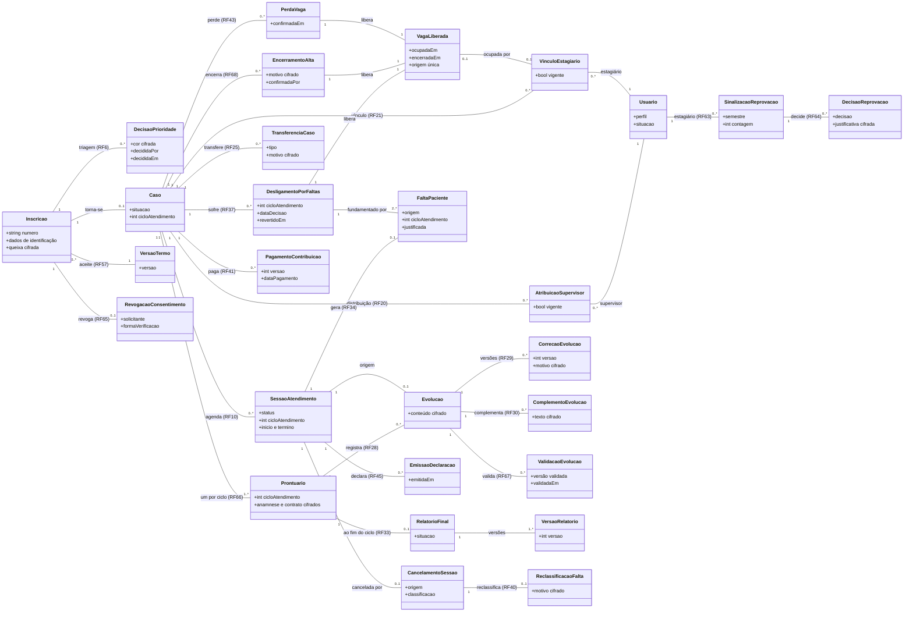

# Execução do processo

Esta página mostra como o processo definido na [Estratégia de Engenharia de Software](../processo/estrategia-esw.md) e na [Engenharia de Requisitos](../processo/engenharia-requisitos.md) foi executado: o que foi produzido em cada atividade, quem revisou e o que mudou com cada revisão. As duas páginas descrevem o processo; esta reúne as evidências de execução, com links para os registros de origem (issues, pull requests, atas e o histórico do documento), sem repetir o conteúdo deles.

## Modelo abrangente do domínio { #1-modelo-abrangente-do-dominio }

O FDD começa pelo modelo abrangente do domínio. O [projeto das features](../construcao/projeto-features.md), com as dos Ciclos 3 a 6, detalha as classes de cada característica de produto; o diagrama abaixo integra essas partes num modelo só, com as relações entre inscrição, caso, ciclo de atendimento, sessão, prontuário e responsáveis.

**Como ler o modelo.** O ciclo de atendimento não é uma classe: é o número `cicloAtendimento`, que o caso guarda e que o prontuário, as sessões, as faltas e o desligamento repetem para saber a que ciclo pertencem. Os responsáveis nunca são apagados: a atribuição do supervisor e o vínculo do estagiário têm o campo `vigente`, e a troca de responsável encerra o registro anterior e cria outro, o que preserva o histórico de responsáveis (RF27). Cada vaga liberada tem uma origem só: o desligamento por faltas, a alta ou a perda da vaga pela contribuição. Correções, complementos, validações, versões do relatório e decisões são só inserção, sem apagar o registro anterior (RNF27). A auditoria (RNF10) e os acessos ao prontuário (RNF52) registram as operações de todas as classes e não aparecem no diagrama. As classes dos Ciclos 4 a 6 entraram no diagrama em 28/11/2026; até então ele cobria só as do Ciclo 3 e a assiduidade do Ciclo 4.

### Revisões do modelo

| Data | Revisão | Quem | O que mudou | Evidência |
| --- | --- | --- | --- | --- |
| 19/10/2026 | Modelo das features do Ciclo 3, na avaliação do DoR | Gabriel | Classes da inscrição, da triagem, da distribuição, do vínculo, do prontuário e da sessão, com a vigência dos responsáveis | [Classes do Ciclo 3](../construcao/projeto-features.md#modelo-detalhado-do-ciclo-3), no Projeto das features, versão 3.1 do [histórico](../index.md#historico-de-revisao) |
| 24/10/2026 | Inspeções de design do Ciclo 3 (DoD 1) | Gabriel, com o `/de-acordo` do Líder de cada feature; o RF51 foi inspecionado por Joaquim em 25/10 | Os apontamentos de cada feature e as correções no projeto, registrados na própria issue | Comentário "Inspeção de design (DoD 1)" nas issues [#45](https://github.com/mdsreq-fga-unb/REQ-2026.2-T02-ClinicaEscolaFBr/issues/45), [#88](https://github.com/mdsreq-fga-unb/REQ-2026.2-T02-ClinicaEscolaFBr/issues/88) a [#97](https://github.com/mdsreq-fga-unb/REQ-2026.2-T02-ClinicaEscolaFBr/issues/97) |
| 24/10/2026 | Avaliação da Unidade 2 pelo professor | Gabriel | O RF66 passa a criar só o prontuário, e a anamnese e o contrato vão para o RF69 | Versão 3.3 do [histórico](../index.md#historico-de-revisao) |
| 05/11/2026 | Modelo das 18 features do Ciclo 4 | Gabriel, revisado por Nicolas e Joaquim | Classes da confirmação, do cancelamento, da assiduidade (falta, desligamento e vaga) e da verificação de identidade; situações novas do caso e da sessão | [PR #203](https://github.com/mdsreq-fga-unb/REQ-2026.2-T02-ClinicaEscolaFBr/pull/203) e [Classes do Ciclo 4](../construcao/projeto-features.md#modelo-detalhado-do-ciclo-4), no Projeto das features |
| 28/10 a 06/11/2026 | Inspeções de design do Ciclo 4 (DoD 1) | Joaquim (RF52 em 28/10; RF7, RF8 e RF57 em 06/11), Nicolas (RF34 a RF38) e Jônatas (RF11 e RF14 a RF16), em 06/11 | Permissões do banco para os registros da assiduidade (RNF32); a comparação do status da sessão numa função imutável; a página do termo de consentimento | Comentário "Inspeção de design (DoD 1)" nas issues de cada feature, como a [#150](https://github.com/mdsreq-fga-unb/REQ-2026.2-T02-ClinicaEscolaFBr/issues/150) e a [#140](https://github.com/mdsreq-fga-unb/REQ-2026.2-T02-ClinicaEscolaFBr/issues/140) |
| 07/11/2026 | Construção do RF36 ao RF38 | Gabriel, com revisão de Nicolas na PR | O cancelamento da sessão entra com o desligamento, o primeiro a cancelar sessões, e é reaproveitado pelo RF15 | [PR #216](https://github.com/mdsreq-fga-unb/REQ-2026.2-T02-ClinicaEscolaFBr/pull/216) |

| 16/11/2026 | Modelo e protótipos das 14 features do Ciclo 6 | Gabriel, revisado por Joaquim na PR | Classes da evolução (complemento e validação), da alta, do relatório final, da contribuição, da declaração, da revogação e da reprovação do estagiário | [PR #291](https://github.com/mdsreq-fga-unb/REQ-2026.2-T02-ClinicaEscolaFBr/pull/291) e [Projeto das features](../construcao/projeto-features.md) |
| 23 a 26/11/2026 | Inspeções de design do Ciclo 6 (DoD 1) | O Líder e o revisor de cada feature, sem o Gabriel, que fez o projeto | Os apontamentos de cada feature, registrados na issue; seis têm o resultado registrado (D1.8); as do RF30, RF67, RF68, RF31 e RF33 esperam o `/de-acordo` do revisor, e as do RF42, RF45 e RF49 ainda não foram registradas | Comentário "Inspeção de design (DoD 1)" nas issues do Ciclo 6 |
| 28/11/2026 | Diagrama integrado com as classes dos Ciclos 4 a 6 | Gabriel | Transferência, correção, complemento e validação da evolução, alta, relatório final, contribuição, perda da vaga, declaração, termo, revogação e reprovação do estagiário | Este diagrama, a partir das classes do Projeto das features |

As inspeções de design do RF22, RF23, RF25, RF27, RF28 e RF69, que faltavam em 10/11, foram registradas depois, nas issues de cada feature, antes do aceite.

## Revisão da lista de features { #2-revisao-da-lista-de-features }

A lista de features foi revisada contra o modelo do domínio e as regras do FDD: cada feature precisa ser pequena o bastante para ser construída e demonstrada num ciclo, não pode sobrepor outra e precisa corresponder a uma parte do modelo. A tabela registra o que cada verificação encontrou e o que mudou.

| Verificação | O que foi encontrado | O que mudou | Evidência |
| --- | --- | --- | --- |
| Tamanho | O RF66 juntava a criação automática do prontuário, no vínculo, e o registro da anamnese e do contrato pelo estagiário, com gatilhos diferentes | RF66 dividido; o registro da anamnese e do contrato virou o RF69, no Ciclo 4 | Versão 3.3 do [histórico](../index.md#historico-de-revisao) |
| Sobreposição | O RF9 misturava as informações institucionais e a capacidade de atendimento usada pelo RF48 | As vagas ofertadas no semestre ficam só no RF48, e o RF9 só as divulga | Versão 3.3 |
| Correspondência com o modelo | O RF19 (áreas de especialidade do supervisor) não correspondia a nada no processo da clínica | RF19 removido em 24/10/2026 ([DF26](../requisitos/decisoes-fbr.md#df26)) | [Features e backlog](backlog.md) |
| Dependências | Dependências obrigatórias, integrações e apoios opcionais apareciam juntos, às vezes apontando para uma CP inteira | Legenda dos tipos de relação e dependências sempre pelo RF necessário | Versão 3.3 e [como ler a rastreabilidade](../requisitos/funcionais.md) |
| Escopo do MVP | A FBr pediu o relatório final de evolução antes do fim do semestre | RF33 incluído no MVP, no Ciclo 6 | Versão 3.3 |
| Consistência entre as listas | A mesma feature aparecia em listas mantidas à mão, que podiam divergir | Catálogo único dos requisitos, com a conferência automática do formato, das dependências e dos estados (`verificar_catalogo.py`, no CI) | Versão 3.34 e [catálogo de requisitos](../requisitos/priorizacao-e-mvp.md#catalogo-de-requisitos) |

## Planejamento por feature e capacidade { #3-planejamento-por-feature-e-capacidade }

Cada feature tem Líder, revisor e ciclo em [Features e backlog](backlog.md). A viabilidade dos ciclos é conferida pela [carga por Líder de Feature e ciclo](cronograma.md#carga-por-lider-de-feature-e-ciclo), calculada da escala de esforço de cada RF, e o tempo das inspeções, da integração e da demonstração aparece nos [pontos de controle por feature](cronograma.md#pontos-de-controle-por-feature) de cada ciclo. Quando a carga de um ciclo passa do que a equipe consegue fazer, vale a [regra de limite de capacidade do MVP](../requisitos/priorizacao-e-mvp.md#limite-de-capacidade).

## Acompanhamento pelos marcos do FDD { #4-acompanhamento-pelos-marcos-do-fdd }

O estado de cada feature segue os marcos do FDD e do [DoD](../requisitos/dor-dod.md): Planejada, Em design, Design inspecionado, Código concluído, Código inspecionado, Promovida para a versão integrada, Demonstrada e Aceita. Ele é atualizado na issue da feature pelo acompanhamento automático (que lê o checklist do DoR e do DoD, as pull requests e os comandos `/de-acordo`, `/demonstrada` e `/aceite`), refletido no [Project do repositório](https://github.com/orgs/mdsreq-fga-unb/projects/124) e copiado para o catálogo, de onde sai a [situação por ciclo](backlog.md#situacao-por-ciclo). Cada passagem de marco fica registrada na issue, com a data e o link da evidência: a inspeção, a aprovação da pull request, o merge, a ata da demonstração e o aceite.

### Integrada não é promovida { #integrada-nao-e-promovida }

O merge na `development` é só um dos itens do marco "Promovida para a versão integrada" (D4.3). A feature só chega a esse marco com o D4 inteiro: aprovada nas inspeções de design e de código (D4.1), com os testes da versão integrada passando (D4.2), o resultado registrado (D4.4) e os RNFs verificados (D4.5). Por isso, os fechamentos do [Cronograma geral](cronograma.md#fechamento-dos-ciclos) escrevem "código integrado" separado do marco alcançado. No fechamento do Ciclo 3, por exemplo, as 13 features estavam integradas, mas nenhuma chegou a "Promovida": o marco de cada uma ficou entre "Em design" e "Código inspecionado", com a revisão e os RNFs como pendências.

Em 27/11/2026, as 12 features abertas do MVP têm o código na `development` e ainda não são "Promovidas": o RF48 e o RF44 estão em "Código inspecionado", porque falta um RNF verificado (D4.5); o RF30, o RF67, o RF68, o RF31, o RF33, o RF42, o RF45 e o RF49 estão em "Em design", porque falta o resultado da inspeção de design (D1.8); e o RF57 e o RF65 estão em "Planejada", porque o termo de consentimento ainda não foi aprovado pela FBr (R4.4 do DoR).

### Ocorrência: DoR registrado depois do código { #ocorrencia-dor-depois-do-codigo }

O DoR deve ser aprovado antes da construção. Quando isso não acontece, a ocorrência fica registrada na issue e no cronograma, com o tratamento, e a feature não é dada como pronta antes do tempo.

| Ciclo | O que aconteceu | Tratamento | A preparação foi antecipada? |
| --- | --- | --- | --- |
| 3 | No RF4, no RF6 e no RF66, o código ([#163](https://github.com/mdsreq-fga-unb/REQ-2026.2-T02-ClinicaEscolaFBr/pull/163)) veio antes do registro do DoR e da inspeção de design (24 e 25/10) | O Líder confirmou o registro com o `/de-acordo` nas três issues, e o DoR ficou registrado como feito depois do código ([fechamento do Ciclo 3](cronograma.md#fechamento-dos-ciclos)) | — |
| 4 | O DoR foi avaliado em 26/10 ([#157](https://github.com/mdsreq-fga-unb/REQ-2026.2-T02-ClinicaEscolaFBr/pull/157)), antes do código, que entrou de 07 a 11/11 | O R8.1, a declaração do Líder, foi marcado entre 06 e 10/11 | Sim |
| 5 | Pré-avaliação em 09/11; registros do DoR de 09 a 16/11, junto com o código, que entrou de 14 a 16/11 | Registrados como "Pronta com ressalvas", com a validação dos protótipos pela FBr (R7.3) em 16/11 | Em parte |
| 6 | Pré-avaliação em 16/11, antes do código; registros do DoR de 23 a 26/11, depois do início do código, em 20/11 | Registrados como "Pronta com ressalvas"; a regra para o DoR aprovado depois do início do código está em [DoR e DoD](../requisitos/dor-dod.md) | Não: a ocorrência se repetiu |

A lição está nos fechamentos: o DoR e a inspeção de design ficaram para o fim do ciclo quando a construção começou cedo. No Ciclo 4, o DoR antes do código funcionou porque foi avaliado no fechamento do ciclo anterior. No Ciclo 6, a pressa da entrega final repetiu a ocorrência.

### Amostra: revisão por outra pessoa e impeditivos resolvidos { #amostra-revisao-e-impeditivos }

Conferência feita em 27/11/2026 nas pull requests de código das features aceitas: quem é o autor, quem revisou e se os apontamentos impeditivos foram resolvidos antes do merge.

| Features | PR | Autor | Revisão | Impeditivos |
| --- | --- | --- | --- | --- |
| RF10 | [#158](https://github.com/mdsreq-fga-unb/REQ-2026.2-T02-ClinicaEscolaFBr/pull/158) | Nicolas | Maria Clara aprovou | Nenhum |
| RF4, RF6, RF66 | [#163](https://github.com/mdsreq-fga-unb/REQ-2026.2-T02-ClinicaEscolaFBr/pull/163) | Luís Henrique | Gabriel pediu mudanças e aprovou depois da correção | Resolvidos na PR |
| RF7 | [#233](https://github.com/mdsreq-fga-unb/REQ-2026.2-T02-ClinicaEscolaFBr/pull/233) | Jônatas | Joaquim aprovou | Nenhum |
| RF14 | [#217](https://github.com/mdsreq-fga-unb/REQ-2026.2-T02-ClinicaEscolaFBr/pull/217) | Nicolas | Jônatas comentou e aprovou | Nenhum |
| RF34, RF35 | [#212](https://github.com/mdsreq-fga-unb/REQ-2026.2-T02-ClinicaEscolaFBr/pull/212) | Gabriel | Nicolas pediu mudanças e aprovou | Resolvidos na PR |
| RF15, RF16, RF36 a RF38 | [#216](https://github.com/mdsreq-fga-unb/REQ-2026.2-T02-ClinicaEscolaFBr/pull/216) | Gabriel | Nicolas pediu mudanças e aprovou | Resolvidos na PR |
| RF8, RF52 | [#202](https://github.com/mdsreq-fga-unb/REQ-2026.2-T02-ClinicaEscolaFBr/pull/202) | Joaquim | Jônatas pediu mudanças duas vezes e aprovou | Resolvidos na PR |
| RF27, RF28, RF69 | [#241](https://github.com/mdsreq-fga-unb/REQ-2026.2-T02-ClinicaEscolaFBr/pull/241) | Luís Henrique | Gabriel pediu mudanças e aprovou | Resolvidos na PR |
| RF29 | [#267](https://github.com/mdsreq-fga-unb/REQ-2026.2-T02-ClinicaEscolaFBr/pull/267) | Luís Henrique | Gabriel pediu mudanças e aprovou | Resolvidos na PR |
| RF39 | [#288](https://github.com/mdsreq-fga-unb/REQ-2026.2-T02-ClinicaEscolaFBr/pull/288) | Nicolas | Jônatas pediu mudanças e aprovou | Resolvidos na PR |
| RF41 | [#263](https://github.com/mdsreq-fga-unb/REQ-2026.2-T02-ClinicaEscolaFBr/pull/263) | Joaquim | Jônatas pediu mudanças duas vezes e aprovou | Resolvidos na PR |
| RF56 | [#269](https://github.com/mdsreq-fga-unb/REQ-2026.2-T02-ClinicaEscolaFBr/pull/269) | Jônatas | Joaquim pediu mudanças e aprovou | Resolvidos na PR |
| RF40, RF63, RF64 | [#319](https://github.com/mdsreq-fga-unb/REQ-2026.2-T02-ClinicaEscolaFBr/pull/319) a [#321](https://github.com/mdsreq-fga-unb/REQ-2026.2-T02-ClinicaEscolaFBr/pull/321) | Nicolas | Jônatas apontou impeditivos (o recorte de privacidade do supervisor e a nova decisão só com a contagem alterada); Gabriel conferiu as correções e aprovou | Resolvidos na PR, com testes de regressão |
| RF43 | [#307](https://github.com/mdsreq-fga-unb/REQ-2026.2-T02-ClinicaEscolaFBr/pull/307) | Joaquim | Jônatas apontou a migration e a origem única da vaga; Gabriel conferiu a correção e aprovou | Resolvido na PR |
| RF32 | [#316](https://github.com/mdsreq-fga-unb/REQ-2026.2-T02-ClinicaEscolaFBr/pull/316) | Jônatas | Gabriel aprovou | Nenhum |

Em todas as PRs da amostra, quem revisou não foi o autor, e os pedidos de mudança foram atendidos antes do merge. Há uma exceção fora da amostra: o RF31 ([#325](https://github.com/mdsreq-fga-unb/REQ-2026.2-T02-ClinicaEscolaFBr/pull/325)), do Gabriel, entrou numa branch empilhada sobre a do RF30, onde a aprovação não era exigida. A Maria Clara revisou o código e escreveu "Aprovo o código", mas não marcou a aprovação, porque o CI completo ainda não tinha rodado. O registro está na issue do RF31, e a revisão passou a valer para o D3.1 em 27/11.

### Pendências da avaliação da Unidade 2 { #pendencias-da-avaliacao-da-unidade-2 }

A [issue #100](https://github.com/mdsreq-fga-unb/REQ-2026.2-T02-ClinicaEscolaFBr/issues/100) pediu cinco evidências do processo. Cada uma tem um artefato publicado, mas nem todas estão encerradas:

| Pedido | Evidência atual | O que ainda falta |
| --- | --- | --- |
| Visão integrada do domínio, com quem revisou | O [diagrama do modelo](#1-modelo-abrangente-do-dominio), agora com as classes dos Ciclos 4 a 6, e a tabela de revisões | O resultado da inspeção de design (D1.8) de oito features do Ciclo 6 |
| Inspeção da lista de features | A [revisão da lista](#2-revisao-da-lista-de-features) | A lista não foi inspecionada de novo depois da validação final, cujas decisões (DF75 a DF78) mudam o RF1, o RF2, o RF56 e o RF45; isso entra na revisão do escopo no fechamento |
| Capacidade demonstrada | A [carga por Líder de Feature e ciclo](cronograma.md#carga-por-lider-de-feature-e-ciclo) | No Ciclo 6, o Gabriel fez o projeto das 14 features e parte do código; a comparação entre a carga prevista e a realizada entra no fechamento do Ciclo 6 |
| Acompanhamento pelos marcos | O estado de cada feature, copiado das issues para as páginas de cada unidade | As 12 features [ainda não promovidas](#integrada-nao-e-promovida) |
| Planejado e realizado por ciclo | Os fechamentos dos Ciclos 3, 4 e 5 no [Cronograma geral](cronograma.md#fechamento-dos-ciclos) | O fechamento do Ciclo 6, na entrega final |

## Fechamento dos ciclos { #5-fechamento-dos-ciclos }

No fim de cada ciclo, o [Cronograma geral](cronograma.md) compara o planejado com o realizado, feature a feature: o marco alcançado, o que passou para o ciclo seguinte e o motivo. Os fechamentos dos Ciclos 3, 4 e 5 estão registrados lá; o do Ciclo 6 entra na entrega final, em 01/12/2026.

## Engenharia de requisitos na prática { #6-engenharia-de-requisitos-na-pratica }

### Documentos analisados

Os documentos da Clínica Escola chegaram no grupo de mensagens com a FBr, em 30/10 e 31/10/2026. Cada um gerou uma decisão no [Registro de Decisões com a FBr](../requisitos/decisoes-fbr.md), e a decisão é a Origem do requisito.

| Documento | O que foi tirado dele | Decisão | Requisitos |
| --- | --- | --- | --- |
| Ficha de identificação | Os dados da ficha que a inscrição ainda não pedia (endereço, contatos, responsável legal) | [DF43](../requisitos/decisoes-fbr.md#df43) | RF1 |
| Ficha de anamnese | As seis seções da anamnese | [DF37](../requisitos/decisoes-fbr.md#df37) | RF69 |
| Registro de evolução | Os campos do registro de cada sessão | [DF38](../requisitos/decisoes-fbr.md#df38) | RF28 |
| Contrato de Prestação de Serviço, com o TCLE para pesquisa | As cláusulas do contrato terapêutico e quem o assina | [DF41](../requisitos/decisoes-fbr.md#df41) | RF69 |
| Modelo de relatório psicológico | As seções do relatório entregue ao paciente | [DF42](../requisitos/decisoes-fbr.md#df42) | RF33 |
| Termo de consentimento para o uso dos dados | A FBr não tinha um; a equipe redigiu o modelo para a FBr revisar | [DF44](../requisitos/decisoes-fbr.md#df44) | RF57, com o [termo, versão 0.1](../construcao/termo-consentimento.md) |

Os documentos não são publicados no site, porque são modelos internos da clínica; o que vale para o sistema está nas decisões e nos requisitos.

### Representação

O processo previa diagramas de atividades "quando necessário". Os fluxos com várias decisões, como a inscrição em três etapas, o desligamento e a reversão, e a confirmação e o cancelamento da sessão, foram representados por diagramas de sequência com os caminhos alternativos (blocos `alt`), no [projeto das features](../construcao/projeto-features.md) dos Ciclos 3, 4 e 5, porque eles mostram, no mesmo desenho, quem faz cada passo e o que o sistema grava. Por isso, nenhum diagrama de atividades foi necessário nas features. As situações do caso e da sessão estão nas listas de situações do modelo, e a visão geral do processo da clínica está no Rich Picture do [Cenário Atual](../produto/cenario-atual.md).

Na Unidade 4, com o MVP inteiro projetado, a equipe juntou as representações numa página só, [Representação de requisitos](../requisitos/representacao.md), e acrescentou três que olham o produto inteiro:

- um diagrama de atividades da jornada do paciente, da inscrição ao encerramento;
- o mapa das features pela jornada, inspirado no USM, com as áreas e os conjuntos de features do FDD e o ciclo de cada feature;
- a especificação de um caso de uso (RF68), com os fluxos alternativos e de exceção.

### Verificação

A verificação interna por checklist é a avaliação do [DoR](../requisitos/dor-dod.md) de cada feature: os critérios ficam marcados na issue, e a seção "Registro da avaliação do DoR" guarda a data, o avaliador, o revisor, o resultado e as ressalvas. Sem esse registro, o acompanhamento automático não deixa a feature passar para "Em design". A inspeção de design (DoD 1) verifica de novo o projeto, com o modelo, a acessibilidade, a LGPD e as normas do CRP. A avaliação da equipe Sem Requisitos é uma verificação externa, registrada na [Análise do Feedback](../requisitos/analise-feedback.md).

### Validação com os diferentes públicos

| Público | Como validou | Registro |
| --- | --- | --- |
| Coordenação e equipe técnica da FBr | Validação do MVP (24/09 a 08/10/2026), do protótipo do Ciclo 3 (23/10/2026), demonstração do Ciclo 3 no ambiente de validação (06/11/2026), demonstração do Ciclo 4 por e-mail (10/11/2026), com as respostas e o aceite de 11 e 12/11/2026, e envio dos protótipos do Ciclo 5 (14/11/2026) | [Reuniões da Unidade 2](../historico/unidade-2/reunioes.md) e [da Unidade 3](../historico/unidade-3/reunioes.md) |
| Supervisores, estagiários e secretaria | Teste de usabilidade do [RNF22](../requisitos/nao-funcionais.md#rnf22), aplicado pela FBr em 12/11/2026 com 3 pessoas sem treinamento. A FBr devolveu a avaliação geral (de acordo com as funcionalidades, com mais dificuldade de navegação para o supervisor), sem a planilha. A forma de verificação do RNF22 foi revista para um teste com os usuários reais disponíveis, aprovado pela coordenação, mais o e2e | [Ata de 06/11/2026](../historico/unidade-3/reunioes.md#reuniao-de-validacao-do-ciclo-3-com-a-fbr) e [registro do teste](../historico/unidade-3/reunioes.md#registro-do-teste-de-usabilidade-rnf22) |
| Pacientes e responsáveis por menores | Não houve sessão com esse público. O contato com os pacientes passa pela clínica, por causa do sigilo e da LGPD, e a equipe não tem acesso direto a eles | A pergunta foi levada às [pendências de validação com a FBr](../requisitos/analise-feedback.md#pendencias-de-validacao-com-a-fbr) |
