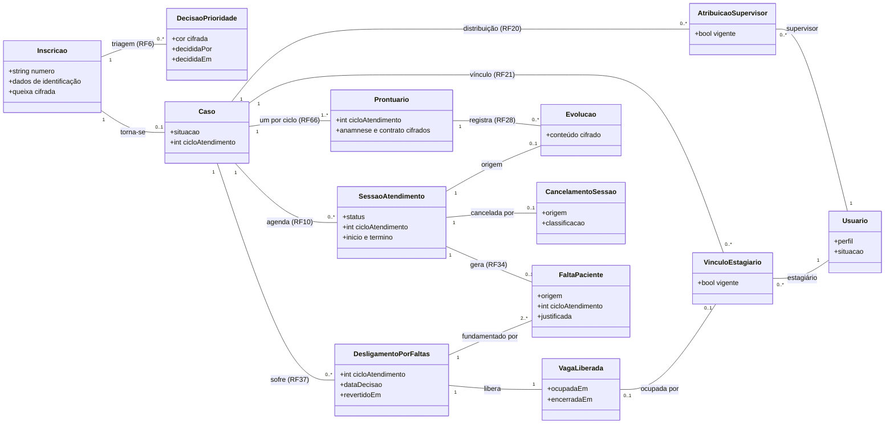

# Execução do processo

Esta página mostra como o processo definido na [Estratégia de Engenharia de Software](../processo/estrategia-esw.md) e na [Engenharia de Requisitos](../processo/engenharia-requisitos.md) foi executado: o que foi produzido em cada atividade, quem revisou e o que mudou com cada revisão. As duas páginas descrevem o processo; esta reúne as evidências de execução, com links para os registros de origem (issues, pull requests, atas e o histórico do documento), sem repetir o conteúdo deles.

## Modelo abrangente do domínio { #1-modelo-abrangente-do-dominio }

O FDD começa pelo modelo abrangente do domínio. Os projetos das features ([Ciclo 3](../construcao/projeto-features.md) e [Ciclo 4](../construcao/projeto-features.md)) detalham as classes de cada característica de produto; o diagrama abaixo integra essas partes num modelo só, com as relações entre inscrição, caso, ciclo de atendimento, sessão, prontuário e responsáveis.

**Como ler o modelo.** O ciclo de atendimento não é uma classe: é o número `cicloAtendimento`, que o caso guarda e que o prontuário, as sessões, as faltas e o desligamento repetem para saber a que ciclo pertencem. Os responsáveis nunca são apagados: a atribuição do supervisor e o vínculo do estagiário têm o campo `vigente`, e a troca de responsável encerra o registro anterior e cria outro, o que preserva o histórico de responsáveis (RF27). A auditoria (RNF10) e os acessos ao prontuário (RNF52) registram as operações de todas as classes e não aparecem no diagrama.

### Revisões do modelo

| Data | Revisão | Quem | O que mudou | Evidência |
| --- | --- | --- | --- | --- |
| 19/10/2026 | Modelo das features do Ciclo 3, na avaliação do DoR | Gabriel | Classes da inscrição, da triagem, da distribuição, do vínculo, do prontuário e da sessão, com a vigência dos responsáveis | [Classes do Ciclo 3](../construcao/projeto-features.md#modelo-detalhado-do-ciclo-3), no Projeto das features, versão 3.1 do [histórico](../index.md#historico-de-revisao) |
| 24/10/2026 | Inspeções de design do Ciclo 3 (DoD 1) | Gabriel, com o `/de-acordo` do Líder de cada feature; o RF51 foi inspecionado por Joaquim em 25/10 | Os apontamentos de cada feature e as correções no projeto, registrados na própria issue | Comentário "Inspeção de design (DoD 1)" nas issues [#45](https://github.com/mdsreq-fga-unb/REQ-2026.2-T02-ClinicaEscolaFBr/issues/45), [#88](https://github.com/mdsreq-fga-unb/REQ-2026.2-T02-ClinicaEscolaFBr/issues/88) a [#97](https://github.com/mdsreq-fga-unb/REQ-2026.2-T02-ClinicaEscolaFBr/issues/97) |
| 24/10/2026 | Avaliação da Unidade 2 pelo professor | Gabriel | O RF66 passa a criar só o prontuário, e a anamnese e o contrato vão para o RF69 | Versão 3.3 do [histórico](../index.md#historico-de-revisao) |
| 05/11/2026 | Modelo das 18 features do Ciclo 4 | Gabriel, revisado por Nicolas e Joaquim | Classes da confirmação, do cancelamento, da assiduidade (falta, desligamento e vaga) e da verificação de identidade; situações novas do caso e da sessão | [PR #203](https://github.com/mdsreq-fga-unb/REQ-2026.2-T02-ClinicaEscolaFBr/pull/203) e [Classes do Ciclo 4](../construcao/projeto-features.md#modelo-detalhado-do-ciclo-4), no Projeto das features |
| 28/10 a 06/11/2026 | Inspeções de design do Ciclo 4 (DoD 1) | Joaquim (RF52 em 28/10; RF7, RF8 e RF57 em 06/11), Nicolas (RF34 a RF38) e Jônatas (RF11 e RF14 a RF16), em 06/11 | Permissões do banco para os registros da assiduidade (RNF32); a comparação do status da sessão numa função imutável; a página do termo de consentimento | Comentário "Inspeção de design (DoD 1)" nas issues de cada feature, como a [#150](https://github.com/mdsreq-fga-unb/REQ-2026.2-T02-ClinicaEscolaFBr/issues/150) e a [#140](https://github.com/mdsreq-fga-unb/REQ-2026.2-T02-ClinicaEscolaFBr/issues/140) |
| 07/11/2026 | Construção do RF36 ao RF38 | Gabriel, com revisão de Nicolas na PR | O cancelamento da sessão entra com o desligamento, o primeiro a cancelar sessões, e é reaproveitado pelo RF15 | [PR #216](https://github.com/mdsreq-fga-unb/REQ-2026.2-T02-ClinicaEscolaFBr/pull/216) |

As inspeções de design do RF22, RF23, RF25, RF27, RF28 e RF69 ainda não foram registradas; elas entram nesta tabela quando forem feitas.

## Revisão da lista de features { #2-revisao-da-lista-de-features }

A lista de features foi revisada contra o modelo do domínio e as regras do FDD: cada feature precisa ser pequena o bastante para ser construída e demonstrada num ciclo, não pode sobrepor outra e precisa corresponder a uma parte do modelo. A tabela registra o que cada verificação encontrou e o que mudou.

| Verificação | O que foi encontrado | O que mudou | Evidência |
| --- | --- | --- | --- |
| Tamanho | O RF66 juntava a criação automática do prontuário, no vínculo, e o registro da anamnese e do contrato pelo estagiário, com gatilhos diferentes | RF66 dividido; o registro da anamnese e do contrato virou o RF69, no Ciclo 4 | Versão 3.3 do [histórico](../index.md#historico-de-revisao) |
| Sobreposição | O RF9 misturava as informações institucionais e a capacidade de atendimento usada pelo RF48 | As vagas ofertadas no semestre ficam só no RF48, e o RF9 só as divulga | Versão 3.3 |
| Correspondência com o modelo | O RF19 (áreas de especialidade do supervisor) não correspondia a nada no processo da clínica | RF19 removido em 24/10/2026 ([DF26](../requisitos/decisoes-fbr.md#df26)) | [Features e backlog](backlog.md) |
| Dependências | Dependências obrigatórias, integrações e apoios opcionais apareciam juntos, às vezes apontando para uma CP inteira | Legenda dos tipos de relação e dependências sempre pelo RF necessário | Versão 3.3 e [como ler a rastreabilidade](../requisitos/funcionais.md) |
| Escopo do MVP | A FBr pediu o relatório final de evolução antes do fim do semestre | RF33 incluído no MVP, no Ciclo 6 | Versão 3.3 |
| Consistência entre as listas | A mesma feature aparecia em listas mantidas à mão, que podiam divergir | Catálogo único dos requisitos, com a conferência automática do formato, das dependências e dos estados (`verificar_catalogo.py`, no CI) | Versão 3.34 e [catálogo de requisitos](../requisitos/priorizacao-e-mvp.md#catalogo-de-requisitos) |

## Planejamento por feature e capacidade { #3-planejamento-por-feature-e-capacidade }

Cada feature tem Líder, revisor e ciclo em [Features e backlog](backlog.md). A viabilidade dos ciclos é conferida pela [carga por Líder de Feature e ciclo](cronograma.md#carga-por-lider-de-feature-e-ciclo), calculada da escala de esforço de cada RF, e o tempo das inspeções, da integração e da demonstração aparece nos [pontos de controle por feature](cronograma.md#pontos-de-controle-por-feature) de cada ciclo. Quando a carga de um ciclo passa do que a equipe consegue fazer, vale a [regra de limite de capacidade do MVP](../requisitos/priorizacao-e-mvp.md#limite-de-capacidade).

## Acompanhamento pelos marcos do FDD { #4-acompanhamento-pelos-marcos-do-fdd }

O estado de cada feature segue os marcos do FDD e do [DoD](../requisitos/dor-dod.md): Planejada, Em design, Design inspecionado, Código concluído, Código inspecionado, Promovida para a versão integrada, Demonstrada e Aceita. Ele é atualizado na issue da feature pelo acompanhamento automático (que lê o checklist do DoR e do DoD, as pull requests e os comandos `/de-acordo`, `/demonstrada` e `/aceite`), refletido no [Project do repositório](https://github.com/orgs/mdsreq-fga-unb/projects/124) e copiado para o catálogo, de onde sai a [situação por ciclo](backlog.md#situacao-por-ciclo). Cada passagem de marco fica registrada na issue, com a data e o link da evidência: a inspeção, a aprovação da pull request, o merge, a ata da demonstração e o aceite.

## Fechamento dos ciclos { #5-fechamento-dos-ciclos }

No fim de cada ciclo, o [Cronograma geral](cronograma.md) compara o planejado com o realizado, feature a feature: o marco alcançado, o que passou para o ciclo seguinte e o motivo. O fechamento do Ciclo 3 está registrado lá; o do Ciclo 4 entra em 10/11/2026.

## Engenharia de requisitos na prática { #6-engenharia-de-requisitos-na-pratica }

### Documentos analisados

Os documentos da Clínica Escola chegaram no grupo de mensagens com a FBr, em 30/10 e 31/10/2026. Cada um gerou uma decisão no [Registro de Decisões com a FBr](../requisitos/decisoes-fbr.md), e a decisão é a Origem do requisito.

| Documento | O que foi tirado dele | Decisão | Requisitos |
| --- | --- | --- | --- |
| Ficha de identificação | Os dados da ficha que a inscrição ainda não pedia (endereço, contatos, responsável legal) | [DF43](../requisitos/decisoes-fbr.md#df43) | RF1 |
| Ficha de anamnese | As seis seções da anamnese | [DF37](../requisitos/decisoes-fbr.md#df37) | RF69 |
| Registro de evolução | Os campos do registro de cada sessão | [DF38](../requisitos/decisoes-fbr.md#df38) | RF28 |
| Contrato de Prestação de Serviço, com o TCLE para pesquisa | As cláusulas do contrato terapêutico e quem o assina | [DF41](../requisitos/decisoes-fbr.md#df41) | RF69 |
| Modelo de relatório psicológico | As seções do relatório entregue ao paciente | [DF42](../requisitos/decisoes-fbr.md#df42) | RF33 |
| Termo de consentimento para o uso dos dados | A FBr não tinha um; a equipe redigiu o modelo para a FBr revisar | [DF44](../requisitos/decisoes-fbr.md#df44) | RF57, com o [termo, versão 0.1](../construcao/termo-consentimento.md) |

Os documentos não são publicados no site, porque são modelos internos da clínica; o que vale para o sistema está nas decisões e nos requisitos.

### Representação

O processo previa diagramas de atividades "quando necessário". Os fluxos com várias decisões, como a inscrição em três etapas, o desligamento e a reversão, e a confirmação e o cancelamento da sessão, foram representados por diagramas de sequência com os caminhos alternativos (blocos `alt`), nos projetos das features ([Ciclo 3](../construcao/projeto-features.md) e [Ciclo 4](../construcao/projeto-features.md)), porque eles mostram, no mesmo desenho, quem faz cada passo e o que o sistema grava. Por isso, nenhum diagrama de atividades foi necessário. As situações do caso e da sessão estão nas listas de situações do modelo, e a visão geral do processo da clínica está no Rich Picture do [Cenário Atual](../produto/cenario-atual.md).

### Verificação

A verificação interna por checklist é a avaliação do [DoR](../requisitos/dor-dod.md) de cada feature: os critérios ficam marcados na issue, e a seção "Registro da avaliação do DoR" guarda a data, o avaliador, o revisor, o resultado e as ressalvas. Sem esse registro, o acompanhamento automático não deixa a feature passar para "Em design". A inspeção de design (DoD 1) verifica de novo o projeto, com o modelo, a acessibilidade, a LGPD e as normas do CRP. A avaliação da equipe Sem Requisitos é uma verificação externa, registrada na [Análise do Feedback](../requisitos/analise-feedback.md).

### Validação com os diferentes públicos

| Público | Como validou | Registro |
| --- | --- | --- |
| Coordenação e equipe técnica da FBr | Validação do MVP (24/09 a 08/10/2026), do protótipo do Ciclo 3 (23/10/2026) e demonstração do Ciclo 3 no ambiente de validação (06/11/2026) | [Reuniões da Unidade 2](../historico/unidade-2/reunioes.md) e [da Unidade 3](../historico/unidade-3/reunioes.md) |
| Coordenação, supervisores e estagiários | Teste de usabilidade do [RNF22](../requisitos/nao-funcionais.md#rnf22), aplicado pela FBr com pessoas sem treinamento, a partir de 06/11/2026, com tarefas, observações e a ajuda que cada pessoa precisou | [Ata de 06/11/2026](../historico/unidade-3/reunioes.md#reuniao-de-validacao-do-ciclo-3-com-a-fbr); a planilha volta até 13/11/2026 |
| Pacientes e responsáveis por menores | Não houve sessão com esse público. O contato com os pacientes passa pela clínica, por causa do sigilo e da LGPD, e a equipe não tem acesso direto a eles | A pergunta foi levada às [pendências de validação com a FBr](../requisitos/analise-feedback.md#pendencias-de-validacao-com-a-fbr) |
