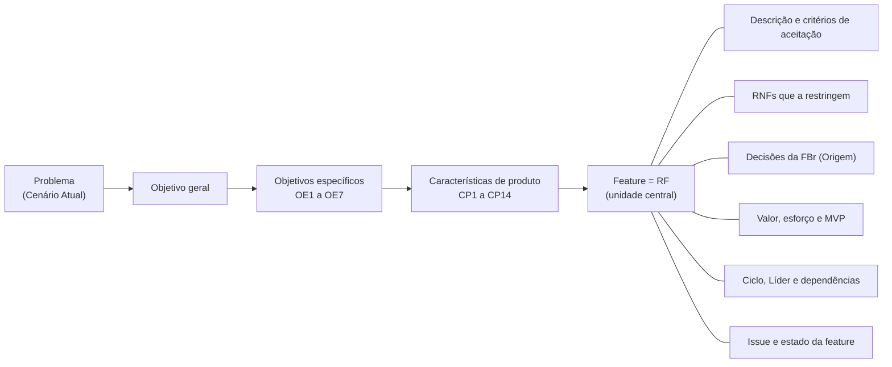
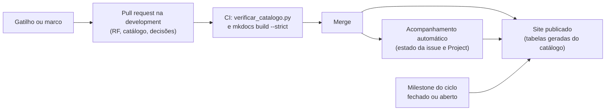

# Organização e atualização dos requisitos

Esta página explica como a documentação está organizada, onde fica a informação vigente de cada assunto, como a estrutura de requisitos é mantida atualizada e onde consultar as versões entregues em cada unidade. Ela é o ponto de partida para quem chega ao site por qualquer página.

## Como a documentação está organizada { #1-como-a-documentacao-esta-organizada }

O menu separa a **referência vigente**, que é atualizada ao longo de todo o projeto, do **histórico das unidades**, que guarda o que foi produzido e entregue em cada uma.

| Parte do menu | Pasta | O que tem | Situação |
| --- | --- | --- | --- |
| Visão geral | `visao-geral/` | Esta página e o andamento do projeto: cronograma geral, features e backlog, e a execução do processo | Vigente |
| Produto | `produto/` | O problema, a solução proposta (objetivo geral, objetivos específicos e características do produto) e a intervenção social | Vigente |
| Requisitos | `requisitos/` | Requisitos funcionais e não funcionais, decisões com a FBr, análise do feedback, DoR e DoD, e priorização e recorte do MVP | Vigente |
| Processo e equipe | `processo/` | Estratégia de engenharia de software (FDD), engenharia de requisitos, equipe e cliente, boas práticas no GitHub e o estudo de FDD | Vigente |
| Construção do MVP | `construcao/` | Arquitetura, projeto das features, protótipos, termo de consentimento e o grupo Implantação e operação (implantação e segurança, cópia de segurança e teste de carga) | Vigente, cresce a cada ciclo |
| Histórico das unidades | `historico/unidade-N/` | Página inicial, cronograma, reuniões e lições aprendidas de cada unidade | Histórico, não é reescrito |

A pasta de cada página no repositório (`documentacao/docs/`) é a mesma parte do menu, e o endereço no site segue a pasta: a página de requisitos funcionais, por exemplo, fica em `requisitos/funcionais/`. Até a versão 3.50, as páginas vigentes ficavam nas pastas da unidade em que nasceram (`unidade-1/`, `unidade-2/` e `unidade-3/`). Os endereços antigos continuam funcionando: cada um leva ao endereço novo, no mesmo trecho da página, e por isso os links já citados em issues, atas e pull requests não quebram.

### Uma fonte por assunto

Os assuntos que apareciam em mais de uma página têm agora uma fonte só; as outras páginas trazem um link para ela.

| Assunto | Fonte única | O que as outras páginas fazem |
| --- | --- | --- |
| Escopo do MVP (quais requisitos entram) | [Definição do MVP](../requisitos/priorizacao-e-mvp.md#1023-definicao-do-mvp), gerada do catálogo | A Solução Proposta explica o critério e aponta para ela; o README e o modelo de issue apontam para ela, sem contagem escrita à mão |
| Lista de features e backlog por ciclo | [Features e backlog](backlog.md), gerada do catálogo | A Priorização e MVP só explica de onde vêm as tabelas |
| Período, status e número de features de cada ciclo | Catálogo de requisitos (`ciclos`) | O Cronograma geral, o cronograma e a página inicial da Unidade 3 e Features e backlog mostram o mesmo valor, gerado na publicação |
| Critérios de validação de cada marco | [DoD](../requisitos/dor-dod.md#92-definition-of-done-dod) | O [processo de validação](../processo/equipe-e-cliente.md#73-processo-de-validacao) só diz onde cada marco acontece; a Engenharia de Requisitos aponta para o D4.5 |
| Planejamento e revisão dos ciclos | [Cronograma geral](cronograma.md) | A Estratégia de ESW aponta para ele; o cronograma da Unidade 1 guarda o planejamento original |

### Numeração do documento de visão

Nas Unidades 1 e 2, as seções tinham a numeração do documento de visão (1 a 10). Os títulos vigentes não usam mais esses números, mas os links antigos para cada seção continuam funcionando, e as issues de avaliação e as atas que citam um número podem ser lidas por esta correspondência:

Correspondência entre os números antigos e as páginas atuais

| Número antigo | Seção | Onde está |
| --- | --- | --- |
| 1 | Cenário Atual do Cliente e do Negócio | [Cenário atual](../produto/cenario-atual.md#1-cenario-atual-do-cliente-e-do-negocio) |
| 1.1 | Identificação do Cliente/Parceiro | [Cenário atual](../produto/cenario-atual.md#11-identificacao-do-clienteparceiro) |
| 1.2 | Introdução ao Negócio e Contexto | [Cenário atual](../produto/cenario-atual.md#12-introducao-ao-negocio-e-contexto) |
| 1.3 | Rich Picture | [Cenário atual](../produto/cenario-atual.md#13-rich-picture) |
| 1.4 | Identificação da Oportunidade ou Problema | [Cenário atual](../produto/cenario-atual.md#14-identificacao-da-oportunidade-ou-problema) |
| 1.5 | Desafios do Projeto | [Cenário atual](../produto/cenario-atual.md#15-desafios-do-projeto) |
| 1.6 | Mapa de Stakeholders | [Cenário atual](../produto/cenario-atual.md#16-mapa-de-stakeholders) |
| 1.7 | Segmentação de Clientes | [Cenário atual](../produto/cenario-atual.md#17-segmentacao-de-clientes) |
| 2 | Solução Proposta | [Solução proposta](../produto/solucao-proposta.md#2-solucao-proposta) |
| 2.1 | Objetivo Geral do Produto | [Solução proposta](../produto/solucao-proposta.md#21-objetivo-geral-do-produto) |
| 2.2 | Objetivos Específicos (OE) do Produto | [Solução proposta](../produto/solucao-proposta.md#22-objetivos-especificos-oe-do-produto) |
| 2.3 | Características de Produto (mapeadas com os Objetivos Específicos) | [Solução proposta](../produto/solucao-proposta.md#23-caracteristicas-de-produto-mapeadas-com-os-objetivos-especificos) |
| 2.4 | Tecnologias a Serem Utilizadas | [Solução proposta](../produto/solucao-proposta.md#24-tecnologias-a-serem-utilizadas) |
| 2.5 | Pesquisa de Mercado e Análise Competitiva | [Solução proposta](../produto/solucao-proposta.md#25-pesquisa-de-mercado-e-analise-competitiva) |
| 2.6 | Viabilidade da Proposta | [Solução proposta](../produto/solucao-proposta.md#26-viabilidade-da-proposta) |
| 2.7 | Benefícios Esperados | [Solução proposta](../produto/solucao-proposta.md#27-beneficios-esperados) |
| 3 | Intervenção Social | [Intervenção social](../produto/intervencao-social.md#3-intervencao-social) |
| 3.1 | Efeitos emergentes: decisões e respostas verificáveis | [Intervenção social](../produto/intervencao-social.md#31-efeitos-emergentes-decisoes-e-respostas-verificaveis) |
| 4 | Estratégias de Engenharia de Software | [Estratégia de ESW](../processo/estrategia-esw.md#4-estrategias-de-engenharia-de-software) |
| 4.1 | Estratégia Priorizada | [Estratégia de ESW](../processo/estrategia-esw.md#41-estrategia-priorizada) |
| 4.2 | Quadro Comparativo | [Estratégia de ESW](../processo/estrategia-esw.md#42-quadro-comparativo) |
| 4.3 | Justificativa | [Estratégia de ESW](../processo/estrategia-esw.md#43-justificativa) |
| 4.4 | FDD adaptado ao projeto | [Estratégia de ESW](../processo/estrategia-esw.md#44-fdd-adaptado-ao-projeto) |
| 5 | Engenharia de Requisitos | [Engenharia de requisitos](../processo/engenharia-requisitos.md#5-engenharia-de-requisitos) |
| 5.1 | Atividades e Técnicas de ER | [Engenharia de requisitos](../processo/engenharia-requisitos.md#51-atividades-e-tecnicas-de-er) |
| 5.2 | Requisitos não funcionais no processo FDD | [Engenharia de requisitos](../processo/engenharia-requisitos.md#52-requisitos-nao-funcionais-no-processo-fdd) |
| 5.3 | Engenharia de Requisitos e o FDD | [Engenharia de requisitos](../processo/engenharia-requisitos.md#53-engenharia-de-requisitos-e-o-fdd) |
| 6 | Cronograma e Entregas (Unidade 1) | [Cronograma da Unidade 1](../historico/unidade-1/cronograma.md), no histórico; o cronograma vigente é o [Cronograma geral](cronograma.md) |
| 7 | Interação entre Equipe e Cliente | [Equipe e cliente](../processo/equipe-e-cliente.md#7-interacao-entre-equipe-e-cliente) |
| 7.1 | Composição da Equipe | [Equipe e cliente](../processo/equipe-e-cliente.md#71-composicao-da-equipe) |
| 7.2 | Comunicação | [Equipe e cliente](../processo/equipe-e-cliente.md#72-comunicacao) |
| 7.3 | Processo de Validação | [Equipe e cliente](../processo/equipe-e-cliente.md#73-processo-de-validacao) |
| 8.1 | Lista de Requisitos Funcionais | [Requisitos funcionais](../requisitos/funcionais.md#81-lista-de-requisitos-funcionais) |
| 8.2 | Lista de Requisitos Não Funcionais | [Requisitos não funcionais](../requisitos/nao-funcionais.md#82-lista-de-requisitos-nao-funcionais) |
| 8.3 | Análise do Feedback da Verificação Cruzada | [Análise do feedback](../requisitos/analise-feedback.md#83-analise-do-feedback-da-verificacao-cruzada) |
| 8.4 | Registro de Decisões com a FBr | [Decisões com a FBr](../requisitos/decisoes-fbr.md#84-registro-de-decisoes-com-a-fbr) |
| 9 | DoR e DoD | [DoR e DoD](../requisitos/dor-dod.md#9-dor-e-dod) |
| 9.1 | Definition of Ready (DoR) | [DoR e DoD](../requisitos/dor-dod.md#91-definition-of-ready-dor) |
| 9.1.1 | Objetivo | [DoR e DoD](../requisitos/dor-dod.md#911-objetivo) |
| 9.1.2 | Escopo e unidade de avaliação | [DoR e DoD](../requisitos/dor-dod.md#912-escopo-e-unidade-de-avaliacao) |
| 9.1.3 | Checklist de critérios | [DoR e DoD](../requisitos/dor-dod.md#913-checklist-de-criterios) |
| 9.1.4 | Verificação rápida da redação | [DoR e DoD](../requisitos/dor-dod.md#914-verificacao-rapida-da-redacao) |
| 9.1.5 | Resultado da avaliação | [DoR e DoD](../requisitos/dor-dod.md#915-resultado-da-avaliacao) |
| 9.1.6 | Situação conhecida na documentação | [DoR e DoD](../requisitos/dor-dod.md#916-situacao-conhecida-na-documentacao) |
| 9.1.7 | Relação com os demais documentos | [DoR e DoD](../requisitos/dor-dod.md#917-relacao-com-os-demais-documentos) |
| 9.1.8 | Revisão deste documento | [DoR e DoD](../requisitos/dor-dod.md#918-revisao-deste-documento) |
| 9.2 | Definition of Done (DoD) | [DoR e DoD](../requisitos/dor-dod.md#92-definition-of-done-dod) |
| 9.2.1 | Regra de fluxo | [DoR e DoD](../requisitos/dor-dod.md#921-regra-de-fluxo) |
| 9.2.2 | Checklist por marco do FDD | [DoR e DoD](../requisitos/dor-dod.md#922-checklist-por-marco-do-fdd) |
| 9.2.3 | Registro | [DoR e DoD](../requisitos/dor-dod.md#923-registro) |
| 9.2.4 | DoD da entrega final (MVP) | [DoR e DoD](../requisitos/dor-dod.md#924-dod-da-entrega-final-mvp) |
| 10 | Backlog de Produto | [Priorização e MVP](../requisitos/priorizacao-e-mvp.md#10-backlog-de-produto) |
| 10.1 | Backlog do Produto | [Priorização e MVP](../requisitos/priorizacao-e-mvp.md#101-backlog-do-produto) |
| 10.2 | Priorização e Recorte do MVP | [Priorização e MVP](../requisitos/priorizacao-e-mvp.md#102-priorizacao-e-recorte-do-mvp) |
| 10.2.1 | Avaliação de Valor de Negócio e de Esforço Técnico | [Priorização e MVP](../requisitos/priorizacao-e-mvp.md#1021-avaliacao-de-valor-de-negocio-e-de-esforco-tecnico) |
| 10.2.1.1 | Escala e critérios de valor de negócio | [Priorização e MVP](../requisitos/priorizacao-e-mvp.md#10211-escala-e-criterios-de-valor-de-negocio) |
| 10.2.1.2 | Escalas adotadas | [Priorização e MVP](../requisitos/priorizacao-e-mvp.md#10212-escalas-adotadas) |
| 10.2.1.3 | Regra de consolidação | [Priorização e MVP](../requisitos/priorizacao-e-mvp.md#10213-regra-de-consolidacao) |
| 10.2.1.4 | Tabela consolidada | [Priorização e MVP](../requisitos/priorizacao-e-mvp.md#10214-tabela-consolidada) |
| 10.2.2 | Matriz de Priorização (Valor de Negócio × Esforço Técnico) | [Priorização e MVP](../requisitos/priorizacao-e-mvp.md#1022-matriz-de-priorizacao-valor-de-negocio-esforco-tecnico) |
| 10.2.3 | Definição do MVP | [Priorização e MVP](../requisitos/priorizacao-e-mvp.md#1023-definicao-do-mvp) |
| 10.2.3.1 | Classificação dos Requisitos Não Funcionais para o MVP | [Priorização e MVP](../requisitos/priorizacao-e-mvp.md#10231-classificacao-dos-requisitos-nao-funcionais-para-o-mvp) |
| 10.2.4 | Validação do MVP com o Cliente | [Priorização e MVP](../requisitos/priorizacao-e-mvp.md#1024-validacao-do-mvp-com-o-cliente) |

## Estrutura de requisitos { #2-estrutura-de-requisitos }

A unidade central da estrutura é a **feature**. No FDD, cada feature é declarada por um **requisito funcional (RF)**: a feature "Registrar falta do paciente na sessão" é o RF34, com o mesmo nome. A equipe não usa histórias de usuário nem casos de uso; o RF é a forma de declaração da feature, e a correspondência é de um para um. Subindo a árvore, cada RF pertence a uma característica de produto (CP), que atende a objetivos específicos (OE), que vêm do objetivo geral e do problema.

Todos os atributos ficam pendurados no RF. Os que são compartilhados por vários RFs, ou que têm descrição longa, ficam numa página própria, e o RF aponta para eles por código:

| Atributo do RF | Onde é declarado (fonte única) | Como o RF aponta para ele |
| --- | --- | --- |
| Descrição, critérios de aceitação e rastreabilidade (Feature → CP → OE) | [Requisitos Funcionais](../requisitos/funcionais.md) | — é o próprio RF |
| Objetivos específicos e características de produto | [Solução Proposta](../produto/solucao-proposta.md) | Linha de rastreabilidade do RF |
| RNFs que restringem a feature | [Requisitos Não Funcionais](../requisitos/nao-funcionais.md) | Campo "relacionado" de cada RNF no catálogo |
| Decisões da Clínica Escola | [Registro de Decisões com a FBr](../requisitos/decisoes-fbr.md) | "Origem: DFnn" na rastreabilidade do RF |
| Valor, esforço, MVP, ciclo, ordem, Líder, dependências e estado | [Catálogo de requisitos](../requisitos/priorizacao-e-mvp.md#catalogo-de-requisitos) (`documentacao/dados/requisitos.yml`) | Uma entrada por RF |
| Evidências da construção (inspeções, testes, demonstração e aceite) | Issue da feature no GitHub | Campo "issue" do catálogo e link no título do RF |
| Projeto da feature (modelo, diagramas e rotas) | [Projeto das features](../construcao/projeto-features.md) | Seção do RF, com o número da issue |

As visões que juntam muitos RFs, como a priorização, o recorte do MVP, o backlog por ciclo, a situação por ciclo e a coluna "Requisitos" das decisões, **não são escritas à mão**: são geradas do catálogo quando o site é publicado. Assim, cada informação tem uma fonte só, e as listas não divergem.

### Recorte do MVP

O MVP é a lista de RFs com `mvp: true` no catálogo, decidida pelas [regras de priorização](../requisitos/priorizacao-e-mvp.md#102-priorizacao-e-recorte-do-mvp) e conferida pela [regra de limite de capacidade](../requisitos/priorizacao-e-mvp.md#limite-de-capacidade). Hoje, **{{ n.rfs_mvp }} dos {{ n.rfs_vigentes }} RFs vigentes** estão no MVP. A priorização, a tabela do MVP, o backlog e a situação por ciclo saem da mesma lista; o `verificar_catalogo.py`, que roda no CI das pull requests que mexem na documentação, recusa um RF sem Líder, com ciclo ou estado desconhecido, com dependência inexistente ou com o nome diferente do registro na página 8.1.

## Estratégia de atualização { #3-estrategia-de-atualizacao }

### Marcos de atualização

A estrutura é conferida em momentos fixos do processo, além dos gatilhos da seção seguinte:

| Marco | O que é atualizado |
| --- | --- |
| Avaliação do DoR, antes da construção | O texto do RF, os critérios, as dependências e os RNFs, conferidos pelo checklist do DoR |
| Inspeção de design (DoD 1) | O projeto da feature e, se a inspeção mudar uma regra, o RF |
| Merge da pull request da feature | O estado da feature na issue (automático) e as decisões de construção no projeto da feature |
| Demonstração e aceite da FBr (DoD 5 e 6) | O estado da feature e, se a FBr pedir correções, as decisões e os RFs |
| Fechamento de cada ciclo | O estado das features no catálogo, o previsto e o realizado no [Cronograma geral](cronograma.md) e a carga do ciclo seguinte |
| Entrega de cada unidade | O histórico da unidade, a versão do site e a marcação da versão entregue no repositório |

### Gatilhos

| Gatilho | Exemplo | Onde a mudança entra |
| --- | --- | --- |
| Decisão ou resposta da FBr | Prazo de confirmação de 24 horas (DF45) | Nova DF no catálogo e o RF que ela fundamenta |
| Avaliação do professor ou dos monitores | Issues de avaliação da Unidade 2 | Pull request que cita a issue, com a versão no histórico |
| Novo entendimento da equipe | Inspeção de design que encontra uma regra ambígua | RF, projeto da feature e, se preciso, pergunta às pendências com a FBr |
| Construção | Tabela de cancelamento que entra com o desligamento (RF37) | Projeto da feature, na seção "Construção" |
| Mudança de escopo ou de capacidade | RF33 incluído no MVP; RF19 removido | Catálogo (`mvp`, `ciclo` ou `removido`), com a decisão registrada |

### O que é manual e o que é automático

| O que muda | Como é atualizado | Quem confere |
| --- | --- | --- |
| Texto, critérios e rastreabilidade do RF | Manual, em `funcionais.md`, por pull request | Revisor da pull request e avaliação do DoR |
| Atributos do RF e as decisões da FBr | Manual, no catálogo (`requisitos.yml`), por pull request | `verificar_catalogo.py` no CI e o revisor |
| Priorização, MVP, backlog, situação por ciclo, índice das decisões e contagens da página inicial | Automático, geradas do catálogo pelas macros do MkDocs a cada publicação | Build estrito no CI |
| Estado da feature na issue e Status no Project | Automático, pelo [acompanhamento das features](../processo/boas-praticas-github.md#acompanhamento-automatico-das-features), a partir do checklist, das pull requests e dos comandos `/de-acordo`, `/demonstrada` e `/aceite` | A equipe, pelos comentários do robô na issue |
| Verificação dos RNFs (D4.5) | Automático, pelos relatórios dos testes da `development`; os RNFs sem teste usam o comando `/rnf` | A equipe, pelo comentário do robô na issue |
| Estado da feature e situação do ciclo no site | Automático na publicação: o site lê o "Estado da feature" de cada issue e a situação do milestone de cada ciclo (fechado é "Encerrado"; dos abertos, o de menor número está "Em andamento"). Do estado, vale o marco mais adiantado entre a issue e o catálogo, porque o catálogo muda na pull request que conclui o código. Se o GitHub não responder, vale o catálogo | Log do workflow de publicação, que lista o que mudou |
| Estado da feature e situação do ciclo no catálogo | Manual, na pull request da feature e no fechamento do ciclo, para o build local e o docs-check | Revisor da pull request |
| Publicação do site | Automática, a cada merge na `development` | Workflow de publicação |

As issues de feature não copiam o texto dos requisitos: elas apontam para o RF e guardam só as decisões e as evidências da construção, para não criar versões paralelas.

## Como a estrutura evoluiu { #4-como-a-estrutura-evoluiu }

| Unidade | Estrutura | O que foi preservado |
| --- | --- | --- |
| Unidade 1 (entregue em 07/09/2026) | Problema, objetivo geral, objetivos específicos e características de produto, no documento de visão | A relação Problema → OG → OE → CP, que continua na [Solução Proposta](../produto/solucao-proposta.md) |
| Unidade 2 (entregue em 13/10/2026) | RFs e RNFs por CP, rastreabilidade, priorização, MVP, DoR e DoD | A numeração dos RFs e dos RNFs e a rastreabilidade de cada RF até a CP e os OEs; os números das seções ficam na [correspondência](#numeracao-do-documento-de-visao) |
| Unidade 3 (em andamento) | Catálogo único de requisitos, registro das decisões com a FBr, issues de feature com o estado do FDD, visão geral do projeto e execução do processo; páginas vigentes em pastas por assunto, separadas do histórico, sem a numeração do documento de visão | Todas as relações anteriores; as decisões passaram a ser citadas como Origem do RF, e as listas passaram a ser geradas do catálogo |

As mudanças de cada versão, com a data e o autor, estão no [histórico de revisão](../index.md#historico-de-revisao).

## Versões anteriores { #5-versoes-anteriores }

O site mostra a versão vigente. As versões entregues ficam no repositório, sem reescrever as páginas:

| Versão | Onde consultar |
| --- | --- |
| Entrega da Unidade 1 (07/09/2026) | [Repositório na versão entregue](https://github.com/mdsreq-fga-unb/REQ-2026.2-T02-ClinicaEscolaFBr/tree/c4601b23320d9dd120a6f7982d863ff75291743d) e [apresentação em vídeo](https://youtu.be/ysMmYmttAH8) |
| Entrega da Unidade 2 (13/10/2026) | [Release `unidade-2`](https://github.com/mdsreq-fga-unb/REQ-2026.2-T02-ClinicaEscolaFBr/releases/tag/unidade-2) e [apresentação em vídeo](https://youtu.be/XUJEFZv7Pn8) |
| Entrega da Unidade 3 (17/11/2026) | Será marcada como a release `unidade-3` na entrega |

As páginas do grupo **Histórico das unidades** guardam o cronograma, as reuniões e as lições aprendidas de cada unidade como foram registrados, e as páginas vigentes que nasceram numa unidade avisam no topo que continuam sendo atualizadas.
